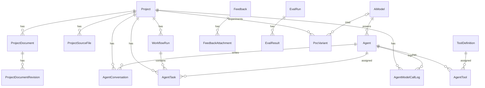
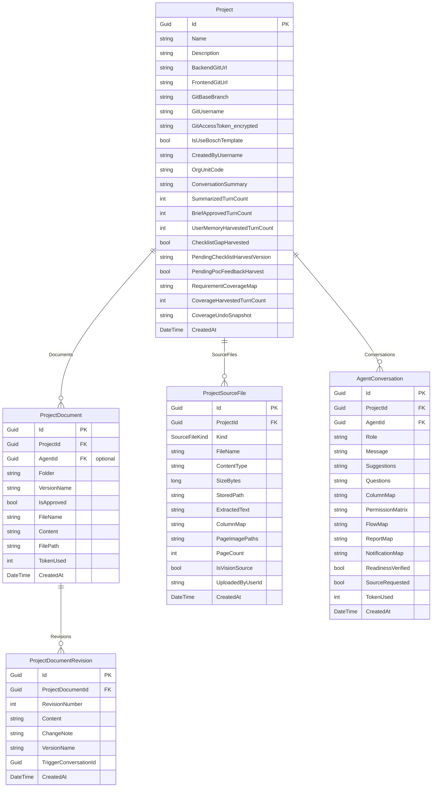
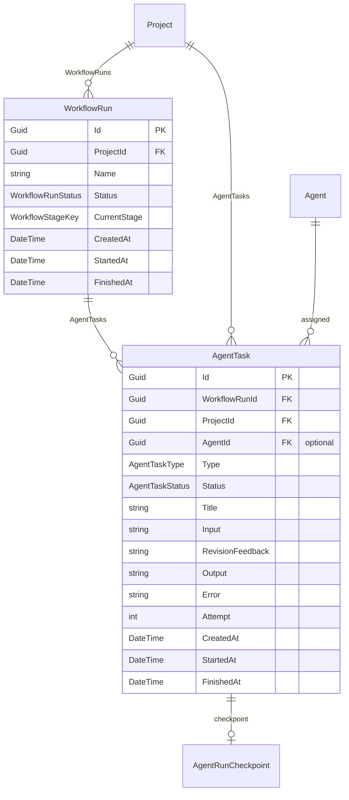
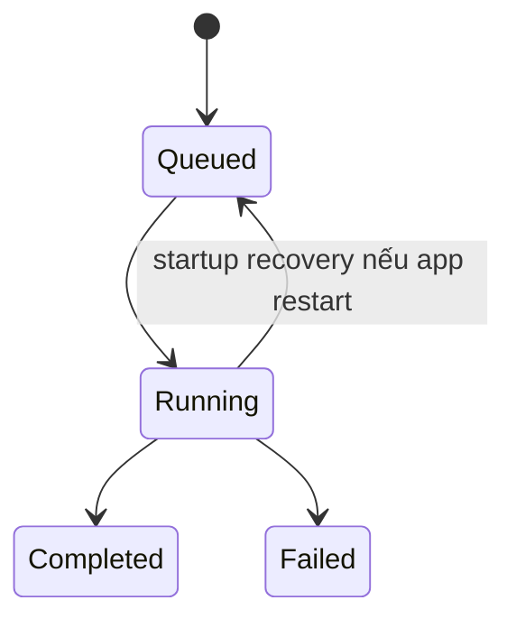
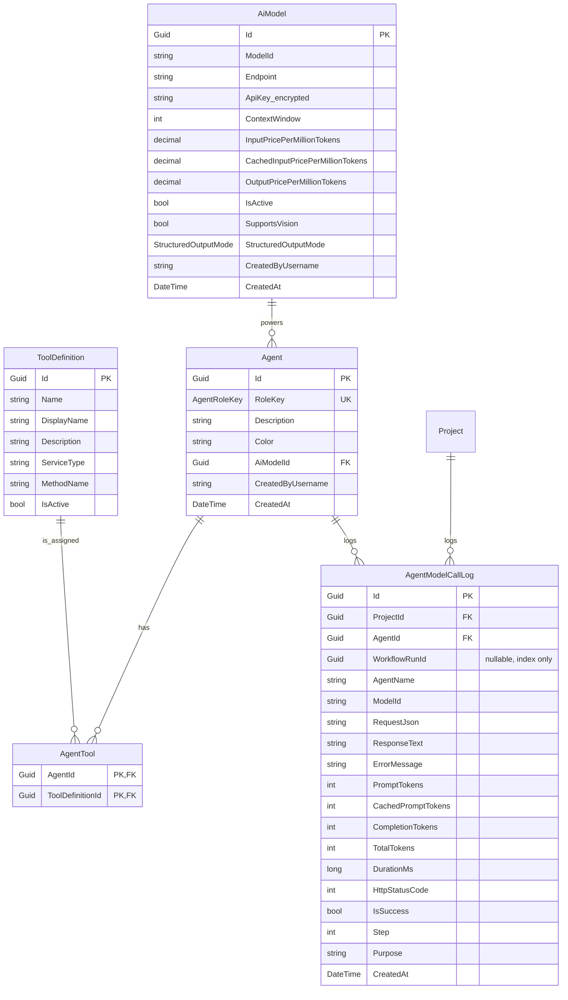
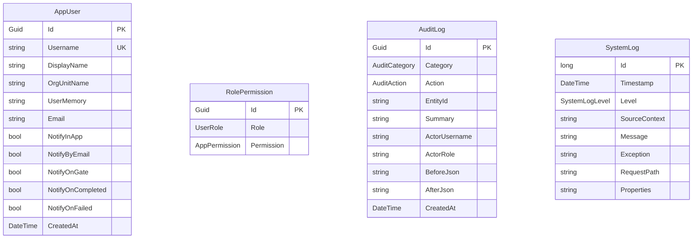
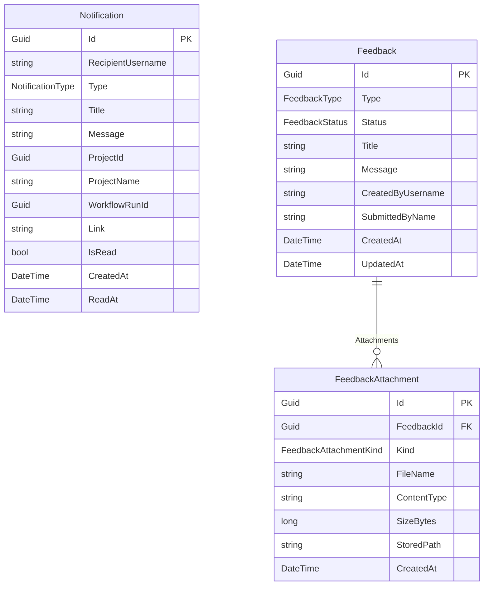
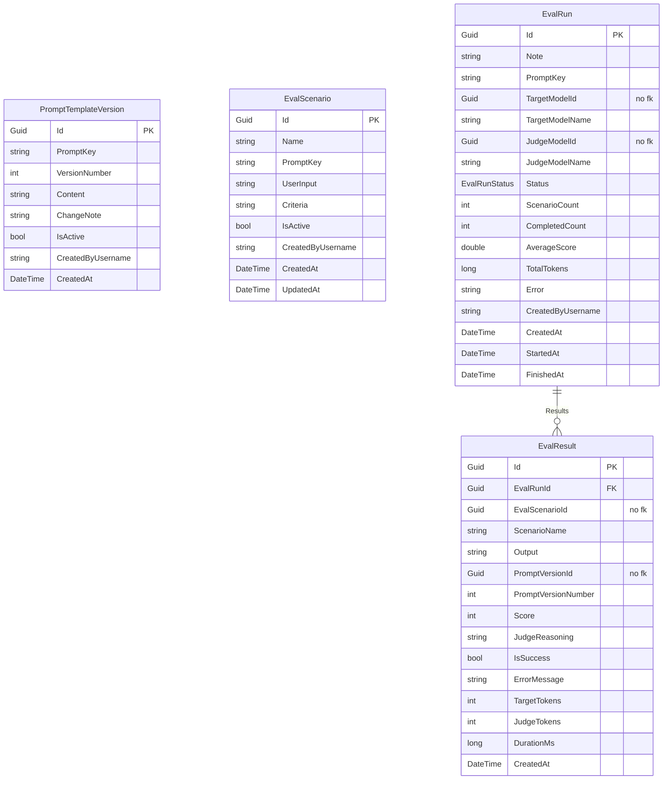
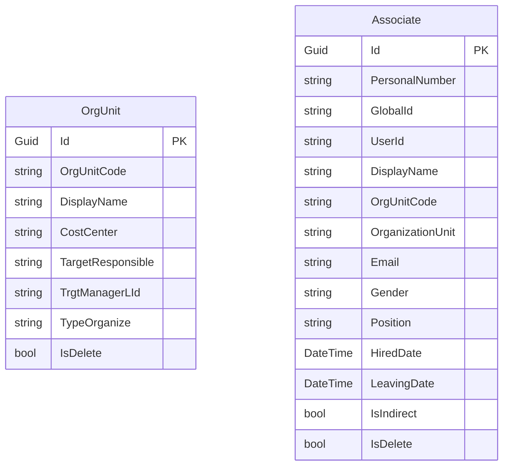

# Mô hình dữ liệu

`Data/AppDbContext.cs` khai báo **32 DbSet**. Điểm chung cần biết trước:

- **Mọi cột `DateTime` được chuẩn hóa `Kind=Utc` khi đọc** (`UtcDateTimeConverter`) để JSON trả ra có hậu tố `Z` — tránh lệch múi giờ trên client.
- **Hầu hết enum lưu dạng chuỗi** (tên enum, ví dụ `'WaitingForHuman'`) — dễ đọc trong DB và bền khi chèn giá trị enum mới. ⚠️ Vì vậy **đừng đổi tên giá trị enum đã có dữ liệu**.
- **`AiModel.ApiKey` được mã hóa AES** bằng value-converter gắn `AesApiKeyProtector`. Protector **bắt buộc là Singleton** (EF cache model toàn cục, converter capture instance đầu tiên) — đừng đổi lifetime, đừng bật `AddDbContextPool`.

## Bản đồ các bảng

### Nhóm lõi: Project & Agent

| Bảng | Vai trò | Điểm đáng chú ý |
|---|---|---|
| `AgentChecklistItem` | Một bài học trong "checklist học được" của MỘT vai (`AgentId` là khóa phân biệt): `DepartmentCode` (mã phòng ban của đơn vị yêu cầu; null = mọi dự án — bài học của vai kỹ thuật LUÔN null), `Text` (phần duy nhất vào prompt), `Rationale`/`Evidence` (vì sao rút ra — chỉ cho trang quản trị), `SourceKind` (`Conversation` / `BriefNote` / `PocFeedback` cho BA, `StageRevision` cho vai kỹ thuật, cộng `SpecAssumption` **di sản** — cổng xác nhận giả định đã gỡ nên không còn mục mới nào mang nguồn này, chỉ các bài học cũ; bằng chứng của vòng harvest đã sinh ra mục; xem [requirement-flow.md](requirement-flow.md#vòng-học-chạy-ở-cổng-duyệt) và [delivery-pipeline.md](delivery-pipeline.md#học-từ-nhận-xét-ở-cổng-duyệt))/`SourceProjectId`, `Status` (Active/DisabledByUser/DisabledByOverflow) | Trần 25 mục đang dùng mỗi bucket; vượt thì mục cũ nhất tự chuyển `DisabledByOverflow` (vẫn thấy, bật lại được). FK dự án nguồn là `SetNull` — xóa dự án không xóa bài học |
| `Projects` | Dự án — gốc nối tới tài liệu, hội thoại, workflow | Ngoài metadata còn mang **bộ nhớ của luồng BA**: `ConversationSummary` + `SummarizedTurnCount` (tóm tắt hội thoại dài), `BriefApprovedTurnCount` (số lượt hội thoại tại lần Approve gần nhất — mốc để khung chat gộp phần trước đó vào tóm tắt và chuyển sang [chế độ yêu cầu thay đổi](requirement-flow.md#sau-approve-khung-chat-chuyển-sang-chế-độ-yêu-cầu-thay-đổi), và để vòng soạn Brief nén phần transcript trước đó), `UserMemoryHarvestedTurnCount` và `InterviewScopeHarvestedTurnCount` (con trỏ của lượt chắt lọc phạm vi trôi — chắt TÁC VỤ mới vào bản thiết kế UX, lượt hậu kỳ DUY NHẤT còn lại, chạy theo lô sau lần thiết kế đầu: xem [requirement-flow.md](requirement-flow.md#cổng-chế-độ-và-phạm-vi-trôi)), `RequirementCoverageMap` + `CoverageHarvestedTurnCount` (bản đồ bao phủ 12 nhóm thông tin, lưu **JSON** — `CoverageMapDocument`: mỗi dòng có `label`, `core`, `status` và `known` = **mảng chuỗi** những điều đã ghi nhận, mỗi ý một phần tử, chở trạng thái MỚI NHẤT chứ không phải nhật ký; không còn trường `evidence` — xem [requirement-flow.md](requirement-flow.md#known-là-danh-sách-và-không-còn-trường-evidence)), `OpenQuestions` (danh sách CÂU HỎI của cuộc phỏng vấn — ghi bởi **cùng lượt distill** với `RequirementCoverageMap` và theo cùng con trỏ `CoverageHarvestedTurnCount`; lưu **JSON** `OpenQuestionDocument`: mỗi mục có `group` = nhãn bản đồ, `text`, `status` (`MỞ`/`ĐÃ TRẢ LỜI`) và `answer`; đọc/ghi qua `InterviewOutlookParser`), `CoverageUndoSnapshot` (ảnh chụp JSON của hai cột trên + con trỏ `CoverageHarvestedTurnCount` ngay TRƯỚC lượt distill gần nhất — chỉ đường sửa/soạn lại lượt user cuối đọc nó, xem [requirement-flow.md](requirement-flow.md#-sửa--đổi-câu-rồi-trả-lời-lại)), `ChecklistGapHarvested` (lưới đỡ rà hội thoại đã tiêu lời gọi duy nhất của nó chưa) + `PendingChecklistHarvestVersion` (hàng đợi học mở ở mốc duyệt Product Brief — tên bản vừa duyệt) và `PendingPocFeedbackHarvest` (cờ hàng đợi học mở ở mốc duyệt bản demo; xem [requirement-flow.md](requirement-flow.md#vòng-học-chạy-ở-cổng-duyệt)); và **nghiệm thu bản demo** `PocAcceptedAtUtc` + `PocAcceptedBy` (null = người yêu cầu chưa xác nhận POC đạt). `CreatedByUsername` để lọc "chỉ thấy project mình tạo"; `OrgUnitCode` (không FK) gắn đơn vị yêu cầu — **bắt buộc khi tạo project** (`CreateProjectUseCase`), cột vẫn nullable vì dự án tạo trước khi có luật này có thể trống; `IsUseBoschTemplate` (mặc định true) do TeamDev đổi ở Agent Dashboard, cùng popup với `BackendGitUrl`/`FrontendGitUrl` và cấu hình Git của bước bàn giao: `GitBaseBranch` (nhánh đích PR, null = `main`), `GitUsername`, `GitAccessToken` (**mã hóa** như `AiModel.ApiKey`) — xem [delivery-pipeline.md](delivery-pipeline.md#tài-khoản-git-và-nhánh-đích-của-dự-án). **Không có cột `Status`** — chặng của dự án được suy ra từ hội thoại/tài liệu/dấu nghiệm thu, xem [overview.md](overview.md#chặng-của-dự-án-projectstatus) |
| `Agents` | "Nhân sự AI": `RoleKey` (BusinessAnalyst/TechLead/Developer/Tester/UiUx), `AiModelId`, `Color`, `JudgeAiModelId` (tuỳ chọn, chỉ agent BA đọc: model riêng cho [lượt trọng tài](requirement-flow.md#lượt-trọng-tài-interviewjudge) `BATurnSignalJudge` — `BATurnJudge` và `BACoverageQuestionJudge` luôn đi `AiModelId`; null = dùng `AiModelId`) | System prompt **không lưu DB** — nạp từ `Prompts/{RoleKey}/instruction.md` qua `AgentInstructionProvider`. FK `AiModelId` là `Restrict` (không xóa được model đang dùng); FK `JudgeAiModelId` là `SetNull` — xoá model trọng tài thì trọng tài lùi về model chính |
| `AiModels` | Danh mục model LLM: `ModelId`, `Endpoint`, `ApiKey` (mã hóa), `ContextWindow`, đơn giá Input/**CachedInput**/Output per-1M-token (decimal 18,6) | Đơn giá là đầu vào của trang Usage + Budget guard. Model tự host giá 0 ⇒ chi phí 0. `CachedInputPricePerMillionTokens` = 0 nghĩa là **chưa khai báo** ⇒ token cache tính theo giá input đầy đủ ([cached input](llm-and-prompts.md#cached-input-token-prompt-đọc-lại-từ-cache)) |
| `ToolDefinitions` | Danh mục tool (đồng bộ từ code khi khởi động) | Unique index `(ServiceType, MethodName)` |
| `AgentTools` | Bảng nối agent ↔ tool được phép dùng | Khóa chính kép `(AgentId, ToolDefinitionId)` |

### Nhóm tài liệu & hội thoại

| Bảng | Vai trò | Điểm đáng chú ý |
|---|---|---|
| `ProjectDocuments` | Tài liệu sinh ra (ProductBrief/AIDesignSpec/BRD/SRS/FSD/UserStories...): `Folder`, `VersionName`, `FileName`, `FilePath`, `Content`, `IsApproved` | Cascade theo Project |
| `ProjectDocumentRevisions` | **Lịch sử nội dung** mỗi lần document bị ghi đè CÓ thay đổi — snapshot đầy đủ + `ChangeNote` nguồn gốc + `TriggerConversationId` (mốc input) | Chốt chặn duy nhất tạo revision là `RequirementDocumentGenerator.UpsertDocument`. Diff tính lúc xem bằng `DocumentDiffService` (DiffPlex, theo dòng). Unique `(DocumentId, RevisionNumber)` |
| `ProjectSourceFiles` | Tài liệu nguồn user upload cho BA đọc (ảnh / PDF / Word .docx / Excel-CSV / trang HTML — `Kind` lưu dạng chuỗi `Image`/`Pdf`/`Spreadsheet`/`Document`/`Html`) — `ExtractedText` do `ProjectSourceIngestor` trích; PDF **scan** không có text thì lấy ảnh nhúng từng trang ra `page-{n}.png`, còn trang PDF **có text** cũng như Word có **hình nhúng** (screenshot, sơ đồ) thì lấy các hình đủ lớn ra `figure-{n}.png` cạnh file gốc (`ScannedPageImageCount` đếm TỔNG cả hai loại) cho model vision | Cascade theo Project |
| `AgentConversations` | Từng lượt hội thoại user ↔ BA trong project (bàn giao của agent delivery nằm ở `AgentTasks.Output`, không ở đây) | Project FK Cascade, Agent FK **Restrict** (xóa agent không wipe lịch sử) |
| `AgentModelCallLogs` | Log **mỗi lời gọi model**: request/response JSON, token (kể cả `CachedPromptTokens` — phần prompt provider đọc lại từ cache, nằm **trong** `PromptTokens`), thời lượng, `Purpose`, `WorkflowRunId` (cột nhóm, cố ý không FK). Ảnh đã gửi kèm chỉ được **mô tả** trong `RequestJson` (tên/kiểu/dung lượng/số thứ tự), bytes nằm trên đĩa — xem ["Ảnh trong call log"](requirement-flow.md#tài-liệu-nguồn-ảnh-và-call-log) | Nguồn dữ liệu của trang Usage, popup AI Call Logs, Delivery Quality, [kiểm toán trọng tài](supporting-features.md#kiểm-toán-trọng-tài). Index `(Purpose, CreatedAt)` INCLUDE `(ModelId, IsSuccess)` cho kiểm toán lấy mẫu/đếm theo mục đích mà không quét cả bảng |

### Nhóm workflow

| Bảng | Vai trò | Điểm đáng chú ý |
|---|---|---|
| `WorkflowRuns` | Một lần chạy quy trình cho project: `Status` (Queued/Running/WaitingForHuman/Completed/Failed/Canceled), `CurrentStage` (`WorkflowStageKey`) | Cascade theo Project; index `(ProjectId, Status, CreatedAt)` |
| `AgentTasks` | Một đầu việc giao cho một agent trong run: `Type`, `Status`, `Input`, `Output`, `Error`, `Attempt`, `RevisionFeedback` (null = task thường), `PendingLessonHarvest` (hàng đợi chắt nhận xét thành bài học cho vai — xem [delivery-pipeline.md](delivery-pipeline.md#học-từ-nhận-xét-ở-cổng-duyệt)) | Agent FK `SetNull`, Project FK `Restrict`. **Index `(Status, CreatedAt)` phục vụ worker poll mỗi 2s** — đừng xóa |
| `AgentRunCheckpoints` | **Điểm dừng bền của lượt agent** — nhiều nhất một dòng mỗi task (`TaskId` vừa là khoá chính vừa là FK), ghi đè sau mỗi bước, xoá khi task `Completed`: `MessagesJson` (hội thoại agent ↔ model ↔ tool mà lời gọi kế tiếp phải gửi), `CompletedSteps` (số lời gọi model đã thành công; 0 = không có gì để nối), `ModelId` (model đã chạy các bước đó), `UpdatedAt`. Nhờ nó "Thử lại" chạy tiếp đúng bước bị hỏng — xem [delivery-pipeline.md](delivery-pipeline.md#thử-lại-là-chạy-tiếp-checkpoint-của-lượt-agent) | FK tới `AgentTasks` `Cascade`. `MessagesJson` **mã hoá at rest** (cùng converter với `AgentModelCallLog.RequestJson` — nó chứa lại nguyên văn spec và kết quả tool) |

### Nhóm người dùng & bảo mật

| Bảng | Vai trò | Điểm đáng chú ý |
|---|---|---|
| `AppUsers` | Tài khoản đăng nhập: `Username` (unique), `DisplayName`, `OrgUnitName` (đồng bộ từ claim `department` của SSO), `UserMemory` (hồ sơ cá nhân hóa BA học được), tùy chọn thông báo (`NotifyInApp/ByEmail/OnGate/OnCompleted/OnFailed`, `Email`) | **Không có cột mật khẩu và không có cột vai trò** — cả hai do provider ngoài quyết định: vai trò chỉ sống trong claim của phiên đăng nhập (xem [screens-and-permissions.md](screens-and-permissions.md#xác-thực--hai-chế-độ-không-có-mật-khẩu-trong-app)). Chưa có UI tạo user — seed 4 tài khoản cố định |
| `RolePermissions` | Cấp quyền `(Role, Permission)` — cấu hình runtime ở popup Permissions (trang User Roles) | Unique `(Role, Permission)`. Admin luôn có `AdministrationManageRoles` dù không có dòng (chống tự khóa) |
| `AuditLogs` | Nhật ký thay đổi cấu hình (Settings/Roles/Agent/Model/Prompt): actor, before/after JSON | Ghi qua `IAuditLogger` |
| `SystemLogs` | Log ứng dụng mức Warning trở lên chép từ Serilog: `Timestamp`, `Level` (`SystemLogLevel`, chuỗi), `SourceContext`, `Message`, `Exception`, `RequestPath`, `Properties` (JSON) — xem [operations.md](operations.md#log-warningerror-trong-db-màn-system-logs) | Khoá `long` tự tăng (bảng chỉ chèn nối đuôi). Index `Timestamp` và `(Level, Timestamp)`. Ghi bởi `DatabaseLogWriter`, tự xoá dòng quá `DatabaseLog:RetentionDays`. **Không** mã hoá at rest |

### Nhóm vệ tinh

| Bảng | Vai trò |
|---|---|
| `Feedbacks` + `FeedbackAttachments` | Phản hồi người dùng toàn app (bug/góp ý/trải nghiệm) kèm file đính kèm; file gốc lưu đĩa ở `{AgentWorkspace:RootPath}/.feedback-uploads/{feedbackId:N}/` (trần 50MB/file, 8 file — hằng số trong `FeedbackAttachmentStore`), DB chỉ giữ metadata + đường dẫn tuyệt đối |
| `OrgUnits` + `Associates` | Dữ liệu tổ chức (orgUnit, nhân sự) đồng bộ hằng ngày từ employee-api — nguyên liệu cho `OrganizationContextService`, cây `OrgChart`, ô gợi ý người nhận. Xem [bên dưới](#orgunits--associates--đồng-bộ-từ-employee-api) |
| `Notifications` | Thông báo in-app (chuông): index `(RecipientUsername, IsRead, CreatedAt)` |
| `EvalScenarios` / `EvalRuns` / `EvalResults` | Prompt eval harness (golden set + LLM-judge). Model/scenario tham chiếu bằng **Guid + snapshot tên, không FK** — xóa không mất lịch sử điểm |
| `JudgeAuditRuns` / `JudgeAuditCases` | [Kiểm toán trọng tài](supporting-features.md#kiểm-toán-trọng-tài): một run lấy mẫu các lượt trọng tài đã log (`Purpose`, `SourceModelId`, `From`/`To`, `SampleSize`), có/không model ứng viên chạy lại, một model trọng tài phân xử; mỗi case giữ phán quyết đã lưu / chạy lại / đáp án chuẩn dạng **danh sách khẳng định** `[{field, key}]` + lời giải thích của trọng tài. `Status` dùng chung `EvalRunStatus`. Model tham chiếu bằng Guid + snapshot tên, không FK; `SourceLogId` trỏ log gốc **không FK** (log bị xoá theo project). Các cột chở chữ hội thoại (`*ClaimsJson`, `ArbiterNotes`) **mã hoá at rest**; đầu vào của lượt trọng tài **không** chép sang — đọc lại từ log lúc xem. Case → Run `Cascade` |
| `PromptTemplateVersions` | Phiên bản prompt chỉnh runtime (Prompt Studio): snapshot đầy đủ, unique `(PromptKey, VersionNumber)`, tối đa một `IsActive` mỗi key |
| `PocComments` | **Lịch sử ghi chú của người review** — hai nguồn chung một bảng theo `Target`: `Poc` (ghim lên phần tử trong POC: màn hình + nhãn + CSS selector + vị trí) và `Brief` (ghim lên một đoạn bản xem trước Product Brief, đoạn trích ở `Quote`). `Open` → gom vào "Yêu cầu chỉnh sửa" ở cổng POC → `Sent` (không gửi lặp) → `Addressed`; ghi chú chỉnh trình bày bị hoãn vì cùng lượt gửi có điểm về Requirement đi `Open` → `Deferred` → (vòng dựng mới bản demo chạy xong) `Sent` → `Addressed` — xem [workspace-and-poc.md](workspace-and-poc.md#ghi-chú-chỉnh-trình-bày-bị-hoãn-tới-bản-demo-dựng-lại); ghi chú POC gửi về Requirement đi `Open` → `RoutedToRequirement` → (vòng dựng mới bản demo chạy xong) `Addressed`. Trang review chiếu năm giá trị này thành ba trạng thái Draft / Waiting / Apply (`PocNoteDisplayStatus`), không có cột riêng. `BriefVersion` đóng dấu bản Brief mà ghi chú nói VỀ; `Route` là đường đã gửi (`FixPoc`/`Requirement`/`Design`, null = chưa gửi; `Design` = góp ý thiết kế màn hình, đi vào bản thiết kế UX rồi cùng vòng đời với `Requirement`) — tách khỏi `Status` (vòng đời); `RevisionTaskId` trỏ vòng sửa đã xử lý nó. Bỏ một ghi chú ĐÃ TỪNG GỬI ĐI là `WithdrawnAtUtc`/`WithdrawnByUsername` (thu hồi mềm, dòng ở lại DB nhưng rời bảng ghi chú); ghi chú chưa gửi đường nào thì bị **xoá thật**. Index `(ProjectId, Status, CreatedAt)` cho đường làm việc, `(ProjectId, BriefVersion, CreatedAt)` cho lọc theo phiên bản |
| `PocShareLinks` | Link chia sẻ bản demo cho người **không có tài khoản** (sếp, người dùng cuối): `Token` (base64url 32 byte, unique), `Label`, `ExpiresAtUtc` (**bắt buộc**), `RevokedAtUtc`. Ba lớp giới hạn: chỉ mở đúng demo của một project, luôn có hạn dùng, thu hồi được. Token lưu nguyên văn để copy lại link — đánh đổi có chủ ý, chấp nhận được vì thứ nó mở ra là demo dữ liệu giả |
| `PocVariants` | **Biến thể POC thử model** (thí nghiệm của Admin, không thuộc run nào): `AiModelId` + `ModelLabel` (snapshot `ModelId` lúc bấm), `SourceTaskId` (task `PocPreview` dựng mới bản chính — đầu vào chung, cố ý không FK), `Status` (`Queued`/`Running`/`Completed`/`Failed`, chuỗi), `RequestedBy`, thời điểm, `Error`, `Output` (bàn giao cắt 4000 ký tự), và chi phí CHỐT lúc xong: `ModelCalls`, `PromptTokens`, `CompletionTokens`, `CostUsd` (decimal 18,6). Bản demo + kết quả tự kiểm nằm trên đĩa ở thư mục riêng, không trong DB — xem [workspace-and-poc.md](workspace-and-poc.md#thử-model-khác-cho-developer-biến-thể-poc). Index `(ProjectId, CreatedAt)` cho bảng so sánh, `(Status, CreatedAt)` cho worker poll |

## Migration

- Đổi entity ⇒ `dotnet ef migrations add <Tên>`; `DbInitializer` tự `MigrateAsync` lúc khởi động (SqlServer).
- Lịch sử migration bắt đầu từ **baseline `V1`** — một migration DUY NHẤT dựng toàn bộ schema hiện tại (đã gộp toàn bộ lịch sử trước đó), sau đó là các migration tiến bình thường. Khi cần sinh migration, để `ConnectionStrings:DefaultConnection` có giá trị (mặc định) — **đừng** đặt `ConnectionStrings__DefaultConnection` rỗng — để nó sinh theo provider SqlServer (không phải Sqlite).
- Sqlite **không chạy migration** (dùng `EnsureCreated`) ⇒ đổi schema khi dev Sqlite = xóa file `ICOGenerator.db*` để dựng lại.

---

## ERD mức cao

## Core project schema

### Ghi chú thiết kế

- `Project.OrgUnitCode` không FK tới `OrgUnits` để project cũ vẫn giữ nhãn lịch sử nếu dữ liệu HR bị đồng bộ lại/xóa.
- `ProjectDocumentRevision` có unique index `(ProjectDocumentId, RevisionNumber)` để bảo toàn thứ tự version.
- `ProjectDocumentRevision.TriggerConversationId` **không FK** tới `AgentConversations` — cố ý. Lượt hội thoại bị xóa cứng ở đường retry (`BAChatService`) và bị lưu trữ ở "New Chat"; một ràng buộc cascade sẽ kéo theo cả revision, tức xóa mất lịch sử tài liệu vì một thao tác trên khung chat. Mốc trỏ hụt thì đường đọc lùi về `CreatedAt` của revision — xem [supporting-features.md](supporting-features.md#lịch-sử-revision-tài-liệu-sinh-ra-version-history--diff).
- `ProjectSourceFile.ExtractedText` và `PageImagePaths` là LOB, dùng cho context BA/vision.
- `ProjectSourceFile.ColumnMap` (JSON `SourceColumnNote[]`) là **bảng cột đã chốt** cho nguồn bảng tính: cột nào ứng dụng mới dùng và nghĩa của nó. BA chốt và hệ thống lưu ngay ở lượt đọc file; người dùng sửa được qua "Xem / sửa bảng cột". `SourceContextBuilder` gắn nó vào ngữ cảnh mọi lượt chat, `RealSampleDataReader` lọc dữ liệu mẫu theo nó — xem [requirement-flow.md](requirement-flow.md#bảng-cột-chốt-phạm-vi-cột-của-file-bảng-tính). **Không** mã hóa at rest, cùng lý do với `ExtractedText` nằm cạnh nó dưới dạng plaintext.
- `AgentConversation.ColumnMap` đánh dấu lượt đọc file nào mang bảng cột (để bong bóng của lượt đó mở được "Xem / sửa bảng cột") và giữ **bản BA chốt lúc đó**; nó là nội dung hội thoại nên **có** mã hóa at rest như `Message`/`Suggestions`/`Questions`.
- `AgentConversation.SourceRequested` đánh dấu lượt BA **là một lời xin tài liệu nguồn** (`SourceRequestTurn`). Phanh "không giục file lần hai" đọc cột này; trước đây nó dò cụm `"📎"`/`"đính kèm"`/`"gửi giúp"` trên mọi lượt BA trong cửa sổ hội thoại — tức app đoán lại chính chuỗi `SourceRequestTurn.Message` mà nó tự phát ra, nên một lượt khai thác bình thường mang đúng hai chữ đó là khoá vĩnh viễn đường xin file, còn sửa câu `Message` là mất dấu mọi lượt đã xin. Cờ được suy MỘT LẦN lúc ghi lượt, từ bản CHỐT (cùng khuôn với `ReadinessVerified`) — phép dò chữ vẫn còn ở đúng chỗ đó vì lượt xin file có thể do chính model tự viết, nhưng nó không quét lại lịch sử ở mọi lượt sau nữa. Fail-open: mặc định `false` ⇒ lượt không mang cờ cùng lắm khiến BA xin thêm một lần.
- `AgentConversation.ReadinessVerified` là **dấu đóng của cổng readiness**, và từ đó là **tín hiệu DUY NHẤT mở cổng "Write Requirement" trên UI** (`Index.cshtml` đọc cột này của lượt BA mới nhất; xem [requirement-flow.md](requirement-flow.md#cái-mở-cổng-là-một-cờ-không-phải-một-câu-chữ)): `true` ⇔ tại thời điểm lượt đó được lưu, model đã khai `ready` VÀ `RequirementReadinessGate.Evaluate` đã xét trên bản đồ bao phủ hiện hành và cho qua. Bước soạn tài liệu đọc cờ của lượt ĐANG ĐỨNG CUỐI để biết có được bỏ qua lần xét lại hay không — thay cho việc dò cụm "Write Requirement" trong transcript, thứ phụ thuộc vào chữ model sinh ra và bị mọi lượt ghi thêm phía sau xoá mất. Fail-closed: mặc định `false`, và chỉ MỘT đường được bật — lượt chat tự dựng cờ khi cổng vừa cho lời mời đi qua. Một đường ghi muốn giữ đường tắt phải chép cờ của lượt nó vừa đè lên thay vì tự dựng; hiện không đường nào làm thế (đường duy nhất từng chép là bước chốt mâu thuẫn, đã gỡ cùng cổng đó). Xem [requirement-flow.md](requirement-flow.md#cổng-chất-lượng-phía-yêu-cầu-đủ).
- `Project.PermissionMatrix` (JSON `PermissionMatrixRow[]`) là **bảng phân quyền của ứng dụng**: mỗi dòng là một **tác vụ** của bản thiết kế UX, khóa theo `TaskId` (`T-NN`; cột `Screen`/`Function` chỉ để hiển thị, lấy lại từ bản thiết kế), × vai trò, mỗi ô mang **phạm vi dữ liệu** (`của mình` / `của đơn vị` / `tất cả`, rỗng = không có quyền). BA soạn nó NGẦM từ hội thoại (`PermissionMatrixDraftService`) ở đầu lượt chat đầu tiên mà bản thiết kế không còn tác vụ chờ xếp chỗ và mọi nhóm khác đã `[RÕ]`; tác vụ mới lộ ra sau đó được bổ sung dòng, thiết kế lại thì `PermissionMatrixBuilder.Rebind` làm tươi cột hiển thị; người dùng không rà nó trong chat mà xem/sửa ở popup mở từ mục «Phân quyền theo nghiệp vụ» của khung Tiến độ khai thác (`GetPermissionMatrixQuery` đọc, `ConfirmPermissionMatrixUseCase` lưu). Có bảng là nhóm đó lên `[RÕ]` (`CoverageConfirmedTableGuard`), và đây là đường duy nhất đưa phân quyền tới POC ở dạng máy đọc được — xem [requirement-flow.md](requirement-flow.md#bảng-phân-quyền-ba-tự-soạn-người-dùng-sửa-ở-popup). `AgentConversation.PermissionMatrix` chỉ còn dữ liệu ở các buổi cũ (hồi bảng còn được bày trong chat) — không lượt mới nào ghi nó; mã hóa at rest như `ColumnMap`.
- `Project.FlowMap` là **bảng người dùng chốt của buổi phỏng vấn** (BA điền sẵn → người dùng sửa/bỏ tích → chốt một lần → khối "đã chốt" đi vào ngữ cảnh chat, lượt distill bản đồ bao phủ và prompt sinh AI Design Spec). Cột tương ứng trên `AgentConversation` giữ bản đề xuất của lượt bày bảng, mã hóa at rest như `ColumnMap`. `Project.UxBlueprint`, `ReportMap` và `PermissionMatrix` đi cùng khối này nhưng **không phải bảng người dùng chốt** — đó là thiết kế, BA/UiUx soạn ngầm (xem dòng của từng cột); cột `ReportMap` / `PermissionMatrix` trên `AgentConversation` chỉ còn dữ liệu ở các buổi cũ. Xem [requirement-flow.md](requirement-flow.md#các-bảng-của-buổi-phỏng-vấn-một-bảng-người-dùng-chốt-ba-bảng-ba-tự-soạn). Không có cột bảng đối tượng nghiệp vụ: cột `EntityMap` đã bị xoá ở migration `BoBangDoiTuong` — mô hình dữ liệu do bước sinh AI Design Spec tự thiết kế, xem [requirement-flow.md](requirement-flow.md#không-có-bảng-đối-tượng-nghiệp-vụ).
  - `FlowMap` (JSON `FlowMapRow[]`): luồng nghiệp vụ theo vai trò, luồng chính + ngoại lệ, mỗi luồng là chuỗi bước `{actor, action, outcome}`.
  - `UxBlueprint` (JSON `UxBlueprint`): **bản thiết kế UX** của ứng dụng — `Objects` (đối tượng + vòng đời), `Tasks` (danh mục tác vụ, ID `T-NN` ổn định, không bao giờ dùng lại nhờ `LastTaskNumber`/`LastScreenNumber`; mỗi tác vụ có `FlowSteps` = chữ của các bước luồng nó phục vụ và cờ `Placed`), `Screens` (màn theo pattern library + `Actions` đặt hành động: `Placement`/`Prominence`/`WhenState`/`Form`), `Navigation` (menu + trang đích theo vai), `DesignNotes` (góp ý thiết kế từ POC Review), và ba trường do code tính: `Journeys`, `Metrics`, `Findings`. BA dựng danh mục, agent UiUx tổ chức màn hình (`UxDesignService`); người dùng không rà nó (xem ở popup chỉ đọc, góp ý ở POC Review). **NGOẠI LỆ của khuôn "null = chưa chốt"** ở khối này: nó là nguồn phạm vi DUY NHẤT của dự án nên chở cả tác vụ chưa xếp chỗ (`Placed = false`, do lượt chắt lọc thêm) — "đã thiết kế" phải hỏi `UxBlueprintBuilder.IsDesigned`, "còn việc chờ" hỏi `HasPending`. Tên màn (`UxScreen.Name`) và tên đối tượng/trạng thái viết bằng **tiếng Anh** (nhãn của bản demo), còn lại giữ ngôn ngữ nghiệp vụ: [luật đặt tên màn hình](requirement-flow.md#tên-màn-hình-là-nhãn-menu-của-bản-demo-nên-nó-ngắn-và-bằng-tiếng-anh). Xem [requirement-flow.md](requirement-flow.md#bản-thiết-kế-ux-ba-dựng-danh-mục-tác-vụ-uiux-tổ-chức-màn-hình). Cột thay cho cột `ScreenScopeMap` (cùng cột ấy trên `AgentConversation`) ở migration `ThayBangManHinhBangBanThietKeUx`.
  - `ReportMap` (JSON `ReportMapRow[]`): **bảng báo cáo / thống kê** — mỗi báo cáo một dòng: `Report` (tên, đọc được như một màn hình và theo [luật đặt tên màn hình](requirement-flow.md#tên-màn-hình-là-nhãn-menu-của-bản-demo-nên-nó-ngắn-và-bằng-tiếng-anh): tiếng Anh, 2–4 từ), `Question` (báo cáo đó trả lời câu hỏi gì, bằng lời người dùng), `Source` (lấy số từ bản ghi nào — chữ tự do, BA ráp theo hội thoại), `Breakdown` (gộp/lọc theo gì), `FilteredList` / `OwnScreen` (hai cờ xếp chỗ model khai), `Screen` (màn hình báo cáo đứng trên — màn tổng quan chung hoặc màn riêng, code gán; rỗng = dòng cũ, mỗi báo cáo một màn), `Included`. **Người dùng không rà bảng này**: `ReportMapDraftService` ráp nó ngầm khi nhóm «Báo cáo / thống kê» vừa `[RÕ]`; lượt thiết kế UX gieo mỗi báo cáo thành một **tác vụ báo cáo** (`UxInventoryBuilder.ReportTasks`, tất định) đặt đúng chỗ `Screen` ghi — đó là lý do bảng này phải có mặt TRƯỚC bản thiết kế và bảng phân quyền, và **không có trường "ai xem"**: quyền xem của một báo cáo được chốt ở bảng phân quyền như mọi tác vụ khác. `Included=false` chỉ còn ở dữ liệu dự án cũ; lượt ráp luôn ra `true`. Không có `Locked`/`Evidence`. `AgentConversation.ReportMap` chỉ còn dữ liệu ở các buổi cũ (hồi bảng còn được bày ra) — không lượt mới nào ghi nó. Xem [requirement-flow.md](requirement-flow.md#bảng-báo-cáo-gom-về-một-màn-hình-tổng-quan).
  - `NotificationMap` (JSON `NotificationMapRow[]`) và `NotificationRecipients` (JSON `string[]`): **chỉ còn dữ liệu ở dự án CŨ** — bảng thông báo (mỗi sự kiện một dòng, `To`/`Cc` chọn từ danh sách người nhận của dự án) không còn được bày ra ở buổi phỏng vấn, và không đường nào ghi mới vào hai cột này (cùng `AgentConversation.NotificationMap`). Giữ cột để bảng đã chốt của dự án cũ vẫn tới được ngữ cảnh chat, bản đồ bao phủ, bản xuất hội thoại và AI Design Spec (`NotificationMapBuilder.RenderConfirmedBlock`). Xem [requirement-flow.md](requirement-flow.md#nhóm-thông-báo-không-chốt-ở-buổi-phỏng-vấn).
  - `PermissionMatrix` theo luật KHẮT KHE MỘT CHIỀU (nhóm của nó KHÔNG BAO GIỜ `[RÕ]` khi chưa có bảng, vì nó không được hỏi bằng câu hỏi); `FlowMap`, `UxBlueprint` và `ReportMap` thì chỉ **xác nhận lại / ráp lại / thiết kế từ** thứ hội thoại đã trả lời. Áp luật một chiều cho chúng là dựng một vòng khóa kín — cổng đòi nhóm `[RÕ]`, bản đồ đòi có bảng. Với `ReportMap` điều đó còn là điều kiện MỞ CỔNG: bảng chỉ được ráp khi nhóm «Báo cáo / thống kê» đã `[RÕ]`.
- `PocComments` giữ **cả** ghi chú Brief lẫn ghi chú POC (`Target`) vì chúng là cùng một dòng lịch sử: người yêu cầu chê bản mô tả hay chê bản demo thì đều là "điểm chưa đạt của phiên bản Brief thứ n". Ghi chú Brief trước đây chỉ tan vào transcript nên sau khi Brief lên bản mới là không truy lại được. Bảng thứ hai bị loại vì sẽ trùng gần hết cột với bảng này, mà pin trên bản demo vẫn phải đọc bảng cũ.
- `PocComment.BriefVersion` đóng dấu bản Brief mà ghi chú nói VỀ, theo hai quy tắc khác nhau có chủ ý: ghi chú POC lấy bản **đã duyệt** hiện hành (POC dựng từ chính nó), còn ghi chú Brief đóng dấu `draft` rồi được `ApproveRequirementUseCase` **nâng lên `V{n}` cùng lúc với file draft**. Đoán trước số version lúc ghim là gán ghi chú cho một bản có thể không bao giờ tồn tại (bản draft bị bỏ).
- `PocComment.Route` tách khỏi `Status`: trạng thái cũ `RoutedToRequirement` vừa là vòng đời vừa là đường đi, nên ghi chú đi đường tài liệu không bao giờ có được trạng thái "đã sửa xong". Giá trị enum cũ **giữ nguyên** (đã nằm trong DB dạng chuỗi).
- **Thu hồi ghi chú có hai hệ quả, chia theo "đã từng gửi đi chưa"** (`WithdrawPocCommentUseCase.WasDispatched` — không `Route`, không `RevisionTaskId`, không `AddressedAtUtc`). Nút Delete chỉ áp dụng cho ghi chú POC còn `Open` hoặc `Deferred` (`PocNoteDisplayStatus.IsWithdrawable`; ghi chú hoãn đã có `Route` nên luôn là thu hồi mềm); trong đó ghi chú **chưa từng gửi đi** bị **xoá thật** (gõ nhầm/gõ thử: chưa ai ngoài người gõ nhìn thấy nó, để lại một dòng gạch ngang chỉ làm loãng lịch sử), còn ghi chú **đã đi một vòng rồi được mở lại** ("vẫn chưa đạt" giữ `RevisionTaskId`) chỉ được đóng dấu `WithdrawnAtUtc` — vòng sửa đã chạy theo nó, xoá đi là làm bàn giao của agent nói về một ghi chú không còn tồn tại. Trần 300 ghi chú/dự án đếm theo dòng **chưa thu hồi**.
- **Xoá thật một ghi chú phải lùi con trỏ `Project.PocFeedbackHarvestedCount`** khi dòng bị xoá nằm trước con trỏ: con trỏ là một `Skip()` đếm theo số lượng trên tập ghi chú POC xếp theo `(CreatedAt, Id)`, tập ngắn lại mà con trỏ đứng yên thì lượt harvest sau nhảy qua đúng một ghi chú mới (xem [requirement-flow.md](requirement-flow.md#vòng-học-chạy-ở-cổng-duyệt)).

## Workflow schema

### Status model

`WorkflowRunStatus` có thêm `WaitingForHuman` để biểu diễn gate duyệt giữa các stage.

### Index quan trọng

| Entity | Index | Lý do |
|---|---|---|
| `WorkflowRun` | `(ProjectId, Status, CreatedAt)` | Query status theo project |
| `AgentTask` | `(ProjectId, Status, CreatedAt)` | Query task theo project/status |
| `AgentTask` | `(Status, CreatedAt)` | Worker poll task queued cũ nhất mỗi ~2 giây |

## AI config/runtime schema

### Ghi chú thiết kế

- `AiModel.ApiKey` và `Project.GitAccessToken` được encrypt/decrypt bằng EF value converter. `IApiKeyProtector` phải là singleton vì EF cache model toàn cục.
- `AgentModelCallLog.WorkflowRunId` có index nhưng không khai FK để tránh multiple cascade path; truy vấn join thủ công khi cần.
- `AgentModelCallLog.Step` là **lượt gọi model thứ mấy trong một task agent**, do `ModelCallLoggingChatClient`
  đếm từ 1 theo instance. Đường agent (`AgentRunService`, purpose `AgentRun`) dùng chung một instance cho cả
  task nên thấy 1, 2, 3… — đọc cùng `MaxSteps` của bước pipeline để biết task có tiêu hết ngân sách bước không.
  Mọi lời gọi qua `LlmClient` (các purpose `BA*`, review POC) dựng đường ống mới mỗi lần nên **luôn bằng 1**;
  popup AI Call Logs vì thế chỉ hiện nhãn "Step" khi `Step > 1`.
- `AgentTool` là bảng many-to-many explicit với composite key.
- `ToolDefinition` unique theo `(ServiceType, MethodName)` để đồng bộ discovery không tạo trùng.
- `ToolDefinition.Description` để `nvarchar(max)`: nó là bản chép nguyên `[Description]` của tool trong
  code — prompt gửi cho LLM, chỉ dài thêm theo thời gian. Cột bound (từng là `nvarchar(3000)`) khiến
  `ToolDiscoveryService` ném `String or binary data would be truncated` **ngay lúc khởi động** khi có tool
  vượt trần. `ToolDefinitionColumnTests` chốt điều này ở CI.
- `Agent.RoleKey` là unique: mỗi role đúng một agent — mọi lookup agent trong hệ thống đều theo `RoleKey`.

## Security/RBAC/Audit schema

| Constraint/index | Ý nghĩa |
|---|---|
| `AppUser.Username` unique | Không trùng tài khoản đăng nhập |
| `RolePermission(Role, Permission)` unique | Một permission chỉ được cấp một lần cho role |
| `AuditLog.CreatedAt`, `(Category, CreatedAt)` | Lọc/sắp xếp audit log |
| `SystemLog.Timestamp`, `(Level, Timestamp)` | Sắp xếp + xoá theo hạn giữ; lọc theo mức ở tab System Logs (màn Logs) |

## Notifications và Feedback schema

`Notification` index `(RecipientUsername, IsRead, CreatedAt)` phục vụ chuông thông báo: đếm unread và lấy danh sách mới nhất.

## Prompt/eval schema

### Index/constraint quan trọng

| Entity | Index | Lý do |
|---|---|---|
| `PromptTemplateVersion` | `(PromptKey, VersionNumber)` unique | Version history không trùng |
| `PromptTemplateVersion` | `(PromptKey, IsActive)` | Lấy bản active nhanh |
| `EvalScenario` | `(IsActive, CreatedAt)` | Lọc scenario active |
| `EvalRun` | `(Status, CreatedAt)` | Worker poll queued + UI list |
| `EvalResult` | `EvalRunId`, `EvalScenarioId` | Chi tiết run và so sánh scenario |

## OrgUnits + Associates — đồng bộ từ employee-api

Không seed sẵn. Hai bảng được job Hangfire `OrganizationSyncJob` (`Services/Organization`) đồng bộ từ
employee-api mỗi ngày theo `EmployeeApi:SyncCron` (mặc định 11:00 giờ Việt Nam — cấu hình ở
[configuration.md](configuration.md)). DB còn trống lúc khởi động thì job chạy ngay một lần.

- **Thứ tự:** orgUnit (`OrgUnitsPath`) → nhân sự (`AllAssociatesPath`) → điền `LeavingDate`
  (`LeavingInfoPath`, mỗi người một lời gọi). Mỗi bước tự lưu; Hangfire thử lại cả job tối đa 3 lần.
- **Khớp bản ghi:** `OrgUnit` theo `OrgUnitCode` (API: `OrgUnitId`), `Associate` theo `PersonalNumber`.
  Bản ghi đang có giữ nguyên `Id`.
- **Xoá mềm:** không còn trong API ⇒ `IsDelete = true`; xuất hiện lại ⇒ bật lại (người quay lại thì xoá
  luôn `LeavingDate` cũ). Không xoá cứng vì `Project.OrgUnitCode` vẫn tra sang đơn vị cũ.
- **API trả danh sách rỗng ⇒ huỷ lần đồng bộ**, không xoá mềm cả bảng.
- **`LeavingDate`:** chỉ hỏi người đã bị xoá mềm mà chưa có ngày nghỉ; API chưa có thì hỏi lại lần sau.
  Một lời gọi lỗi không chặn người khác, nhưng **mọi** lời gọi đều lỗi thì job thất bại.
- **Cột API không trả** (`IsIndirect`, `Birthday`, `Description`) giữ nguyên giá trị đang có.
  `Gender` lưu dạng chuỗi (`"1"` nam, `"2"` nữ) từ số của API.
- **Department:** không có cột riêng — đơn vị có `TypeOrganize` là `A` hoặc `L` là department
  (`OrgChart.IsDepartmentType`, nơi duy nhất mang luật này).
- Cây orgUnit và bối cảnh BA cache 1 giờ ⇒ dữ liệu mới tới BA chậm nhất 1 giờ sau khi job xong.

Bảng của Hangfire (schema `HangFire`) nằm cùng DB nhưng do Hangfire tự tạo, không thuộc EF model — xem
[architecture.md](architecture.md#job-chạy-theo-lịch-đi-qua-hangfire).

Index chính:

- `OrgUnit.OrgUnitCode`
- `Associate.OrgUnitCode`
- `Associate.GlobalId`

## Cascade/delete behavior

| Relationship | Delete behavior | Lý do |
|---|---|---|
| `Project -> ProjectDocuments` | Cascade theo convention/relationship | Xóa project dọn tài liệu |
| `ProjectDocument -> ProjectDocumentRevisions` | Cascade | Xóa document dọn revision |
| `Project -> ProjectSourceFiles` | Cascade | Xóa project dọn source upload metadata |
| `Project -> WorkflowRuns` | Cascade | Xóa project dọn workflow |
| `WorkflowRun -> AgentTasks` | Cascade | Xóa run dọn task |
| `AgentTask -> AgentRunCheckpoint` | Cascade | Xóa task dọn checkpoint của lượt agent |
| `AgentTask -> Project` | Restrict | Tránh multiple cascade path |
| `AgentTask -> Agent` | SetNull | Xóa agent vẫn giữ task history |
| `AgentModelCallLog -> Project` | Cascade | Xóa project dọn call logs |
| `AgentModelCallLog -> Agent` | Restrict | Xóa agent không wipe audit lịch sử |
| `AgentConversation -> Project` | Cascade | Xóa project dọn chat |
| `AgentConversation -> Agent` | Restrict | Giữ lịch sử theo agent |
| `Agent -> AiModel` | Restrict | Không xóa model đang được agent dùng |
| `Feedback -> FeedbackAttachment` | Cascade | Xóa feedback dọn attachment metadata |
| `EvalRun -> EvalResult` | Cascade | Xóa run dọn result |
| `PocVariant -> Project` | Cascade | Xóa project dọn kết quả thử model |
| `PocVariant -> AiModel` | SetNull | Xóa model vẫn giữ kết quả đã đo (tên ở `ModelLabel`) — đó chính là thứ người ta đọc lại sau khi chọn model |

## Seed data

Khi DB khởi tạo rỗng, `DbInitializer` seed:

| Data | Nội dung |
|---|---|
| Role permissions | Chỉ Admin: toàn bộ quyền (cấu hình được). TeamDev/User không có dòng nào — Admin tự cấp |
| Tool definitions | Đồng bộ từ tool discovery |
| AI models | LM Studio local + DeepSeek mẫu |
| Agents | BA, Tech Lead, Developer, Tester, UI/UX |
| Agent tools | Tool mặc định theo role |

Không seed user nào: chế độ SSO tạo `AppUser` từ claim ở lần đăng nhập đầu; chế độ cục bộ tạo user mang đúng tên `IdentityServer:LocalRole` (xem [screens-and-permissions.md](screens-and-permissions.md#xác-thực--hai-chế-độ-không-có-mật-khẩu-trong-app)).
