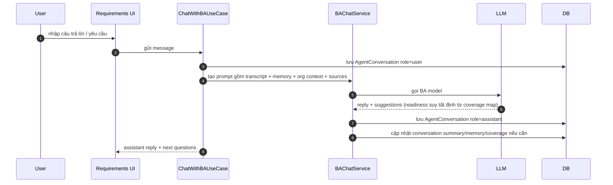
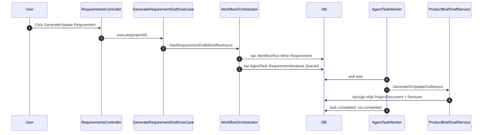
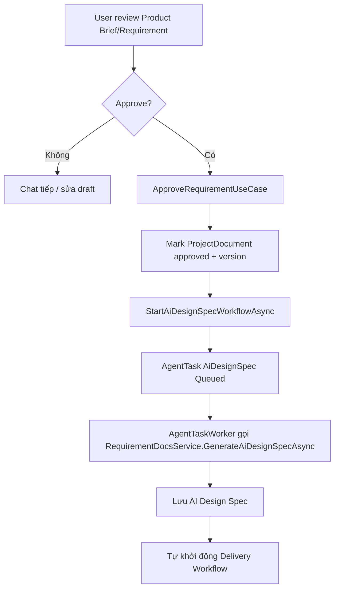

# Luồng yêu cầu — chat với BA

> Đây là "động cơ 1" của hệ thống: một request HTTP xử lý trọn một lượt chat và stream kết quả về.
> Động cơ còn lại (pipeline nền) nằm ở [delivery-pipeline.md](delivery-pipeline.md).

## Đường chat SSE và bốn chốt chặn "không lượt nào được treo"

Đường chat chính là `POST /Requirements/ChatStream` — cùng một request xử lý trọn lượt chat và trả
**Server-Sent Events**: frame `status` ("BA đang soạn câu trả lời…"), frame `token` (BA "đang gõ" —
đã lọc cú pháp JSON qua `BAChatTokenFilter`, chỉ phần `message` hiển thị được stream; **lượt bày bảng
không phát frame này**, xem [Lượt bày bảng mà model quên trả bảng](#lượt-bày-bảng-mà-model-quên-trả-bảng)), và frame `done`
mang bản chốt (reply + suggestions + cờ mời Write Requirement) để client render tại chỗ **không reload
trang**. Client dùng `fetch` + đọc `ReadableStream` (EventSource không POST được).
Lượt chat chạy với `CancellationToken.None` — người dùng đóng tab giữa chừng thì turn vẫn hoàn tất và lưu
DB, chỉ việc ghi response dừng lại.

Đường này **đóng lại khi bản demo đã được nghiệm thu**: `ChatStream` (cùng `NewChat`, `UploadSource`,
`ReviseBrief`) trả 409 và khung chat render ở trạng thái khoá cho tới khi người dùng bấm "Withdraw Approve"
ở trang POC Review — luật khoá và lý do của nó ở
[workspace-and-poc.md](workspace-and-poc.md#nghiệm-thu-là-công-tắc-hai-chiều-và-nó-khoá-nội-dung).

Đây là **đường ghi duy nhất** của khung chat, và stream hỏng kiểu gì `requirements.js` cũng **reload chứ
không gửi lại**. Chính vì lượt chạy với `CancellationToken.None`: khi client không nghe thấy gì (proxy đệm
cả response nên không frame nào về, đồng hồ canh bắn abort sau 45s) thì server **vẫn đang chạy trọn lượt
đó** — POST lần hai cho cùng câu hỏi sẽ nhân đôi lượt user lẫn lời gọi LLM, vì `BAChatService.ChatAsync`
ghi lượt user vô điều kiện và `BAChatTurnTracker` chỉ loại trừ hai nhánh chạy lại một lượt ĐÃ CÓ
(`retry` và `regenerate`). Reload phủ trọn cả hai khả
năng: lượt đã tới đích thì trang hiện bản đã lưu (và `ChatReplyStatus` lo phần còn lại), lượt chưa tới thì
nháp "đã gửi" không khớp lượt user cuối nên `draftRestore` đổ lại nội dung vào ô nhập kèm lời giải thích.

**Không lượt nào được phép "treo"** — hội thoại luôn kết thúc bằng một lượt assistant, và UI luôn có
đường thoát. Lượt user được lưu TRƯỚC khi gọi LLM, nên nếu phần sau vỡ mà không ai đóng lượt thì hội
thoại nằm lại ở "lượt cuối là user" và trang kẹt vĩnh viễn ở "BA đang soạn câu trả lời…" (F5 cũng không
thoát, không gửi được tin mới). Bốn chốt chặn:

- **Đóng lượt kiểu gì cũng đóng**: mọi ngoại lệ trong một lượt (`BAChatService.RunTurnGuaranteedAsync`,
  và nhánh catch của `AcknowledgeSourcesAsync`) đều ghi một lượt assistant ⚠️ có nút "Thử lại".
- **Nhịp tim SSE**: frame `ping` mỗi 10s trong lúc lượt chạy — client phân biệt được "BA đang nghĩ lâu"
  với "kết nối đã chết". Không có nó, một lời gọi structured-output dài trông y hệt stream đứt.
- **Đồng hồ canh phía client** (`STREAM_IDLE_TIMEOUT_MS`, 45s không nghe thấy gì ⇒ abort) + kiểm tra
  "stream kết thúc mà THIẾU frame `done`": hai kiểu đứt im lặng mà `fetch` không hề báo lỗi.
- **`GET /Requirements/ChatReplyStatus` trả `{pending, stale}`**: `stale` = lượt đang chờ đã chết —
  không tiến trình nào đang chạy nó (`BAChatTurnTracker`, sổ singleton trong bộ nhớ) và lượt user đã cũ
  hơn `BAChatService.ReplyStaleAfter` (3 phút). UI mở khóa ô nhập và mời "Thử lại"; retry lúc này chạy
  lại đúng lượt user còn "cụt" (`RetryLastTurnAsync`) nên người dùng không phải gõ lại câu hỏi.

```
Browser POST /Requirements/ChatStream (SSE)
  └► RequirementsController.ChatStream               [Controllers]
       └► ChatWithBAUseCase.ExecuteAsync             [Application/Requirements]
            └► BAChatService.ChatAsync               [Services/Requirements]
                 ├► OrganizationContextService       → system message: hằng số sản phẩm (phạm vi + nền tảng) + "bức tranh tổ chức" (cache 1h)
                 ├► UserMemoryService                → hồ sơ user (học dần, xuyên project)
                 ├► ConversationMemoryService        → 20 lượt gần nhất nguyên văn + tóm tắt lượt cũ
                 ├► RequirementCoverageService       → bản đồ bao phủ 11 nhóm thông tin
                 ├► SourceContextBuilder             → ngữ cảnh từ tài liệu user upload (text + ảnh/ảnh trang scan)
                 ├► RequirementPromptBuilder         → dựng prompt (template Prompts/BusinessAnalyst/*)
                 ├► ILlmClient                       → gọi LLM  [Services/Llm]
                 └► BAChatReplyParser                → parse trả lời (+ cổng readiness tất định từ bản đồ bao phủ)
       └► AppDbContext.SaveChanges                   [Data] — lưu lượt hội thoại
```

Một lượt chat nằm ở bốn file, chia theo thứ đọc khi sửa:

| File | Giữ gì |
|---|---|
| `BAChatService` | trình tự của lượt: chốt ngữ cảnh tất định (`TurnContext`) → lắp message → gọi model → chạy các chốt chặn → lưu. Mỗi chốt chặn một method, và **thứ tự chạy là một phần của hành vi** (xem [Lượt hỏi GỘP, chuẩn `[RÕ]` và phanh chống hỏi lại](#lượt-hỏi-gộp-chuẩn-rõ-và-phanh-chống-hỏi-lại)) |
| `BAChatPromptBlocks` | văn bản mọi khối system message dựng từ **dữ liệu dự án** (các bảng đã chốt, sáu khối `## LƯỢT NÀY:`). Không quyết định gì — chọn khối nào là việc của `InterviewTableGate` + `BAChatService`. Với sáu khối bày bảng, class này chỉ NỐI hai nửa: nửa luật nạp từ `Prompts/BusinessAnalyst/table-*.v1.md`, nửa dữ liệu dựng tại chỗ — xem [Nửa luật ở prompt riêng](#nửa-luật-ở-prompt-riêng-nửa-dữ-liệu-ở-code). Riêng lệnh *"ĐỂ CUỐI, đừng hỏi lẻ"* của hai nhóm chốt-bằng-bảng là văn bản thuần luật nhưng **ở lại đây**, vì nó là một nhánh trạng thái chứ không phải câu dặn chung — xem [Lệnh "ĐỂ CUỐI, đừng hỏi lẻ" ở lại code](#lệnh-cấm-hỏi-lẻ-ở-lại-code-và-vì-sao-nó-không-đi-cùng-đường) |
| `BAChatTurnDraft` | hình dạng lượt trả lời đang được nắn (nội dung, chip, thẻ hỏi, bảng người dùng chốt) + các phép thay lượt. Thay lượt là **một** lời gọi vì thay nội dung mà quên hạ chip là bày ra câu hỏi kèm nút của câu trước |
| `BASourceAckPrompt` | ba khối dựng từ dữ liệu của lượt đọc tài liệu nguồn (file nào cần chốt bảng cột, phạm vi kể lại, bối cảnh hội thoại) — xem [Lượt đọc file](#lượt-đọc-file-hiểu-luôn-rồi-hỏi-tiếp) |

Phần luật viết thuần văn phong — cách hỏi, giọng, nhịp phỏng vấn — vẫn nằm ở file prompt (`Prompts/BusinessAnalyst/*`), sửa được ở Prompt Studio và đo được ở Prompt Evals.

Các cơ chế trí nhớ (chi tiết đầy đủ ở [phần dưới](#các-cơ-chế-trí-nhớ)):

- **Bộ nhớ hội thoại 2 tầng**: 20 lượt gần nhất gửi nguyên văn; lượt cũ gộp dần vào `Project.ConversationSummary` **theo lô ≥10 lượt** (không tóm tắt mỗi lượt — đó là chỗ tiết kiệm token). Fail-open: gọi tóm tắt lỗi thì giữ summary cũ, không mất lượt nào. Vòng soạn Product Brief dùng lại đúng bộ nhớ này (cửa sổ riêng, rộng hơn — xem [Ngữ cảnh gửi lên model ở vòng soạn Brief](#ngữ-cảnh-gửi-lên-model-ở-vòng-soạn-brief)).
- **Bộ nhớ cấp user** (`AppUser.UserMemory`): BA chắt lọc sự thật bền về user (vai trò, lĩnh vực, văn phong...) theo lô, dùng lại ở mọi project của họ.
- **Bản đồ bao phủ yêu cầu** (`Project.RequirementCoverageMap`, lưu **JSON** — xem "Hình dạng bản đồ" bên dưới): 11 nhóm thông tin đánh dấu [RÕ]/[MỘT PHẦN]/[CHƯA HỎI]/[KHÔNG ÁP DỤNG] (bốn tên này là hằng số `CoverageStatus`, kể cả phép chuẩn hoá chuỗi model trả về; các tầng đọc bản đồ so bằng hằng số chứ không bằng chuỗi trần) — NGUỒN CHÂN LÝ DUY NHẤT của độ sẵn sàng: BA chọn câu hỏi kế tiếp dựa vào đây, panel "Tiến độ khai thác" render nó, và cổng "Write Requirement" suy ready TẤT ĐỊNH từ nó (`RequirementReadinessGate.Evaluate`: mọi dòng áp dụng [RÕ] ⇔ cho phép) — không có lời gọi LLM nào chấm lại, nên panel/nút/lời mời không thể vênh nhau.
- **Checklist học được** (`AgentChecklistItem`): ở **mỗi cổng người dùng bấm duyệt** — duyệt Product Brief, duyệt bản demo — hệ thống rà "buổi phỏng vấn lẽ ra phải hỏi thêm gì" và ghi nhớ **cho mọi project sau**. Hai đường harvest: ghi chú trên bản mô tả / hội thoại (`ChecklistGapMemoryService`) → ghi chú trên bản demo (`PocFeedbackMemoryService`). Cả hai chạy nền qua một cửa duy nhất — xem [Vòng học chạy ở cổng duyệt](#vòng-học-chạy-ở-cổng-duyệt). Mỗi bài học là MỘT DÒNG có định danh, kèm **lý do rút ra + trích dẫn bằng chứng + dự án nguồn**, bật/tắt được ở trang `Agents/Checklist`. Chỉ phần `Text` của mục đang bật đi vào prompt; mục bị tắt được gửi cho vòng harvest sau như **danh sách cấm** nên bài học sai không quay lại. Bài học gom theo **bucket phòng ban**: bucket chung (`DepartmentCode = null`, áp dụng mọi dự án) + bucket của department chứa đơn vị yêu cầu — xem [Bucket của checklist học được](#bucket-của-checklist-học-được). Bảng này còn phục vụ **các vai kỹ thuật** (đường harvest thứ ba, bucket luôn là bucket chung) — xem [delivery-pipeline.md](delivery-pipeline.md#học-từ-nhận-xét-ở-cổng-duyệt).
- **Bối cảnh tổ chức**: render từ OrgUnits/Associates, chỉ dữ liệu GỘP (không PII), cache 1h. Fail-open toàn tuyến. Đi kèm hai khối TĨNH "hằng số của sản phẩm" luôn được đính kể cả khi bảng OrgUnits trống: **ranh giới phạm vi** (chỉ nhà máy Đồng Nai) và **nền tảng đã chốt** (chỉ có kênh thông báo email; chỉ đăng nhập bằng SSO qua IdentityServer; danh sách orgUnit + nhân sự đồng bộ từ hệ thống COMPAS; mọi ứng dụng có sẵn vai Admin gán vai cho người dùng).

### Lượt ⚠️ không bao giờ đi lên model

Lượt ⚠️ đóng một lượt đã vỡ là thông báo của HỆ THỐNG cho người dùng, không phải lời BA. Nó thường biến
mất ngay (nút "Thử lại" xóa nó), nhưng người dùng gõ một tin mới thay vì bấm nút thì nó ở lại hội thoại
vĩnh viễn. Vì thế **mọi chỗ dựng ngữ cảnh cho model từ hội thoại đều bỏ nó**, qua đúng một phép thử dùng
chung — `ConversationTurnRenderer.IsFailureTurn` (lượt assistant mang tiền tố
`RequirementScreenText.LlmFailurePrefix`): transcript của lượt chat (`BAChatService.AppendTranscript`),
lượt distill bản đồ bao phủ, tóm tắt hội thoại, hồ sơ user, lượt thiết kế UX và lượt chắt tác vụ mới, transcript soạn
Brief, ngữ cảnh lượt đọc file và sổ câu đã hỏi. Để lọt thì model đọc "câu trả lời trước của mình" là một
lỗi API, và các bản đúc kết gộp lũy tiến khắc chi tiết lỗi hạ tầng vào trí nhớ của buổi phỏng vấn.

Lọc **sau** khi đã `Skip` theo con trỏ chứ không lọc trong truy vấn: các con trỏ gộp đếm trên MỌI dòng
hội thoại, nên lượt ⚠️ vẫn giữ chỗ của nó trong phép đếm. Thêm một reader mới đọc hội thoại cho model thì
phải gọi phép thử này.

### Sửa / soạn lại lượt vừa gửi

Bong bóng user **cuối cùng** mang một hàng hai nút, hiện ra khi rê chuột: **"↻"** (thử lại — BA trả lời lại
chính câu đó) và **"✎"** (sửa — đổi câu rồi trả lời lại). Hai nút, một lõi: `BAChatService.RerunLastUserTurnAsync`
xóa câu trả lời của lượt user cuối, kéo lùi các con trỏ gộp rồi chạy lại lượt — đường sửa truyền nội dung
mới, đường thử lại truyền `null` nên câu hỏi đứng nguyên. Hàng nút nổi NGAY DƯỚI bong bóng chứ không đè lên
góc trên của nó: đặt đè lên chữ là che đúng dòng đầu của câu người dùng đang muốn đọc lại để quyết định bấm
nút nào.

**Rê vào bong bóng ⇒ chỉ hiện ICON; rê vào một icon mới hiện chữ** ("Thử lại" / "Sửa") trong một tooltip
nhỏ bung xuống DƯỚI icon (`.chat-act-tip`) — cùng lối với hàng nút dưới tin nhắn của Claude/ChatGPT. Hai nút
mang chữ sẵn rộng gần nửa bong bóng, nên mỗi lần con trỏ đi ngang là một mảng chữ lạ hiện ra giữa hội thoại;
còn nghĩa của icon thì người dùng lấy được ngay khi rê vào. Tooltip đi xuống chứ không lên: phía trên là mép
dưới của chính bong bóng vừa gửi. Nút **không** dùng `title` (trình duyệt sẽ bày thêm tooltip hệ thống chồng
lên) — lời giải thích dài nằm ở `aria-label`, cũng chính là tên nút mà trình đọc màn hình đọc lên vì icon
không đọc được.

#### "↻ thử lại" — cùng câu hỏi, câu trả lời khác

`POST /Requirements/ChatStream` kèm `regenerate=true` ⇒ `ChatWithBAUseCase.RegenerateAsync` ⇒
`BAChatService.RegenerateLastReplyAsync`. Không lượt user nào được ghi thêm và câu hỏi không đổi — chỉ câu
trả lời cũ bị xóa và thay bằng lượt mới.

Phía client, `removeAnswerAfter` gỡ ngay câu trả lời cũ khỏi màn hình: đó là bong bóng BA **đầu tiên** sau
bong bóng user, **bỏ qua panel tiến độ workflow** (`.workflow-progress` — một `WorkflowRun` riêng mà server
không xoá) và **dừng ở mọi chỗ neo cố định** của trang (phần tử `.req-msg` mang `id`: bảng, cổng, khung "BA
đang soạn…"). Ca thật cần luật bỏ qua: phản hồi POC kích run "Write Requirement" ngay sau lượt user, cổng
readiness ghi câu chặn thành lượt BA nằm SAU panel của run — bản cũ gỡ thứ đứng ngay sau bong bóng user nên gỡ
nhầm panel, còn câu chặn server vừa xoá thì vẫn nằm trên màn hình tới lần tải trang sau.

Không có nút này, muốn một câu trả lời khác cho cùng câu hỏi chỉ còn hai đường đều sai: bấm "✎ sửa" rồi lưu
lại y nguyên (nút đó **cố ý** không chạy lượt nào khi nội dung không đổi — xem phía client bên dưới), hoặc
gõ thêm một câu *"trả lời lại giúp mình"* — mà câu đó thành một lượt user THẬT, đi thẳng vào bản đồ bao phủ
và bộ nhớ hội thoại, tức làm bẩn đúng thứ mà người dùng không định nói.

**Nó KHÔNG dùng chung cờ với nút "Thử lại" của bong bóng lỗi** (`retry=true`, xem [bốn chốt chặn](#đường-chat-sse-và-bốn-chốt-chặn-không-lượt-nào-được-treo)),
dù hai nút đọc lên giống nhau. `RetryLastTurnAsync` chỉ ĐÓNG một lượt đã hỏng (lượt ⚠️ hoặc lượt user còn
cụt) và trả `NothingToRetry` khi hội thoại đang lành lặn — nó không được phép xóa một câu trả lời đã có, vì
cú bấm sinh ra nó có thể là cú bấm trên một trang đã cũ (lượt kia đã về đích trong lúc đó). Đường
`regenerate` thì ngược lại: người dùng đang NHÌN câu trả lời và nói rõ "trả lời lại đi". Gộp hai cờ làm một
là để một cú bấm trên trang cũ âm thầm vứt mất một câu trả lời chưa ai đọc. Ở cấp controller thì hai nhánh
đi chung: cả hai đều không cần `message` và cả hai đều phải giành chỗ độc quyền ở `BAChatTurnTracker`, vì
chúng chạy lại một lượt đã nằm trong hội thoại.

#### "✎ sửa" — đổi câu rồi trả lời lại

Nút này mở một **ô sửa ngay trong bong bóng** (textarea +
"Hủy"/"Lưu", Enter = Lưu, Shift+Enter = xuống dòng, Escape = bỏ sửa). "Lưu" gửi lại chính đường
`POST /Requirements/ChatStream` kèm `edit=true` ⇒ `ChatWithBAUseCase.EditLastAsync` ⇒
`BAChatService.EditLastUserTurnAsync`, và lượt đó làm ba việc chứ không phải một:

1. **Ghi đè** nội dung lượt user cuối (không thêm lượt mới), và **xóa** lượt assistant đứng sau nó nếu có —
   câu trả lời cũ là câu trả lời cho một câu hỏi không còn tồn tại.
2. **Kéo lùi bốn con trỏ gộp** về trước lượt vừa sửa (`CoverageHarvestedTurnCount`,
   `UxDesignedTurnCount`, `UserMemoryHarvestedTurnCount`, `SummarizedTurnCount`) để mọi bản
   đúc kết đọc lại nội dung ĐÃ SỬA. Đây là lý do đường này tồn tại: không có nó, một câu gõ nhầm chỉ
   "sửa" được bằng cách nhắn thêm câu đính chính, trong khi bản đồ bao phủ và bộ nhớ hội thoại đã kịp ghi
   nhận câu sai — mà chúng **gộp lũy tiến**, nên câu sai không bao giờ rời khỏi ngữ cảnh.

   **Riêng bản đồ bao phủ thì lùi cả NỘI DUNG, không chỉ con trỏ.** Câu gốc đã được gộp vào bản đồ ngay
   ở đầu lượt gốc, nên chỉ kéo con trỏ là để lượt chạy lại chắt câu đã sửa *chồng lên* một bản còn chứa ý
   cũ — và ý đó ở lại mãi khi câu mới nói sang chuyện khác thay vì trực tiếp phủ định nó. Lượt distill
   vì thế chụp `RequirementCoverageMap` + `OpenQuestions` + con trỏ vào
   `Project.CoverageUndoSnapshot` ngay trước khi ghi đè, và đường sửa trả đúng ảnh đó lại
   (`CoverageUndoSnapshot.TryRestore`). Chỉ giữ **một** ảnh, của lượt distill gần nhất — đủ dùng vì chỉ
   lượt user cuối sửa được. Ảnh không dùng được (dự án có từ trước khi có cột này, hoặc một lượt distill
   khác đã chen vào sau lượt user — bước soạn Product Brief gộp nốt câu trả lời của BA — nên ảnh đã chứa
   câu gốc) ⇒ từ chối và lùi về hành vi cũ, chỉ kéo con trỏ. Ba bản đúc kết còn lại (tóm tắt hội thoại,
   hồ sơ user, tác vụ chờ xếp chỗ của bản thiết kế UX) **không** có ảnh chụp: lượt cuối gần như không bao
   giờ đã rơi vào tóm tắt, hồ sơ user là dữ liệu xuyên dự án, và một tác vụ chờ xếp chỗ chỉ là đầu vào của
   lượt thiết kế kế tiếp — lượt đó đọc lại TRỌN hội thoại, nên câu đính chính tự đến được nó.
3. Chạy lại lượt như một lượt chat thường (`RunTurnGuaranteedAsync`), nên mọi chốt chặn và mọi frame SSE
   hành xử y hệt.

Chỉ lượt user **cuối cùng** chạy lại được — đúng với **cả hai nút**, ở cả hai phía: server đọc đúng hai lượt
cuối (lượt cuối là assistant ⇒ xóa nó rồi lấy lượt user trước đó; lượt cuối là user ⇒ câu trả lời chưa bao
giờ tới, chạy thẳng lượt đó và không xóa gì; không khớp hình dạng nào ⇒ `NothingToRetry`), còn `Index.cshtml`
chỉ render hàng nút ở đúng bong bóng đó — và không render khi bản demo đã nghiệm thu, vì lúc ấy `ChatStream`
trả 409. Chạy lại một lượt giữa hội thoại thì mọi lượt sau nó nói về nội dung đã biến mất, nên không có đường
nào mở ra việc đó.

Bong bóng mang hàng nút được đánh dấu `has-actions` để **chừa sẵn chỗ** bên dưới cho nó: hàng nút nằm ngoài
dòng chảy (`position: absolute`) nên không tự đẩy được gì, và không có khoảng chừa đó thì nó đè lên nhãn
"BA" của lượt trả lời ngay sau. Đánh dấu ở CẢ hai đường render (Razor và `appendUserBubble`) như mọi thứ
khác của khung chat.

Phía client (`requirements.js`), bốn điều đáng nhớ:

- **Ô sửa nằm trong bong bóng, không chiếm ô nhập.** Nháp đang gõ dở ở ô nhập sống nguyên, và cú bấm "Gửi"
  không bao giờ mang hai nghĩa. Gửi một lượt MỚI trong lúc ô sửa còn mở thì ô sửa đóng lại: lượt đang sửa
  vừa bị đẩy lùi khỏi vị trí cuối, tức không còn sửa được nữa.
- **Lưu mà không đổi chữ nào thì không chạy lượt nào** — chỉ đóng ô. Một lời gọi LLM cho đúng câu hỏi cũ
  chỉ đẻ ra một câu trả lời khác, thứ mà nút "Lưu" không hứa hẹn (đường đó là nút "↻ thử lại" ngay cạnh).
- **Cả hai nút gỡ câu trả lời cũ khỏi màn hình bằng cùng một hàm** (`removeAnswerAfter`) trước khi lượt
  chạy, vì server xóa đúng lượt đó ở cả hai đường: để nó lại là bày hai câu trả lời cho một câu hỏi cho tới
  lần tải trang sau. Hàm này biết chừa hai khung KHÔNG phải câu trả lời của lượt nào — thẻ hỏi gộp và bảng
  phân quyền — vì chúng là chỗ neo cố định của trang, treo tới khi được chốt chứ không tới lượt kế.
  Bấm "↻ thử lại" cũng đóng ô sửa đang mở (nếu có): lượt sắp chạy trả lời nội dung CŨ, để ô mở tiếp là hứa
  hẹn một bản sửa mà lượt đó không hề mang theo.
- **Nháp của bản sửa** (`localStorage["req-chat-edit:<projectId>"]`) giữ nội dung vừa bấm "Lưu" cho tới
  frame `done`. Stream hỏng thì trang reload theo luật chung, và nếu lượt sửa chưa tới server thì bong bóng
  vẫn mang câu cũ — lúc đó `editDraftRestore` mở lại ô sửa kèm lời nhắn giải thích. Nháp trùng nội dung
  lượt cuối (đã tới đích) hoặc bấm "Hủy" thì nháp bị dọn. Khóa riêng, không dùng chung với nháp ô nhập:
  hai ô sống được cùng lúc.


### "＋ New Chat": lưu trữ hội thoại và ẩn run cũ

`StartNewChatUseCase` đóng dấu `ArchivedAt` lên mọi lượt hội thoại hiện hành (không xoá cứng — hội thoại
là nguồn gốc của tài liệu đã sinh), reset bộ nhớ hội thoại per-project (summary, bản đồ bao phủ, các con
trỏ đếm lượt) và ghi `Project.ConversationStartedAtUtc` = mốc đó. Không đụng tài liệu, file Context, hồ sơ
USER hay workflow run. Bị chặn khi bản demo đã nghiệm thu (`PocAcceptanceGate`).

Timeline của trang trộn lượt hội thoại với workflow run. Run **không** có cờ lưu trữ, nên nếu để nguyên
thì thẻ "✓ POC đã tạo xong" của hội thoại cũ đứng trơ ngay dưới lời chào mới như thể BA vừa dựng POC.
`GetRequirementWorkspaceQuery` vì vậy bỏ các run tạo trước `ConversationStartedAtUtc` — POC vào qua trang
POC Review, Product Brief vẫn ở sidebar. Ngoại lệ: run còn `Queued`/`Running` vẫn hiện, để người dùng thấy
tiến độ và cổng "đang soạn" vẫn khoá nút soạn Brief. `WaitingForHuman` không tính là đang chạy — cổng POC
dừng ở đó lâu dài và chính nó là thẻ cần ẩn.

Mốc là cột riêng chứ không suy từ `MAX(ArchivedAt)`: bấm New Chat khi hội thoại hiện hành đang trống thì
không lượt nào được đóng dấu, mà run sinh sau lần New Chat trước vẫn phải ẩn.

## Tài liệu nguồn, ảnh và call log

### Lượt xin file tất định

Đường vào này chỉ có giá trị khi file thật sự tới. `requirement-chat.v4.md` đã bắt BA *"xin file NGAY TẠI LƯỢT
người dùng nhắc tới nó"* từ lâu, in đậm, kèm ví dụ — và nó vẫn trượt, trượt **im lặng**: không cổng nào
biết rằng buổi phỏng vấn vừa bỏ qua một file. Ca thật (JD Libary 5, lượt 3 và 5): người dùng kể *"1 file excel
danh sách JD… và 1 file excel khác để quản lý JD được gán cho nhân viên"* — nhắc **hai lần** — và không lượt nào
trong cả 26 lượt xin file. Hậu quả không dừng ở một tệp đính kèm thiếu: không có file thì không có
[bảng cột](#bảng-cột-chốt-phạm-vi-cột-của-file-bảng-tính) để chốt phạm vi, nên toàn bộ mô hình dữ liệu của dự án
được dựng từ trí nhớ người dùng gõ tay trong một lượt chat — đúng thứ đang nằm sẵn trong file.

Vì vậy nó là một chốt chặn (`SourceRequestTurn`): lượt user cuối **nhắc tới một nơi dữ liệu đang nằm sẵn và
đính kèm được** (file Excel, bảng tính, biểu mẫu…) trong khi dự án **chưa có tài liệu nguồn nào** và **chưa lượt
BA nào xin file** ⇒ lượt trả lời bị thay bằng một lời xin file **đứng một mình** (không chip, không thẻ hỏi, ô
nhập là chỗ trả lời). Hai điều kiện sau là tất định (đếm nguồn, đọc cột `SourceRequested`); điều kiện đầu là
phán quyết `userMentionsExistingSource` của [lượt trọng tài](#lượt-trọng-tài-interviewjudge) — trước đây là một bảng cụm *"excel / bảng tính / sheet / file /
biểu mẫu"*, thứ bắt cả chữ *"file"* trong *"cho phép upload file đính kèm"* (một tính năng, không phải một nguồn
dữ liệu) và phải kê lại cho từng ngôn ngữ. Lượt xin file do **chính model** tự viết cũng do trọng tài nhận ra
(`asksForFile`); câu dựng sẵn thì nhận bằng dấu hiệu máy của nó (nút 📎). Trọng tài lỗi ⇒ không xin (fail-open).
Ba tính chất của thiết kế:

- **Thay TRỌN lượt, không chèn thêm một câu.** Xin file là lời nhờ *hành động*: người dùng đọc xong đi tìm file
  và mọi câu hỏi kèm trong lượt bị nuốt mất — trong khi bản đồ bao phủ vẫn tính là đã hỏi. Câu hỏi model vừa
  viết không mất: nhóm của nó chưa nhúc nhích nên nó quay lại ở lượt sau, lúc đó đọc được file rồi thì thường
  còn hỏi ngắn hơn.
- **Bắn đúng MỘT lần.** Người dùng nói không có file thì hội thoại đi tiếp bình thường; giục lần hai là phí đúng
  cái lượt mà luật này sinh ra để tiết kiệm.
- **Không có dấu hỏi, và đó là lý do nó là ngoại lệ DUY NHẤT của [chốt chặn lượt câm](#cổng-chất-lượng-phía-yêu-cầu-đủ)** (`BAChatTurnDraft.AsksForFile`).

`BAChatSourceRequestTurnTests` chốt cả ba.

**Tài liệu nguồn** (`ProjectSourceIngestor`) — người dùng nghiệp vụ mô tả yêu cầu bằng thứ họ đang có, nên đường vào này quyết định chất lượng phỏng vấn:

| Định dạng | Cách đọc |
|---|---|
| Ảnh (PNG/JPG/WebP/GIF) | gửi thẳng cho model vision |
| PDF có text | bóc text từng trang (PdfPig), **cộng các hình nhúng đủ lớn trong trang** (sơ đồ, ảnh chụp màn hình phần mềm cũ) lấy ra `figure-{n}.png` kèm mốc `[Hình n]` dưới đúng trang chứa nó (`PdfFigureExtractor`, ngưỡng ~50k pixel, tối đa 12 hình/file, bản lặp như logo/header bị loại theo nội dung bytes) — không có bước này thì cùng một tài liệu lưu `.docx` được gửi kèm hình còn xuất `.pdf` thì mất trắng phần đó |
| PDF **scan** | trang không có text ⇒ lấy ảnh nhúng lớn nhất của trang ra `page-{n}.png` (`PdfScanPageRenderer`, ngưỡng ~200k pixel vì giả định "một trang scan = một ảnh phủ kín trang", tối đa 10 trang), gửi cho model vision theo đúng thứ tự trang. Không lấy được ảnh nào mới cảnh báo "không đọc được" |
| Word `.docx`/`.docm` | đoạn văn + bảng (render `ô \| ô`) theo đúng thứ tự tài liệu, **cộng các hình nhúng đủ lớn** (screenshot phần mềm cũ, sơ đồ nghiệp vụ) lấy ra `figure-{n}.png` kèm mốc `[Hình n]` đúng vị trí trong text (`WordDocumentTextExtractor`, tối đa 12 hình/file) — quy trình/biểu mẫu phòng ban gần như luôn ở dạng này, và phần quý nhất của nó thường nằm trong ảnh |
| Excel `.xlsx`/`.xlsm` / CSV | **khối `#### Tổng quan file`** (tệp nhiều sheet: mỗi sheet một dòng + giá trị lặp qua sheet), **hàng tiêu đề dò được** + dòng mẫu (29 dòng, giảm còn 15/8 khi tệp nhiều sheet), **cộng khối `#### Thống kê cột` quét TOÀN BỘ bảng** (`SpreadsheetTextExtractor`, tối đa 30 sheet) — xem dưới |
| Trang HTML `.html`/`.htm` (thường là **mockup giao diện**) | đọc DOM tĩnh, **kể cả phần đang ẩn**: heading, đoạn chữ, bảng (`ô \| ô`), control của form thành token (`[Ô nhập: …]`, `[Chọn: a / b]`, `[Nút: …]`, ☐/○), chú thích HTML ngắn (`[Chú thích: DASHBOARD]`); rồi khối `#### Chữ trong script của trang`, rồi mã script nguyên văn; hình nhúng đủ lớn ra `figure-{n}.*` như Word (`HtmlDocumentTextExtractor`) — xem dưới |

**Trang HTML: đọc như một bản thiết kế, không như người xem.** Mockup là thứ người dùng có sẵn khi họ đã tự hình dung ứng dụng mới, và nó chở đúng những gì BA phải khai thác: danh sách màn hình, trường của từng form, nút thao tác, cột của từng bảng, trạng thái và câu giải thích luật. Bốn quyết định của bộ bóc, mỗi cái vá một cách đọc ra rỗng:

- **DOM tĩnh, không `innerText`.** Mockup nhiều màn giấu mọi màn trừ màn đầu (`display:none`, `hidden`, nhánh điều kiện của template); đọc như trình duyệt hiển thị thì BA chỉ thấy đúng một màn. Chú thích HTML ngắn được giữ vì người dựng mockup hay đặt tên từng màn/hộp thoại bằng chúng. Phần tử inline cũng được ngăn bằng khoảng trắng — không có CSS thì không biết con của một lưới là từng ô, và `TypeROPSafety` dính chữ tệ hơn một dấu cách thừa.
- **Chữ trong script đứng TRƯỚC mã, mã đứng sau cùng.** Mockup dựng bằng React/Vue hay template của công cụ thiết kế để menu, tiêu đề màn hình, thông báo và dữ liệu mẫu nằm trong JavaScript, còn DOM chỉ là khung với `{{ binding }}` (bộ bóc viết lại thành `⟨binding⟩`: ngắn hơn, và prompt gọi tên được nó mà không vướng luật placeholder `{{…}}` của `PromptConventionTests`). Mà phần quý nhất lại ở CUỐI script (khối render), sau hàng chục nghìn ký tự mảng dữ liệu — trần `MaxTextCharsPerFile` cắt từ đầu thì cái tới được BA là mảng dữ liệu còn tên màn hình thì không. `ScriptTextReader` rút riêng các chuỗi (bỏ CSS/class/selector, khử trùng, mỗi dòng mã một nhóm) — cỡ một phần tám mã; ca thật (mockup quản lý tủ locker, file 10MB) ra ~10.600 ký tự giao diện + ~9.100 ký tự chữ script, lọt trọn trần 20.000. Thư viện (`src` ngoài, mã nén dòng dài) bị bỏ.
- **File "tự chứa" được mở gói.** Công cụ thiết kế xuất mockup thành MỘT file mà thân thật nằm trong chuỗi JSON `<script type="__bundler/template">`, ảnh/font/thư viện trong `__bundler/manifest` (base64, có gzip), trang con trong `__bundler/page_order`. Đọc vỏ ngoài chỉ ra "Unpacking…". Vì cùng lý do đó HTML có trần cỡ file riêng (`Llm:SourceUpload:MaxHtmlFileBytes`, 30MB): 10MB file thì 95% là font + thư viện base64 — bộ bóc chỉ lấy phần chữ nên cỡ file không thành cỡ prompt.
- **Không chạy JS, không tải gì từ mạng, có ngân sách thời gian parse.** File do người dùng upload: mở URL trong đó từ server là cửa SSRF. Bộ dựng cây HTML5 chạy bậc hai với thẻ khối lồng sâu (5MB `<div><div>…` là hàng chục phút CPU trên luồng request), nên parse có trần 15 giây — hết thì bỏ phần bóc chữ, file gốc vẫn lưu và người dùng được báo "không đọc được". Mở **bản gốc** (`GET Requirements/SourceContent`) thì trang HTML đi kèm CSP `sandbox` như POC demo — xem [screens-and-permissions.md](screens-and-permissions.md#bảo-mật-đăng-nhập-phân-quyền-rào-chắn).

`source-ack.v3.md` có mục riêng dạy BA đọc khuôn này (token control là danh sách TRƯỜNG; `⟨…⟩` được điền từ khối chữ script; mockup là hình dung về app MỚI, dữ liệu mẫu trong đó chưa chắc là quy mô thật). Chốt bằng `HtmlDocumentTextExtractorTests` + `ScriptTextReaderTests`.

Một PDF có thể góp cả hai loại ảnh (trang bản scan + hình nhúng trong trang có chữ) — hai tập trang rời nhau, cùng đếm vào một con số `ProjectSourceFile.ScannedPageImageCount`, vì `SourceContextBuilder` chỉ cần TỔNG để nói đúng số ảnh thực sự gửi kèm. Ảnh đi theo thứ tự: trang scan trước (theo số trang), rồi hình nhúng (theo số hình) — tên file không tới model, nên mốc `[Hình n]` trong text tự nói ra nó thuộc trang nào.

**Bảng tính: danh mục lấy từ thống kê, không lấy từ dòng mẫu** (`SpreadsheetTextExtractor`). Dòng mẫu chỉ để BA thấy hình dạng dữ liệu; **danh mục của mỗi cột** — thứ sẽ thành enum/danh mục trong mô hình dữ liệu ở các bước sau — phải lấy từ khối `#### Thống kê cột`, quét cả bảng và ghi cho từng cột: bao nhiêu dòng có giá trị, bao nhiêu giá trị phân biệt, các giá trị đó là gì kèm số dòng (liệt kê **đủ** khi ≤ 12 giá trị, còn lại nêu 5 giá trị hay gặp nhất). Vì sao không thể chỉ gửi dòng mẫu: các dòng đầu của một bản xuất thường được sắp theo người/đơn vị nên không đại diện cho cả bảng — ca thật, file 262 dòng mà 29 dòng đầu chỉ chứa `REQ`/`MAN` nên bản đọc lại của BA bỏ sót `OPT`, đúng giá trị mã hóa "khóa học **tự chọn**" mà người dùng đã nói ngay câu đầu tiên; cùng cửa sổ đó cột `Required Date` trống sạch trong khi cả bảng có 12 dòng mang hạn hoàn thành. Các chi tiết đi kèm, đều là lỗi đã gặp:

- Ô **inline string** (`<c t="inlineStr"><is><t>…</t></is></c>`, không có `<v>`) được đọc từ `<is>`: Excel tự lưu dùng shared string, nhưng nhiều bộ xuất file của hệ thống khác (và openpyxl) ghi kiểu này — đọc mỗi `<v>` là cả sheet thành ô rỗng và file bị báo "không đọc được gì".
- Ô được đặt theo **`CellReference`** chứ không theo thứ tự xuất hiện. OpenXML lược bỏ hẳn phần tử của ô rỗng, nên đọc tuần tự thì mọi giá trị sau một chỗ trống trượt sang cột khác — BA từng đi báo với người dùng rằng bảng "bị lệch giữa hàng tiêu đề và các giá trị", trong khi bảng gốc không lệch, chỉ text ta dựng ra mới lệch.
- **Thống kê đứng TRƯỚC các dòng mẫu — của MỌI sheet — nhưng `RealSampleDataReader` cắt ngược lại.** Hai consumer của cùng chuỗi text muốn hai nửa ngược nhau, nên text mang hai mốc hằng số (`ColumnStatsHeading`, `DataRowsHeading`). `SourceContextBuilder.Truncate` cắt ở `Llm:SourceUpload:MaxTextCharsPerFile` (mặc định 20.000) giữ **phần đầu** — một sheet rộng (tới 40 cột, ô tới 200 ký tự) ăn hết ngân sách chỉ bằng 29 dòng mẫu ⇒ thống kê phải đứng trước để sống sót. Với tệp nhiều sheet thì thứ tự là: tổng quan → thống kê của sheet 1, 2, … n → dòng mẫu của sheet 1, 2, … n; để mỗi sheet trọn gói (thống kê + mẫu của sheet 1 rồi mới tới sheet 2) là để dòng mẫu của sheet đầu đẩy thống kê của các sheet sau ra khỏi ngân sách. Ngược lại `RealSampleDataReader` (trần **3.000** ký tự) chỉ lấy từ `DataRowsHeading` trở đi, vì nó cần **bản ghi thật**: đó là dữ liệu POC seed lên màn hình, và là chuẩn để `PocSampleDataCheck` rút token đối chiếu. Để nguyên cả khối thì cái tới POC là mấy dòng *"có giá trị 262/262 · ĐỦ 5 giá trị"* — token đặc trưng thành từ vựng thống kê, POC seed sai mà cổng kiểm cũng mù theo.
- Phần bảng mẫu tự nói rõ nó chỉ là dòng đầu và không được dùng để suy ra danh mục.
- **Tổng quan file đứng ĐẦU tất cả** (`WorkbookOverviewHeading`, chỉ có ở tệp từ hai sheet): mỗi sheet một dòng — số dòng, số cột, tên cột, sheet nào bị ẩn — và các sheet trống. Ca thật (file quản lý tủ locker hơn chục sheet): với bố cục cũ, vài sheet đầu ăn hết ngân sách và BA kể lại *"2.092 dòng tủ khu giày và 1.368 dòng tủ nam"* trong khi tệp có khoảng 4.460 tủ ở bảy khu — các sheet sau không hề tới được model và không để lại dấu vết nào. Một dòng mỗi sheet là thứ rẻ nhất bảo đảm BA biết ĐỦ phạm vi của tệp, kể cả khi chi tiết của sheet cuối bị cắt. Trần cũ 8 sheet nâng lên 30; sheet vượt trần được nói thẳng ra trong tổng quan.
- **Tín hiệu chất lượng dữ liệu tính sẵn bằng máy**, vì model chỉ thấy vài dòng mẫu nên không tự so được hàng nghìn dòng: cột ĐỊNH DANH (nhiều giá trị phân biệt, số giá trị ≥ nửa số ô có giá trị) ghi thêm *"n giá trị lặp ở hơn một dòng"* (trùng số tủ, một người hai tủ — mỗi giá trị chỉ lặp hai lần nên chìm dưới top 5); ô lỗi công thức (`#VALUE!`, `#REF!`…) được đếm riêng; và tổng quan liệt kê **cột cùng tên ở nhiều sheet có giá trị lặp qua sheet** (một mã nhân viên giữ tủ ở hai khu). Chỉ xét cột định danh — cột danh mục như `Status` trùng qua sheet là hiển nhiên.
- **Hàng tiêu đề được DÒ, không lấy dòng đầu tiên có chữ** — xem mục ngay dưới.

Chốt bằng `SpreadsheetTextExtractorTests` + `SourceAckRuleTests`, và chấm điểm bằng các scenario `source-ack` trong golden set.

**Hàng tiêu đề phải DÒ ra, vì dòng đầu sheet gần như không bao giờ là tiêu đề.** Biểu mẫu do người làm nghiệp vụ dựng mở đầu bằng một dòng banner MỘT Ô (`HcP_JD Database 2023`), rồi `Created by` / `Updated on`, rồi mới tới hàng tiêu đề thật ở dòng 6. Lấy "dòng có chữ đầu tiên" làm tiêu đề hỏng hai đường cùng lúc, và đường thứ hai im lặng: (1) tên cột rỗng ⇒ **bảng cột bày cho người dùng toàn `(cột 1)`, `(cột 2)`…** trong khi file có sẵn `Org Unit`, `Job title`, `Job Grade` — họ không phân xử nổi một cái tên không có trong file nào; (2) bề rộng bảng bị chốt theo dòng banner ⇒ **mọi cột từ B trở đi biến mất khỏi bản đọc**, sheet `JD Database_Master` 12 cột chỉ còn 1, và không có dấu vết nào cho thấy 11 cột kia từng tồn tại. Ca thật: `StandardJDTemplate.xlsx` — cả tệp 8 sheet chỉ ra được **một** tên cột dùng được, còn bảng cột thì đề nghị người dùng xác nhận ý nghĩa của `(cột 1)`…`(cột 10)`.

Cách dò (`SpreadsheetTextExtractor.ChooseHeaderRow`), tất định, không gọi LLM: đệm 25 dòng đầu sheet, chấm mỗi dòng trong 12 dòng đầu bằng số ô **trông như tên cột** — có chữ, ngắn (≤ 60 ký tự), không phải số, và **không lặp lại ở phía dưới trong cùng cột**. Ô lặp là dấu hiệu tách tiêu đề khỏi dữ liệu mạnh nhất mà không cần biết nghiệp vụ: giá trị của một cột danh mục thì lặp, tên cột thì không. Ba luật đi kèm, cả ba đều có ca hỏng thật đứng sau:

- **Hoà điểm ⇒ lấy dòng TRÊN.** Đó là cách hàng tiêu đề thắng hàng gợi ý nằm ngay dưới nó (`Automatically filled`, `Please choose from drop down list`) — nếu không thì ba cột khác nhau cùng mang tên `Automatically filled`.
- **Chỉ 12 dòng đầu được làm ứng viên**, dù đệm 25 dòng: dòng càng gần đáy đệm càng ít dòng phía dưới để đối chiếu nên điểm bị thổi lên, và một dòng dữ liệu ở cuối đệm sẽ ăn gian thắng hàng tiêu đề thật (sheet `JSDL Skills list` hỏng đúng kiểu đó khi chưa có luật này).
- **Bỏ dòng trên phải hơn hẳn 2 điểm.** Với bảng nhỏ, dòng dữ liệu đầu tiên chỉ cần đông ô hơn hàng tiêu đề một ô — một cột không có tiêu đề là đủ — đã cướp được vai tiêu đề, vì giá trị của nó chưa kịp lặp lại để bị trừ điểm. Giá của biên này: bảng chỉ **hai** cột nằm dưới một banner một ô thì không đổi được, vẫn ra `(cột n)`.

Hai hệ quả của cùng thay đổi:

- **Bề rộng lấy theo dòng rộng nhất trong đệm, không theo riêng hàng tiêu đề.** Biểu mẫu thật hay có cột chỉ có dữ liệu mà không có tiêu đề (bảng phụ dán cạnh, ô tiêu đề gộp như `Qualifications` trải trên ba cột). Cắt theo hàng tiêu đề thì dữ liệu của chúng biến mất không dấu vết; để lại dưới tên `(cột n)` thì người dùng còn nhìn thấy giá trị mà gọi tên chúng ngay ở bảng cột. Ô tiêu đề gộp vẫn là giới hạn đã biết: tên thật của các cột sau nằm ở dòng dưới và **không** được lấy — lấy được nó đòi một heuristic thứ hai từng đặt tên cột bằng đúng một giá trị dữ liệu (`MSE1`), mà một cái tên sai tệ hơn `(cột n)` vì bản đọc lại sẽ tự tin giải nghĩa nó.
- **Các dòng trước hàng tiêu đề không bị vứt**: chúng được kể lại nguyên văn sau nhãn `Dòng đầu sheet (trước hàng tiêu đề):` (hằng số `PreambleHeading`). Chúng nói file này là bản gì, của ai, kỳ nào — bỏ hẳn thì BA mất bối cảnh, để nguyên như cũ thì chúng đội lốt tên cột. Cùng lý do, **dòng trống xen giữa bảng không còn được đếm là bản ghi**: đếm vào thì mọi tỉ lệ `có giá trị n/m` lệch và nó chiếm một suất trong 29 dòng mẫu.

**Các cột được đọc CẠNH NHAU, không đọc rời từng cột.** Khối thống kê có số dòng có giá trị của mọi cột, nên đặt vài con số cạnh nhau bắt được cách hiểu sai với giá gần bằng không. Các dấu hiệu prompt bắt soát: **hai cột cùng số dòng có giá trị** (`Item Status` có `Active (219)` và `Complete Date` có giá trị ở đúng 219/262 dòng ⇒ `Active` nhiều khả năng là *đã học xong* chứ không phải *nội dung còn hiệu lực* — cột này quyết định file kể "ai đã học" hay "nội dung nào còn dùng"); **cột tên có giá trị nhiều hơn cột mã đi kèm** (tên 2.000 dòng, mã nhân viên 1.840 ⇒ khoảng 160 người không đối chiếu được với dữ liệu nhân sự); **cột mã và cột tên lệch số giá trị phân biệt** (`Item ID` 134 mã nhưng `Item Title` 136 tiêu đề ⇒ mã không phải khóa như tưởng); **một cột chỉ có giá trị ở đúng những dòng mà cột khác có giá trị** ⇒ cột dẫn xuất, xem ngay dưới.

**Hệ cũ có hai loại cột, loại thứ hai khó thấy hơn hẳn.** Cột **hạ tầng** (`Revision Number`, `Preferred Time zone`) lộ ra ngay từ cái tên. Cột **dẫn xuất** — giá trị tính sẵn từ một cột khác tại thời điểm hệ cũ xuất file, như `Days Rem` = `Required Date` trừ ngày xuất — thì đọc lên *như một dữ kiện nghiệp vụ thật* nên trôi qua rất êm. App mới tính lại được bất cứ lúc nào, còn con số trong file thì đông cứng từ ngày xuất ⇒ POC seed lên màn hình một giá trị vĩnh viễn sai. Phép thử của prompt: *giá trị này có tự đổi theo thời gian mà không ai sửa gì không?* — có thì giữ cột **gốc**, bỏ cột tính sẵn.

### Lượt đọc file: hiểu luôn, rồi hỏi tiếp

Ngay sau upload, `BAChatService.AcknowledgeSourcesAsync` chạy **một** lượt BA (`source-ack.v3.md`) cho mọi loại nguồn — bảng tính, Word, PDF, HTML, ảnh. Lượt đó nói ngay BA hiểu tài liệu ra sao, nêu các **phát hiện** nối tài liệu với điều người dùng đã kể, rồi kết bằng **đúng một câu hỏi khai thác** để buổi phỏng vấn đi tiếp. Người dùng gửi file để BA hiểu công việc của họ, không phải để duyệt bài đọc của BA.

Thiết kế trước đó chia ba lượt cho một file Excel: lượt upload chỉ bày bảng cột bắt người dùng tích, người dùng bấm "Gửi bảng cột", rồi lượt sau mới kể lại file kèm cụm "Chỗ chưa chắc" và hỏi "hiểu vậy đúng chưa?". Ca thật (file quản lý tủ locker): ba lượt trôi qua mà BA chưa nói được điều gì người dùng chưa biết, trong khi file đầy bằng chứng cho đúng ba nỗi đau họ vừa kể — Status để trống ở phần lớn số tủ (*"data không được update"*), khoảng 160 dòng có tên mà thiếu mã nhân viên (*"nghỉ việc phải dò tay"*), một người giữ nhiều tủ. Vì vậy ba thứ **bị cấm** ở lượt này, prompt gọi đích danh từng thứ:

- **Không có cụm "Chỗ chưa chắc".** Mỗi mục ở đó thành một việc tồn đốt một lượt phỏng vấn thật. Điều chưa chắc được xử theo ba bậc: thứ tự kiểm được thì tự kiểm (44330 là số ngày kiểu Excel), thứ phải đoán thì viết thành **giả định khẳng định** *"mình hiểu là…"* ngay trong gạch đầu dòng của nó — người dùng thấy sai thì nói, thấy đúng thì không ai phải bấm gì — và đúng một điều chặn nhiều thứ nhất thì thành câu hỏi kết.
- **Không kết bằng câu xin xác nhận bản đọc.** Lượt "Đúng rồi / Có chỗ chưa đúng" là một lượt người dùng không nói thêm được gì mới. Chip của lượt nay là phương án trả lời câu hỏi kết (2–4 phương án cho câu đóng, rỗng cho câu mở).
- **Không bắt người dùng rà hay gửi bảng cột** — BA tự chốt, hệ thống lưu luôn; xem mục bảng cột ngay dưới.

**Lượt đọc file nhận bối cảnh hội thoại** (`BASourceAckPrompt.ConversationContext` → khối `## BỐI CẢNH HỘI THOẠI`): tóm tắt dài hạn và bản đồ bao phủ đã lưu trên project, cộng các lượt chưa gộp vào tóm tắt (tối đa 30 lượt, 12.000 ký tự, giữ phần ĐUÔI — lượt gần nhất thường là lượt BA vừa xin file, tức chính lý do file tới). Trước đây lượt này chỉ nhận prompt + text nguồn, không một dòng hội thoại nào, trong khi chính prompt bắt nó "đối chiếu với điều người dùng đã kể" — nên bản đọc chỉ kể lại số đếm như một vật thể độc lập. Khối này chỉ đọc thứ ĐÃ có, không gọi LLM gộp tóm tắt như lượt chat thường: lượt đọc file đã là lời gọi nặng nhất của buổi, thêm một lời gọi phụ trước nó là kéo dài đúng lúc người dùng đang chờ. Upload ngay lượt đầu (chưa có gì) ⇒ không có khối.

Prompt dạy lượt này **soát ba điều đối chiếu** (đúng file đã xin chưa — ca thật xin *"Master List phải học trong năm"* mà nhận về lịch sử đã học; thứ người dùng kể mà file không có; quy mô có khớp lời kể không) và **nêu hai loại phát hiện người dùng cần biết dù chưa nói tới**: chất lượng dữ liệu sẽ phải dọn khi chuyển sang app mới (trùng mã, một người ở nhiều dòng/nhiều sheet, ô lỗi công thức — đọc thẳng từ các tín hiệu máy đã tính sẵn ở khối thống kê và tổng quan), và dữ liệu nhạy cảm nằm trong file (mật khẩu, mã khóa) ⇒ không mang sang.

**Phạm vi KỂ LẠI do cơ chế nói ra** (`BASourceAckPrompt.ReadbackScope` → khối `## PHẠM VI KỂ LẠI CỦA LƯỢT NÀY`). Lượt đọc file nạp lại **toàn bộ** nguồn của project và điều đó là cố ý — nguồn cũ là thứ duy nhất để **đối chiếu**, mà chỗ **nối** giữa file mới và file cũ thường là điểm đắt nhất của cả lô upload (*"biểu mẫu vừa gửi lấy danh sách người học từ file kia, hay người dùng tự nhập?"*). Nhưng "đính kèm để đối chiếu" khác hẳn "phải kể lại". Ca thật: người dùng gửi một file Excel ở đầu buổi, mười mấy lượt sau gửi một ảnh chụp biểu mẫu để trả lời một câu hỏi — bản đọc mở đầu bằng gần nửa số dòng nói lại đúng bộ cột của file Excel, rồi mới tới cái ảnh. Model không sai luật nào nó được cho; cơ chế nói dối về chữ "vừa gửi". Nay lô vừa upload đi từ controller xuống dưới dạng `attachments`, và:

- câu dẫn của lượt user **gọi tên** đúng các file vừa gửi thay vì gộp chung;
- khối phạm vi liệt kê file vừa gửi, liệt kê các nguồn cũ và cấm kể lại chúng — trừ đúng một chỗ: một phát hiện hoặc câu hỏi nằm ở chỗ **nối** giữa hai nguồn;
- bảng tính cũ **chưa có bảng cột** không nằm trong danh sách bị cấm đó: bảng của nó được chốt ngay lượt này, nên câu phạm vi cột phải được gọi tên nó;
- không biết lô nào vừa gửi (`attachments` rỗng) ⇒ coi mọi nguồn là vừa gửi. Kể lại thừa còn đỡ hơn để một file vừa gửi rơi khỏi phạm vi.

`sourceNotes` **không** bị bó theo phạm vi này: nguồn nào có ảnh thật sự đi kèm lượt này đều phải có một mục, kể cả nguồn cũ lần đầu được gửi ảnh — đó là chỗ cất ảnh thành chữ (`VisionSummary`), không phải chỗ người dùng đọc.

Lượt kế tiếp là lượt chat thường: `requirement-chat.v4.md` dặn đi tiếp từ câu trả lời của người dùng, ghi nhận đính chính nếu họ bác một giả định, và **không** quay lại hỏi "mình hiểu file vậy đúng chưa". Lượt đọc file mang bảng cột vẫn vào sổ câu đã hỏi (`AskedQuestionHistory`) như mọi lượt có câu hỏi — nó chỉ thu gọn bảng trong bong bóng, câu hỏi kết của nó là câu hỏi thật.

### Bảng cột: chốt phạm vi cột của file bảng tính

File người dùng gửi gần như luôn là bản **xuất của hệ thống họ đang dùng**, nên nó chở cả cột nghiệp vụ lẫn cột hạ tầng của hệ cũ. Toàn bộ text của file đi tiếp vào **dữ liệu mẫu thật** của bước sinh spec và POC seed màn hình bằng đúng các cột đó: không chốt thì người dùng mở demo ra thấy `Revision Number`, `Preferred Time zone` nằm như trường của app mới.

Cách chốt: ở **chính lượt BA đọc file**, BA trả thêm `columns` — mỗi cột của file một dòng, kèm **cách hiểu viết sẵn** và cột đó có thuộc ứng dụng mới hay không — và `AcknowledgeSourcesAsync` **lưu luôn** vào `ProjectSourceFile.ColumnMap`. Người dùng không phải tích hay gửi gì. Trong `message` chỉ có đúng một câu nói ứng dụng dựng trên cột nào, bỏ qua cột nào của hệ cũ; bong bóng của lượt đó có thêm dòng thu gọn **"Xem / sửa bảng cột"** — bung ra là bảng đầy đủ, sửa rồi bấm "Lưu bảng cột" (`POST Requirements/ConfirmColumnMap` → `ConfirmSourceColumnMapUseCase`, không gọi LLM). Lưu xong **không** có tin nhắn nào gửi tiếp vào hội thoại: bảng đã lưu đi kèm mọi lượt sau và lượt chắt lọc bản đồ bao phủ, nên một câu "mình đã sửa bảng cột" chen vào chỉ làm lạc nhịp câu hỏi đang chờ người dùng trả lời. Bảng trong bong bóng render từ bản **đã lưu** của file (không phải đề xuất gốc ghi trên lượt), nên sửa xong tải lại trang vẫn thấy bản mới.

File nào cần chốt bảng do **cơ chế** nói ra (`BASourceAckPrompt.ColumnScope` → khối `## BẢNG CỘT CỦA LƯỢT NÀY`): bảng tính có text bóc được mà `ColumnMap == null`. Model nhìn thấy text của **mọi** nguồn trong project (kể cả file đã có bảng từ lần upload trước) nên nó không tự suy ra được file nào đang chờ. File đã có bảng thì không bao giờ bị dựng lại — nếu không, mỗi lần đính thêm một file là bảng cũ (có thể người dùng đã sửa tay) bị một lời gọi model khác ghi đè.

Bảng cột không bao giờ **chặn** gì: `PendingConfirmTableGate` không còn xét nó, vì không còn trạng thái "chờ gửi" nào.

Các quyết định của thiết kế này, mỗi cái vá một đường hỏng đã gặp:

- **Bảng chứ không phải hàng chip.** Chip chỉ nêu được tập con do BA tự chọn; các cột không lên chip bị coi là "của hệ cũ" mà người dùng không bao giờ nhìn thấy để phản đối. Bảng phơi **đủ** cột của file — `SourceColumnMapBuilder.Build` luôn bổ sung các cột model bỏ sót vào cuối, ở trạng thái không dùng.
- **Ô ý nghĩa do BA ĐIỀN SẴN.** BA có tên cột, mọi giá trị phân biệt và số dòng từ khối `#### Thống kê cột` nên đoán được gần hết; một bảng toàn ô trống là lượt hỏng.
- **Mọi tên cột phải khớp hàng tiêu đề THẬT.** `SourceColumnMapBuilder` đọc tên cột từ khối thống kê (gộp mọi sheet, bỏ trùng) rồi loại mọi dòng không khớp, và luôn dùng chính tả của **file** chứ không của model — ở cả đường model đề xuất lẫn đường trình duyệt gửi lên (server không tin payload nó vừa render ra). Một dòng bịa lọt qua là POC đi lọc dữ liệu mẫu theo một cột không tồn tại.
- **Bảng nhận phần giải nghĩa cột, bản đọc thì không.** Bảng đã đi qua đủ mọi cột kèm ô ý nghĩa **sửa được**, nên `message` đi qua nốt 18 cột trong văn xuôi là lặp cùng nội dung ở dạng không sửa được — một bức tường số (*"Revision Number có 3 giá trị: 1 (218), 3 (21), 2 (18)"*) ai cũng đọc lướt. Phạm vi cột chỉ được xử ở **một** chỗ: nêu "cột này trông như của hệ cũ" thành một phát hiện hay một câu hỏi là tạo việc tồn trùng với chính cái bảng.
- **Tiêu đề khối ngữ cảnh nói đúng nguồn của bảng.** `SourceColumnMapBuilder.RenderConfirmedBlock` viết *"Bảng cột của … đã CHỐT (BA chọn lúc đọc file, người dùng xem/sửa được…)"*, không viết "người dùng chốt": mọi tầng chắt lọc tin vào nguồn được khai, và gán bảng cho lời người dùng là khai man.

Chốt xong, bản đồ cột được **tiêu thụ ở hai đầu** — đây mới là chỗ bảng trả tiền cho chính nó:

| Đầu đọc | Việc |
|---|---|
| `SourceContextBuilder` | gắn khối *"Bảng cột của … đã CHỐT"* ngay sau text của nguồn, ở **mọi** lượt chat sau ⇒ BA thôi hỏi lại nghĩa cột, thôi hỏi lại phạm vi, thôi dựng yêu cầu trên cột đã loại |
| `RequirementCoverageService` | gắn **cùng khối đó** vào lượt distill bản đồ bao phủ: bảng cột là câu trả lời cho phần "bộ cột chính thức". Thiếu nó thì dòng *Dữ liệu / danh mục chính* kẹt `[MỘT PHẦN]` với *"còn thiếu: chốt bộ cột"* trong khi bằng chứng nằm ngay trong DB — và vì cổng readiness đọc đúng bản đồ đó, lời mời "Write Requirement" bị thay bằng một câu hỏi về đúng thứ đã có trong bảng, lặp lại mỗi lần người dùng bấm nút |
| `RealSampleDataReader` | **lọc** các dòng dữ liệu mẫu xuống đúng tập cột đánh dấu dùng, trước khi chúng vào prompt AI Design Spec và làm chuẩn cho `PocSampleDataCheck` |

Chưa chốt (file không phải bảng tính, hoặc model không đề xuất được dòng nào khớp cột thật) ⇒ không có bảng, không có khối ngữ cảnh, không lọc gì. Bảng cột không khớp hàng tiêu đề nào cũng không lọc: cắt sạch dữ liệu mẫu tệ hơn nhiều so với để lọt vài cột thừa.

## Các bảng của buổi phỏng vấn: một bảng người dùng chốt, ba bảng BA tự soạn

Buổi phỏng vấn có bốn bảng, chia làm hai loại theo đúng một câu hỏi: **đó là YÊU CẦU hay là THIẾT KẾ?**
Ai nhận email ở sự kiện nào thì không có bảng nào — xem [Nhóm thông báo không chốt ở buổi phỏng
vấn](#nhóm-thông-báo-không-chốt-ở-buổi-phỏng-vấn).

- **Yêu cầu** — ai làm gì, khi nào, trạng thái nào — là thứ người dùng cung cấp. Có những yêu cầu **BA ráp
  lại từ hội thoại** mà người dùng chưa bao giờ nhìn thấy để bác (chuỗi bước của một luồng), nên chúng được
  bày thành **bảng người dùng tự tay chốt**: bảng là chỗ họ nhìn thấy
  và sửa được, và bằng chứng thu về là **một thao tác trên từng dòng** thay vì một chip trả lời thay cho tất
  cả.
- **Thiết kế** — cần bao nhiêu màn hình, việc/nút nào đặt ở màn nào, vai nào được làm việc nào — là phần
  người dùng đi thuê BA để làm. Phần thiết kế **BA tự soạn ngầm**, lưu thẳng, không lượt nào
  bắt người dùng rà: bảng báo cáo ở đầu lượt chat, còn bản thiết kế UX và bảng phân quyền ở bước **"Write
  Requirement"** (xem [Thứ tự phụ thuộc](#một-cổng-đúng-một-bảng-mỗi-lượt--và-phần-thiết-kế-chạy-ở-write-requirement)). Bày chúng ra cho người dùng chốt là đẩy ngược phần thiết kế về cho
  người đi thuê — ca thật (dự án Locker, thời bảng màn hình còn là một bảng): người dùng thêm trạng thái Need
  Clean sau khi bảng màn hình đã chốt, và BA hỏi *"Nút «Thu hồi tủ» và nút «Đã clean» nên đặt ở màn hình nào?"* + ba chip tên màn hình.

| Bảng | Cột trên `Project` | Ai chốt | Chốt cái gì | Đường tiêu thụ ngoài chat |
|---|---|---|---|---|
| Luồng nghiệp vụ | `FlowMap` | **người dùng** (bày trong chat) | luồng chính + 1–2 ngoại lệ, mỗi luồng là chuỗi bước *ai làm → làm gì → trạng thái sau đó* | chuyển trạng thái ở `## 8. Business Rules` + nút/hành động ở `## 6. Screens To Generate` |
| Báo cáo / thống kê | `ReportMap` | BA tự ráp | các báo cáo người dùng đã chọn ở hội thoại, mỗi cái đứng ở màn tổng quan hay màn riêng | mỗi báo cáo thành một tác vụ của bản thiết kế UX + khối báo cáo của spec |
| Bản thiết kế UX | `UxBlueprint` | BA dựng danh mục tác vụ, **UiUx** tổ chức màn hình | đối tượng + vòng đời, **tác vụ** có ID ổn định (phục vụ bước luồng nào), màn hình theo pattern library, hành động đặt ở đâu, menu theo vai | DÒNG của bảng phân quyền (theo ID tác vụ) + *"Các màn hình chính"* của Brief + `## 5`/`## 6`/`## 6c`/`## 6d` của spec |
| Phân quyền | `PermissionMatrix` | BA tự soạn, **người dùng sửa được** ở popup | quyền theo từng TÁC VỤ, kèm phạm vi dữ liệu | `## 6b. Permission Matrix` + hành vi lọc thật ở `## 6. Screens To Generate` |

Phần thiết kế có ba mục riêng: [Bảng báo cáo](#bảng-báo-cáo-gom-về-một-màn-hình-tổng-quan),
[Bản thiết kế UX](#bản-thiết-kế-ux-ba-dựng-danh-mục-tác-vụ-uiux-tổ-chức-màn-hình) và
[Bảng phân quyền](#bảng-phân-quyền-ba-tự-soạn-người-dùng-sửa-ở-popup). Chỗ người dùng góp ý về màn hình là
**POC Review**, nơi họ thấy màn hình thật chứ không phải một bảng chữ; chỗ họ sửa quyền là popup mở từ nút
«Xem bảng phân quyền» dưới panel Tiến độ khai thác.

### Không có bảng đối tượng nghiệp vụ

Mô hình dữ liệu — đối tượng nào có thông tin nào, bắt buộc hay không, nhập tay hay chọn từ danh sách, danh
sách lấy ở đâu, quan hệ cha-con — **không được chốt với người dùng ở buổi phỏng vấn**. Buổi phỏng vấn từng có
một bảng thứ sáu cho đúng việc đó, và nó đã bị gỡ vì nó bắt người dùng nghiệp vụ ký vào thứ họ không đọc
nổi: các cột *"Bắt buộc"*, *"Nhập thế nào"*, *"Danh sách lấy ở đâu"* là câu hỏi mô hình hoá dữ liệu, không
phải câu hỏi nghiệp vụ. Ca thật (dự án Locker Management): bảng bày ra ô **Photo** — *"hình ảnh đính kèm khi
báo tủ hư"* — với kiểu nhập *"Gõ tay"*, và ô số tủ của phiếu báo hư cũng *"Gõ tay"* thay vì chọn từ danh sách
tủ; người dùng bấm gửi cả hai. Bước chốt không bắt được lỗi nào, chỉ làm người dùng mệt và đóng dấu "đã
duyệt" lên một phỏng đoán của BA. Product Brief (tài liệu cho người nghiệp vụ) vốn cũng không in bảng ấy ra.

Phần việc của bảng ấy nay đi theo ba đường, đều xuất phát từ HỘI THOẠI:

| Việc cũ của bảng đối tượng | Nay ở đâu |
|---|---|
| Mô hình dữ liệu | **không nằm trong AI Design Spec** — spec chỉ phục vụ dựng POC. Bước sinh spec tự đặt tên trường/trạng thái (tiếng Anh, Title Case) ở cột bảng/field form của `## 6. Screens To Generate` và ở các chuyển trạng thái của `## 8. Business Rules`; ràng buộc nó tự đặt mà Brief không nói thì ghi vào `## 10. Assumptions`. Thiết kế dữ liệu thật (thực thể, quan hệ) và API là việc của bước **"Đề xuất kiến trúc từ AI Design Spec"** (`TechLead/architecture-design*.v1.md`) sau khi POC được duyệt |
| Danh mục ứng dụng tự quản lý | lượt danh mục của bản thiết kế UX (`ux-inventory.v1.md`) dựng đối tượng `IsCatalog` + tác vụ quản lý nó từ lời người dùng kể ở nhóm «Dữ liệu / danh mục chính»; lượt thiết kế gom các danh mục đơn giản thành một màn `master-data` có tab — xem [Bản thiết kế UX](#bản-thiết-kế-ux-ba-dựng-danh-mục-tác-vụ-uiux-tổ-chức-màn-hình) |
| Ô "lấy số từ" ở bảng báo cáo | chữ TỰ DO, BA ráp theo hội thoại — xem [Bảng báo cáo](#bảng-báo-cáo-gom-về-một-màn-hình-tổng-quan) |

Hai nhóm «Dữ liệu / danh mục chính» và «Vòng đời & trạng thái» vẫn được HỎI bằng câu hỏi như mọi nhóm khác —
cấm hỏi kiểu *"mỗi JD cần lưu những thông tin gì?"* vẫn giữ (`requirement-chat.v4.md`); việc của BA ở nhóm dữ
liệu chỉ là nắm được các DANH MỤC chính bằng lời nghiệp vụ (danh sách nào ứng dụng tự quản lý, danh sách nào
lấy từ hệ thống khác). **Luật tên tiếng Anh** của mô hình dữ liệu (tên đối tượng, tên thông tin, tên trạng
thái — dạng hiển thị Title Case, vì chúng thành cột bảng dữ liệu, nhãn ô nhập và chip trạng thái của POC) nay
sống ở prompt sinh spec (`BAChatEntityNamingRuleTests`).

Cột `EntityMap` trên `Project` và `AgentConversation` đã bị xoá (migration `BoBangDoiTuong`): các lượt cũ có
bảng đối tượng không còn hiện bảng ấy trong lịch sử chat.

### Nửa luật ở prompt riêng, nửa dữ liệu ở code

Khối `## LƯỢT NÀY: BÀY BẢNG …` của bảng người dùng chốt (bảng luồng) là nửa LUẬT, nằm ở prompt riêng. Phần BA tự soạn không có khối này — mỗi phần có prompt soạn riêng
(`report-map-draft`, `ux-inventory` + `UiUx/ux-blueprint`, `permission-matrix-draft`), gọi bằng lời gọi structured
output riêng chứ không qua lượt chat (bảng báo cáo ở đầu lượt chat; thiết kế và phân quyền ở bước "Write
Requirement" — `DesignPreparationService`), và nửa dữ liệu của chúng dựng trong chính service soạn
(`UxDesignService` + `UxDesignInputBuilder`, `PermissionMatrixDraftService.RenderInput`).

| Nửa | Ở đâu | Vì sao |
|---|---|---|
| **LUẬT** — đặc tả từng trường, cách viết, thứ tuyệt đối không làm | `Prompts/BusinessAnalyst/table-flow-map.v1.md` | sửa được ở Prompt Studio, đo được ở Prompt Evals, có `PromptKey` để lần vết phiên bản |
| **DỮ LIỆU** — các bước luồng đã chốt | `BAChatPromptBlocks` / `FlowMapBuilder` | dựng từ dữ liệu dự án và phải khớp đúng với builder đọc lại kết quả |

`BAChatService.AppendTableBlocks` nạp file đó **chỉ** ở đúng lượt cổng của nó mở. Đó là toàn bộ điểm của
việc tách: một lượt chat thường không phải đọc đặc tả của mọi bảng chỉ để thi hành các lệnh *"để mảng
rỗng"* — và các lệnh phủ định thường trực chính là loại lệnh model hay rò rỉ nhất.

**Lý do KHÔNG phải là token.** Prompt nền nằm ở message đầu tiên, tức vị trí prefix cache tốt nhất có thể,
nên phần cắt đi (~5.400 token, 20% file) vốn được phục vụ với giá rẻ hơn 10 lần — cỡ nửa xu cho cả buổi
phỏng vấn. Vị trí đính khối bảng cũng theo đúng logic ấy: nó nằm ở **vùng biến động** của danh sách message,
SAU khối tài liệu nguồn tĩnh, nên prefix cache không mất gì. Đính một khối biến động lên TRƯỚC khối nguồn
(tới 20.000 ký tự mỗi file) sẽ vô hiệu hoá cache của toàn bộ phần sau — tốn hơn nhiều lần thứ tách được.

**Lý do thật là một bản sao thứ hai đã trôi lệch.** Trước lần tách, nửa LUẬT sống ở CẢ HAI chỗ: chuỗi C#
trong `BAChatPromptBlocks` và một bản thứ hai trong `requirement-chat.v4.md`. Hai bản đã lệch nhau đúng
theo cách [llm-and-prompts.md](llm-and-prompts.md) cảnh báo — bản C# bắt model điền `evidence` cho **từng
bước** của bảng luồng và **từng dòng** của bảng màn hình (nay đã thay bằng bản thiết kế UX), trong khi các
contract đó không hề có trường ấy nên nó bị bỏ lúc parse; bản prompt thì nói đúng rằng các bảng ấy không có
`evidence`. Model được dạy tìm trích dẫn cho một ô
không tồn tại, và được hứa một hệ quả không có thật (*"dòng có trích dẫn được tích sẵn kèm dấu ✓"*).
`InterviewTablePromptTests` nay so prompt với contract để bản sao đó không mọc lại.

**Cái ở lại `requirement-chat.v4.md`** chỉ còn một bất biến, và nó là thứ giữ cho lượt chat thường không tự
đẻ ra bảng: *không có khối `## LƯỢT NÀY: BÀY BẢNG …` trong ngữ cảnh ⇒ không dựng bảng nào*. Các ví dụ JSON của lượt thường cũng không liệt kê khóa bảng nữa —
`BAChatReplyParser` dùng `List<…>?` + `?? new()` nên khóa thiếu không sao, và lượt chat stream bằng
`ChatResponseFormat.JsonObject` chứ không phải json_schema nên không có schema nào đòi đủ khóa.

> **Cạm bẫy vận hành.** Prompt Studio ưu tiên bản DB active hơn nội dung file (`DbPromptOverrideProvider`).
> Dự án nào đang có bản override active cho `requirement-chat.v4.md` thì việc cắt ở file **không có hiệu
> lực** cho tới khi bản active ấy được cập nhật — nếu không, model đọc lại đúng bản cũ, cộng thêm khối
> mới, tức quay về đúng hai bản. Đúng cho cả phần đặc tả bảng ở trên lẫn lệnh cấm hỏi lẻ ở mục dưới.

### Lệnh cấm hỏi lẻ ở lại code, và vì sao nó KHÔNG đi cùng đường

Phân quyền và nhóm không-hỏi «Thông báo / nhắc nhở» mang thêm một khối, `PermissionMatrixDeferred` / `NotificationDeferred` —
văn bản thuần luật, không một mẩu dữ liệu dự án nào, nên theo bảng trên nó "đáng lẽ" phải nằm ở file prompt.
Nó ở lại code vì các lý do dưới đây. Với phân quyền, chúng nói cùng một điều: **đây không phải một câu dặn,
nó là một NHÁNH TRẠNG THÁI.** Lệnh cấm thông báo thì vô điều kiện — nó ở lại đây vì là nửa LỜI của một cơ chế
mà nửa MÁY (`CoverageUnaskedGroupGuard`) ở code, và đứng cạnh lệnh cấm phân quyền để hai lệnh cùng khuôn
"cấm gì / vẫn PHẢI hỏi gì" không trôi lệch nhau.

- **Prompt nền vào MỌI lượt.** Lệnh cấm phân quyền chỉ đúng ở nhánh *chưa có bảng*; nhánh kia là khối *bảng
  ĐÃ CHỐT* (sau lần bấm "Write Requirement" đầu tiên). Một bản sao thường trực ở prompt nền chọi thẳng với
  nó — nói "sẽ soạn khi bấm nút" về một bảng đã có.
- **Câu dặn ở đầu một prompt nền 116 KB thì không đủ** — xem
  [Bảng phân quyền](#bảng-phân-quyền-ba-tự-soạn-người-dùng-sửa-ở-popup): khối điều kiện đứng ở vùng biến động
  cuối danh sách message, gần lượt đang trả lời.

Vì vậy `requirement-chat.v4.md` chỉ giữ **con trỏ** gọi đúng tiêu đề của khối. Trước lần dọn này, prompt nền
chở đủ bản sao của lệnh cấm, và nó đã trôi lệch: có ngoại lệ *"trừ orgUnit và nhân sự — đồng bộ từ COMPAS"*,
hằng C# thì không. `InterviewTablePromptTests` nay giữ cả
hai chiều: các mẩu đặc tả cấm phải có trong hằng và **không** được xuất hiện lại ở prompt nền.

### Một cổng, đúng một bảng mỗi lượt — và phần thiết kế chạy ở "Write Requirement"

`InterviewTableGate.Select` là chỗ DUY NHẤT quyết định lượt này bày bảng nào — nay chỉ còn một ứng viên,
bảng luồng. Chỗ chọn duy nhất vẫn giữ vì nếu để mỗi cổng tự quyết thì mỗi cổng bơm một khối `## LƯỢT NÀY:` vào ngữ
cảnh, và hai khối như thế cùng lúc là hai mệnh lệnh chọi nhau — model trả một bảng lai hoặc bỏ cả hai.

Phần thiết kế không đi qua `Select`. **Thứ tự là thứ tự PHỤ THUỘC, không phải thứ tự tiện tay:**

```
trong buổi phỏng vấn:  luồng (người dùng chốt) → báo cáo (BA ráp, đầu lượt chat)
bấm "Write Requirement": thiết kế UX (BA dựng tác vụ, UiUx tổ chức màn) → phân quyền (BA soạn) → Product Brief
```

Luồng trước, vì mọi thứ sau đều trỏ về bước luồng — mỗi tác vụ có ô *"phục vụ bước nào"*. **Bảng báo cáo được
ráp TRƯỚC lượt thiết kế**, vì nó là một NGUỒN tác vụ: mỗi báo cáo thành một tác vụ đứng đúng chỗ bảng báo cáo
ghi (khối của màn tổng quan, ô đếm, hay màn riêng — `UxInventoryBuilder.ReportTasks`). **Phân quyền sau thiết
kế**, vì các DÒNG của nó là các tác vụ. Tác vụ lộ ra ở một lần bấm sau thì được bổ sung dòng riêng
(`PermissionMatrixGate.MissingTasks`).

| Bước | Ở đâu | Cổng |
|---|---|---|
| Ráp báo cáo | đầu lượt chat (`BAChatService.BuildTurnContextAsync`); bước "Write Requirement" ráp bù nếu lần đó lỗi | `ReportMapGate.ShouldDraft`: cổng luồng đủ điều kiện mở (`FlowMapGate.CoverageReady`) + «Báo cáo / thống kê» `[RÕ]` |
| Thiết kế UX | `DesignPreparationService` → `UxDesignService.PrepareAsync`, sau cổng readiness | `UxDesignGate.IsStale`: chưa thiết kế, hội thoại có lượt mới từ lần thiết kế gần nhất, hoặc phạm vi trôi trên các bảng (`NeedsRedesign`) |
| Soạn phân quyền | `DesignPreparationService` → `PermissionMatrixDraftService`, ngay sau thiết kế | `PermissionMatrixGate.ShouldDraft(Project)` (lần đầu: đã có bản thiết kế, không còn tác vụ chưa xếp chỗ) / `MissingTasks` (bổ sung) |

#### Vì sao thiết kế chạy ở "Write Requirement" chứ không giữa buổi

Thiết kế giữa buổi là thiết kế trên một phạm vi còn trôi. Trước đây lượt thiết kế chạy ở đầu lượt chat ngay
khi bảng luồng và bảng báo cáo xong, và mỗi lần người dùng kể thêm một việc là một chuỗi: lượt chắt phạm vi
(cứ 10 lượt một lần) → lượt thiết kế lại → bổ sung dòng phân quyền. Lượt chat ngay sau bảng luồng còn phải chờ
tới năm lời gọi (danh mục, thiết kế, hai vòng phản biện, phân quyền) trước khi BA trả lời. Và vì nhóm «Phân
quyền theo nghiệp vụ» từng là một dòng của bản đồ bao phủ — chỉ `[RÕ]` khi bảng đã có — nên bảng phân quyền
(và bản thiết kế nó đứng trên) BẮT BUỘC phải có trước khi nút "Write Requirement" sáng.

Nay nhóm đó đã bỏ (xem [Bảng phân quyền](#bảng-phân-quyền-ba-tự-soạn-người-dùng-sửa-ở-popup)), nên không gì
buộc thiết kế phải chạy trong buổi. Tới lúc bấm nút thì cổng readiness đã xác nhận mọi nhóm áp dụng `[RÕ]` —
mọi nguồn tác vụ đã ngã ngũ — nên MỘT lần thiết kế đọc trọn hội thoại là đủ, và lượt chắt phạm vi giữa buổi
(`InterviewScopeService`) không còn việc gì để làm — đã gỡ.

Cái giá chấp nhận: trước lần bấm đầu tiên, popup «Xem bảng phân quyền» trống (nó tự nói "BA sẽ soạn khi bấm
Write Requirement"), và lượt chat chưa có khối "các màn hình của ứng dụng"
— trước khi có Brief, BA vốn không bàn màn hình với người dùng.

#### Hai luật lỗi khác nhau

- **Thiết kế lỗi ⇒ fail-closed.** Brief đọc mục *"Các màn hình chính"* từ bản thiết kế
  (`UxBlueprintRenderer.RenderBriefBlock`); soạn khi không có nó là soạn một tài liệu thiếu màn hình. Vòng soạn
  dừng với thông báo lỗi trên panel tiến độ, người dùng bấm lại. Cùng luật khi lượt bổ sung (đã có bản thiết
  kế) lỗi: soạn trên bản cũ là thiếu đúng phần vừa kể thêm.
- **Phân quyền lỗi ⇒ fail-open.** Brief không đọc bảng phân quyền (nó chỉ vào `## 6b` của AI Design Spec, sinh
  sau khi duyệt), nên vòng soạn đi tiếp và lần bấm sau soạn bù. Bảng báo cáo cũng fail-open.

#### Bảng luồng là điều kiện của cổng readiness

`RequirementReadinessGate.Evaluate(Project, …)` / `IsReady(Project)` — bản mà mọi chỗ production gọi — đòi
thêm đúng một vế ngoài bản đồ: **bảng luồng đã chốt** (`FlowMapGate.ShouldAsk` = false). Đủ mọi nhóm `[RÕ]`
thì cổng luồng đương nhiên đã đủ điều kiện mở, nên vế này chỉ chặn một ca: model quên bày bảng ở lượt cổng mở
(hoặc người dùng chưa gửi), mà bản thiết kế lại dựng từ chính các bước luồng đã chốt. Trước đây ca này được
chặn GIÁN TIẾP — dòng phân quyền chờ bảng phân quyền, bảng đó chờ bản thiết kế, bản thiết kế chờ bảng luồng;
bỏ dòng phân quyền thì phải nói thẳng ra. Câu chặn (`RequirementReadinessGate.FlowTablePending`) mời người
dùng nhắn một tiếng để lượt sau bày bảng.

### Vì sao bảng luồng và bảng báo cáo không được là điều kiện để một nhóm lên `[RÕ]`

Hai nhóm của chúng được hỏi suốt buổi, và bảng chỉ **xác nhận lại** (luồng) hoặc **ráp lại** (báo cáo) thứ
hội thoại đã trả lời. Với bảng báo cáo thì `[RÕ]` còn là **điều kiện mở cổng**, không chỉ một lựa chọn ghi
trong bản đồ — xem mục riêng của nó bên dưới.

Bắt nhóm phụ thuộc vào bảng là dựng một vòng khóa kín: cổng đòi nhóm `[RÕ]` mới mở, bản đồ đòi có bảng mới
`[RÕ]`, không bên nào đi trước được. Triệu chứng nếu làm sai rất khó truy: nút "Write Requirement" không bao
giờ sáng, panel tiến độ đứng ở 10/11 vĩnh viễn. (Vế "bảng luồng đã chốt" ở mục trên KHÔNG phải luật như vậy:
nó nằm ở cổng readiness, không ở bản đồ, và cổng luồng tự mở khi các nhóm của nó đã `[RÕ]`.)

### Ba chốt chặn tất định dùng chung

Các builder áp cùng bộ luật, vì chúng hỏng theo cùng một kiểu:

- **Luật bằng chứng.** Server chỉ khóa một ô/dòng khi model kèm được TRÍCH DẪN. Cờ suông bị bỏ. Không
  có ranh giới này thì một bảng điền sẵn toàn bộ trông như đã chốt, và người dùng bấm gửi trong ba giây.
  Ở **bảng phân quyền** (BA soạn,
  không ai bấm gửi), ô có trích dẫn là ô *người dùng đã tự nói* — popup đánh dấu ✓ kèm câu gốc nhưng vẫn cho
  sửa. Bảng luồng và bản thiết kế UX **không** có trường bằng chứng: mọi dòng của chúng đều ra ở trạng thái
  được giữ, nên một trích dẫn ở đó không đổi được trạng thái nào — xem
  [Vì sao bảng luồng và bản thiết kế không có dấu ✓ bằng chứng](#vì-sao-bảng-luồng-và-bản-thiết-kế-không-có-dấu--bằng-chứng).
- **Cờ tích ở đề xuất của model luôn là TÍCH SẴN**, bất kể model trả gì. Cờ đó là chỗ NGƯỜI DÙNG loại bớt
  (bảng luồng), không phải chỗ model tự phủ nhận đề xuất của mình — mà structured output buộc
  điền đủ trường, nên một model điền `false` cho có sẽ âm thầm bỏ tích sạch bảng. Bản thiết kế UX (không ai
  rà) vì thế không có cờ tích nào trong đề xuất của model: một tác vụ chỉ rời danh mục khi NGUỒN của nó biến
  mất (bước luồng bị bỏ tích, báo cáo bị loại) — xem
  [Bản thiết kế UX](#bản-thiết-kế-ux-ba-dựng-danh-mục-tác-vụ-uiux-tổ-chức-màn-hình).
- **Bản kể là CHỮ, nhưng trên màn hình nó là THẺ.** Bong bóng của tin nhắn gửi bảng (bảng luồng; bảng thông
  báo, bảng phân quyền, bảng màn hình, bảng báo cáo ở các buổi cũ, khi chúng còn được bày ra) được
  `wwwroot/js/table-submission.js` dựng lại thành thẻ có cấu trúc (bảng phân
  quyền là **ma trận** chức năng × vai trò — dòng gom theo màn hình và gập/mở được, ô là phạm vi dữ liệu tô
  màu hoặc "—" khi vai đó không được làm, dòng tiêu đề vai và cột chức năng dính khi cuộn; dòng "không vai
  nào" và điều kiện nổi bật, mục bị loại gạch ngang). Thẻ chỉ là cách HIỂN THỊ: nó
  đọc ngược chính `<p>` chữ gốc (vẫn nằm trong bong bóng, chỉ ẩn, và vẫn là nguồn của ô "✎ sửa"), nên
  transcript và mọi tầng chắt lọc không đổi. Parser bám đúng khuôn chữ của các `RenderUserMessage`; đổi
  câu chữ ở builder mà quên file JS thì bong bóng **rơi về chữ thường**, không vỡ gì. Bảng luồng chưa có thẻ.
- **Lượt trả lời câu hỏi CHỌN NHIỀU cũng lên thẻ, cùng file JS đó.** "Gửi các lựa chọn" gửi đi các chip đã
  tích nối bằng `", "`, mà mỗi chip là cả một câu *"<tên> — để <mục đích>"* và hay tự chứa dấu phẩy — ba
  báo cáo đọc ra thành một dòng chạy dài không thấy ranh giới. Bong bóng vì vậy hiện thành thẻ **«Các lựa
  chọn đã tích»**: mỗi lựa chọn một dòng (tên đậm, mục đích ở dòng phụ), lời gõ ở ô "Ý khác" là dòng cuối
  gắn nhãn, chip không tích nằm gạch ngang ở dưới. Chữ không tự tách ngược được, nên bong bóng chở bộ chip
  của lượt BA ngay trước trong `data-choices` (đường live: `sendSelectedSuggestions` → `appendUserBubble`;
  sau F5: `Index.cshtml` đọc `Suggestions` của lượt BA đứng trước khi nó có `SuggestionsMultiSelect`), và
  `parsePicks` ăn dần tin nhắn từ đầu, chip dài nhất trước — cùng thuật toán với
  `UserTurnOrigin.IsMadeOfChips`. Thẻ là **chung cho mọi câu chọn nhiều** (ý tưởng, báo cáo, vai trò…), không
  riêng báo cáo: lượt hỏi một câu không mang nhãn nhóm nào để biết nó đang hỏi về gì. Dưới hai dòng, hoặc
  không chip nào khớp (câu tự gõ, hay lượt đã "✎ sửa" thành câu khác) ⇒ để nguyên bong bóng chữ.
- **Văn xuôi của BA không bao giờ thành lời người dùng.** Tin nhắn `RenderUserMessage` được lưu dưới **vai
  NGƯỜI DÙNG**, nên chữ nào lọt vào đó cũng thành lời của họ với mọi tầng phía sau: bộ chắt bản đồ bao phủ
  ghi thẳng vào `known`, bộ chắt "điểm cần làm rõ" lấy làm một vế mâu thuẫn, BA đem ra chất vấn ở lượt kế.
  Nên bản kể chỉ chở các ô người dùng thật sự QUYẾT. Dòng **"là gì"** của mỗi màn hình là văn xuôi của thiết
  kế (cả bản thiết kế UX là việc của BA/UiUx, không đi qua bản kể nào) — khối ngữ cảnh
  (`UxBlueprintRenderer.RenderChatBlock`) mở bằng nhãn *"thiết kế của BA/UiUx, KHÔNG phải lời người dùng"*
  kèm một câu cấm trích nó làm bằng chứng. Ca thật (JD Library 1, ở bảng đối tượng nay đã gỡ): ô mô tả ghi *"JD — Mô tả công việc
  được Manager tạo, kiểm tra, verify và approve…"* trong khi người dùng đã kể ở chat VÀ tự tay rà bảng luồng
  rằng HRBP verify rồi HoD approve; câu đó quay về trong vai họ, BA hỏi *"luồng nào đúng với thực tế ạ?"*,
  và mục tồn đọng sinh ra từ đó hạ ba dòng bản đồ xuống `[MỘT PHẦN]` — khóa cổng "Write Requirement" ở đúng
  lượt mọi nhóm vừa đủ. Phần prompt của cùng chốt chặn này: trường `purpose` nói màn hình **là gì**, không
  kể **ai làm gì** (`UiUx/ux-blueprint.v1.md`), và ba bộ đọc — chat, bản đồ bao phủ, triển vọng phỏng vấn —
  đều bị cấm coi dòng đó là lời người dùng.
- **Dòng bịa bị loại, dòng bị bỏ quên vẫn phải có mặt** (với danh sách gieo sẵn — dòng tác vụ của bảng phân
  quyền, tác vụ của bản thiết kế UX) — và có mặt ở trạng thái TÍCH SẴN. "BA quên nêu" không phải "đã loại":
  bỏ nó đi là làm một việc người dùng đã đặt hàng biến mất khỏi mọi tầng sau. Ở bảng phân quyền, dòng
  khóa theo **ID tác vụ** (`T-NN`) nên một dòng model bịa (ID không có trong danh mục) bị loại thẳng, còn
  tác vụ model quên nêu được gieo lại với cột vai trống — xem
  [Bảng phân quyền](#bảng-phân-quyền-ba-tự-soạn-người-dùng-sửa-ở-popup).

Gửi bảng luồng đi là **hai bước**: `POST Requirements/ConfirmFlowMap` lưu vào cột `Project.FlowMap` (không
gọi LLM), rồi trình duyệt gửi tiếp
**một tin nhắn người dùng** do SERVER soạn qua đúng đường chat thường — hội thoại vẫn chỉ có một đường ghi.
Lưu hỏng thì dừng hẳn, không gửi tin nhắn. Model không trả bảng dùng được thì lượt **đòi lại** trước đã —
xem [Lượt bày bảng mà model quên trả bảng](#lượt-bày-bảng-mà-model-quên-trả-bảng); đòi hết trần mà vẫn không
có thì fail-open, cổng mở lại ở lượt sau.

**Mỗi bảng phải có mặt ở CẢ HAI đường render, và frame `done` là đường dễ quên.** Bảng được LƯU vào lượt hội thoại nên sau F5 nó luôn hiện đúng — điều đó che mất ca một bảng không được chở qua frame `done`: lượt bày bảng về tới client mà không có bảng, `render*` thấy mảng `undefined` nên bỏ qua, panel vẫn ẩn, và người dùng đọc đúng một câu BA mời *"rà bảng bên dưới rồi bấm Gửi bảng …"* trỏ vào chỗ trống. Đây chính là hình dạng "câu hỏi không có chỗ trả lời" mà lượt đọc bảng tính đã vấp một lần. Bảng báo cáo — hồi nó còn là một bảng bày ra cho người dùng — đã hỏng đúng như vậy (`reportMap` thiếu trong frame), và triệu chứng trên màn hình còn tệ hơn: bảng chỉ hiện ra vì cú bấm "Write Requirement" tải lại trang — tức người dùng nhìn thấy nó SAU khi đã lỡ soạn tài liệu thiếu nó. `ChatStreamFrameCoverageTests` giữ bất biến này: mọi trường của `BAChatTurnResult` phải được frame `done` đọc tới.

Bảng **treo theo DỰ ÁN** (cột còn null) chứ không theo lượt, và lượt có bảng thì **bỏ** chip và thẻ
hỏi gộp — chip bấm là GỬI NGAY, để cả hai cùng sống thì một cú bấm nhầm cuốn mất lượt trước khi người dùng
rà xong.

### Lượt bày bảng mà model quên trả bảng

Lượt bày bảng bị prompt ép vào một hình dạng rất hẹp: `message` đúng MỘT câu mời rà bảng rồi bấm nút,
`suggestions` và `questions` rỗng, không kết bằng dấu hỏi — vì bảng là chỗ trả lời duy nhất của lượt, nên
một câu hỏi ở đó là câu hỏi không có nút bấm.

Hình dạng ấy **trùng khít với LƯỢT CÂM** (`BAChatTurnDraft.IsSilent`). Đó là chỗ fail-open cũ thủng: khi
model viết đúng câu dẫn mà bỏ quên trường bảng, lượt không hề "chạy như một lượt chat thường" — nó rơi
thẳng vào [chốt chặn lượt câm](#đường-chat-sse-và-bốn-chốt-chặn-không-lượt-nào-được-treo) và bị thay bằng
câu chặn của cổng bao phủ, tức một câu hỏi về một nhóm khác hẳn việc BA vừa hứa ở chính câu đó.

Ca thật (log `BAChat` 2026-09-08 03:35:04 UTC, `deepseek-v4-flash`, ở bảng đối tượng nay đã gỡ): cổng bảng
mở, model trả đúng 168 token gồm mỗi câu *"…Anh/chị vui lòng xem bảng bên dưới và bấm nút «Gửi bảng …»…"* và
**không có trường bảng**. Thứ hiện lên màn hình là câu phát lại của cổng bao phủ về một nhóm khác hẳn; câu
của model thì không bao giờ được lưu. Người dùng mở AI Call Log thấy model nói một đằng, UI hiện một nẻo —
mà cả hai đều "đúng" theo code.

**Chốt chặn: đòi lại ngay trong lượt.** `BAChatService.CallForTurnAsync` gọi model tối đa
`MaxTableAttempts` = 4 lần cho một lượt bày bảng (lượt chat thường vẫn đúng MỘT lời gọi, không đổi gì).
Bốn điều đáng nhớ:

- **Điều kiện dừng là BẢNG DỰNG ĐƯỢC, không phải trường JSON có mặt.** `reportMap: []`, hay một bảng mà
  builder loại sạch dòng (dòng trỏ vào màn hình ngoài phạm vi, dòng rỗng ruột), hỏng đúng bằng việc thiếu
  hẳn trường — và chỉ builder mới biết. Nên vòng này dựng bảng thật bằng `FillTableRows` rồi hỏi
  `CarriesTable`.
- **Đòi lại bằng cách NỐI THÊM, không dựng lại prompt.** Bản trả lời hỏng được chép lại dưới vai
  `assistant`, rồi tới lời đòi dưới vai `user` (`InterviewTableContract.RetryDemand`). Tiền tố dài giữ
  nguyên nên endpoint đọc lại nó từ cache — ca thật: 68.561 token prompt, trong đó 49.408 từ cache.
- **Lời đòi cấm luôn đường "gỡ" bằng một câu hỏi**, vì đó chính là hình dạng chốt chặn lượt câm sẽ bắt.
- **Lượt bày bảng KHÔNG stream token.** Frame `token` chỉ biết CỘNG chữ vào bong bóng đang gõ, nên bản nháp
  của lần hỏng không rút lại được và lần sau sẽ nối tiếp vào nó. Đổi lại không mất gì mấy — phần hiển thị
  được của lượt này chỉ là một câu dẫn, còn thân bài là JSON bảng vốn đã bị `BAChatTokenFilter` lọc khỏi
  luồng — và người dùng nhận dòng trạng thái gọi đúng tên việc (*"BA đang dựng bảng luồng nghiệp vụ…"*, rồi *"…đang làm lại (lần 2/4)…"*).

Trần bốn lần là trần có chủ đích: mỗi lần đòi lại cộng thêm một lời gọi vào độ chờ của lượt (ca thật ~3,6
giây mỗi lời gọi), nên trần cao hơn đổi một lượt hỏng lấy một lượt treo. Hết trần thì fail-open như cũ —
cổng bảng đọc bản đồ bao phủ chứ không đọc lịch sử lượt, nên nó mở lại ở lượt kế và bảng được bày lại.

Nửa còn lại của chốt chặn nằm ở **prompt**: hai file `table-*.v1.md` đều kết bằng một đoạn nói thẳng trường
nào là bắt buộc, rằng một câu trả lời chỉ có `message` là câu trả lời HỎNG, và rằng hệ thống sẽ bắt trả
lại — nên viết bảng TRƯỚC rồi mới viết câu dẫn. `BAChatTableRetryTests` giữ cả hai vế.

### Bảng luồng: chuỗi bước người dùng tự tay duyệt, và đường của nó tới POC

Bảng này đã **thay hẳn** sơ đồ luồng chỉ-đọc mà BA từng vẽ ở lượt mời "Write Requirement" (`flowDiagram`,
đã gỡ — xem [Vì sao sơ đồ luồng ở lượt mời bị gỡ](#vì-sao-sơ-đồ-luồng-ở-lượt-mời-bị-gỡ)). Sơ đồ đó chỉ **vẽ
ra để nhìn**: một luồng chính, không ngoại lệ, đính chính bằng lời trong khung chat rồi chờ BA vẽ lại. Bảng
luồng khác ở chỗ quyết định — bước **sửa được và bỏ được** tại chỗ.

Phần trả tiền lớn nhất nằm ở đường ra: mỗi bước của luồng đã chốt trở thành một chuyển trạng thái ở
`## 8. Business Rules` của spec (và một nút/hành động ở đúng màn của `## 6`), tức **POC được dựng theo
đúng chuỗi bước người dùng gật** chứ không theo bản BA tự hiểu từ transcript.

Bảng bắt buộc chở NGOẠI LỆ vì chuẩn `[RÕ]` của nhóm «Luồng ngoại lệ» đòi một tình huống hỏng cụ thể kèm
cách xử lý, mà đó là loại thông tin không bao giờ tự nhiên xuất hiện trong phỏng vấn — người dùng kể đường
đi thuận, còn đường hỏng thì họ coi là hiển nhiên. `FlowMapBuilder.Build` vì vậy **không bao giờ cắt ngoại
lệ trước** khi chạm trần: prompt xin ngoại lệ đứng sau luồng chính, nên cắt tuần tự sẽ luôn vứt đúng phần
khó lấy nhất đi đầu tiên. Luồng một bước bị loại — đó là một câu mô tả, không thành được chuyển trạng thái nào và cũng
không cho người dùng chỗ nào để bắt lỗi thứ tự.

**Bỏ bước bằng nút ×, không bằng cột tích.** Bảng từng có một cột đầu tên *"Đúng"*: bước có bằng chứng hiện
dấu ✓ khóa cứng, bước còn lại là một ô tích để bỏ. Cột ấy chết trên bảng thật — model kèm trích dẫn cho mọi
bước nên **mọi dòng đều ra dấu ✓**, không dòng nào bấm được, và một cột 44px chỉ để bày ra một hàng ✓ giống
hệt nhau thì người dùng đọc nó là trang trí (lý do đầy đủ ở [mục dưới](#vì-sao-bảng-luồng-và-bản-thiết-kế-không-có-dấu--bằng-chứng)).
Nay mỗi dòng có nút **×** ở cột cuối, và nó là một cái LẬT chứ không phải xóa thật: dòng bị bỏ vẫn nằm
nguyên trên bảng — mờ đi, gạch ngang, nút đổi thành **↩** để lấy về — và vẫn đi trong payload gửi lên. Hai
điều kiện đó không phải chi tiết trình bày. Dòng còn nằm đó là cách người dùng nhìn lướt thấy ngay mình vừa
loại những gì; còn dòng còn trong payload là cách `RenderUserMessage` gọi tên được nó (`- (bỏ: …)`) trong
tin nhắn đi vào hội thoại — im lặng bỏ đi thì họ không có bằng chứng nào cho thấy mình vừa loại đúng thứ
định loại. Cờ đi theo dòng nằm ở một `input` ẩn chứ không ở class, để phép gom
bảng của trình duyệt vẫn đọc đúng một chỗ (`tableChecked`) cho mọi bảng.

### Vì sao sơ đồ luồng ở lượt mời bị gỡ

Ở lượt BA mời bấm **"Write Requirement"**, code từng đính thêm một **sơ đồ luồng** vẽ từ `flowDiagram` của
lượt đó: luồng chính dựng thành các bước dọc, mỗi bước một nút *"chưa đúng?"* soạn sẵn câu đính chính vào ô
nhập. Cả đường đó đã gỡ — trường `flowDiagram` ra khỏi schema trả lời, `renderFlowDiagram` và khối server
render ra khỏi khung chat, và `AgentConversation` không còn cột lưu sơ đồ.

Ba lý do, theo thứ tự nặng dần:

1. **Nó không bày ra được gì người dùng chưa duyệt.** `InterviewTableGate.Select` trả bảng luồng ĐẦU TIÊN
   và `FlowMapGate.ShouldAsk` chỉ tắt khi bảng đã chốt, nên **không bảng nào khác được bày trước khi bảng
   luồng chốt xong**; mà lời mời thì đòi bản đồ bao phủ đủ, tức đòi bảng phân quyền đã có. Tới lúc sơ đồ hiện ra, chuỗi bước ấy đã được người dùng tự tay duyệt từng dòng.
2. **Đường đính chính của nó là ngõ cụt.** `Project.FlowMap` chỉ được ghi bởi `ConfirmFlowMapUseCase`, và
   `FlowMapGate` **không có đường mở lại** (khác cổng thiết kế UX). Bấm *"chưa đúng?"* rồi gõ đính chính
   chỉ đẩy một câu vào transcript: bảng đã chốt không đổi, **các chuyển trạng thái của spec vẫn giữ
   chuỗi bước cũ**. Người dùng tưởng mình vừa sửa, thực tế không. Sơ đồ lại do model vẽ
   lại từ transcript chứ không dựng từ `FlowMap` đã chốt, nên nó còn lệch được với bản người dùng đã gật.
3. **Nó là cổng rà soát bị bấm qua** — đúng thứ đã gỡ *"bản tổng kết trước khi tạo tài liệu"*: một cổng rà
   soát bị bấm qua còn tệ hơn không có cổng nào, vì nó tạo cảm giác ĐÃ rà, và nó được bày ra đúng lúc người
   dùng chỉ còn muốn bấm nút.

**Cái mất: gần như không có.** Dòng transcript `(Sơ đồ luồng nghiệp vụ đã trình bày…)` từng nuôi bản đồ bao
phủ và bước soạn Product Brief, nhưng khối *"bảng đã chốt"* của bảng luồng (`FlowMapBuilder.RenderConfirmedBlock`)
đã vào đúng các chỗ đó — ngữ cảnh chat của BA và tài liệu — với nội dung giàu hơn
hẳn (nhiều luồng, có ngoại lệ, đã được người dùng duyệt).

**Luồng có trôi sau lúc chốt bảng không?** Có — hội thoại còn chạy tiếp sau bảng luồng. Nhưng một bản vẽ chỉ-đọc chỉ *cho thấy* trôi mà không sửa được (lý do 2), còn phần
bắt trôi nằm ở chính lượt chat (BA soát mâu thuẫn ngay tại lượt — không còn cổng nào phía sau nút tạo
tài liệu). Nếu đo được rằng
trôi là rủi ro thật, cách đúng là mở **đường mở lại cho bảng luồng** như cổng soạn phạm vi, không phải dựng
lại một bức tranh không bấm được.

### Thêm bước, thêm luồng, và đổi thứ tự bước

Bảng luồng thêm dòng được ngay trên bảng. Ba nút:

- **+ thêm bước** ở cuối mỗi luồng — dòng trống, ba ô gõ, xóa hẳn được bằng **×**;
- **+ thêm luồng** ở cuối bảng — một khối mới với bốn ô tiêu đề (tên · loại · vai khởi xướng · điều kiện
  kích hoạt) và **đúng `MinStepsPerFlow` dòng bước gieo sẵn**. Ô *"kích hoạt khi"* chỉ hiện khi loại là
  **ngoại lệ**: luồng chính không có điều kiện kích hoạt nào ngoài chính việc người dùng bắt đầu nó, và
  server cũng xoá trắng ô đó ở luồng chính. Điều kiện ấy **không được in ra tiêu đề** của luồng BA bày ra —
  tên một ngoại lệ thường đã chính là điều kiện của nó, nên dòng tiêu đề đọc lên thành *"Khóa học bị hủy ·
  NGOẠI LỆ · HR · khi Khóa học bị hủy"*, nửa dòng lặp lại nửa kia ở mọi luồng ngoại lệ. Giá trị vẫn đi
  trong payload và vẫn tới hội thoại qua `FlowMapBuilder.RenderUserMessage`;
- **↑ ↓** ở cuối mỗi dòng — đổi chỗ bước, giới hạn **trong một luồng**.

Lý do là lý do cũ, áp nguyên xi: đường duy nhất trước đó là gõ vào khung chat rồi chờ BA bày lại bảng — một
vòng gọi LLM cho một bước họ đã biết chính xác mình muốn gì, và bảng bày lại thì không có gì bảo đảm giữ
nguyên các ô họ vừa điền.

**Không có chốt chặn nào phải nhường đường.** Bước là chữ tự do và tên luồng không phải khóa nối sang đâu cả:
`FlowMapBuilder.Sanitize` không đối chiếu bước với danh sách cho phép nào. Bản thiết kế UX nối với bước bằng
CHỮ (ô "phục vụ bước" của tác vụ, kéo về chữ bảng luồng bằng so khớp chứa-nhau), nên sửa chữ hay thêm một bước
không làm vỡ gì — bước lệch chữ thành bước chưa có tác vụ nhận, và cổng thiết kế mở lượt thiết kế lại.
`FlowMapStep.AddedByUser` và `FlowMapRow.AddedByUser` vì thế chỉ còn **đúng một việc** — để `RenderUserMessage`
gọi tên chúng: *"Các luồng mình tự bổ sung vào bảng: …"* / *"Các bước mình tự bổ sung: …"*. Việc đó vẫn bắt
buộc: mỗi bước được giữ là một bước mà bản thiết kế sau đó **buộc phải** có tác vụ nhận
(`UxInventoryBuilder.UncoveredSteps`), và câu kể kia là chỗ hội thoại — nguồn lượt thiết kế đọc để hiểu bước
đó — biết nó là đặt hàng của người dùng chứ không phải đề xuất của BA. Cờ vẫn bị ép về `false` ở đường **BÀY BẢNG**: ở đó nó là cờ
của model, tức một chỗ để model gán chữ ký của người dùng lên luồng chính nó vừa bịa.

**Vì sao ↑ ↓ chứ không phải kéo-thả.** Đây là đánh đổi có chủ ý, không phải bản rút gọn:

| | kéo-thả | ↑ ↓ |
|---|---|---|
| Ô của bảng là `<textarea>` | `draggable` trên `<tr>` cướp mất thao tác bôi đen chữ trong ô — đúng thao tác chính của cả bảng. Tránh nó thì phải đẻ thêm một **cột tay cầm** trên bảng cố ý chỉ có ba cột | không đụng vào ô |
| Bàn phím | không thao tác được | là `<button>`, có `aria-label` như mọi nút khác của panel |
| Cảm ứng | HTML5 DnD không chạy nếu không kèm polyfill; repo không có thư viện kéo thả nào | chạy sẵn |
| Quy mô | một luồng tối đa `MaxStepsPerFlow` bước và thường chỉ lệch một hai vị trí | một hai cú bấm |

`↑` của dòng đầu và `↓` của dòng cuối bị **khóa chứ không giấu**: giấu đi thì cột cuối đổi bề rộng theo từng
lần đổi chỗ và hai nút còn lại nhảy chỗ ngay dưới con trỏ vừa bấm. Sau mỗi lần đổi chỗ, focus được trả về
đúng nút vừa bấm — đổi chỗ hiếm khi chỉ một nhịp, và một cú bấm phải đi tìm lại nút ở một dòng vừa nhảy chỗ
là một nhịp thừa ở đúng chỗ người ta đang bấm liên tục.

**Thứ tự bước là dữ liệu, không phải cách bày** — đó mới là lý do nút đổi chỗ tồn tại. Nó đi thẳng vào khối
*"bảng đã chốt"* của mọi lượt chat sau đó và vào các chuyển trạng thái ở `## 8. Business Rules`, tức **POC
được dựng theo đúng thứ tự này**. BA ráp sai thứ tự mà chỉ sửa được bằng cách gõ đè chữ của hai dòng (sáu ô) là một đường
sửa đắt tới mức không ai đi, và cái sai thì đi tiếp vào tài liệu.

**Cả bốn trần đều chặn ở TRÌNH DUYỆT, ngay tại nút bấm** — một dòng vừa gõ mà bị server nuốt lúc lưu là loại
quyết định câm mà bảng sinh ra để chặn — và ở đây có một
đường hỏng riêng: `NormalizeSteps` đếm **cả bước đã bỏ** rồi `break` khi chạm `MaxStepsPerFlow`, nên phép
đếm phía trình duyệt cũng phải đếm cả dòng đã bỏ; đếm theo con số khác con số server dùng là vẫn còn đúng
cái đường bị nuốt im lặng mà trần này sinh ra để bịt. `MaxFlows` chặn ở nút **+ thêm luồng**;
`MaxExceptionFlows` chặn ngay **tại ô chọn loại** (chọn quá trần thì ô bật về *luồng chính* kèm một câu
giải thích) chứ không đợi lúc gửi, vì quá trần thì `BuildCore` bỏ hẳn luồng ngoại lệ thứ tư — mà ngoại lệ
là phần khó lấy nhất của cả buổi. `MinStepsPerFlow`, tên rỗng và trùng tên thì chặn ở **nút Gửi**
(`validateFlowMap`): cả ba đều bị `BuildCore` `continue` qua không một lời nào, mà bảng thì biến mất ngay
sau khi gửi nên người dùng cũng không còn chỗ nào để thấy mình vừa mất gì.

**Ranh giới giữ nguyên ở một chỗ:** tiêu đề của luồng **BA đề xuất** vẫn chỉ-đọc (tên/loại/vai/điều kiện
nằm ở `data-*`). Sửa được tên ở đó là đổi nhãn của một thứ model đề xuất trong khi tin nhắn gửi đi vẫn kể
lại nó là đề xuất của model. Chỉ luồng người dùng tự thêm mới có bốn ô gõ đó.

### Bản thiết kế UX: BA dựng danh mục tác vụ, UiUx tổ chức màn hình

Các DÒNG của bảng phân quyền, mục lục màn hình của Product Brief, và các màn ở `## 6. Screens To Generate` đều
đứng trên **bản thiết kế UX** (`Project.UxBlueprint`, contract `UxBlueprint`). Bản thiết kế là THIẾT KẾ: cần bao
nhiêu màn hình, việc nào đặt ở màn nào, nút nào nổi bật là phần người dùng đi thuê BA để làm — nên
`UxDesignService` dựng và lưu nó ngầm ở bước "Write Requirement" (`DesignPreparationService`), không lượt nào
bày nó ra, không nút "gửi" nào. Chỗ người
dùng góp ý về màn hình là **POC Review** (ghi chú nhóm *"Sửa thiết kế màn hình"* — xem
[workspace-and-poc.md](workspace-and-poc.md#vòng-phản-hồi-poc-hai-chiều--link-chia-sẻ-cho-người-ngoài-hệ-thống)),
nơi họ thấy màn hình thật; còn xem bảng thiết kế thì có tab **«Thiết kế màn hình»** trong hộp thoại "Chi tiết
kỹ thuật" của chính trang đó (chỉ đọc, dựng sẵn từ `GetPocReviewQuery` — xem
[workspace-and-poc.md](workspace-and-poc.md#poc-demo)). Trang Requirements không có lối xem nào: người dùng
nghiệp vụ không đọc bảng thiết kế, họ nhìn màn hình thật trên bản demo — bảng này chỉ có ích cho đội delivery
khi soi vì sao bản demo được tổ chức như vậy.

**Vì sao không còn "bảng màn hình".** Bảng cũ (`ScreenScopeMap` — đã gỡ, đừng tìm cùng `ScreenScopeDraftService`,
`ScreenStepPlacementService`, `ScreenScopeMapBuilder`) có ba khuyết tật mà vá bằng luật prompt không chữa được:

1. **Màn hình được CHẮT từ hội thoại chứ không được THIẾT KẾ.** Lượt chắt lọc rút tên màn theo cách người dùng
   kể, còn lượt soạn chỉ được *"chép đúng một mục trong danh sách phạm vi"* — không bước nào nhìn cả ứng dụng để
   quyết cấu trúc. Kết quả là một màn cho mỗi bước luồng, "My X" và "All X" là hai màn, đổi trạng thái thành
   trang riêng, mỗi danh mục một màn CRUD.
2. **Mô hình không biểu đạt được UX**: một dòng chỉ có `Screen / Purpose / Functions` — không biết màn phục vụ
   đối tượng nào, dạng màn gì, nút đặt ở đâu, nút nào là nút chính, form mở modal hay trang riêng.
3. **Tên màn hình là khóa nối của bảng phân quyền**, nên gộp/tách màn là vỡ quyền ⇒ bảng chỉ được THÊM, và một
   khi đã chốt thì không bao giờ tối ưu lại được.

#### Ba tầng, mỗi tầng một câu hỏi

| Tầng | Trường | Trả lời | Ai quyết |
|---|---|---|---|
| Đối tượng | `Objects` (`UxObject`) | ứng dụng quản lý những bản ghi nào, vòng đời của chúng (`States`), danh mục hay bản ghi nghiệp vụ (`IsCatalog`), form lớn hay nhỏ (`FieldCount`, `HasLineItems`) | BA — prompt `BusinessAnalyst/ux-inventory.v1.md` |
| Tác vụ | `Tasks` (`UxTask`) | ai làm VIỆC gì trên bản ghi nào (`Kind`: xem/tạo/sửa/chuyển trạng thái/nhập/xuất/báo cáo/cấu hình…), phục vụ bước luồng nào (`FlowSteps`), từ trạng thái nào sang trạng thái nào | BA — cùng lời gọi; tác vụ báo cáo gieo TẤT ĐỊNH từ bảng báo cáo |
| Tổ chức | `Screens` (`UxScreen` + `UxAction`), `Navigation` | màn hình theo **pattern library**, mỗi hành động đặt ở đâu (`Placement`), nổi bật tới đâu (`Prominence`), hiện theo trạng thái nào (`WhenState`), mở form kiểu gì (`Form`); menu + trang đích theo vai | agent **UiUx** — prompt `UiUx/ux-blueprint.v1.md` (không cấu hình model UiUx thì dùng model của BA) |

Ba trường còn lại do **code** tính, không model nào ghi: `Journeys` (hành trình từng luồng qua các màn —
`UxJourneyAnalyzer`), `Metrics` (chỉ số) và `Findings` (lỗi/cảnh báo thiết kế còn lại — `UxBlueprintLint`).
`DesignNotes` là góp ý thiết kế người dùng gửi từ POC Review, sống qua mọi lần thiết kế lại.

**Khóa là ID TÁC VỤ, không phải tên màn hình.** Tác vụ mang ID ổn định (`T-07`, code cấp, giữ nguyên qua mọi lần
thiết kế lại kể cả khi model diễn đạt lại tên — `UxInventoryBuilder.FindSame`), và **bảng phân quyền khóa theo
nó** (`PermissionMatrixRow.TaskId`). Màn hình chỉ còn là CÁCH TỔ CHỨC các tác vụ: gộp/tách/đổi tên màn ở một lần
thiết kế lại chỉ làm đổi cột hiển thị của bảng phân quyền (`PermissionMatrixBuilder.Rebind`), không mất một quyền
nào người dùng đã sửa ở popup. ID đã cấp không bao giờ được dùng lại cho việc khác (`UxBlueprint.LastTaskNumber`,
`LastScreenNumber`) — một quyền còn sót của ID cũ sẽ dính sang việc mới mà không ai thấy.

#### Lượt thiết kế: bốn bước

`UxDesignService.PrepareAsync`, chạy ở bước "Write Requirement" khi `UxDesignGate.IsStale` (xem
[Cổng, chế độ, và bấm lại nút](#cổng-chế-độ-và-bấm-lại-nút)):

1. **Danh mục** (một lời gọi structured output `UxInventoryDraft`, purpose `BAUxInventory`). Đầu vào: bảng kê
   các bước luồng đã chốt (danh sách phẳng để đối chiếu), danh mục đang có (lần thiết kế lại — "chỉ bổ sung"),
   khối bảng báo cáo, các điều đã ghi nhận ở «Vai trò» / «Dữ liệu» / «Vòng đời» / «Quy tắc», rồi hội thoại.
   `UxInventoryBuilder.Build` kéo đề xuất về đúng chữ bảng luồng, giữ ID cũ, gieo tác vụ báo cáo, chỉ bỏ tác vụ
   cũ khi nguồn của nó biến mất ("model quên nêu" không phải "đã bỏ").
2. **Mối nối luồng ⇄ tác vụ** (TẤT ĐỊNH — `UxInventoryBuilder.UncoveredSteps`, so CHỨA-NHAU sau chuẩn hoá): mọi
   bước đã chốt phải có ít nhất một tác vụ nhận. Bước model khai ở `outsideSoftware` được ghi lên bảng luồng
   (`FlowMapBuilder.MarkOutsideSoftware`, xem dưới). Bước còn mồ côi ⇒ hỏi lại ĐÚNG các bước đó một lần
   (purpose `BAUxInventoryOrphans`, nối thêm vào cùng hội thoại để tiền tố đọc lại từ cache); vẫn mồ côi ⇒
   **lưới an toàn** dựng một tác vụ đúng bằng bước đó (`AddFallbackTasks`). Một bước người dùng đã chốt không bao
   giờ rơi khỏi ứng dụng.
3. **Thiết kế + phản biện** (purpose `UiUxBlueprint`, model của agent UiUx). Đầu vào là một khối **JSON** máy đọc
   được (`UxDesignInput`, `UxDesignInputBuilder`): vai, đối tượng, tác vụ có ID, luồng (mỗi bước gắn ID tác vụ),
   báo cáo kèm chỗ đứng (`dashboard` / `counter` / `own-screen`), phạm vi dữ liệu theo vai (khi đã có bảng phân
   quyền), bản đang có và góp ý thiết kế. JSON chứ không văn xuôi vì model chép ID chính xác hơn hẳn, và Prompt
   Evals đọc ngược được chính khối này để chấm tất định. `UxBlueprintBuilder.FromDraft` chỉ nhận hành động trỏ vào
   tác vụ có thật, gộp màn trùng tên, giữ ID màn theo tên, bỏ vai lạ, lấy mặc định theo loại tác vụ khi vị trí/độ
   nổi/cách mở form không đọc được, và tự gán `WhenState` = trạng thái nguồn cho nút chuyển trạng thái. Rồi
   `UxBlueprintLint` chấm; còn **lỗi** thì danh sách lỗi (kèm mã luật) được nối lại cho model sửa — tối đa
   `UxDesignService.MaxRevisions` = 2 vòng (purpose `UiUxBlueprintRevision`), và **bản ít lỗi nhất thắng**: một
   vòng sửa làm hỏng thêm chỗ khác không được thay bản tốt hơn.
4. **Vá + đo** (TẤT ĐỊNH). `UxBlueprintBuilder.Repair` lấp phần vòng phản biện còn sót: tác vụ chưa có chỗ ⇒ đặt
   vào "nhà" của đối tượng (hoặc dựng nhà `<Object> List`); vai làm tác vụ không vào được màn đặt nó ⇒ thêm vào
   audience; màn có mục menu mà không ở menu nào ⇒ thêm vào menu của audience; ≥3 màn danh mục / báo cáo nằm phẳng
   ⇒ gom nhóm (cùng ngưỡng với audit POC, `PocNavGroups`); trang đích thiếu ⇒ màn tổng quan hoặc màn đầu; menu
   rỗng ⇒ bỏ. Rồi tính hành trình, phát hiện còn lại và chỉ số, lưu cùng bản thiết kế; bảng phân quyền (nếu có)
   được `Rebind`; `Project.UxDesignedTurnCount` đặt về cuối hội thoại (lượt thiết kế vừa đọc hết).

**Lỗi thì không ghi gì.** Lời gọi danh mục hoặc thiết kế lỗi ⇒ không ghi gì và trả `UxDesignOutcome.Failed` —
`DesignPreparationService` dừng vòng soạn Brief (fail-closed, xem [Hai luật lỗi khác
nhau](#hai-luật-lỗi-khác-nhau)), người dùng bấm lại. Model không trả nổi màn nào ⇒ cũng không ghi: dựng cả ứng
dụng từ lưới an toàn của `Repair` là chốt một thiết kế không ai thiết kế. Vòng phản biện lỗi ⇒ dùng bản tốt
nhất đang có.

#### Pattern library và các luật lint

Luật thiết kế sống ở HAI chỗ có chủ đích: prompt `UiUx/ux-blueprint.v1.md` dạy chúng như điều kiện chọn (bảng
"Khi … thì …"), và `UxBlueprintLint` kiểm chúng bằng code — prompt kể đủ mọi mã lỗi lint
(`UxBlueprintPipelineTests.BlueprintPrompt_NamesEveryErrorRuleTheLintEnforces`), vì vòng phản biện gửi lại đúng
mã đó và model chỉ sửa trúng khi đã biết luật từ đầu.

| Mã (`UxLintCode`) | Mức | Chặn kiểu thiết kế hỏng nào |
|---|---|---|
| `unplaced-task` / `uncovered-step` | lỗi | tác vụ không có chỗ / bước luồng không có tác vụ |
| `empty-screen` | lỗi | màn không có hành động hay khối nội dung nào |
| `transition-as-screen` | lỗi | đổi trạng thái là một trang riêng (*"Locker Recovery"*, *"Plan Submit"*) — nó phải là NÚT trên dòng / đầu trang chi tiết của màn nhà, hiện theo trạng thái |
| `duplicate-home` | lỗi | hai màn danh sách cho cùng một đối tượng (*"My Tickets"* + *"All Tickets"*): các vai chỉ khác PHẠM VI DỮ LIỆU và nút được thấy thì dùng chung một màn lọc theo vai; chỉ tách khi nội dung thật sự khác (hàng chờ `queue`, báo cáo) |
| `form-should-be-modal` | lỗi | form ít trường (≤ `ModalFieldLimit` = 8), không danh sách con, lại là một màn riêng có mục menu |
| `fragmented-flow` | lỗi | hai bước liên tiếp của CÙNG người trên CÙNG loại bản ghi lại ở hai màn có mục menu khác nhau (danh sách → trang chi tiết `drilldown` của chính nó thì không tính) |
| `catalog-sprawl` | lỗi | ≥3 danh mục đơn giản (≤6 trường, không danh sách con) là ≥3 màn CRUD giống hệt nhau — phải gom một màn `master-data` có tab |
| `primary-overload` | lỗi | nhiều hơn một nút chính trong cùng một vùng của một màn |
| `report-misplaced` | lỗi | báo cáo đặt ngoài màn tổng quan / màn báo cáo |
| `unreachable-screen` / `no-navigation` | lỗi | màn không có đường vào / vai làm tác vụ mà không có menu |
| `thin-screen`, `overloaded-screen`, `nav-too-wide`, `audience-mismatch` | cảnh báo | màn chỉ một hành động; màn > 10 hành động; menu > 7 mục gốc; vai làm tác vụ không vào được màn đặt nó (`Repair` vá) — ghi lại, không chặn |

**Đổi màn được ĐẾM**, không chỉ được dặn (`UxJourneyAnalyzer`): với mỗi luồng, chuỗi bước → tác vụ → màn đặt nó
(ưu tiên màn mà người làm vào được); `ScreenSwitches` đếm số lần CÙNG một người phải đổi màn giữa hai bước liên
tiếp, `Handoffs` đếm số lần bàn giao vai. Bộ chỉ số (`UxMetrics`): số màn, màn trên mỗi đối tượng nghiệp vụ, menu
dài nhất, đổi màn trung bình mỗi luồng, màn mỏng, nhà trùng, tác vụ chưa có chỗ, số lỗi/cảnh báo — chính bộ này
là baseline của Prompt Evals (xem [supporting-features.md](supporting-features.md#prompt-evals--golden-set--llm-judge)).

#### Cổng, chế độ, và bấm lại nút

`UxDesignGate` (cạnh các cổng khác ở `InterviewTableGate.cs`). Lượt thiết kế chạy SAU cổng readiness — mọi
nhóm áp dụng đã `[RÕ]`, bảng luồng đã chốt — nên cổng không còn hỏi "đã tới lúc chưa" mà chỉ hỏi "bản đang lưu
còn đúng không" (`IsStale`):

- **Chưa thiết kế lần nào** ⇒ đủ bốn bước.
- **Đã thiết kế** ⇒ cũ khi hội thoại có lượt mới từ lần thiết kế gần nhất (`Project.UxDesignedTurnCount`), hoặc
  phạm vi trôi ngay trên các bảng (`NeedsRedesign`: tác vụ chưa xếp chỗ, bước luồng chưa tác vụ nào nhận, bộ tác
  vụ báo cáo lệch bảng báo cáo). Không cũ ⇒ bấm lại nút không gọi model lần nào cho phần thiết kế.
- **Cũ nhưng đã có bản thiết kế** ⇒ chỉ chạy lượt DANH MỤC ở chế độ "chỉ bổ sung" (giữ ID tác vụ). Danh mục
  không thêm/bớt tác vụ nào, không gộp thêm người làm hay bước luồng nào (`UxDesignService.SameInventory`) ⇒
  dừng ở đó, bản thiết kế giữ nguyên, con trỏ tiến tới cuối hội thoại — một lời gọi thay vì bốn. Có thay đổi ⇒
  chạy tiếp lượt UiUx để xếp chỗ phần mới. Vòng lặp có đáy vì mỗi lượt thiết kế xếp chỗ MỌI tác vụ và phủ MỌI
  bước.

Ba chế độ (`UxDesignMode`, `UxDesignGate.Mode`): **`design`** trước khi Brief được duyệt — tái cấu trúc tự do, giữ
tên những màn vẫn đúng; **`patch`** sau khi duyệt (`Project.BriefApprovedTurnCount > 0`) — người dùng đã duyệt một
Brief liệt kê các màn này, nên giữ nguyên cấu trúc, chỉ xếp chỗ phần mới; **`feedback`** — sửa đúng những gì góp
ý thiết kế ở POC Review yêu cầu (`UxDesignService.RedesignFromFeedbackAsync`, gọi từ
`RoutePocFeedbackToDesignUseCase`).

**Không có lượt chắt phạm vi giữa buổi.** Trước đây một lượt hậu kỳ (`InterviewScopeService`, theo lô 10 lượt sau
lần thiết kế đầu) chắt TÁC VỤ mới vào bản thiết kế ở trạng thái chưa xếp chỗ để lượt thiết kế kế tiếp đặt chúng
vào màn hình. Thiết kế nay chạy ở lần bấm nút và lượt danh mục tự đọc trọn hội thoại, nên lượt đó đã gỡ — đừng
tìm `InterviewScopeService`, `interview-scope.v1.md` hay `UxInventoryBuilder.AddPending`.

#### Bước làm NGOÀI PHẦN MỀM

Không phải bước nào của luồng cũng diễn ra trên một màn hình: gọi điện, xuống hiện trường, một bộ phận khác gửi
file qua email (ca thật Locker management 10: *"Gửi cho FCM file Excel nhân viên nghỉ việc"* là việc HR làm qua
email — ứng dụng chỉ bắt đầu ở bước FCM tải file lên). Lượt danh mục khai các bước đó ở `outsideSoftware[]` kèm
một câu lý do; `UxInventoryBuilder.ResolveOutside` chỉ nhận bước ĐANG mồ côi (không có đường gạt một bước đã có
tác vụ ra khỏi ứng dụng). Quyết định ghi lên bảng luồng (`FlowMapStep.OutsideSoftware` + `OutsideReason`): bước
vẫn nằm trong luồng nhưng phép đối chiếu thôi đòi tác vụ cho nó, và khối "bảng luồng đã chốt" gắn nhãn
`[NGOÀI PHẦN MỀM — lý do]`. Prompt đặt phanh ở chiều đắt hơn: việc tay chân mà kết quả phải ghi vào ứng dụng vẫn
thuộc ứng dụng, và **phân vân thì coi là thuộc ứng dụng**. Người CHỈ làm bước ngoài phần mềm (HR ở ví dụ trên)
và "Hệ thống" không phải vai của ứng dụng — không có menu (`UxRoles`).

#### Tên màn hình là nhãn menu của bản demo, nên nó ngắn và bằng tiếng Anh

Tên màn (`UxScreen.Name`) là nhãn hiển thị: bước sinh POC chép nguyên văn tên ở `## 6. Screens To Generate` ra
`navItems` của sidebar, không dịch, không rút gọn (`Prompts/Developer/poc-preview.v1.md`). Luật đặt tên:

> **Tiếng Anh, 2–4 từ, là một DANH TỪ CHỈ NƠI CHỐN — không phải một câu mô tả.**
> `Locker List` · `Ticket Queue` · `JD Library` · `Master Data` · `Locker Dashboard` · `Remaining Leave Report`.

- **Ngắn và tiếng Anh** — các ứng dụng nội bộ nơi bản demo được đem đi trình bày đều dùng tiếng Anh; phần mô tả
  đã có ô riêng (`Purpose`) và thành các bullet dưới heading `### 6.n` của spec.
- **Danh từ chỉ nơi chốn** (hậu tố `List`/`Library`/`Queue`/`Board`/`Detail`/`Dashboard`/`Report`, hoặc `Master
  Data`) — một tên TRẦN trùng tên đối tượng (`Locker` là đối tượng, `Locker List` mới là màn) làm cùng một tài liệu
  có hai thứ cùng tên mà không chốt chặn nào phân biệt nổi.
- Màn tổng quan / màn báo cáo riêng dùng ĐÚNG tên `screen` bảng báo cáo đã ghi (`ReportMapBuilder.DashboardName`
  và `HostScreen` — tất định).

Luật sống ở `UiUx/ux-blueprint.v1.md`; `UxBlueprintBuilder.CleanScreenName` chỉ gỡ chữ dẫn (`Màn hình …`,
`Trang …`, `… Screen`) mà model lỡ thêm. Tên đối tượng, tên thông tin và tên trạng thái cũng tiếng Anh Title Case
(`UxObject.Name`, `States`) — chúng thành cột bảng, nhãn ô nhập và chip trạng thái của POC. Việc của màn, tên tác
vụ giữ ngôn ngữ nghiệp vụ của người dùng; **nhãn nút** (`actions[].label`) và **tên vai** là nhãn giao diện của
bản demo nên cũng tiếng Anh, giữ vốn từ nghiệp vụ (`Recall Locker`, `HRBP`) — xem
[workspace-and-poc.md](workspace-and-poc.md#poc-demo) mục ngôn ngữ của POC.

#### Từ bản thiết kế tới Brief, spec và bản demo

| Tầng đọc | Đọc gì | Ở đâu |
|---|---|---|
| Lượt chat BA | màn + việc của màn + nhãn hành động, gắn nhãn *"thiết kế, KHÔNG phải lời người dùng"*; chế độ yêu cầu thay đổi chỉ nhận mục lục màn | `UxBlueprintRenderer.RenderChatBlock` / `RenderScreenIndex`, khối `BAChatPromptBlocks.ConfirmedUxBlueprint` |
| Lượt distill bản đồ bao phủ | cùng khối chat | `RequirementCoverageService` |
| Product Brief | mục *"Các màn hình chính"* là ĐÚNG các màn của bản thiết kế, kể bằng lời dễ hiểu | `UxBlueprintRenderer.RenderBriefBlock` trong khối trạng thái đã chắt (`ProductBriefDraftService.BuildDistilledState`) |
| AI Design Spec | dạng màn, vai, từng hành động + vị trí/độ nổi/điều kiện/form, menu theo vai, hành trình | `UxBlueprintRenderer.RenderSpecBlock` → `RequirementPromptBuilder.UxBlueprintSection` |
| AI Design Spec (sau khi sinh) | §5 điều hướng ghi đè bằng bản chuẩn; chèn §6c **UX Blueprint** (mỗi hành động một dòng khuôn cố định) và §6d **UX Journeys** | `UxSpecSections.Apply` (tất định, chạy lại không nhân đôi) |
| Đối chiếu spec | màn của bản thiết kế thiếu ở §6, hoặc §6 có màn ngoài bản thiết kế ⇒ vào báo cáo của vòng sửa parity | `SpecBriefParityChecker.CheckBlueprint` |
| POC / audit / UAT / chấm hình | dựng theo §6c; audit kiểm TỪNG nhãn hành động có trên POC; kịch bản nghiệm thu đi theo §6d; UiUx chấm cả bố cục lệch dạng màn / nút sai vùng | xem [workspace-and-poc.md](workspace-and-poc.md#poc-demo) |

#### Vì sao bảng luồng và bản thiết kế không có dấu ✓ bằng chứng

Bảng phân quyền có dấu **✓** cho phần người dùng đã tự nói: ở popup phân quyền nó đánh dấu ô người dùng đã tự
nói để phân biệt với ô BA suy ra từ luồng. Bảng luồng từng chép dấu ✓ ấy về và hỏng: ở đó dấu ✓ **thay** ô tích
thật — mọi bước ra khỏi `FlowMapBuilder.Build` đều được giữ sẵn, nên trích dẫn không thêm được trạng thái nào mà
chỉ lấy đi một thao tác, và model thì luôn kèm được trích dẫn cho mọi bước — bảng thật chạy ra **toàn dấu ✓**,
tức cả bảng thành chỉ-đọc ở đúng chiều người dùng cần bác. Bản thiết kế UX thì là thiết kế, không phải lời người
dùng — không có gì để trích dẫn. Nên **cả hai không có** cờ `locked`/`evidence`: prompt không sinh, contract
không chở (`InterviewTablePromptTests` so prompt với contract).

### Bảng báo cáo: gom về một màn hình tổng quan

**Bảng này do BA ráp ngầm; người dùng không rà nó.** Nó vẫn tồn tại (`Project.ReportMap`) vì câu trả lời của
nhóm «Báo cáo / thống kê» là một **danh sách**, và mỗi mục cần đủ *"lấy số từ đâu"* và *"gộp theo gì"* —
gom cả danh sách vào một đoạn văn thì bước sinh spec phải đoán lại cả hai, và kết quả điển hình là một màn
hình đổ toàn bộ bảng dữ liệu ra rồi gọi đó là báo cáo.

**Vì sao không bày ra cho người dùng chốt.** Nhóm lên `[RÕ]` bằng chính lựa chọn của người dùng: prompt bắt
BA **tự đề xuất 2–4 báo cáo** dưới dạng chip chọn nhiều, mỗi chip là *"<tên> — để <mục đích>"* và bám đúng
một căn cứ; người dùng tích cái cần, thiếu thì gõ thêm. Bày tiếp một bảng để "chốt lại" là hỏi lần thứ hai
đúng điều vừa được trả lời. Hai cột bảng có thêm ("lấy số từ", "gộp / lọc theo") là thứ BA ráp từ lời họ
chứ không phải thứ họ sửa. Chỗ người dùng góp ý về báo cáo là bản demo (POC Review), nơi họ thấy màn hình
báo cáo thật.

**Vì sao các báo cáo GOM về một màn tổng quan chứ không mỗi báo cáo một màn hình.** Người dùng mở báo cáo để
trả lời một câu *"tình hình hôm nay thế nào"*; rải chúng ra từng mục menu là bắt họ mở từng màn cho một câu
hỏi. Ca thật (dự án *Locker management 10*): người dùng tích ba báo cáo và nhận ba màn hình — *Locker Status
Report*, *Damaged Locker Report*, *Locker Ticket Report* — trong đó hai màn sau chỉ là danh sách tủ / danh
sách ticket lọc theo trạng thái, thứ mà *Locker List* và màn cấp tủ đã có sẵn. Nên mỗi báo cáo được **xếp
chỗ** theo ba loại, và chỗ đứng đó được ghi lại trên chính dòng báo cáo:

| Loại | Dấu hiệu | Thành gì ở bản thiết kế UX |
|---|---|---|
| Tổng hợp số liệu (mặc định) | đếm / cộng / gộp theo khu, kỳ, đơn vị | một **khối** (`section`) của màn tổng quan `<tên> Dashboard` |
| Danh sách lọc (`FilteredList`) | chỉ là danh sách bản ghi lọc theo một điều kiện mà một màn hình làm việc đã hiển thị | một **ô đếm** trên màn tổng quan, bấm vào mở danh sách đã lọc ở màn nhà của đối tượng — không dựng lại danh sách, không bao giờ có màn riêng |
| Màn riêng (`OwnScreen`) | người xem / phạm vi dữ liệu **khác** các báo cáo còn lại, hoặc là bảng chi tiết theo kỳ có bộ lọc riêng để xuất file | một màn `report` riêng `<tên> Report` |

Hai lý do của màn riêng không phải khẩu vị. Một màn tổng quan dùng chung bộ lọc và phạm vi dữ liệu của cả
màn, nên gom một báo cáo "quản lý xem đơn vị mình" chung màn với một báo cáo "HR xem cả nhà máy" là bắt một
trong hai thấy sai phạm vi; còn một bảng chi tiết theo kỳ nhét vào màn tổng quan thì biến màn đó thành một
dãy bộ lọc không liên quan nhau. Model khai hai cờ (`report-map-draft.v1.md`, mặc định là gom, chưa rõ ai
xem thì không đoán); **chỗ đứng `Screen` do code gán** (`ReportMapBuilder.Build`) vì nó là khoá nối báo cáo
với màn hình của nó. Tên màn tổng quan do model đặt (`ReportMapDraft.Dashboard`, vd *"Locker Dashboard"*) và
`ReportMapBuilder.DashboardName` chuẩn hoá — rỗng thì `Overview Dashboard`, thiếu hậu tố thì gắn `Dashboard`.

Các trường của một dòng, và đường đi của từng trường:

| Trường | Là gì | Đi đâu |
|---|---|---|
| `report` | tên, tự nói ra nó đếm / liệt kê cái gì, theo [luật đặt tên màn hình](#tên-màn-hình-là-nhãn-menu-của-bản-demo-nên-nó-ngắn-và-bằng-tiếng-anh) (*"Remaining Leave Report"*) | phần ĐẦU tên của tác vụ báo cáo (`UxInventoryBuilder.ReportTaskName`), hoặc tên màn riêng |
| `question` | mục đích, viết bằng **lời người dùng** (*"để biết tháng này ai chưa đi học"*) | phần sau tên tác vụ (*"<report> — <question>"*) — câu hỏi báo cáo trả lời, đi tiếp vào spec và bản demo |
| `source` | bản ghi mà số liệu đến từ đó (*"Leave Request"*) — chữ tự do, chưa rõ thì để trống | gợi ý để spec tính số từ đúng các bản ghi đó — không dựng bộ dữ liệu riêng cho báo cáo |
| `breakdown` | kỳ, đơn vị, trạng thái, người phụ trách… | đầu vào lượt thiết kế UX (bộ lọc của màn báo cáo), rồi **bộ lọc thật** ở `## 6. Screens To Generate` |
| `filteredList`, `ownScreen` | hai cờ xếp chỗ — xem bảng ba loại ở trên | `placement` của báo cáo ở đầu vào lượt thiết kế: `dashboard` / `counter` / `own-screen` |
| `screen` | màn hình báo cáo đứng trên (code gán) | tên màn mà lượt thiết kế phải dùng đúng; lint `report-misplaced` bắt tác vụ báo cáo nằm trên màn không phải `dashboard`/`report` |

Dòng có `screen` rỗng được đọc như báo cáo có màn riêng mang tên nó (`ReportMapBuilder.HostScreen`).

**Lượt ráp** (`ReportMapDraftService`, prompt `report-map-draft.v1.md`, purpose `BAReportMapDraft`): một lời
gọi LLM riêng ở **đầu lượt chat** (bước "Write Requirement" ráp bù một lần nữa ngay trước lượt thiết kế UX,
nếu lần đó lỗi). Nó đọc phần bản đồ đã ghi về nhóm cùng hội thoại,
trả `dashboard` + `reports`, rồi ghi `Project.ReportMap`. Mỗi báo cáo còn tích thành một **tác vụ báo cáo**
của bản thiết kế, gieo **tất định** (`UxInventoryBuilder.ReportTasks`) chứ không để model kể lại — bảng báo
cáo đã chốt chỗ đứng của từng báo cáo, kể lại là mời nó gộp/tách/đổi tên. Prompt cấm ba thứ: báo cáo
BA đề xuất mà người dùng không tích, báo cáo rải thêm cho đủ bộ, và màn hình làm việc đã nằm trong luồng —
vì không ai rà danh sách này nên mỗi dòng thừa là một phần phạm vi chưa từng được đặt hàng.

**Các ranh giới, đều là chỗ dễ làm hỏng nếu sửa mà không biết lý do:**

- **Cổng ĐÒI nhóm đã `[RÕ]` mới ráp** (`ReportMapGate.ShouldDraft`), và mượn điều kiện bản đồ của cổng luồng
  (`FlowMapGate.CoverageReady`). Ráp sớm hơn là để model tự nghĩ ra báo cáo. "Qua hội thoại" **không** có
  nghĩa là một câu mở: tới nhóm này BA thường đã cầm đủ căn cứ (điểm đau đã nói, luồng/trạng thái đã chốt,
  sheet tổng hợp trong file nguồn). Ca thật (dự án *Locker management 4*, lượt 36): luồng thu hồi khi nghỉ
  việc, bốn trạng thái tủ và sheet SUMMARY đều đã có, BA vẫn hỏi *"Anh/chị cần xem những báo cáo hoặc danh
  sách tổng hợp nào…, và mỗi báo cáo giúp theo dõi hay quyết định việc gì?"* — tức bắt người dùng tự thiết kế
  hộ. Ranh giới giữ cho đề xuất không thành độn phạm vi: chip không căn cứ bị cấm (bộ chip bày sẵn rất dễ
  được tích vì "nhìn cũng hợp lý", mà mỗi cú tích là một phần phạm vi thật), không đề xuất lại màn hình làm việc đã
  nằm trong luồng, và không có chip *"Không cần báo cáo"*. Câu mở đầu ở `CoverageGroupOpeners` chỉ còn là
  đường của ca chưa có căn cứ nào và của nhánh dự phòng ở cổng readiness.
- **`[KHÔNG ÁP DỤNG]` ⇒ không bao giờ ráp.** Người dùng nói rõ không cần báo cáo nào thì đó là câu trả lời
  xong; không có bảng, không có tác vụ báo cáo nào được gieo.
- **Fail-open, nhưng giữ thứ tự.** Lời gọi ráp lỗi hoặc không trả dòng nào dùng được ⇒ không ghi gì, lượt
  chat vẫn chạy. Cổng còn mở nên lượt kế ráp lại, và bước "Write Requirement" ráp bù NGAY TRƯỚC lượt thiết kế
  UX — thiết kế khi chưa có bảng là thiếu các màn hình báo cáo, và bảng phân quyền thiếu luôn dòng quyền của
  chúng.
- **KHÔNG có trường "ai xem".** Báo cáo là một tác vụ, nên quyền xem của nó được chốt ở bảng phân quyền cùng
  với mọi tác vụ khác, kèm cả PHẠM VI DỮ LIỆU (*"của mình"* / *"của đơn vị"* / *"tất cả"*). Thêm nó ở đây là
  dựng danh sách vai trò **thứ hai** trong cùng một buổi phỏng vấn. Đây cũng là lý do bảng báo cáo phải có
  mặt **trước** bản thiết kế UX rồi bảng phân quyền: nằm lại trong cột `ReportMap` thì báo cáo không có DÒNG
  nào ở bảng phân quyền và không có chỗ nào ở `## 6` — mặc nhiên *"không ai được xem"* một màn hình người
  dùng vừa đặt hàng.
- **Nhóm `[RÕ]` muộn** (sau lần bấm "Write Requirement" đầu): bảng báo cáo vẫn được ráp, và `UxDesignGate`
  thấy danh sách tác vụ báo cáo lệch với bảng báo cáo ⇒ lần bấm sau thiết kế lại — xem
  [Cổng, chế độ, và bấm lại nút](#cổng-chế-độ-và-bấm-lại-nút).

### Nhóm thông báo không chốt ở buổi phỏng vấn

Nhóm «Thông báo / nhắc nhở» **không được hỏi bằng câu hỏi và cũng không có bảng nào để chốt**. Thứ người dùng
nhận ở cuối buổi phỏng vấn là một POC chạy trên trình duyệt — không gửi email nào, bản demo chỉ hiện dòng
*"đã gửi email cho…"*. Bắt người dùng chọn To/CC cho từng sự kiện lúc này là đòi một quyết định họ không thấy
tác dụng, ở đúng lúc mệt nhất của buổi. Ai nhận email ở sự kiện nào là việc đội Dev xác nhận với người dùng
**sau POC**.

> Đừng tìm `NotificationMapGate`, `ConfirmNotificationMapUseCase`, prompt `table-notification-map.v1.md`,
> panel `#notificationMapPanel` hay bảng "Danh sách người nhận": đã gỡ cùng bảng thông báo.

**Vì sao vẫn cấm hỏi lẻ.** Hình dạng tự nhiên của câu hỏi **tách hai vế** *ai nhận* và *khi nào* ra thành
hai câu rời — *"vai trò nào cần nhận email?"* và *"sự kiện nào cần gửi thông báo?"* — và không gì nối chúng
lại. Ca thật: người dùng bấm bốn chip vai trò ở câu đầu, dòng được nâng `[RÕ]`, và tài liệu đóng băng thành
*"mọi thay đổi trạng thái đều gửi cho cả bốn nhóm"*, tức mỗi lần một bản ghi đổi trạng thái thì **toàn bộ
nhân viên nhà máy** nhận email. Nên nhóm chỉ **ghi nhận** điều người dùng tự kể, và mọi tầng sau thấy một
chỗ trống CÓ TÊN thay vì một người nhận do model đoán.

**Vì sao nhóm vẫn đứng trong bản đồ** dù không bao giờ được hỏi và không bao giờ chặn: nó là **chỗ cách ly**.
Người dùng vẫn tự kể về thông báo, và những lời đó phải dồn vào MỘT dòng có khoá riêng. Bỏ nhóm thì chúng
rơi sang «Quy tắc nghiệp vụ & ràng buộc» — nhóm có chuẩn `[RÕ]` "điều kiện và hệ quả", nơi *"duyệt xong thì gửi
mail"* thiếu người nhận dễ bị hạ `[MỘT PHẦN]` kèm câu *"ai sẽ nhận email?"*: một câu BA bị cấm hỏi, nằm lẫn
trong một nhóm phải hỏi bình thường, mà không guard nào tách được nó ra khỏi một câu hỏi quy tắc hợp lệ trừ
khi dò chữ. Còn trong dòng riêng thì guard dọn được 100% bằng một phép so khoá.

Tính chất "không đi đường câu hỏi" khai báo ở **một chỗ**: `CoverageGroupKey.Unasked`. Mọi tầng đọc từ đó.

Cơ chế đi qua năm chỗ:

| Chỗ | Làm gì |
|---|---|
| Ngữ cảnh chat — `BAChatPromptBlocks.NotificationDeferred` | khối *"Nhóm «Thông báo / nhắc nhở» — KHÔNG hỏi, chỉ ghi nhận"* đính vào **mọi** lượt. Cấm vô điều kiện, không cần đường thoát: nhóm không bao giờ chặn cổng readiness. Người dùng tự kể thì BA ghi nhận, không hỏi thêm cho đủ; các TRẠNG THÁI và điều kiện chuyển (nhóm «Vòng đời & trạng thái») vẫn hỏi như thường |
| Bản đồ bao phủ — `CoverageUnaskedGroupGuard` | ở mọi lượt distill: xoá mọi câu hỏi của nhóm; `[KHÔNG ÁP DỤNG]` (ứng dụng một người dùng, người dùng nói không cần báo ai) thì giữ; còn lại ⇒ `[RÕ]`, giữ nguyên `known` của distiller (lời người dùng tự kể) và **không ghi thêm chữ nào**. Hệ quả nhìn thấy: dòng này hiện là đã xong trên panel tiến độ ngay từ lượt distill đầu |
| Panel tiến độ — `CoverageMapItem.Note` | tooltip của dòng kết bằng chú thích *"Người nhận email của từng sự kiện chưa chốt ở buổi phỏng vấn — đội Dev xác nhận …"* (resource `CoverageGroup.UnaskedNote.<khoá>`, không có ở dòng `[KHÔNG ÁP DỤNG]`). Đây là chữ của GIAO DIỆN, không lưu vào bản đồ: `known` chỉ chở lời người dùng, nên lượt distill và bước soạn Brief không cần được dặn "đừng chép câu này" |
| Product Brief — `product-brief.v3.md`, `product-brief-review.v2.md` | không dùng van thoát `needsClarification` vì thiếu người nhận; thông báo người dùng tự kể ghi ở "Quy tắc cần nhớ" đúng như họ nói. Bước tự soát không bắt lỗi "thiếu người nhận email" |
| AI Design Spec — `RequirementPromptBuilder.NotificationSection` | khối *"người nhận email CHƯA CHỐT"* luôn đi kèm: thông báo nào Brief có nhắc thì thành quy tắc ở `## 8. Business Rules` theo đúng chữ Brief, người nhận Brief không nêu thì ghi "chưa chốt"; cấm tự thêm sự kiện gửi mail hay tự suy người nhận thành cả một vai trò; và đúng một bullet ở `## 10. Assumptions` — chỗ đội Dev đọc thấy trước khi làm code |

Kênh gửi duy nhất vẫn là email (xem `organization-platform.v1.md`).

> Đừng tìm cột `Project.NotificationMap` / `NotificationRecipients` / `AgentConversation.NotificationMap`,
> `NotificationMapBuilder`, `NotificationMapRow` hay câu ghim `NotificationDeferredNote` trong `known`: đã gỡ ở
> migration `BoBangThongBao` (app chưa roll out, không có dự án nào cần giữ bảng đã chốt).

**Giới hạn đã biết:** sau POC chưa có màn hình nào hỏi lại người dùng người nhận email — bullet ở
`## 10. Assumptions` của spec là tín hiệu duy nhất cho đội Dev.

## Bảng phân quyền: BA tự soạn, người dùng sửa ở popup

Phân quyền **không được hỏi bằng câu hỏi** và **không là một nhóm của bản đồ bao phủ**. Lý do nằm ở một buổi
phỏng vấn thật, 94 lượt: BA hỏi mở *"từng vai trò còn được xem những dữ liệu nào?"*, người dùng đáp *"hiện tại
cứ vậy đã, có gì tôi bổ sung sau"*, BA tự soạn phương án cho cả năm vai trò rồi xin gật, người dùng bấm một chip
*"Đồng ý phương án này"* — và nhóm phân quyền (hồi đó còn là một dòng của bản đồ) lên `[RÕ]` với bằng chứng
đúng bằng bốn chữ ấy. Câu hỏi đó hỏng
vì hình dạng: nó bắt một người dùng nghiệp vụ tự dựng cả ma trận (tác vụ × vai trò × phạm vi dữ liệu) trong
đầu rồi đọc ra thành lời.

**Phần quyết định thật đã được hỏi ở chỗ khác.** Quyền định hình LUỒNG (*"HOD duyệt từng quý"*, *"manager trực
tiếp duyệt ticket"*), ai quản lý danh mục nào, ai chỉ xem phần của mình — đều được hỏi trong hội thoại đúng lúc
nó phát sinh (nhóm «Chức năng & luồng nghiệp vụ chính», «Dữ liệu / danh mục chính»; *ai đủ điều kiện làm một
thao tác của người dùng cuối* ở «Quy tắc nghiệp vụ & ràng buộc») và chốt ở bảng luồng. Phần còn lại — quyền
trên từng tác vụ của bản thiết kế UX — là **hệ quả** của những câu trả lời đó, nên `PermissionMatrixDraftService`
tự SOẠN bảng ở bước "Write Requirement" và lưu thẳng; người dùng xem/sửa nó ở popup.

**Vì sao bỏ hẳn dòng «Phân quyền theo nghiệp vụ» khỏi bản đồ.** Không được hỏi bằng câu hỏi thì dòng đó không
bao giờ mang lời người dùng: phần `known` của nó chỉ còn câu máy tự viết (*"Đã có bảng phân quyền: 19 chức
năng trên 4 màn hình, 5 vai trò."* + *"bảng phân quyền BA đã soạn từ hội thoại"*). Cái giá thì lớn: dòng chỉ
`[RÕ]` khi bảng đã có, bảng chờ bản thiết kế UX, nên bản thiết kế BẮT BUỘC phải chạy giữa buổi phỏng vấn cho
nút "Write Requirement" sáng được — kéo theo lượt chắt phạm vi, các lần thiết kế lại, một ngoại lệ "bỏ qua
chính dòng của mình" ở cổng phân quyền để hai cổng không khóa lẫn nhau, và một guard riêng nâng dòng lên
`[RÕ]`. Bỏ dòng thì mọi thứ đó đi theo, và thiết kế dời được ra bước "Write Requirement". Bảng từng
được bày ra cho người dùng chốt từng ô ở cuối buổi; với người dùng đó là hỏi lần hai, thêm một bảng dài phải rà
ngay trước nút tạo tài liệu, trong khi họ hiếm khi đổi ô nào.

### Lượt soạn

**Thời điểm:** bước "Write Requirement", ngay sau lượt thiết kế UX (`DesignPreparationService`). Cổng
(`PermissionMatrixGate.ShouldDraft`) chỉ đọc bản thiết kế và bảng đang lưu: chưa có bảng, bản thiết kế UX đã có
**và không còn tác vụ chưa xếp chỗ**. Trước khi có bảng, ngữ cảnh chat mang lệnh cấm hỏi lẻ
(`BAChatPromptBlocks.PermissionMatrixDeferred`); có bảng rồi thì mang khối *"Bảng phân quyền của ứng dụng"*
(đừng hỏi lại, muốn đổi thì chỉ người dùng tới popup). Hai khối loại trừ nhau, nên khối thứ nhất không thể sống
ở prompt nền — xem [Lệnh cấm hỏi lẻ ở lại code](#lệnh-cấm-hỏi-lẻ-ở-lại-code-và-vì-sao-nó-không-đi-cùng-đường).

**Một lời gọi structured output** (`PermissionMatrixDraft`, prompt `permission-matrix-draft.v1.md`, purpose
`BAPermissionMatrixDraft`). Đầu vào: danh mục tác vụ của bản
thiết kế (`UxBlueprintRenderer.RenderTasksForPermission` — mỗi tác vụ một dòng: ID, màn nhà, tên, loại, người làm
theo luồng, bước luồng nó phụ trách), bảng luồng đã chốt (ai làm bước nào), điều đã ghi nhận về vai trò, rồi hội
thoại. Prompt dạy cách suy theo thứ tự: *người làm một bước có quyền trên tác vụ phụ trách bước đó* → người quản
lý danh mục có quyền trên tác vụ quản lý danh mục đó → ai cần thấy bản ghi để làm việc thì có quyền ở tác vụ
xem/tra cứu đúng phạm vi họ cần → **không có căn cứ ⇒ để trống**. Fail-open: lời gọi lỗi, hoặc không ra được bảng
nào có vai trò ⇒ không ghi gì, vòng soạn Brief vẫn đi tiếp (Brief không đọc bảng này), lần bấm sau soạn lại.

Bảng phân quyền **không soạn lại cả bảng** khi phạm vi trôi sau lúc nó đã có — chỗ đổi nó là popup, và soạn lại
là xoá mất các ô người dùng đã sửa. Hai đường giữ bảng khớp với bản thiết kế mà không đụng ô nào người dùng đã sửa:

- **Thiết kế lại** ⇒ `PermissionMatrixBuilder.Rebind` (cùng lần lưu bản thiết kế): cột màn hình và tên tác vụ
  theo bản mới, thứ tự theo thứ tự màn hình, dòng của tác vụ đã bỏ đi theo tác vụ đó. Không thêm dòng.
- **Tác vụ mới** (`PermissionMatrixGate.MissingTasks` — tác vụ của bản thiết kế chưa có dòng, khi không còn tác
  vụ chờ xếp chỗ) ⇒ cùng lượt soạn chạy ở chế độ **bổ sung** (purpose `BAPermissionMatrixPatch`): chỉ đề xuất
  quyền cho đúng các tác vụ đó, và `Build(keep: bảng đang lưu)` để mọi dòng đã có thắng mọi đề xuất.

### Popup xem/sửa

Nút **«Xem bảng phân quyền»** dưới panel Tiến độ khai thác mở popup
`#permissionModal`. Nút luôn hiện; trước lần bấm "Write Requirement" đầu tiên popup nói *"BA sẽ soạn khi anh/chị
bấm Write Requirement"* thay vì một khung trống. Các dòng của panel thì CHỈ-ĐỌC hết — nhãn nhóm là từ vựng nội
bộ của BA, xem [Đính chính một nhóm](#đính-chính-một-nhóm-đường-thoát-khỏi-một-dòng-rõ-oan).

- Popup là **một bảng tổng thể**, cùng khuôn popup *Roles & Permissions* ở trang User Roles: dòng = chức năng,
  mỗi màn hình là một dòng nhóm nền xám; cột = vai trò; hàng tiêu đề dính, chỉ thân bảng cuộn; không có đoạn
  dẫn giải hay ô tìm kiếm phía trên. Vai trò — tức bộ cột — sửa ở hàng chip phía trên bảng (đổi tên mang
  theo các ô đã chọn, × hỏi lại khi cột đang có quyền, tối đa `PermissionMatrixBuilder.MaxRoles`).
- Popup **đọc bảng tươi mỗi lần mở** (`GET Requirements/PermissionMatrix` → `GetPermissionMatrixQuery`) chứ không
  dựng từ bản server render lúc tải trang — bảng có thể vừa được soạn ở vòng soạn chạy nền (trang không tải lại), hoặc
  vừa được lưu ở lần mở trước. Một nguồn duy nhất là cột `Project.PermissionMatrix`.
- **Lưu chỉ là lưu** (`POST Requirements/ConfirmPermissionMatrix` → `ConfirmPermissionMatrixUseCase`, không gọi
  LLM): không có tin nhắn nào gửi tiếp vào khung chat, cùng khuôn với bảng cột. Sửa vài ô quyền không phải một
  lượt phỏng vấn; BA đọc lại bảng ở khối ngữ cảnh của mọi lượt sau, bước sinh AI Design Spec đọc thẳng cột. Payload mang **cả danh sách vai trò** (`rolesJson`) — để riêng thì server lại chắt cột từ
  grants và một vai vừa thêm nhưng chưa cấp quyền ở dòng nào sẽ biến mất. Không còn vai nào ⇒ từ chối lưu, kèm
  câu nói rõ lý do.
- Mọi ô **sửa được**. Ô mang trích dẫn (điều người dùng đã tự nói trong hội thoại) hiện ✓ kèm câu gốc ở tooltip,
  để phân biệt với ô BA suy ra từ luồng; lưu xong thì `PermissionMatrixBuilder.Sanitize` xoá cờ — mọi ô đều là
  quyết định của người dùng.

### Sáu quyết định của bảng

- **Ô là PHẠM VI DỮ LIỆU, không phải dấu tích.** Quyết định thật gần như luôn có mệnh đề phạm vi —
  *"Assistant xem và chỉnh Training Plan **do mình lập**"*, *"manager xem ticket **của nhân viên thuộc quyền**"*.
  Bốn nấc: rỗng (không có quyền) / `của mình` / `của đơn vị` / `tất cả`, và `PermissionMatrixBuilder` kéo mọi cách
  viết của model về đúng bốn nấc đó. **Chuỗi không đọc được rơi về Ô TRỐNG, không phải nấc rộng nhất**: một quyền
  rộng hơn thực tế đi thẳng vào tài liệu mà không ai gõ ra nó là lỗi nặng hơn một ô trống người dùng điền được.
- **Chỉ ô có TRÍCH DẪN mới mang dấu "người dùng đã nói".** Server không nhận lời tuyên bố ấy từ một lá cờ — phải
  có `evidence` đi kèm, và prompt cấm bịa trích dẫn (ký tên người dùng vào phán đoán của BA).
- **Dòng LÀ một tác vụ có thật, khóa theo ID, và không tác vụ nào được vắng mặt.** Khóa của dòng là `TaskId`
  (`T-NN`, [ổn định qua mọi lần thiết kế lại](#ba-tầng-mỗi-tầng-một-câu-hỏi)); cột màn hình và tên tác vụ luôn
  lấy lại **từ bản thiết kế**, không từ chữ model gõ. Dòng trỏ vào ID không có thật bị bỏ (model quên ID thì
  khớp theo tên tác vụ), còn tác vụ model quên nhắc tới được **bổ sung vào bảng** ở trạng thái chưa ai có quyền —
  người dùng thấy nó trong popup và điền được. Cùng luật với bảng cột (`SourceColumnMapBuilder.Build`). Khóa
  theo ID chứ không theo tên màn hình là để đổi tên màn, tách hay gộp màn ở một lần thiết kế lại không làm mồ
  côi một quyền nào.
- **Mọi dòng có ĐỦ mọi vai trò.** Vai chỉ được model nêu ở vài dòng thì các dòng còn lại không có ô cho vai đó —
  và trên màn hình, "không có quyền" với "không hỏi" trông giống hệt nhau.
- **Bộ CỘT là một bảng người dùng tự sửa được** (bảng *"Vai trò"* đứng ngay trên các bảng của popup — dòng tác vụ
  gom theo màn nhà của nó — dạng danh sách sửa trực tiếp). Thêm / sửa chữ / xóa
  một dòng ở đó là thêm / đổi tên / bỏ **một cột trên MỌI bảng**, và ô đã chọn đi theo tên mới. Trần **8
  vai** (`PermissionMatrixBuilder.MaxRoles`) là giới hạn đọc được. Xóa một vai đang có quyền đòi **cú bấm × thứ
  hai** kèm số ô sẽ mất; xóa vai cuối cùng bị chặn.
- **Có cột ĐIỀU KIỆN.** Ràng buộc mà bốn nấc phạm vi không chở nổi (*"chỉ đăng ký được khóa nằm trong danh sách
  bắt buộc của mình"*, *"chỉ sửa khi chưa submit"*) có chỗ riêng ở mức dòng. Đây là loại ràng buộc đổi ngược lại
  cả luồng: ca thật là nhu cầu mở lớp được tính từ danh sách "ai phải học khóa nào" nhưng không ai hỏi nhân viên có
  bị giới hạn chỉ đăng ký khóa của mình không ⇒ tài liệu để đăng ký mở tự do.

### Hai đầu đọc

| Đầu đọc | Việc |
|---|---|
| `BAChatService` | gắn khối *"Bảng phân quyền của ứng dụng"* vào **mọi** lượt chat sau ⇒ BA thôi hỏi lại, thôi bắt xác nhận lần nữa, thôi dựng yêu cầu trái với bảng |
| `RequirementPromptBuilder.BuildAiDesignSpec` | đưa bảng vào mục `## 6b. Permission Matrix` của spec, và bắt phạm vi dữ liệu thành **hành vi lọc thật** của từng màn ở `## 6. Screens To Generate` chứ không phải một câu mô tả. Đây là đường DUY NHẤT để phân quyền tới được POC ở dạng máy đọc được |

Chưa có bảng (chưa bấm "Write Requirement" lần nào, hoặc lời gọi soạn lỗi) ⇒ ngữ cảnh chat mang lệnh "đừng hỏi
lẻ" thay cho khối bảng, và lần bấm sau soạn lại. `DesignPreparationServiceTests`, `PermissionMatrixGateTests`,
`ConfirmPermissionMatrixUseCaseTests` giữ các luật trên.

**Ảnh đi một lần, chữ đi mãi** (`SourceContextBuilder` + `ProjectSourceFile.VisionSummary`). Ảnh nguồn được đính vào lượt user của MỖI lời gọi model, mà mỗi lượt chat là một request mới ⇒ nếu không chặn, một cuộc chat 20 lượt trả tiền upload lại cùng bộ ảnh 20 lần (12 screenshot full-width ≈ 20–40k token/lượt). Chặn bằng cách: lượt BA **đọc tài liệu** (`source-ack.v3.md`, chạy ngay sau upload) vừa đọc ảnh vừa ghi lại nội dung từng `[Hình n]` thành chữ vào `VisionSummary`; từ lượt sau builder gửi phần chữ đó thay cho ảnh. Hai rào an toàn đi kèm:

- Chỉ khóa lại khi **TOÀN BỘ** hình của nguồn thật sự đã đi kèm lượt đó — mô tả dựa trên nửa số hình rồi khóa là mất trắng nửa còn lại. Nguồn chưa đủ vẫn được ưu tiên hạn mức ảnh ở lượt sau, nên project nhiều tài liệu tự cuốn chiếu.
- Câu ghi chú gắn kèm mỗi nguồn nói **đúng số ảnh thực sự đi trên dây** (tính sau khi đã chốt danh sách). Nói "kèm 12 hình" rồi chỉ gửi 6 là mời model bịa nội dung 6 hình còn lại — trần `Llm:SourceUpload:MaxImagesPerCall` mặc định **12** để khớp trần bóc hình của Word, hạ xuống 4–6 nếu chạy model vision context nhỏ.

**Ba trần, ba thước đo khác nhau** (`SourceContextBuilder.ImageQuota`). Ảnh của một lượt gọi bị chặn đồng thời bởi **số ảnh** (`MaxImagesPerCall`), **dung lượng gói tin** (`MaxTotalImageBytes`, chống gateway đóng kết nối giữa lúc đẩy) và **token** (`PromptBudget.ImageTokens`, suy từ model — xem [Token của ảnh](llm-and-prompts.md#token-của-ảnh)). Không thứ nào thay được thứ nào: trần số ảnh coi một icon 32px (255 token) bằng một ảnh chụp màn hình full-width (1.445 token), còn trần dung lượng đo byte — cùng khung hình, PNG chụp màn hình và JPEG nén mạnh chênh nhau hàng chục lần byte mà token y hệt. Chạm trần token thì hành xử **y như** chạm hai trần kia: ảnh không đi được nói thẳng trong câu ghi chú, và nguồn thiếu ảnh **không** bị khóa lại thành `VisionSummary` — lượt sau nó vẫn được ưu tiên hạn mức.

**Ảnh trong call log** (`ModelCallImageStore` + `ModelCallRequestPreview`). `RequestJson` của `AgentModelCallLogs` là một bản DỰNG LẠI để hiển thị, không phải body thật, và trước đây nó chỉ lấy phần text của message ⇒ mọi ảnh đã gửi biến mất khỏi log. Khi truy lỗi, ba tình huống khác hẳn nhau — model không bật vision, ảnh bị cắt vì chạm trần, đọc file ảnh lỗi nên bỏ qua — để lại log **giống hệt nhau**. Nay:

- Message có ảnh thì `content` là **mảng part**: `{"type":"image","index":n,"name":"tai-lieu.docx › Hình 3","mediaType":"image/png","bytes":78138}`. Message toàn chữ vẫn là chuỗi như cũ (UI "Dễ đọc" và log cũ dựa vào dạng đó). **Không nhúng base64** — 12 screenshot là ~1.3MB base64 mỗi dòng, trong bảng mà `BudgetGuard` quét trước mỗi lời gọi.
- Bytes ghi ra **đĩa** trong workspace project (`99_CallLogs/{logId}/image-{n}.{ext}`), mở lại bằng `GET /AgentDashboard/CallLogImage?id=…&index=…` (cùng cổng quyền với `CallLogDetail`; đường dẫn dựng hoàn toàn phía server từ log id — endpoint không bao giờ nhận path). Khối Model Invocation Detail (bung trong dòng ở popup AI Call Logs) hiện dải thumbnail ở tab Request. Không thể chỉ lưu đường dẫn tới file gốc: ảnh chụp POC do Playwright chụp trong RAM rồi thả, không hề có trên đĩa — mà đó lại là loại ảnh cần xem lại nhất.
- Luôn bật, không có công tắc; trần dung lượng lưu cho một lời gọi dùng chung `Llm:SourceUpload:MaxTotalImageBytes` với lúc gửi, nên ảnh nào đã gửi thì lưu được. Ảnh chết cùng workspace khi xóa project, không cần cơ chế dọn riêng. Log cũ / ảnh đã xóa ⇒ ô "ảnh không còn" thay vì icon vỡ, vì "không xem lại được" khác hẳn "không gửi ảnh nào".

Text bóc từ **Excel/Word** còn được nạp vào prompt sinh AI Design Spec làm **dữ liệu mẫu THẬT** (`RequirementDocsService.BuildRealSampleDataAsync`), để POC demo bằng đúng danh mục/tên của đơn vị yêu cầu thay vì "Sản phẩm A / Nguyễn Văn B".

## Sidebar đã gỡ: mọi cổng chờ người dùng chuyển vào khung chat

**Sidebar không có panel nào của các lượt chắt lọc.** Những thứ chúng rút ra từ hội thoại — `OpenQuestions` (cùng lượt với bản đồ bao phủ), phần phạm vi mới (lượt thiết kế UX đọc lại trọn hội thoại ở mỗi lần bấm "Write Requirement" — [Cổng, chế độ, và bấm lại nút](#cổng-chế-độ-và-bấm-lại-nút)) — đi thẳng vào đường tiêu thụ của máy: ngữ cảnh chat của BA (`BAChatService`) và bước soạn Product Brief (`ProductBriefDraftService`). Tác vụ mới thì đi thẳng vào bản thiết kế UX ở trạng thái chưa xếp chỗ, rồi lượt thiết kế kế tiếp đặt nó vào màn hình; xem [Các bảng của buổi phỏng vấn](#các-bảng-của-buổi-phỏng-vấn-một-bảng-người-dùng-chốt-ba-bảng-ba-tự-soạn).
**Stepper 5 chặng ở đầu trang đã bỏ.** Quy trình thực tế không chạy một chiều — người dùng sửa tới sửa lui (chat thêm → sinh lại brief → duyệt lại → dựng lại POC), nên một thanh tuyến tính vừa chiếm chỗ đầu trang vừa mô tả sai việc đang diễn ra. Trạng thái thật vẫn ở đúng chỗ cần đọc: tiến trình workflow nằm trong khung chat, các bản mô tả nằm ở panel tài liệu.

**ĐỪNG TÌM panel "Điều đã chốt", và cũng đừng tìm nhật ký quyết định phía sau nó.** Panel bày nhật ký `DecisionLogService` (tới 40 dòng) cạnh khung chat để người dùng tự rà bị gỡ trước — nó bắt họ **vừa kể chuyện nghiệp vụ vừa làm QA cho BA**, hai chế độ tư duy song song đúng lúc cần tập trung nhất, và đặt việc soát mâu thuẫn nhầm vai: người dùng không có nghĩa vụ nhớ mình đã nói gì ở lượt thứ ba, còn BA thì đọc được cả hội thoại. Sau đó **cả cơ chế được gỡ theo**: cột `Project.DecisionLog` + `DecisionHarvestedTurnCount`, `DecisionLogService`, `DecisionUnderHarvestGuard`, prompt `decision-log.v1.md`, khối `## Điều đã chốt` trong ngữ cảnh chat, và `RequirementConflictService` — cổng soát mâu thuẫn vốn soát BẰNG CHÍNH danh sách này, nên giữ nó lại là giữ nguyên chi phí một lời gọi LLM cho một cổng đã mù.

**Cái mất, nói thẳng: không còn bản đúc kết nào giữ NGUYÊN VĂN từng quyết định.** Bản đồ bao phủ có 12 dòng cố định, và ca kinh điển "lượt 3 nói *quản lý duyệt xong là hết*, lượt 12 lại kể thêm *HR duyệt lần nữa*" không có chỗ nào đối chiếu: bản đồ đánh `[RÕ]` cả hai lần. (Từ khi `known` là một **danh sách** — xem [mục về nó](#known-là-danh-sách-và-không-còn-trường-evidence) — chi tiết của lượt 3 không còn bị lượt 12 viết đè nữa, nhưng bản đồ vẫn chở trạng thái MỚI NHẤT chứ không phải lịch sử, nên nó vẫn không phải chỗ để bắt mâu thuẫn.) Việc bắt mâu thuẫn dồn hết về **lượt chat** (`requirement-chat.v4.md` § *"Soát mâu thuẫn với điều đã chốt"* — nay đối chiếu với hội thoại + bản đồ bao phủ thay vì với một danh sách riêng), và không còn lưới an toàn nào phía sau nó. Cùng mất theo: đường `DecisionUnderHarvestGuard` dùng `{nguồn: …}` của bản đồ làm bộ đọc độc lập bắt lô lượt bị chắt sót.

**Cái được:** mỗi lượt chat bớt một lời gọi LLM ở hậu kỳ (`BADecisionLog`, cộng `BADecisionLogRecheck` mỗi khi guard nổ), cổng "Write Requirement" bớt một lời gọi nữa (`BAConflictCheck`), và bốn cột rời khỏi `Projects`.

**CỔNG TẠO TÀI LIỆU (`#writeReqZone`) — chỗ DUY NHẤT có nút sinh Product Brief.** Cụm cuối khung chat. Đặt trong chat vì quy trình đang ĐỨNG CHỜ người dùng: câu hỏi và nút trả lời phải nằm cùng chỗ mắt đang nhìn. Vẫn là **một wrapper** (nay chứa `#summaryGate` và `#tableGate`) vì `syncWriteReqGate` phải dời cả cụm xuống cuối dòng hội thoại sau mỗi lượt — các bong bóng mới chèn vào trước `#thinkingBox`, nên dời lẻ thì một khối lạc lên giữa các lượt cũ; wrapper cũng giữ cụm không kề trực tiếp bong bóng BA nên quy tắc gộp "câu hỏi + chip gợi ý" (`.req-msg.ba:has(+ .suggestion-list …)`) không bị chen vào giữa. Hai khối trong cụm là **bong bóng BA đúng nghĩa**: nhãn "BA" đứng NGOÀI khung theo `.req-who` (một nhãn riêng ngay trước mỗi khối, ẩn/hiện cùng khối đó ở cả `Index.cshtml` lẫn `syncWriteReqGate`) chứ không nằm trong một dòng tiêu đề bên trong. `#summaryGate` không có tiêu đề nào — câu hint ngay dưới đã nói đúng điều một tiêu đề "Sẵn sàng tạo tài liệu" định nói; `#tableGate` thì giữ tiêu đề vì ở đó tin "chưa bấm được nút đâu" là câu chính, phải đọc được ngay dòng đầu.

**ĐỪNG TÌM "bản tổng kết trước khi tạo tài liệu".** Nó từng là nhịp đầu của cụm: toàn bộ nhật ký `DecisionLogService` bày thành danh sách (thường ~40 dòng) kèm nút **✎ Sửa** cho từng ý, nút nổi "✎ Ghi chú đoạn này" khi bôi đen, và một nút "Gửi N đính chính cho BA" loại trừ với nút tạo tài liệu. Gỡ vì đúng cái lý do đã gỡ panel "Điều đã chốt" ở sidebar (và về sau là cả nhật ký), chỉ muộn hơn một nhịp: **một cổng rà soát bị bấm qua còn tệ hơn không có cổng nào** — nó tạo cảm giác đã rà. Bốn mươi dòng phẳng, không thứ tự ưu tiên, bày ra đúng lúc người dùng chỉ còn muốn bấm nút thì bị đọc lướt; và kể cả đọc kỹ, danh sách chỉ kể lại **những gì đã nói** nên nó không giúp thấy thứ đắt nhất ở bước này là điều còn **THIẾU**.

Việc rà soát không mất — nó đã nằm ở những chỗ **sửa được** và đúng lúc hơn, nên bản tổng kết là lần thứ hai (có chỗ là lần thứ ba) nói cùng một điều:

| rà cái gì | ở đâu |
|---|---|
| cách hiểu chung, theo từng chặng phỏng vấn | nhịp BA **chủ động đọc lại** sau mỗi ~5–7 câu đã trả lời (`requirement-chat.v4.md`) |
| các bước quy trình | **bảng luồng** — sửa/bỏ/đổi thứ tự từng bước rồi bấm chốt ([Bảng luồng](#bảng-luồng-chuỗi-bước-người-dùng-tự-tay-duyệt-và-đường-của-nó-tới-poc)) |
| cột dữ liệu, luồng | bảng cột + [bảng luồng](#các-bảng-của-buổi-phỏng-vấn-một-bảng-người-dùng-chốt-ba-bảng-ba-tự-soạn) — người dùng sửa trực tiếp trong ô rồi gửi |
| phân quyền | popup mở từ nút «Xem bảng phân quyền» dưới panel tiến độ — [BA soạn ở bước "Write Requirement", người dùng sửa](#bảng-phân-quyền-ba-tự-soạn-người-dùng-sửa-ở-popup) |
| những điều đã rõ có chọi nhau không | **chính lượt chat** — BA đối chiếu và gỡ ngay tại lượt nó xuất hiện; không còn cổng nào ở bước này |
| toàn văn tài liệu | [ghim ghi chú thẳng trên bản xem trước Product Brief](#ghi-chú-trên-bản-xem-trước-product-brief) (`ReviseBriefFromNotesUseCase`) |

Cái mất kèm theo: đường **✎ Sửa → Gửi đính chính** một-cú-bấm. Đính chính nay đi qua khung chat như mọi điều khác (nó vốn đã đi qua chat — nút cũ chỉ soạn hộ câu vào ô nhập). Nhật ký quyết định thì **không đổi gì**: vẫn được gộp sau mỗi lượt, chỉ mất mặt UI cuối cùng, nên nay hoàn toàn là dữ liệu cho máy (ngữ cảnh chat của BA, soát mâu thuẫn, `ProductBriefDraftService`) — client không nhận frame `decisions` nữa và `BAChatTurnResult` không mang danh sách này.

**Năm trạng thái, chỉ MỘT trạng thái có nút** (`writeReqState`, suy tất định ở đầu `Index.cshtml`, ghi vào `data-state` của wrapper để `requirements.js` khởi tạo từ đúng bản server render):

| trạng thái | điều kiện | trên màn hình |
|---|---|---|
| `waiting` | lượt BA mới nhất chưa mời — kể cả khi Brief đã có và bản đồ đã đủ | cổng ĐÓNG, không có nút nào; panel "Tiến độ khai thác" bên cạnh là chỗ nói điều còn thiếu |
| `table` | còn [bảng luồng](#các-bảng-của-buổi-phỏng-vấn-một-bảng-người-dùng-chốt-ba-bảng-ba-tự-soạn) đang chờ người dùng bấm gửi (`PendingConfirmTableGate`) | cổng ĐÓNG; `#tableGate` nói ra **bảng nào** + **nút nào**, nhưng chỉ khi cổng lẽ ra đã mở — xem [dưới](#cổng-đóng-khi-còn-một-bảng-chờ-chốt) |
| `ready` | lượt BA mới nhất mời tạo tài liệu (đường mở **duy nhất** — xem [dưới](#cổng-chỉ-mở-bằng-lời-mời)); và không còn bảng nào chờ chốt | cổng MỞ, nút "Write Requirement" — và lượt mời **không có bong bóng riêng**: thẻ cổng nói thay nó ([dưới](#lời-mời-không-có-bong-bóng-riêng)) |
| `running` | vòng soạn đang xếp hàng/đang chạy | cổng ĐÓNG; tiến độ đã có panel `.workflow-progress` trong chat, xong thì `requirement-workflow.js` tải lại trang. Lượt mời vẫn **không có bong bóng** ([dưới](#lời-mời-không-có-bong-bóng-riêng)) |
| `done` | draft đã có và hội thoại chưa có gì mới kể từ vòng soạn gần nhất | cổng ĐÓNG hẳn; người dùng nhắn thêm một câu là nó mở lại. Lượt mời vẫn **không có bong bóng** |

"Draft đã có" ở đây nghĩa là **đã có một bản Product Brief bất kỳ** — `draft` hoặc bản đã duyệt `V{n}`. Approve đổi tên bản `draft` thành `V{n}` (`ApproveRequirementUseCase`), nên chỉ đếm `draft` thì ngay sau khi duyệt cổng rơi về `ready` (lượt BA cuối vẫn là lời mời) và nút "Write Requirement" hiện lại dưới panel dựng POC.

**Soạn xong thì cổng ĐÓNG, không phải mở ra một nút "tạo lại".** Trạng thái `done` từng là `regenerate`: bày lại cả bản tổng kết (nay đã gỡ) kèm nút "🔄 Tạo lại tài liệu" và một hộp xác nhận GHI ĐÈ. Cả cụm đó là nhiễu ở đúng chỗ người dùng cần tập trung nhất. Panel workflow ngay phía trên đã nói *"Tài liệu đã sẵn sàng · Xem Product Brief"* kèm link mở bản xem trước, nên bong bóng này nói lại đúng điều đó — mà lại đẩy hành động thật (đọc Brief → Approve) xuống dưới hàng chục dòng. (Lượt BA kể lại việc vừa soạn xong cũng đã gỡ vì cùng lý do — xem [dưới](#soạn-xong-không-sinh-bong-bóng-ba--lời-tóm-tắt-về-làm-detail-của-mốc-final).) Soạn xong rồi thì thứ đáng rà là chính Product Brief, và đường đó đã có, chính xác hơn hẳn: ghim ghi chú ngay trên bản xem trước (`ReviseBriefFromNotesUseCase`) hoặc nhắn thẳng trong khung chat. Còn cái nút thì tự nó vô nghĩa: bấm khi chưa bổ sung gì tốn 2–3 lời gọi LLM để ra gần đúng bản cũ rồi ghi đè bản đang có, mà model chạy ở `temperature > 0` nên bản mới có thể tệ hơn — chính lời dẫn cũ của cổng cũng khuyên *"nhắn thêm trong khung chat rồi tạo lại"*, tức một cái nút mà dòng chữ ngay trên nó bảo hãy làm việc khác. Đường soạn lại không mất: nhắn một câu, BA hỏi cho đủ (hoặc mời ngay nếu thay đổi đã rõ), và khi BA mời thì cổng mở lại ở `ready` — lúc đó nút soạn từ hội thoại ĐÃ có thông tin mới.

### Cái mở cổng là một CỜ, không phải một câu chữ

`ready` — trường boolean model trả về cùng `message`/`suggestions` — là **tín hiệu duy nhất** nói "lượt này mời tạo tài liệu". Nó đi từ `BAChatReply.Ready` vào `BAChatTurnDraft.InvitesWriteRequirement`, qua cổng readiness, rồi đóng dấu xuống cột `AgentConversation.ReadinessVerified`; từ đó `Index.cshtml` (lúc tải trang) và `BAChatTurnResult.InvitesWriteRequirement` → frame `done` (lúc chat) chỉ còn ĐỌC dấu ấy.

**Trước đây tín hiệu là mặt chữ:** mọi tầng dò cụm `"Write Requirement"` trong nội dung lượt. Cái giá của nó:

- **Phụ thuộc vào chữ model tự viết.** Đổi cách diễn đạt, dịch nhãn nút, hay chỉnh một dòng prompt là mất tín hiệu — **trong im lặng**, không test nào đỏ, không log nào kêu.
- **Chiều ngược lại còn tệ hơn:** một lượt nhắc tới nút để nói rằng **CHƯA** nên bấm (*"Mình chưa mở nút 'Write Requirement' vì bảng luồng còn đang chờ chốt…"* — đúng câu mà `#tableGate` và cổng chặn tự soạn) cũng khớp phép dò, tức tự mở cổng bằng chính câu giải thích vì sao cổng đóng.
- **Nó dò trên thứ vừa bị giấu đi.** Từ khi lượt mời được cổng nói thay ([mục trên](#lời-mời-không-có-bong-bóng-riêng)), nội dung ấy không còn lên màn hình nữa — đọc tín hiệu điều khiển từ một đoạn văn không ai thấy là chỗ dễ trôi nhất.

`ready` **không được tin một mình** — model tự chấm mình thì chưa phải một cổng, và đó chính là cơ chế mà repo đã bỏ một lần (xem đầu mục [Bản đồ bao phủ](#cổng-chất-lượng-phía-yêu-cầu-đủ)). Hai chốt chặn tất định đứng sau nó, cả hai ở `ApplyReadinessGate`:

1. **Cờ nói "đủ", nội dung lại đang HỎI ⇒ tin nội dung, hạ cờ.** Phép thử là phép thử dùng chung của phanh chống hỏi lại (`AskedQuestionHistory.IsAskingTurn`: có dấu hỏi, hoặc có sẵn chỗ trả lời). Đây là chốt chặn **thay cho thứ mà phép dò chuỗi vô tình làm được**: hồi đó một lượt `ready: true` mà thật ra đang hỏi thì cổng vẫn đóng vì câu chữ không mời gì. Không có nhánh này, đúng ca đó vừa mở cổng vừa **giấu mất câu hỏi** — người dùng chỉ còn thấy một cái nút. Lượt mời hợp lệ đi qua được vì prompt bắt lượt `ready` phải rỗng chip, rỗng thẻ hỏi, và câu mời thì không có dấu hỏi; lượt mời lỡ kết bằng dấu hỏi chỉ chậm đúng một nhịp.
2. **Bản đồ bao phủ mới là nguồn chân lý.** Không đổi so với trước: `Evaluate` chưa đủ ⇒ lời mời bị thay bằng câu hỏi nêu đúng nhóm còn thiếu, và cờ rơi theo.

Ba đường thay trọn lượt đều **hạ cờ**, cùng kỷ luật với `SummaryCheck`: `Replace` (mặc định `false`, riêng bước kế tất định của `BuildFollowUpAfterRepeat` tự nói ra khi câu nó soạn CHÍNH LÀ lời mời), `TakeOverForTable` (lượt có bảng không bao giờ là lời mời — bảng là chỗ trả lời duy nhất), và nhánh lượt trùng còn câu để hỏi.

Cùng nhịp này, hai chỗ khác thôi đọc mặt chữ: `BuildAssistantContext` echo `ready` từ **chính cột đã lưu** thay vì suy ngược từ `Message` (dạy model đúng cờ nó đã khai, không phải một cờ suy đoán), và eval phỏng vấn (`InterviewTranscript.Measure`) chấm "tới đích" bằng cờ của lượt — trước đó một kịch bản chỉ cần **nhắc tên nút** là bị tính là đã tới đích và eval dừng ngay tại đó.

### Cổng chỉ mở bằng lời mời

**Bất biến: cổng mở ⇒ BA không còn câu hỏi nào đang chờ trả lời.** Nó đúng vì lời mời (cột `ReadinessVerified` lúc tải trang, `BAChatTurnResult.InvitesWriteRequirement` ở frame `done`) là đường mở **duy nhất**, và lời mời đã qua chốt chặn *"lượt đang hỏi thì hạ cờ"* của `ApplyReadinessGate` ([trên](#cái-mở-cổng-là-một-cờ-không-phải-một-câu-chữ)). `WriteRequirementGateInviteOnlyTests` giữ cả hai chỗ vẽ ra cổng không có đường mở nào khác.

**ĐỪNG THÊM LẠI "đường lùi khi bản Brief đã cũ".** Cổng từng có vế thứ hai: *draft đã có + bản đồ bao phủ đủ* ⇒ mở, bất kể lượt BA cuối nói gì (cờ `CoverageReady` ở frame `done`, `data-draft-exists` trên `#writeReqZone`). Nó sinh ra để cứu một ca kẹt: Brief đã có, người dùng nhắn lời đính chính, BA đáp bằng một câu hỏi thay vì lời mời ⇒ cổng đóng. Nhưng vì không đọc lượt cuối, nó mở cổng **đúng ở lượt BA đang hỏi**. Ca thật (dự án JD Library, 2026-11-25): Brief V1 đã duyệt, POC đã dựng, người dùng xin thêm *"trang riêng để nhân viên xem các JD được gán"*, BA hỏi *"chỉ JD đang active, hay cả JD đã gán trước đây?"* — và ngay dưới thẻ hỏi là nút "Write Requirement" kèm câu *"Mình đã thu thập đủ thông tin để soạn bản mô tả sản phẩm"*. Bản đồ vẫn báo 11/11 vì yêu cầu mới tự nó đã rõ; chỉ có câu hỏi chi tiết là đang treo. Bấm nút lúc đó là soạn lại Brief thiếu đúng điều đang được hỏi.

Ca kẹt kia tự gỡ theo đường thường mà không cần vế thứ hai: người dùng trả lời ⇒ BA mời. Trước Approve, BA phỏng vấn mời ngay khi mọi nhóm đã `[RÕ]`. Sau Approve, `requirement-change.v1.md` dặn BA mời sau 0–2 lượt hỏi, và **mời ngay khi người dùng bảo soạn luôn** — đó là lối thoát đúng chỗ, do người dùng chủ động, thay cho một cái nút luôn sáng cạnh câu hỏi. Đường soạn lại không đi qua chat (ghi chú trên bản xem trước Brief, góp ý POC) thì vẫn nguyên.

### Lời mời không có bong bóng riêng

Ở trạng thái `ready`, lượt BA mời bấm nút và thẻ `#summaryGate` ngay dưới nó nói **đúng một điều** — và chỉ một trong hai có nút bấm. Ca thật trên màn hình: người dùng vừa gửi bảng thông báo, BA đáp *"Cảm ơn anh/chị đã xác nhận bảng thông báo. Mình đã nắm đầy đủ các thông tin cần thiết về yêu cầu của ứng dụng. Nếu bản tóm tắt trên đúng với cách anh/chị hình dung, anh/chị bấm nút 'Write Requirement' để mình soạn tài liệu nhé."*, rồi ngay dưới là thẻ *"Mình đã thu thập đủ thông tin để soạn bản mô tả sản phẩm. Bấm nút bên dưới…"* kèm chính cái nút. Lời mời còn trỏ tới *"bản tóm tắt trên"* trong khi thứ đứng ngay trên nó là một cái **bảng**. Nên bong bóng của lượt mời bị **gỡ**, y như câu dẫn của [lượt hỏi GỘP](#lượt-hỏi-gộp-chuẩn-rõ-và-phanh-chống-hỏi-lại) đã dọn vào trong thẻ hỏi: khung nào chở hành động thì khung đó là bong bóng của lượt.

Luật giữ nguyên **sau khi bấm nút** (trạng thái `running`, rồi `done`). Lúc đó cổng đóng, nên nếu chỉ giấu ở `ready` thì lời mời hiện ra thành bong bóng ĐÚNG lúc người dùng vừa bấm — ngay trên panel tiến độ soạn tài liệu — đọc lên như BA vừa nói thêm một lượt mới, mà nội dung chỉ là lời mời bấm cái nút vừa bấm xong.

**Vì không ai đọc, model không viết gì: lượt `ready` trả `message: ""`.** Trước đây prompt bắt lượt này tóm tắt lại cả buổi rồi mời bấm nút — ca thật (BAChat 2026-11-19, dự án tủ đồ): ~1.300 ký tự tóm tắt bốn mảng nghiệp vụ, phần lớn trong 1.739 token output của lượt, và là phần chiếm thời gian stream chính của lời gọi 12,8 giây, để rồi bong bóng ấy bị gỡ ngay ở frame `done`. Tệ hơn tốn token: đoạn tóm tắt đó vẫn đi vào transcript mà bước soạn Product Brief đọc, tức một bản diễn giải của BA mà người dùng **chưa từng nhìn thấy để bác** đứng cạnh lời của họ. Xác nhận cách hiểu là việc của các [nhịp tóm tắt kiểm chứng](#lượt-hỏi-gộp-chuẩn-rõ-và-phanh-chống-hỏi-lại) giữa buổi, nơi người dùng thấy và có chip để đính chính. Rỗng ở đây KHÔNG phải [lượt câm](#cổng-chất-lượng-phía-yêu-cầu-đủ) (`BAChatTurnDraft.IsSilent` loại lượt mời ra), và cổng readiness vẫn xét như cũ: cờ bị hạ thì `Replace` đè lượt bằng câu hỏi của cổng. `BAChatService.ApplyModelReply` điền câu mời cố định `BAChatService.ApplyModelReply.2` vào lượt lưu xuống, để những chỗ còn hiện nó (transcript, bản xuất chat, bong bóng lịch sử khi người dùng nhắn tiếp sau lời mời) đọc đúng. Model lỡ vẫn viết chữ thì chữ đó được giữ — chỉ phí token, không sai hành vi.

Lượt vẫn được **LƯU nguyên văn** — nó là tín hiệu máy đọc (`requirementReady` mở cổng, `ReadinessVerified` đóng dấu lượt, transcript vẫn kể lại buổi phỏng vấn đúng như nó đã diễn ra); đây thuần là chuyện **vẽ hay không vẽ**. Luật ở `RequirementReadinessGate.InviteTurnToHide`, hai chỗ vẽ (`Index.cshtml` lúc tải trang, `absorbInviteBubble` của `requirements.js` ở frame `done`) đọc chung nó nên F5 không làm bong bóng hiện lại. Hai ranh giới:

- **Chỉ lượt CUỐI.** Một lời mời cũ nằm giữa hội thoại đã có lượt khác nối tiếp, giấu nó là đục một lỗ trong lịch sử — cùng luật với câu dẫn của các lượt gộp CŨ, vốn vẫn giữ bong bóng.
- **Không khi còn bảng chờ chốt.** Ở trạng thái `table`, cái đứng dưới là `#tableGate`, và nó tồn tại để trả lời *"cái nút vừa được mời bấm đâu mất rồi?"* — giấu lời mời ở đó là lấy đi chính thứ nó đang trả lời. Lượt cuối KHÔNG phải lời mời thì không bao giờ bị giấu: không có cổng nào đứng dưới để nói thay nó.

### Cổng đóng khi còn một bảng chờ chốt

Lượt bày bảng không bao giờ là lời mời (`TakeOverForTable` hạ cờ), nhưng **bảng treo theo dự án, không theo lượt**: bảng của lượt TRƯỚC còn nằm đó (đã cuộn khỏi tầm mắt) trong khi lượt này model mời bấm nút — ca fail-open. Hai việc chọi nhau, và người dùng bấm cái nút.

Cái giá đo được (dự án JD Libary, hồi bảng báo cáo còn là một bảng bày ra cho người dùng chốt, và cổng còn [một đường mở không đọc lượt cuối](#cổng-chỉ-mở-bằng-lời-mời)): Brief đã có, người dùng nhắn thêm hai báo cáo, BA bày bảng báo cáo — người dùng bấm "Write Requirement". Vòng soạn chạy trên một hội thoại mà bảng còn chưa chốt, nên chưa màn hình báo cáo nào được gieo vào bảng màn hình ⇒ tài liệu ra đời **thiếu hẳn phần báo cáo** ở `## 6. Screens To Generate`; rồi họ vẫn phải gửi bảng, và tin nhắn chốt bảng lại mở cổng lần nữa ⇒ một vòng soạn thứ hai ghi đè bản vừa sinh. Hai lần gọi LLM cho một tài liệu, lần đầu chắc chắn sai.

`PendingConfirmTableGate.Select` là hàm tất định trả lời *"còn bảng nào đang chờ gửi không"*, và **ba** chỗ đọc nó — nên không có bản chép tay nào: `Index.cshtml` (trạng thái `table`), `requirements.js` (frame `done`), và `ProductBriefDraftService` (chặn TRƯỚC mọi lời gọi LLM, cho các đường không đi qua cái nút: tab mở từ trước, đường POC-feedback, đường ghi chú trên bản xem trước).

Bốn ranh giới:

- **Xét "bảng còn treo", không xét "lượt này có bày bảng".** Lượt bày bảng đã tự dọn lời mời rồi (`TakeOverTurn`), và chốt chặn đó KHÔNG đủ: bảng treo theo DỰ ÁN nên nó còn nguyên trên màn hình qua F5 và qua các lượt sau. Xét đúng câu hỏi mà chính panel dùng để tự ẩn/hiện còn phủ luôn ca fail-open — lượt sau model không trả nổi bảng dùng được nên lượt đó chạy như chat thường và mời bấm nút, trong khi bảng của lượt TRƯỚC vẫn nằm đó.
- **Khi cổng lấy đi một cái nút thì phải GỌI TÊN bảng và nút.** `#tableGate` là một bong bóng BA xám, không nút, ngay dưới bảng: *"Mình chưa mở nút tạo tài liệu vì bảng luồng ngay phía trên còn đang chờ anh/chị chốt…"*. Nó chỉ dựng khi cổng **lẽ ra đã mở** (`tableGateSpeaks` ở `Index.cshtml`, `writeReqWouldOpen` ở `requirements.js`) — tức ca fail-open: bảng của lượt TRƯỚC còn treo, đã cuộn khỏi tầm mắt, lượt này model mời bấm nút. Ở đó im lặng đọc lên thành "hệ thống hỏng": người dùng vừa đọc một lời mời rồi nhìn xuống không thấy nút, mà cũng không có gì để bấm để biết vì sao. Tên bảng + nhãn nút đi từ chính cổng chặn ra `data-table-name`/`data-send-label` của từng panel, nên JS không chép lại danh sách bảng lần thứ hai.
- **Ở lượt vừa bày bảng thì KHÔNG nói gì.** Trạng thái `table` nuốt cả ca lẽ ra là `waiting`: lượt BA vừa bày bảng ra và vừa nói *"rà lại rồi bấm Gửi bảng … giúp mình"* thì chưa có lời mời tạo tài liệu nào, cổng vốn đã đóng im lặng. Bong bóng ở đó là lần **thứ hai** nói cùng một việc — ngay dưới một cái bảng đã có sẵn nút gửi và câu dẫn của chính nó — mà lại còn kéo khái niệm *"nút tạo tài liệu"* vào đầu người dùng đúng lúc họ đang rà từng dòng, để giải thích vì sao thiếu một cái nút chưa ai hứa. Cổng **chặn** thì không đổi gì: trạng thái vẫn là `table`, nút vẫn không được dựng, `ProductBriefDraftService` vẫn chặn trước mọi lời gọi LLM. Đây thuần là chuyện nói hay không nói.
- **Không có ngõ cụt.** Bảng luồng gửi được ngay: bỏ tích sạch vẫn là một quyết định hợp lệ và vẫn được lưu. Nên "cổng đóng" ở đây luôn kèm đúng một việc bấm một cái là xong — khác hẳn cái nút mờ-và-khóa mà repo đã cố ý bỏ.

Chuỗi tự nhiên của đúng ca đó hôm nay: nhóm báo cáo `[RÕ]` lại ⇒ bảng báo cáo được ráp ngầm ⇒ `UxDesignGate` thấy bộ tác vụ báo cáo lệch bảng báo cáo và thiết kế lại ngay ở đầu lượt đó ⇒ không bảng nào treo, và vòng soạn tài liệu (nếu người dùng bấm) chạy trên bản thiết kế đã đủ. Bản thiết kế UX và bảng phân quyền không bao giờ là "bảng còn treo": BA soạn ngầm chúng (`PendingConfirmTableGateTests.Select_DesignTables_NeverBlock`).

**Không có nút mờ-và-khóa nào nữa.** Nút "Write Requirement" từng sống ở sidebar với cả bốn trạng thái, trong đó ba là nhiễu: `waiting` bày ra một nút mời bấm mà bấm không được, `running` lặp lại đúng điều panel tiến độ workflow đang nói, và ở `ready` thì người dùng đã có nút thật ngay dưới câu BA vừa mời — hai nút cùng một việc, cách nhau nửa màn hình. Nút nay là **nút submit thật** của `form.write-req` nằm trong cổng, nên không còn đường "bấm hộ" nào — và cũng không còn listener nào chen giữa cú bấm và form: bấm là submit.

**Nhãn nút là "Write Requirement", đúng cái tên mọi chỗ khác đã gọi nó.** Prompt BA mời người dùng bấm nút *"Write Requirement"* (`requirement-chat.v4.md`), thông báo lỗi lúc Approve thiếu Brief cũng gọi vậy — chỉ riêng cái nhãn trên màn hình từng được dịch thành *"Tạo bản mô tả sản phẩm"*, để lại một khoảng vênh mà người dùng phải tự bắc cầu: BA bảo bấm một nút không tồn tại trên màn hình. Tên nút ở đây là **danh tính của một bước quy trình** (như Approve), không phải một câu tiếng Việt cần dịch; lời dẫn và tooltip quanh nó vẫn tiếng Việt và đã nói đủ nút này làm gì.

**Nút rộng theo nhãn, không trải hết cổng.** `.summary-gate-bar .btn { width: 100% }` có từ thời thanh nút chứa một CẶP nút loại trừ xếp chồng ("tạo tài liệu" / "gửi đính chính") và cần hai nút bằng nhau. Nút thứ hai đã gỡ cùng bản tổng kết, nên luật đó chỉ còn tác dụng kéo nút duy nhất còn lại thành một dải xanh đặc chạy gần hết bề rộng cổng (~92% khung chat) — đọc lên như một băng thông báo chứ không như thứ bấm được, và vì nó ăn đứt `.write-req-btn` về độ ưu tiên nên kích cỡ thật của nút không sửa được ở chỗ khai báo nút. Luật đã bỏ; nút nay có sàn `min-width`, đệm rộng hơn, bo góc 10px theo khuôn các điều khiển khác trong khung chat, neo trái thẳng hàng với lời dẫn, và chỉ trải hết bề rộng ở khung hẹp (≤ 640px) nơi vùng bấm to mới là đúng.

Cổng chỉ còn **một** thứ để vẽ — trạng thái — và nó đến từ đúng **một** frame SSE (`gateState`: cờ mời + cờ readiness ở frame `done`), nhưng `syncWriteReqGate()` vẫn viết dạng **toàn phần** (mọi trạng thái đều có nhánh): một hàm chỉ vá mẩu nó vừa đổi thì thêm một mẩu trạng thái nữa là có ngay tổ hợp không ai vẽ đúng — đúng lỗi đã gặp thời cổng bị hai frame điều khiển.

Đính chính đi qua **một lượt chat bình thường**, không qua endpoint riêng: BA đọc và xác nhận lại cách hiểu mới, bản đồ bao phủ gộp lượt đó, cổng tự mở lại ở lượt mời kế tiếp. Đây cũng là điều kiện để bước soạn tài liệu (vốn đọc transcript) thấy được đính chính — ghi chú nằm ngoài transcript thì chỉ là trang trí. **Ranh giới với cổng "chốt nhanh" đã bỏ:** mọi dòng trong nhật ký đều là điều người dùng ĐÃ nói hoặc đã bấm đồng ý (`decision-log.v1.md` cấm suy diễn); BA không bao giờ điền hộ ô trống rồi ghi vào hội thoại như lời người dùng — chỗ trống vẫn phải hỏi tiếp trong chat, và cổng readiness vẫn là thứ quyết định khi nào cổng mở.

## Lượt hỏi GỘP, chuẩn `[RÕ]` và phanh chống hỏi lại

**Lượt hỏi GỘP (2–4 câu hỏi độc lập một lượt).** Phỏng vấn được thiết kế "mỗi lượt một câu hỏi" và cổng readiness chỉ mở khi MỌI nhóm áp dụng đã `[RÕ]` — hai điều đúng về chất lượng nhưng cộng lại thành hàng chục lượt chat, và người dùng nghiệp vụ bận thì bỏ dở chứ không có cách nào rút ngắn. Bản trước rút ngắn bằng cổng **"chốt nhanh phần còn lại"**: BA tự soạn một phương án cho mỗi nhóm còn trống, người dùng duyệt một lần. Cổng đó **đã bỏ**, vì nó rút ngắn ở sai chỗ — phương án do BA soạn được ghi vào hội thoại **như lời của chính người dùng**, nên bản đồ bao phủ đầy lên mà không ai thật sự trả lời câu nào, và mọi tầng phía sau (Product Brief, spec, POC, UAT) tin đó là điều người dùng đã nói. Với hội thoại còn ngắn thì phần lớn phương án là BA phỏng đoán theo thông lệ, tức là tài liệu của BA đoán, ký tên người dùng.

Nay thứ được rút ngắn là **số vòng đi-về**, không phải độ sâu khai thác: BA vẫn là người HỎI, người dùng vẫn là người TRẢ LỜI, nhưng một lượt chở được nhiều câu hỏi.

- **Phép thử để được gộp** (`BusinessAnalyst/requirement-chat.v4.md`): *câu trả lời của câu này có làm ĐỔI câu hỏi kế tiếp không?* Không đổi ⇒ **phải gộp**: các góc còn hở của cùng một chủ đề và các nhóm rời nhau (quy mô sử dụng, báo cáo, dữ liệu & danh mục) — đang cầm từ 2 câu đóng độc lập mà vẫn phát mỗi lượt một câu là tự kéo dài buổi phỏng vấn (xem [Nhịp của buổi phỏng vấn](#nhịp-của-buổi-phỏng-vấn-một-giờ-đi-hết-từng-chủ-đề-ba-đề-xuất-ý-tưởng)). Có đổi ⇒ **phải hỏi một mình**: xin câu chuyện thật, đào ngoại lệ, chốt ví dụ số, chốt kịch bản luồng, gỡ mâu thuẫn, nhịp tóm tắt kiểm chứng. Gộp mấy câu đó là mất đúng cái phễu mở → đào sâu → chốt.
- **Trần cứng 4 câu/lượt, chặn TẤT ĐỊNH ở `BAChatReplyParser`** — không chỉ dặn trong prompt. Model luôn có xu hướng gộp tối đa để "xong sớm", và một lượt 12 câu hỏi chính là cổng chốt nhanh đội lốt phỏng vấn. Trần áp ở **cả hai** đường vào: `Parse` (model trả text) và `Normalize` (structured output trả thẳng `BAChatReply` — đường mặc định của các model tốt, nếu chỉ chặn trong `Parse` thì đúng những model đó không bị chặn).
- **Hình dạng bộ chip do PROMPT giữ, KHÔNG còn chốt chặn ở parser.** Một bộ gợi ý chỉ thuộc đúng một trong hai kiểu: **phương án thay thế** (mỗi chip là câu trả lời trọn vẹn, chọn cái này loại cái kia ⇒ chọn MỘT) hoặc **liệt kê thành phần** (câu trả lời thật là một danh sách, mỗi chip là một MẢNH ⇒ chọn NHIỀU). Model hay trộn hai kiểu, và hậu quả là thật: hỏi *"gồm những vai trò nào?"* với `multiSelect: true` nhưng chip lại lồng nhau và phủ định nhau (`["Nhân viên và HR/đào tạo", "Chỉ bộ phận HR/đào tạo"]`) thì UI cho tích ô 1 + ô 2 cùng lúc, và thứ gửi đi là một câu trả lời **tự mâu thuẫn** được chắt thẳng vào bản đồ bao phủ như lời người dùng. `BAChatReplyParser` từng chặn ca này bằng `ShapeAnswer`: nó đọc câu hỏi qua các bảng cụm từ tiếng Việt (`ListingCues`, `SinglePickCues`), đọc hình dạng bộ chip qua các bảng khác (`ExclusiveChipPrefixes`, `DependentChipPrefixes`, `BundleSeparators`), rồi tự bật/hạ `multiSelect` — và khi hai bên chỏi nhau thì **xóa sạch hàng chip**, đổi lượt thành câu mở. **Guard đó đã gỡ.** Lý do: nó đoán ngữ nghĩa tiếng Việt bằng `Contains` nên không bao giờ phủ hết, mà mỗi lần đoán sai là người dùng **mất trắng** hàng chip — nên các bảng cụm từ buộc phải chính xác, thứ không đạt được, và chúng lớn dần theo từng ca lọt lưới (có lúc chiếm 45% file parser). Ca làm vỡ nó: BA hỏi *"Admin còn cần làm những việc gì khác không?"* kèm bốn chip dùng được ngay ở chế độ chọn-một, nhưng chip đầu mở đầu bằng *"Chỉ …"* nên cả bộ bị coi là sai hình dạng và bị xóa — trên màn hình hiện ra một câu hỏi không có nút nào để bấm, trong khi AI Call Logs vẫn ghi đủ bốn gợi ý model trả về. Nay `suggestions` và `multiSelect` của model lên thẳng màn hình; chỗ dạy viết chip cho đúng kiểu là prompt (`requirement-chat.v4.md`, mục *"HAI KIỂU BỘ GỢI Ý"*), và cái giá của việc bỏ phanh — một bộ chip lồng nhau ở chế độ chọn nhiều — là cái giá đã biết và đã chấp nhận.
- **Câu ĐÓNG mới có chip; câu MỞ thì KHÔNG, chặn TẤT ĐỊNH ở `BAChatReplyParser`.** Luật trước bắt *"mỗi khi bạn HỎI bất cứ điều gì thì PHẢI kèm gợi ý"*, nên BA xin một câu chuyện rồi vẫn dựng ra một hàng chip. Lỗi thật đã gặp trên màn hình: *"Anh/chị kể giúp một lần gần nhất lập kế hoạch cho các lớp học trong năm: bắt đầu từ đâu, thực hiện những bước nào, và kết quả cuối cùng cần có là gì?"* với `["Đã có danh sách khóa học", "Bắt đầu từ nhu cầu đào tạo", "Đang theo dõi bằng Excel", "Chưa có quy trình cố định"]`. Bốn chip chỉ chạm vế *"bắt đầu từ đâu"*, mà ở lượt hỏi một câu **bấm chip là GỬI NGAY** — nên *các bước* và *kết quả cuối cùng*, đúng hai thứ đắt nhất, không bao giờ được kể; rồi mẩu bốn chữ đó được chắt vào bản đồ bao phủ **như câu trả lời thật của người dùng**, và nhóm coi như đã hỏi xong. Chip ở đó không phải tiện ích mà là một cái bẫy. Phép thử của prompt (`requirement-chat.v4.md`, mục *"CÂU ĐÓNG hay CÂU MỞ"*): *viết được 2–5 đáp án mà MỖI đáp án là câu trả lời TRỌN VẸN không?* — được ⇒ câu đóng, bắt buộc kèm chip; các đáp án chỉ trả lời được một MẨU ⇒ câu mở, `suggestions: []` + `openEnded: true`. Parser áp cờ đó ở cả hai đường vào và cho cả câu lượt-đơn lẫn từng câu của lượt gộp: `openEnded` ⇒ **xóa chip** (không bao giờ có hai chỗ trả lời cho một câu). **Ai ĐẶT cờ thì chỉ có model** — `openEnded` đi thẳng lên màn hình như `suggestions` và `multiSelect`, parser không đoán hộ. Trước đây có thêm `LooksOpenEnded`: một bảng cụm từ tiếng Việt (`NarrativeCues` — *"kể giúp"*, *"mô tả"*, *"nói rõ hơn"*…) tự bật cờ cho lượt nào có dấu hỏi và chạm một cụm, tức tự **xoá hàng chip** của lượt đó. **Guard đó đã gỡ**, cùng lý do và cùng đường đi với `ShapeAnswer` ở gạch đầu dòng trên: đoán ngữ nghĩa bằng `Contains` thì không bao giờ phủ hết, mà mỗi lần đoán sai là người dùng **mất trắng** hàng chip — nên bảng buộc phải chính xác, thứ không đạt được, và nó lớn dần theo từng ca lọt lưới. Hai ca thật, hai vòng vá, cùng đúng hai chữ *"mô tả"*: (1) một câu hỏi ĐÓNG kèm bốn chip vai trò mở đầu bằng *"Cảm ơn anh/chị đã mô tả."* — cụm chỉ **nhắc lại** điều người dùng vừa nói; (2) *"…có cần quản lý thêm thông tin gì về vai trò không **(ví dụ: mô tả vai trò, phòng ban áp dụng)**, hay chỉ cần tên vai trò là đủ?"* kèm ba chip trả lời trọn vẹn — cụm là **tên một cột dữ liệu**. Cả hai lần, AI Call Logs ghi đủ gợi ý model trả về mà màn hình không còn nút nào để bấm; vòng vá thứ ba đằng nào cũng tới, và mỗi ngôn ngữ mới lại là một bảng nữa. Chỗ dạy quyết định đóng/mở nay chỉ còn là prompt (`requirement-chat.v4.md`, mục *"CÂU ĐÓNG hay CÂU MỞ"* và *"Đừng lạm dụng openEnded"*), và cái giá của việc bỏ phanh — một câu xin lời kể mà model quên đánh dấu nên vẫn còn chip — là **cái giá đã biết và đã chấp nhận**, lưới an toàn của nó là điểm chấm trong golden set chứ không phải một bảng cụm từ. Luật *cờ ⇒ xoá chip* thì giữ nguyên ở cả hai đường vào: nó không đoán gì. Mặc định vẫn là câu đóng có chip: bỏ chip ở câu đóng là bắt người dùng nghiệp vụ gõ tay đúng thứ đáng lẽ bấm một cái là xong.
- **Hai nhóm ĐÓNG ĐƯỢC BẰNG MỘT CÚ BẤM có luật riêng, chặn TẤT ĐỊNH ở `InterviewQuestionRules`.** «Luồng ngoại lệ & trường hợp đặc biệt» và «Báo cáo / thống kê» là hai nhóm duy nhất mà một câu phủ định của người dùng đưa dòng bản đồ thẳng tới `[KHÔNG ÁP DỤNG]` — trạng thái **không có đường quay lại**: cổng bỏ qua dòng đó và BA bị cấm hỏi lại. Nghĩa là một chip *"Không có trường hợp đặc biệt"* đóng vĩnh viễn đúng cái nhóm mà prompt gọi là lỗ hổng lớn nhất của tài liệu yêu cầu. Ca thật (JD Libary 5, lượt 22–23): BA gộp ba câu vào một thẻ, câu ngoại lệ và câu báo cáo đều dùng cặp chip có/không; người dùng bấm hai chip phủ định và cả hai nhóm đóng tới hết buổi — trong khi chính hội thoại ấy đã kể một đường hỏng ở lượt 9 (bị reject thì Manager sửa rồi submit lại) và hai điểm đau ở lượt 7 chính là một màn hình tra cứu. Hai luật, cả hai chỉ **mở rộng** chỗ trả lời: bộ chip **dạng có/không** của cả hai nhóm bị **xóa sạch**, câu thành câu mở; và câu **mở** của nhóm ngoại lệ (model khai `openEnded`, hoặc vừa bị xóa cặp chip có/không) lỡ nằm trong lượt gộp thì **các câu đi kèm bị bỏ cùng câu dẫn của lượt** (nó vốn nằm trong danh sách "bắt buộc hỏi một mình", và các câu bị bỏ là các câu RẺ — nhóm của chúng chưa nhúc nhích nên lượt sau hỏi lại không mất gì; câu dẫn thì nói về cả cụm nên đứng trên một câu là nói sai). Luật hỏi-một-mình xét **hình dạng câu hỏi, không chỉ nhãn nhóm**: câu ĐÓNG có chip cụ thể của nhóm ngoại lệ **ở lại lượt gộp** — mỗi chip là một câu trả lời trọn vẹn, không chip nào đóng nhóm, và nó qua đúng phép thử gộp. Ca thật (Locker management, log BAChat 2026-11-15): bốn câu đóng rời nhau, trong đó *"Một nhân viên có được giữ nhiều tủ cùng lúc không?"* mang nhãn nhóm ngoại lệ với ba chip cụ thể — khi luật còn xét theo nhãn, ba câu kia bị bỏ và người dùng thấy câu dẫn *"mình hỏi nhanh mấy điểm rời nhau"* trên đúng một câu hỏi. Phép thử bắt đúng hình dạng (đúng hai chip, một mở đầu bằng *"không"*, một bằng *"có"*) nên bộ hai chip ở lượt xin chốt (`["Đúng rồi", "Không, tính khác"]`) — nơi vế "không" là một nhánh trả lời thật — không bị đụng tới. `InterviewQuestionRulesTests` chốt các ranh giới này.
- **Lượt tóm tắt kiểm chứng luôn có nút để bấm.** Lượt này là câu ĐÓNG (gật, hoặc đòi sửa) nên `BAChatService` gắn sẵn `SummaryCheckSuggestions` (`["Đúng rồi, tiếp tục", "Tôi muốn sửa lại"]`) khi model quên chip. **Nhận ra nhịp này bằng cờ `summaryCheck` do MODEL khai**, cùng đường với `openEnded`/`multiSelect`: trước đây nó được đoán bằng một bảng cụm từ tiếng Việt (*"tóm tắt lại"*, *"mình hiểu đúng"*…) cộng một dấu hỏi, và bảng ấy bắt quá tay thì gắn hai chip xác nhận vào một câu hỏi khai thác thật — người dùng bấm *"Đúng rồi, tiếp tục"* và điều BA vừa hỏi không bao giờ được trả lời. Cái giá của việc bỏ phanh (model quên cờ nên lượt tóm tắt không có chip) là cái giá đã biết và đã chấp nhận, y như với `openEnded`; lưới của nó là `SummaryCheckFlagRuleTests` giữ prompt còn dạy cờ. Không có hai nhánh bày sẵn thì model trượt sang hỏi **độ đầy đủ** của cả buổi phỏng vấn — ca thật (JD Libary 5, lượt 20): *"anh/chị thấy đã đầy đủ chưa?"* nhận về *"đầy đủ rồi"* trong khi bản đồ còn hai nhóm `[CHƯA HỎI]`, và bốn lượt hỏi tiếp sau đó đọc như hỏi thừa. Người dùng không nhìn thấy bản đồ bao phủ nên họ không có cách nào trả lời câu đó; prompt vì vậy cấm hỏi độ đầy đủ và chỉ cho xin xác nhận **cách hiểu**. Lệnh cấm ấy nằm ở hai mục, nhưng chỗ dễ thủng lại từng là mục thứ ba: phần hướng dẫn cờ `ready` từng nêu một VÍ DỤ câu mời bấm nút, và một ví dụ được model chép lại mạnh hơn mọi lệnh cấm — ví dụ ở đó từng chính là câu *"anh/chị thấy đã đầy đủ chưa?"*, và model chép gần như nguyên văn (log BAChat 2026-09-06, lượt 45: lời mời bị cổng readiness thay vì bản đồ còn 6 dòng chưa `[RÕ]`). Nay lượt `ready` có `message` rỗng ([lời mời không có bong bóng riêng](#lời-mời-không-có-bong-bóng-riêng)) nên mục `ready` không còn câu mời mẫu nào để model chép.
- **Khung chat KHÔNG BAO GIỜ hiện ra một khối JSON, chặn TẤT ĐỊNH ở `BAChatReplyParser`.** Nhánh dự phòng của parser vốn là *"đọc không được thì coi cả phản hồi là text hiển thị"* — đúng cho một model trả văn xuôi, nhưng thảm hoạ cho một phản hồi CÓ hình dạng JSON mà hỏng: ca thật (dự án JD Libary, lượt 6) là nguyên khối `{"message":"C\u1EA3m \u01A1n…","suggestions":[…],"ready":false}` nằm trong bong bóng chat như một lượt trả lời của BA — người dùng đọc phải sổ sách của hệ thống, chip thì mất, và các tầng chắt lọc phía sau (bản đồ bao phủ, triển vọng phỏng vấn) đọc khối đó như lời BA vừa nói ra. Ba lớp, hẹp dần: `LlmJson` [sửa dãy thoát hỏng rồi đọc lại](llm-and-prompts.md#giải-phẫu-servicesllm-một-trách-nhiệm-một-file) (lượt về nguyên vẹn, còn cả chip) → sửa không xong mà text bắt đầu bằng `{` hoặc hàng rào ``` thì parser **vớt lấy phần `message`**, dùng lại chính `BAChatTokenFilter` (máy trạng thái vốn đã bóc `message` để stream "BA đang gõ", cố ý khoan dung: dãy `\u` hỏng thì bỏ qua, chuỗi chưa đóng thì lấy tới hết — nên bản xem trước lúc gõ và bản chốt lúc lưu không thể nói hai điều khác nhau) → vớt không ra chữ nào thì trả lượt **RỖNG**, để [chốt chặn lượt câm](#cổng-chất-lượng-phía-yêu-cầu-đủ) thay bằng bước kế tiếp tất định suy từ bản đồ. Một câu hỏi khô cứng vẫn hơn một khối JSON.
- **Chip RỖNG bị XÓA — trọng tài phán, `BAChatService.ApplyEmptyChipVerdict` thi hành.** Chip mà toàn bộ nội dung chỉ là *"không phải mấy cái kia"* hoặc *"để tôi tự nói"* — *"Khác"*, *"Tự nhập"*, *"Other"*, các bản đội lốt nghiệp vụ *"Quy tắc khác"*, *"Trạng thái khác"*, *"Cách xử lý khác"*, và chip **tự-mô-tả** *"Mình mô tả cụ thể hơn"*, *"Để tôi kể rõ hơn"* — nói **đúng bằng** ô *"Ý khác"* nằm ngay dưới mọi hàng chip, chỉ thiếu đúng phần đắt nhất: nội dung. Mà ở lượt một câu **bấm chip là GỬI NGAY**, nên cú bấm đó gửi đi một lượt user rỗng (*"Quy tắc khác"* — quy tắc gì thì không ai biết) trong khi bản đồ bao phủ tính là nhóm đó đã hỏi VÀ đã trả lời: đúng ca *"câu trả lời rỗng"* mà prompt cảnh báo, chỉ khác là lần này chính bộ chip bày sẵn cái bẫy. Prompt chat cấm chip này từ lâu nhưng model né được chỉ bằng cách thêm một danh từ vào trước, hoặc chép ví dụ JSON mẫu thay vì đọc luật — ca thật đã gặp trên màn hình. Chip nào rỗng là phán quyết `emptyChips` của [lượt trọng tài](#lượt-trọng-tài-interviewjudge) (*"Chuyển sang phòng ban khác"*, *"Chưa có quy trình cố định"*, *"Mô tả công việc theo vai trò"* chở câu trả lời thật ⇒ giữ). Code giữ lại **hai chốt hình dạng** để phép xoá không quá tay: chỉ xoá chip khớp **nguyên văn** một chip đang có, và **xóa xong phải còn ≥ 2 chip** — thứ giữ nguyên vẹn bộ HAI chip mà prompt kê sẵn ở lượt xin chốt (`["Đồng ý", "Tôi muốn khác"]`): ở đó vế *"khác"* không phải lối thoát mà là một trong hai **nhánh trả lời**, xóa đi là biến câu hỏi thành cái gật bắt buộc. Đúng bộ chip đó lại là bộ mà cú bấm *"khác"* tốn kém nhất, nên tầng dưới đỡ tiếp: `isDissentChip` mở ô nhập tại chỗ thay vì gửi (mục kế). **Đừng tìm `DropBareOtherChips` / `MetaChipHeads` / `IsSelfDescribeChip` trong `BAChatReplyParser` — đã gỡ:** sáu bảng cụm tiếng Việt, cố ý hẹp nên lọt lưới thường xuyên và câm hẳn với *"Other"*; parser nay không tự xoá chip nào vì mặt chữ của nó (`BAChatSuggestionChipTests`).
- **Chip BẤT ĐỒNG mở ô tự nhập TẠI CHỖ, không gửi ngay.** Prompt kê sẵn ba bộ chip có vế từ chối — `["Đúng rồi", "Không, tính khác"]` (chốt ví dụ số / kịch bản luồng), `["Đồng ý", "Tôi muốn khác"]` (xin chốt một phương án), `["Đúng rồi, tiếp tục", "Tôi muốn sửa lại"]` (nhịp tóm tắt kiểm chứng) — và cả ba đều thuộc nhóm **bắt buộc hỏi một mình**, tức các lượt đắt nhất của cuộc phỏng vấn. Nhưng ở lượt hỏi một câu, **bấm chip là GỬI NGAY**, nên vế từ chối gửi đi một lượt user RỖNG NỘI DUNG: phủ định mà không kèm cái đúng. Giá phải trả là trọn một vòng LLM chỉ để BA hỏi lại *"vậy anh/chị tính thế nào?"*, trong khi nhóm bị đụng tới đã rớt khỏi `[RÕ]` mà không có thông tin nào thay thế — và **lượt quay lại duy nhất** mà mỗi nhóm được phép (xem mục trên) bị tiêu đúng vào đó; câu trả lời thật thì đang nằm sẵn trong đầu người dùng đúng giây họ bấm "Không". Nay `requirements.js` nhận diện chip bất đồng (`isDissentChip`) rồi **mở ô nhập ngay trong hàng chip** thay vì gửi. Bốn điều ràng buộc thiết kế này:
  - **Tin nhắn đi ra là `chip — lời viết thêm`**, giữ lại vế phủ định: bỏ đi thì *"làm tròn xuống"* đứng trơ trọi và các tầng chắt lọc không còn biết nó đang bác lại cách tính nào.
  - **Ô KHÔNG bắt buộc** — để trống rồi bấm gửi thì tin nhắn đúng bằng chip như trước, và dòng nhắc dưới nút nói rõ điều đó. Bắt gõ mới đi tiếp được sẽ đẩy một phần người dùng sang bấm "Đúng rồi" cho xong: đổi một lượt cụt lấy một **xác nhận giả**, thứ đắt hơn hẳn vì mọi tầng sau tin nó là thật.
  - **Hàng chip luôn có ô "Ý khác", và ô đó MỞ SẴN** — không nấp sau một cái nút. Một hàng chip đọc như tập đáp án ĐÓNG: không có ô này thì người dùng có ý riêng chỉ còn cách bỏ qua chip rồi tự tìm xuống khung chat, thao tác mà phần lớn người dùng nghiệp vụ không nghĩ ra. Một viên nút *"✎ Ý khác"* cũng **không** sửa được điều đó — nó không nói được gì mà cái ô mở sẵn không tự nói, nhưng vẫn bắt người ta NGHĨ RA là còn lối thoát ở đó rồi mới bấm, trong khi người đang rà một hàng đáp án thì đọc lướt chứ không đi tìm nút. Khối này do JS dựng cho **cả hai** đường render (`ensureOtherControls`, như `ensureMultiControls`) chứ không nhân đôi markup sang `Index.cshtml`: nó không mang dữ liệu của lượt nào nên server không có gì để render. Lượt câu MỞ không có chip nên cũng không có ô này — ở đó khung chat đã là chỗ trả lời duy nhất.
  - **Nhãn khoét trên viền, không phải một dòng chữ phía trên ô.** Ô mang **nhãn nổi** — *"Ý khác"* ở **cả hai** chỗ (`.suggestion-other-cap` ở hàng chip lượt-đơn, `.batchq-other-cap` trên thẻ gộp) vì hai ô làm đúng một việc và ghép vào tin nhắn theo đúng một luật; hai tên gọi cho một thứ chỉ bắt người dùng học lại từ đầu ở màn hình thứ hai. Nó giữ danh tính của ô mà không tốn thêm một dòng nào trong một khung chat vốn đã chật. Ô là `textarea` **tự cao theo nội dung** (`autoGrowOtherBox`, trần 200px) chứ không phải ô một dòng: câu trả lời thật ở đây thường dài hơn một dòng, và cuộn ngang để đọc lại thứ mình sắp gửi là đúng lúc không được phép bắt họ làm. Ở chế độ chọn NHIỀU, hàng nút gửi riêng của ô ẩn đi: chữ tự nhập được gộp vào nút *"Gửi các lựa chọn"* như một lựa chọn nữa, hai nút cùng một việc cách nhau hai dòng là mời người dùng bấm nhầm. **Viền xanh của ô là dấu hiệu ĐANG chọn, không phải trang trí**: lúc ô còn rỗng nó mang viền xám của gợi ý chưa chọn (`.suggestion-option` / `.batchq-choice`) và chỉ chuyển xanh khi con trỏ đang ở trong ô hoặc trong ô đã có chữ (`:focus` / `:not(:placeholder-shown)` — không cần JS gắn class theo từng phím gõ). Tô xanh sẵn thì ô đọc như một lựa chọn đang được chọn, và người dùng bấm một gợi ý xong vẫn thấy hai thứ cùng xanh — không còn nhìn ra mình đã chọn cái nào. Nhãn nổi đổi màu theo viền, vì một ô nửa xám nửa xanh lại thành một trạng thái thứ ba không có thật.
  - **Nhận diện bắt theo HÌNH DẠNG, không chỉ theo cụm cố định.** Ngoài danh sách cụm (`DISSENT_CHIP_CUES`) và biến thể *"Không, … khác"*, mọi chip **kết bằng "khác"** đều tính là bất đồng: *"Quy tắc khác"*, *"Trạng thái khác"*, *"Cách xử lý khác"* là cùng một chip đội ba cái tên, danh sách cụm không bao giờ phủ hết. Ở đây bắt **rộng hơn** parser được, vì hai tầng trả giá khác nhau cho cùng một lần nhận nhầm: JS chỉ tốn thêm một cú bấm *"Gửi"* (ô để trống vẫn gửi nguyên chip), còn parser thì **xóa hẳn** chip nên phải hẹp.
  - **Nhận diện đặt ở JS, không ở `BAChatReplyParser`.** Nó chỉ quyết định cú bấm MỞ Ô hay GỬI NGAY, không đổi nội dung được lưu — khác hẳn các chốt chặn tất định của parser (`multiSelect`, `openEnded`) vốn sửa chính câu trả lời trước khi nó lên màn hình. Vẫn giữ luật **sửa một chiều**: nhận nhầm ⇒ tốn thêm một cú bấm "Gửi"; bỏ sót ⇒ đúng bằng hành vi cũ. Không cú bấm nào bị chặn, không chip nào bị xoá.
- **Lượt XIN FILE cũng phải đứng một mình.** Xin file không phải câu hỏi nên nó không lọt vào danh sách "hỏi một mình" ở trên, nhưng nó hỏng đúng cùng một kiểu: người dùng đọc xong thì đi tìm file, và vế còn lại của lượt bị nuốt mất. Ca thật, BA vừa xin file Master List vừa hỏi *"hiện nay việc lập kế hoạch và tính số lớp được thực hiện như thế nào và điểm khó chịu nhất là gì?"* — người dùng đính kèm file rồi đáp đúng một dòng (*"làm thủ công, tự tính tay thường bị sai sót, data không đồng bộ"*), tức chỉ chạm vế *điểm khó chịu*; **các bước** của quy trình hiện tại không bao giờ được kể, mà nhóm *Quy trình hiện tại & điểm khó* vẫn được chắt là đã hỏi xong nên BA không quay lại. Prompt tách làm hai lượt: lượt này chỉ xin file (`suggestions` rỗng, `openEnded: true`), đọc xong rồi mới xin lời kể — file thường trả lời hộ một phần câu định hỏi, nên hỏi trước khi đọc file còn là tự bỏ mất lợi thế đó. Không chặn được bằng máy (phân biệt "lời nhờ đính kèm" với "câu hỏi" là việc của model), nên lưới an toàn là điểm chấm trong golden set.
- **NGUỒN của dữ liệu: hỏi *từ đâu ra*, không hỏi *nối bằng gì*.** Danh sách cấm hỏi kỹ thuật từng gộp luôn *"tích hợp hệ thống ngoài"*, tức cấm cả vế nghiệp vụ — và chỗ hỏng không lộ ra trong hội thoại mà ở cuối đường: tài liệu im lặng về nguồn ⇒ bước soạn tài liệu mặc định là nhập tay ⇒ POC seed một màn hình CRUD đầy nút Thêm/Sửa/Xóa cho danh sách nhân viên mà thực tế HR đổ sang hằng tháng (cùng loại thiệt hại với cột `Revision Number` của hệ cũ nằm lại trong app mới, chỉ khác là sai cả một màn hình). Ranh giới nay tách đôi trong `requirement-chat.v4.md` (mục *"NGUỒN của dữ liệu"*): **nghiệp vụ** = dữ liệu vào ứng dụng bằng đường nào (có người tải file lên / nhập tay / app tự lấy về), cập nhật khi nào, và trong app còn sửa được không; **kỹ thuật, vẫn cấm** = API/webhook/đọc thẳng DB/real-time hay chạy lô/định dạng trao đổi. Quy tắc có **điều kiện kích hoạt**: chỉ hỏi khi CHÍNH người dùng nhắc tới một hệ thống/file đang dùng — cùng câu nói kích hoạt luật xin file, nên thứ tự bắt buộc là lượt đó chỉ xin file, đọc xong mới hỏi nguồn. Phía coverage khoá luôn chiều ngược lại: người dùng chưa hề nhắc tới nguồn nào ⇒ mặc định dữ liệu do chính app quản lý, TUYỆT ĐỐI không giữ dòng ở `[MỘT PHẦN]` với *"còn thiếu: nguồn dữ liệu"* — đó đúng là hình dạng vòng lặp câu hỏi chết mà `CoverageDeadQuestionLoopTests` đã phải dựng lưới một lần. Chốt bằng `BAChatDataSourceRuleTests` + điểm chấm golden set.
- **Câu hỏi kép mà chip chỉ trả lời được một nửa** (*"những vai trò nào sẽ dùng ứng dụng **và mỗi vai trò chịu trách nhiệm gì**?"* với chip là danh sách vai trò) bị cấm trong prompt — người dùng bấm chip là hết lượt, nửa sau rơi mất trong khi BA tưởng đã hỏi. Chỗ này KHÔNG chặn được bằng máy (tách một câu hỏi làm đôi là việc chỉ model làm đúng), nên lưới an toàn nằm ở tầng chấm điểm: `requirement-coverage.v5.md` nay có chuẩn `[RÕ]` riêng cho **Đối tượng người dùng & vai trò** — phải rõ **mỗi vai trò làm gì**, một danh sách tên vai trò trần chỉ được `[MỘT PHẦN]` kèm *còn thiếu: mỗi vai trò làm/xem được gì*. Nhờ vậy nửa câu trả lời bị chấm là thiếu và BA buộc phải hỏi nốt ở lượt sau, thay vì dựa vào việc BA không bao giờ hỏi câu kép.
- **Contract**: `BAChatReply.Questions` (`BAChatQuestion[]`: nhóm + câu hỏi + gợi ý riêng + cờ chọn-nhiều + cờ `openEnded`), lưu ở cột `AgentConversation.Questions` (mã hóa at rest như `Message`/`Suggestions`). Lượt hỏi một câu vẫn đi đường cũ (`message` + `suggestions`) — đó là ca thường gặp nhất VÀ là ca bắt buộc của mọi câu hỏi đào sâu, nên nó không đổi gì. `Normalize` giữ hai đường **loại trừ nhau**: có thẻ hỏi thì không có chip lượt-đơn (chip bấm là GỬI NGAY, để cả hai cùng sống thì một cú bấm cướp lượt trước khi người dùng kịp trả lời các câu còn lại), và một lượt "gộp" chỉ có một câu bị **hạ về** đường một-câu với câu hỏi nối vào `message`.
- **UI**: thẻ nhiều dòng trong khung chat (`.batchq`), mỗi dòng là một câu hỏi + hàng gợi ý bấm + **một ô "Ý khác" luôn mở** ở dưới (dòng `openEnded` thì không có hàng gợi ý, chỉ còn ô — một dòng chỉ có câu hỏi mà không có chỗ trả lời đọc như dòng bị lỗi); nút gửi đếm live số câu đã trả lời và nói rõ **không cần trả lời hết** (câu để trống thì BA hỏi tiếp ở lượt sau). Không dòng nào in **nhãn nhóm** của bản đồ lên đầu câu hỏi — xem [Câu chặn không nói nhóm](#cổng-chất-lượng-phía-yêu-cầu-đủ). Render ở CẢ hai đường — server lúc tải trang, JS ở frame `done` — vì F5 giữa chừng mà thẻ biến mất thì người dùng mất các câu chưa trả lời, và `message` của lượt gộp chỉ là câu dẫn.
  - **Chip giữ lựa chọn, ô giữ lời tự nói — hai vai TÁCH HẲN.** Trạng thái chọn nằm trên chính chip (`.is-on`, `batchPicks`); ô bên dưới là ô *"Ý khác"* đúng như ở hàng chip lượt-đơn, và câu trả lời gửi đi của dòng đó là hai vế ghép lại: `chip đã bấm — lời viết thêm` (`batchAnswerOf`, cùng luật ghép với `otherAnswerMessage`). Trước đây bấm chip **chép nguyên văn chip vào ô**: màn hình nói một điều hai lần (chip sáng ngay trên, y hệt câu chữ đó nằm trong ô ngay dưới) mà không đổi lại được gì — sửa một chữ trong ô là chip tắt, tức không hề "sửa lời gợi ý" như hình thức của nó hứa; và chỗ duy nhất để nói thêm một ý nằm ngoài mọi gợi ý thì bị chiếm mất. Đây cũng là lý do nhãn ô quay lại là **"Ý khác"**: nó lại đúng là thứ nó chứa.
  - **Chọn-nhiều: mỗi chip là một công tắc riêng; chọn-một: chip vừa bấm sáng và tắt các chip còn lại**, bấm lại chính chip đang chọn = bỏ chọn, để một cú bấm nhầm có đường lùi (`toggleBatchChip`). **Bấm chip KHÔNG focus vào ô**: bấm gợi ý là thao tác "câu này xong rồi", focus thì trên điện thoại bật bàn phím lên che mất các câu còn lại của thẻ.
  - **Nháp của thẻ lưu HAI vế riêng** (`{picks, other}` theo từng câu hỏi) chứ không lưu câu trả lời đã ghép: ghép rồi thì lúc F5 đổ về không tách lại được đâu là chip đâu là lời viết thêm, và cả cụm sẽ rơi vào ô *"Ý khác"* — người dùng thấy nguyên văn gợi ý nằm trong ô mình chưa từng gõ. Nháp lưu theo dạng CŨ (một chuỗi) vẫn đổ về được, vào đúng ô *"Ý khác"*: chữ họ đã gõ không mất, và không chip nào bị bật lên thay họ.
- **Không có endpoint riêng**: cả cụm được soạn thành MỘT tin nhắn `- câu hỏi: trả lời` rồi gửi qua đúng đường chat thường. Nhờ vậy không có đường ghi thứ hai nào lệch khỏi luồng chính, và mọi thứ đã đúng ở lượt chat (cổng readiness, chắt lọc bản đồ bao phủ, decision log) tự khắc đúng ở đây. `ConversationTurnRenderer` render cả các câu hỏi vào transcript — thiếu nó thì reader chỉ thấy câu trả lời mà không biết nó trả lời cho câu nào.

**Chuẩn `[RÕ]` được siết ở `BusinessAnalyst/requirement-coverage.v5.md`.** Lượt gộp làm người dùng dễ trả lời ngắn hơn, nên "giám khảo" của cổng phải khắt khe hơn ở đúng chỗ một câu khẳng định chung chung có thể trôi qua: ngoại lệ phải có **một tình huống hỏng cụ thể kèm cách xử lý** — nhưng "ít nhất một" là SÀN cho ca người dùng tự kể, không phải giấy phép đóng nhóm khi chính câu hỏi của BA đã **nêu đích danh mấy ca** mà câu đáp chỉ xử lý một phần (mỗi ca nêu tên là một vế, và mỗi vế còn treo là một câu hỏi riêng gọi TÊN đúng ca đó); quy tắc nghiệp vụ phải có **điều kiện và hệ quả**; vòng đời phải **gọi tên các trạng thái** và điều kiện chuyển; thông báo thì KHÔNG có chuẩn nào để chấm — nhóm chỉ ghi điều người dùng tự kể (xem [Nhóm thông báo không chốt ở buổi phỏng vấn](#nhóm-thông-báo-không-chốt-ở-buổi-phỏng-vấn)); phân quyền phải rõ **vai nào làm/xem được gì** ("phân quyền theo vai trò" là nhắc lại tên nhóm, không phải câu trả lời) và các thao tác của **người dùng cuối** còn phải rõ **ai đủ điều kiện làm**; *Dữ liệu / danh mục chính* có thêm một chuẩn **CÓ ĐIỀU KIỆN KÍCH HOẠT** — người dùng đã nêu một hệ thống/file mà dữ liệu đang nằm sẵn ở đó thì phải rõ **vào app bằng đường nào** và **cập nhật khi nào**, còn chưa ai nhắc tới nguồn thì mặc định app tự quản lý và dòng KHÔNG được giữ `[MỘT PHẦN]` vì chuyện đó. Thêm ba điều **không được tính là căn cứ**: (1) lời của BA mà người dùng chưa xác nhận — mọi phần tử `known` phải lấy từ lượt của NGƯỜI DÙNG hoặc tài liệu nguồn, vì một dòng `[RÕ]` sai thì BA sẽ không bao giờ hỏi lại nhóm đó nữa; (2) một tiếng "có/không" trả lời cho một câu hỏi MỞ; (3) lượt người dùng nói họ **không hiểu câu hỏi** — lượt đó không chứa dữ kiện nào, và lượt BA kế tiếp mở đầu bằng *"giờ mình đã rõ: …"* là BA tự trả lời hộ. Hai chuẩn cũ (định lượng phải có ví dụ số, luồng/trạng thái phải có chuỗi bước xác nhận) giữ nguyên.

**Ba chuẩn cắt ngang** (áp cho mọi dòng, không riêng nhóm nào) chặn đúng loại lỗ hổng mà tài liệu vẫn trông đầy đủ: **tham số của một quy tắc phải có nguồn** (biết công thức mà không biết sĩ số tối đa được nhập ở đâu ⇒ bản kỹ thuật tự đẻ ra một màn hình cấu hình chưa ai yêu cầu); **danh mục dùng để kiểm tra dữ liệu phải có người quản lý** (bộ cột của file upload KHÔNG thay được cho câu hỏi này); **dữ kiện mồ côi thì chưa xong** — một trường/tham số được nhắc tới mà không quy tắc nào dùng tới là dấu hiệu còn một luật chưa được hỏi, không phải chi tiết thừa.

### Hình dạng bản đồ: JSON, năm trường bậc nhất — và câu hỏi ở một cột khác

Bản đồ được **lưu dưới dạng JSON** (`CoverageMapDocument`), mỗi nhóm là một phần tử với năm trường:
`label`, `core`, `status`, `known` (danh sách những điều đã ghi nhận — xem
[mục riêng](#known-là-danh-sách-và-không-còn-trường-evidence)). Nó chở TRẠNG THÁI và
chỉ trạng thái; **câu hỏi** nằm ở cột riêng — xem [mục ngay dưới](#một-lượt-distill-hai-cột-bản-đồ-trạng-thái-và-danh-sách-câu-hỏi).

**Vì sao không còn là 12 dòng text.** Format cũ nhồi bốn trường vào một chuỗi —
`- ★ Nhãn: [TRẠNG THÁI] đã ghi nhận còn thiếu: phần hụt {nguồn: trích}` — nên mọi tầng muốn sửa MỘT phần
đều phải regex ra rồi ghép chuỗi lại. Các guard (`CoverageQuestionGuard`,
`CoverageUnaskedGroupGuard`, `CoveragePendingGuard`) đều làm đúng việc đó,
mỗi cái một kiểu, và mỗi cái phải tự nhớ dựng lại cờ ★ với khối cuối dòng cho đúng vị trí — quên một lần
là dòng mất một phần nội dung trong im lặng, mà nội dung ấy lại là thứ duy nhất cho người dùng kiểm chứng
một dòng `[RÕ]`. Nay chúng chỉ gán thuộc tính rồi serialize.

**Chỉ còn MỘT format.** `CoverageMapParser` đọc và ghi JSON, không còn đường đọc bản đồ text nào —
đừng đi tìm nó, nó đã bị gỡ cùng lần đổi format (DB được dựng lại từ đầu nên không còn bản đồ cũ nào để
đọc). Nhánh dự phòng khi model không nhận `response_format` nằm ở `RequirementCoverageService` và dùng
`LlmJson.TryDeserialize` như mọi đường "parse tay" khác của repo, nên nó lo luôn hàng rào ```json và câu
dẫn quanh object. Test dựng bản đồ bằng `CoverageMapFixture` — một DSL của test viết ở dạng bullet cho
dễ đọc rồi chuyển sang JSON, và `CoverageMapFixtureTests` chốt nó khớp với `ToText` để fixture không
trôi khỏi format thật.

**Panel và cổng thấy 12 dòng bullet kèm vế "còn thiếu:"; các PROMPT thì không.** Câu hỏi ở cột khác, nên
tầng nào cần nhìn cả hai thì **gắn** chúng vào dòng trước đã: `CoverageMapParser.AttachQuestions` điền
`CoverageMapItem.Questions` (thuộc tính chỉ sống trong bộ nhớ, không nằm trong JSON đã lưu) rồi
`Summary`/`ToText` dựng lại đúng chuỗi *«đã ghi nhận … còn thiếu: …»*. Ba việc gắn, và cả ba đều cần cặp
nhóm↔câu hỏi để làm việc của mình: panel "Tiến độ khai thác" (`GetRequirementWorkspaceQuery` + payload
frame `done` của lượt chat) hiện phần còn hụt ngay trên dòng của nhóm, cổng readiness lấy đúng mẩu ấy làm
câu chặn, và phanh chống hỏi lại đọc nó để biết nhóm nào vừa được mở lại
(`AskedQuestionHistory.ReopenedGroups`).
Gắn ở đường ĐỌC chứ không lưu vào bản đồ: câu hỏi có vòng đời riêng (được đánh dấu đã trả lời, bị guard
dọn), và một bản sao trong bản đồ là bản sao thứ hai sẽ trôi lệch — đúng thứ mà lần gộp hai lời gọi này
vừa bỏ đi.

**Chỗ nạp PROMPT thì không gắn — bản đồ chở trạng thái, danh sách câu hỏi chở câu hỏi.** Cả ba chỗ nạp
hai cột này vào một lời gọi model — ngữ cảnh chat của BA (`BAChatPromptBlocks.CoverageMap` +
`BAChatPromptBlocks.OpenQuestions`), lượt distill (`RequirementCoverageService`), bước soạn Product Brief
(`ProductBriefDraftService`) — đều nạp bản đồ
**không kèm câu hỏi**, rồi nạp danh sách câu hỏi thành một khối riêng. Gắn vào cả hai là in mỗi mẩu hỏi
đang treo HAI lần trong cùng một ngữ cảnh, và model đọc một việc thành hai (đo trên log BAChat
2026-09-05: cả hai mục còn treo của buổi đó xuất hiện đúng hai lần). Bản đồ cũng không phải chỗ chở đủ
danh sách ấy: mục có `group` rỗng không khớp dòng nào, và mục gắn vào một dòng đã `[RÕ]` thì rơi đúng vào
lệnh *"nhóm đã [RÕ]: KHÔNG hỏi lại"* — cả hai loại chỉ tới được model qua khối riêng.

**Chặn trên độ dài cắt theo TRƯỜNG, không cắt chuỗi.** Bản cũ cắt thẳng `map[..4000]`; với text thì chỉ
mất một dòng cuối, với JSON thì đó là một tài liệu vỡ cú pháp — mất TRẮNG cả bản đồ ở đúng lúc nó dài
nhất. Nay nội dung bị cắt ngắn dần từ trường dài nhất, nên 12 nhãn và 12 trạng thái luôn sống sót.

### Một lượt distill, hai cột: bản đồ trạng thái và danh sách câu hỏi

`RequirementCoverageService` gọi model **một lần** và nhận về `CoverageDistillDocument` — `items` (12 dòng
bản đồ) và `questions` (danh sách câu hỏi) — rồi ghi ra hai cột: `Project.RequirementCoverageMap` và
`Project.OpenQuestions`, cùng một con trỏ lượt `CoverageHarvestedTurnCount`, cùng một `SaveChangesAsync`.

**Vì sao một lời gọi chứ không hai.** Hai danh sách này ràng buộc nhau chặt tới mức chúng chỉ đúng khi
được viết cùng nhau: *một nhóm còn câu hỏi `MỞ` thì dòng của nó không được `[RÕ]`*. Trước đây bản đồ được
chắt TRONG lượt chat còn danh sách câu hỏi ở HẬU KỲ, bởi một lời gọi khác đọc cùng hội thoại nhưng không
bao giờ nhìn thấy bản đồ. Cái giá là ba tầng chữa cháy chồng lên nhau:

- Chúng nói ngược nhau mà không tầng nào biết. Ca thật (dự án *Learning and Development 7*): bản đồ ghi
  «Luồng ngoại lệ & trường hợp đặc biệt», «Vòng đời & trạng thái» và «Dữ liệu / danh mục chính» là `[RÕ]`
  trong khi hệ thống đang giữ đúng bảy điểm tồn đọng thuộc ba nhóm ấy. `[RÕ]` là **lệnh cấm BA hỏi lại**,
  nên bảy điểm đó vĩnh viễn không được lấy.
- Danh sách luôn cũ hơn bản đồ **đúng một lượt**, nên `CoveragePendingGuard` phải nhận thêm bản đồ TRƯỚC
  lượt distill và bỏ qua mọi dòng vừa đổi — nếu không, câu người dùng vừa trả lời thành câu chặn của cổng.
  Ca thật (*JD Libary 5*, lượt 3→4): người dùng kể xong quy trình Excel ở lượt 3, lượt 4 nhận lại đúng mục
  chắt từ lượt 2 và họ dán lại nguyên văn câu vừa gõ; ba lượt bị đốt.
- Guard chỉ biết **chép nguyên văn** mục tồn đọng vào ô câu hỏi của bản đồ, nên thứ lên màn hình là một
  mẩu cộc lốc do một lời gọi LLM khác viết cho máy đọc.

Gộp lại thì độ trễ biến mất cùng cả tầng hoà giải: `CoveragePendingGuard` rút về đúng một việc — áp bất
biến trên một tài liệu có thể tự mâu thuẫn — và không còn tham số "bản đồ trước" nào.

**Một nhóm được phép có NHIỀU câu hỏi.** Ô `nextQuestion` cũ của dòng bản đồ chỉ chứa được MỘT câu, nên
prompt phải dặn *"nhiều mục cùng nhóm thì gộp thành MỘT câu hỏi cho điểm quan trọng nhất"* — đúng hình dạng
**câu hỏi kép** mà `requirement-chat.v4.md` cấm ở phía chat: người dùng trả lời vế đầu rồi hết lượt, các vế
sau rơi mất trong khi hệ thống tưởng đã hỏi xong. Danh sách phẳng với nhóm là một TRƯỜNG thì mỗi điểm còn
treo giữ được câu hỏi của riêng nó; cổng vẫn chỉ phát **một câu mỗi lượt** (`RequirementReadinessGate`
chọn câu đầu tiên dùng được của dòng nó chọn), các câu còn lại tới lượt ở vòng sau.

**Hình dạng một mục** (`OpenQuestionDocument`, lưu ở `Project.OpenQuestions`): `group` (nhãn nhóm bản đồ),
`text` (câu hỏi), `status` (`MỞ` | `ĐÃ TRẢ LỜI`), `answer` (trích ngắn câu trả lời đã thu được).

**Mục đã trả lời được ĐÁNH DẤU, không bị xoá.** Lượt distill chỉ nhìn thấy các lượt hội thoại MỚI, nên một
câu hỏi đã đóng từ mười lượt trước mà biến mất khỏi đầu vào là một câu nó dựng lại y nguyên — và người dùng
bị hỏi lại điều họ đã nói. Đánh dấu thì mục ấy vừa đứng ngoài mọi đường hỏi (`ToText` chỉ in mục `MỞ`,
`AttachQuestions` chỉ gắn mục `MỞ`, `CoveragePendingGuard` chỉ hạ dòng vì mục `MỞ`), vừa còn nguyên trong
khối echo `ToTaggedText` để không ai dựng lại nó. Đây cũng là chỗ bắt được thứ mà hai sổ chống-hỏi-lại
khác không với tới: một điểm **người dùng vô tình trả lời** trước khi ai kịp hỏi.

**Trần giữ mục đã đóng, và thứ tự serialize.** `InterviewOutlookParser.SerializeOpenQuestions` xếp mục `MỞ`
lên TRƯỚC rồi mới tới tối đa `MaxAnsweredKept` mục đã trả lời gần nhất — vì trần độ dài cắt từ CUỐI. Thứ tự
ấy biến trần thành "bỏ mục đã đóng trước" chứ không phải "bỏ mất một điểm chưa ai chốt"; mất một câu hỏi
còn treo là mất trong im lặng, đúng loại hỏng mà cả tầng guard này sinh ra để chặn. Trần cắt theo MỤC chứ
không theo ký tự: một JSON bị cắt giữa chuỗi không parse lại được, tức trần độ dài tự biến thành cái bẫy
xoá trắng cả danh sách.

**Nhãn nhóm được chốt ở ĐƯỜNG GHI.** `RequirementCoverageService.Canonicalize` snap `group` về đúng một
trong 12 nhãn checklist (`CoverageChecklist`, so tiền tố hai chiều qua `CoverageMapParser.IsSameGroup`)
**trước khi lưu**, nên mọi tầng đọc sau đó thấy CÙNG một nhãn và chỉ còn đọc thuộc tính. Đối chiếu với
checklist bóc từ prompt chứ không với 12 nhãn model vừa xuất: nhãn của chính lượt ấy cũng do model viết,
lấy nó làm chuẩn là để một lần viết chệch tự hợp thức hoá nó. Viết gọn một nhãn (*"Luồng ngoại lệ"*) vẫn
khớp; một cái tên model tự nghĩ ra thì về **rỗng** — mục vẫn nằm trong ngữ cảnh để BA hỏi, chỉ không hạ
được dòng bản đồ nào (fail-open).

**Nhãn nhóm KHÔNG đi vào ngữ cảnh chat.** `InterviewOutlookParser.ToText` chỉ dựng phần `text` — nhãn nhóm
là từ vựng nội bộ, nạp cả nhãn là mời BA chép nó vào câu hỏi kế tiếp. Chỗ DUY NHẤT in kèm nhãn là khối
"Danh sách câu hỏi hiện có" echo lại cho chính lượt chắt lọc (`ToTaggedText`), nơi model cần thấy cặp
nhóm↔câu hỏi để không gán lại mục cũ sang nhóm khác — và cần thấy mục đã đóng để không dựng lại nó.

**Chuỗi guard của đường ghi, thứ tự bắt buộc** (`RequirementCoverageService`). Nó chỉ có một cách đọc: **DỌN danh
sách câu hỏi trước, ÁP bất biến sau.**

0. `CoverageKnownLossGuard` — trả lại phần đã ghi nhận bị xoá trắng. Chỉ chạy ở đường distill (đường sửa chữa
   không có "bản trước" nào để trả lại), và chạy **trước cả lượt trọng tài** vì trọng tài đọc `known`.
1. `CoverageQuestionGuard` — xoá câu hỏi không dùng được: phần hình dạng tự làm, phần nghĩa (đã được trả lời,
   rỗng nghĩa, tường thuật trạng thái) theo phán quyết của [lượt trọng tài](#lượt-trọng-tài-interviewjudge).
2. `CoverageUnaskedGroupGuard` — ép nhóm không-hỏi về trạng thái không chặn và xoá câu hỏi của nó.
3. `CoveragePendingGuard` — hạ `[RÕ]` của nhóm còn câu hỏi `MỞ`.

Ba lớp 1–3 (`ApplyGuards`) chạy cả trên đường fail-open/sửa chữa vì bản cũ cũng là bản mà cổng readiness sắp
đọc — ở đường đó không có phán quyết nên lớp 1 chỉ còn phần hình dạng. Hai lớp đầu có quyền xoá câu hỏi,
nên lớp cuối phải đứng CUỐI: hạ một dòng vì một câu sắp bị xoá là hạ oan. Chi tiết từng lớp ở các mục dưới.

**Chốt chặn `[RÕ]` ⇄ câu hỏi còn mở (`CoveragePendingGuard`).** Một nhóm không được đứng `[RÕ]` khi danh
sách vẫn còn một mục `MỞ` gắn đúng nhóm đó. Prompt đã ghi luật, và từ khi hai danh sách ra đời trong cùng
một lời gọi thì model không còn bị hai nguồn tin xung khắc — nhưng nó vẫn tự mâu thuẫn được trong chính một
tài liệu. Cái giá của lần lỡ tay đó không đối xứng, nên vẫn phải có máy:

- **Một chiều, chỉ hạ không nâng.** Hạ nhầm thì BA hỏi thêm một câu; bỏ sót thì sinh ra một khoảng trống
  mà mọi tầng sau tin là đã đủ — cùng cách cân giá với các chốt chặn của `BAChatReplyParser`.
- **Phần đã ghi nhận và bằng chứng giữ NGUYÊN** khi hạ: chúng là căn cứ cho điều đã biết, không phải cho
  phần còn thiếu, và xoá đi là làm panel tiến độ mất lý do vì sao nhóm này từng được chấm `[RÕ]`.
- **Chạy ở đường GHI, không ở đường đọc.** Bản đồ là nguồn chân lý mà cổng readiness, panel tiến độ và bốn
  cổng bảng cùng đọc; lọc lúc đọc ở một chỗ là để các tầng khác thấy một sự thật khác.

**Chốt chặn nhóm không-hỏi (`CoverageUnaskedGroupGuard`).** Guard thứ hai của đường ghi, chạy **sau** guard
trên và đi ngược chiều nó — chỉ cho đúng nhóm không đi đường câu hỏi: [«Thông báo / nhắc
nhở»](#nhóm-thông-báo-không-chốt-ở-buổi-phỏng-vấn) LUÔN về trạng thái không chặn. Mọi câu hỏi còn gắn vào nhóm ấy bị xóa.

Vì sao phải là máy chứ không phải prompt: `requirement-coverage.v5.md` đã ghi luật cho nhóm này, nhưng lượt
distill cũng được đính **trạng thái hiện có**, và danh sách ấy thường mang sẵn một câu hỏi cũ. Model cập nhật
phần tóm tắt nhưng **giữ nguyên câu hỏi cũ**. Ca thật (dự án *JD Libary 7*, ba lượt cuối của buổi 102 lượt):
người dùng gửi bảng thông báo với đủ To/CC cho 4 sự kiện và tắt sự kiện thứ 5, bảng đã lưu, mà dòng bản đồ là
*«[MỘT PHẦN] … đã chốt To/CC riêng từng sự kiện … còn thiếu: Chưa rõ người nhận cho từng sự kiện thông báo»* —
một dòng vừa nói đã chốt vừa nói chưa rõ. Cổng readiness lấy nguyên mẩu ấy làm câu chặn, nên lượt kế tiếp của BA
hỏi lại đúng điều người dùng vừa trả lời; và không lối thoát nào còn lại. Nút "Write Requirement" khóa vĩnh viễn.
(Ca đó xảy ra hồi bảng thông báo còn được bày; nay nhóm thông báo không còn đường nào để kẹt.)

- **Được phép NÂNG cấp, khác luật một chiều ở trên** — vì bằng chứng không do LLM chắt: nó là chính quyết định
  thiết kế "không chốt ở buổi phỏng vấn". Guard không đoán thêm gì.
- **Thắng cả câu hỏi gắn vào nhóm này**, và đó là lý do nó chạy ngay TRƯỚC `CoveragePendingGuard`: BA bị cấm
  hỏi lẻ nhóm ấy — nên một câu hỏi ở đây là **câu hỏi chết**.
- Dòng giữ nguyên `known` của distiller (lời người dùng tự kể) và không ghi thêm chữ nào — chú thích "người nhận
  chưa chốt" là chữ của panel (`CoverageMapItem.Note`), nên guard là phép bất động qua mọi lượt distill.
- **Chỗ cố ý không đụng vào**: dòng đã `[KHÔNG ÁP DỤNG]`. Lời đính chính của người dùng về thông báo đi vào
  `known` — nhóm không có đường hỏi nào để mở lại.
- **Chạy cả ở lượt không có gì mới** (và cả trên đường fail-open khi distill hỏng): người bị kẹt không gõ
  thêm gì cả, họ bấm gửi lại hoặc tải lại trang — bắt bản đồ chờ một lượt chat mới là bắt nó chờ đúng thứ
  đang bị chặn. Chỉ ghi DB khi bản đồ thật sự đổi.

`requirement-coverage.v5.md` còn ghi một điều **không được tính là căn cứ để `[RÕ]`**: câu trả
lời chỉ chạm được MỘT VẾ của một câu hỏi NHIỀU VẾ. BA bị cấm hỏi câu nhiều vế nhưng luật đó chỉ định
hướng, nên việc của distiller là **đếm vế**. Ca thật: *"từ lúc nhận file đến lúc lập kế hoạch, anh/chị làm
bằng công cụ nào, và điểm khó chịu nhất ở đâu?"* — ba vế, câu đáp 32 token chạm hai vế, **các bước** của
quy trình Excel không bao giờ được kể, mà dòng *Quy trình hiện tại & điểm khó* vẫn lên `[RÕ]` với đúng câu
đó làm bằng chứng.

Dòng *Quy trình hiện tại & điểm khó* còn có một chuẩn `[RÕ]` riêng, vì nó là dòng duy nhất nói được ứng
dụng phải **khác** cách làm cũ ở chỗ nào: nó chỉ `[RÕ]` khi đủ **ba** phần — cách làm hiện tại (công cụ +
các bước), điểm đau của cách làm đó, và **hướng cải tiến người dùng muốn** (ý tưởng của chính họ, một quy
trình cải tiến do BA đề xuất mà họ đã gật, hoặc câu *"cứ làm y như hiện tại, chỉ chuyển từ Excel sang app"*
— cũng là một câu trả lời đủ). Prompt chat (`requirement-chat.v4.md`, mục *"Quy trình HIỆN TẠI đã kể xong ⇒
ĐI TIẾP sang HƯỚNG CẢI TIẾN"*) xếp ba phần đó thành ba chặng theo thứ tự và cấm quay lại chặng 1: kể xong
cách làm hiện tại thì lượt kế phải là điểm đau hoặc mong muốn cải tiến. Ca thật (dự án *JD Libary*, lượt
3–6): người dùng kể xong quy trình 2 file Excel, BA phát lại nguyên văn câu cũ, họ đáp *"mình nói ở trên rồi
đó"*, BA lại xin xác nhận đúng chuỗi thao tác ấy thêm một lượt — ba lượt bị đốt, và cả điểm đau lẫn mong
muốn cải tiến không bao giờ được hỏi tới. Chặng 3 rẽ nhánh theo việc **người dùng đã nói điểm đau chưa**:
chưa thì hỏi ý tưởng của họ bằng câu mở, rồi lùi về điểm đau nếu họ chưa nghĩ ra; **đã nói rồi — kể cả
ngay trong lời kể mở đầu — thì bỏ câu mở**, BA tự dựng quy trình cải tiến cho từng điểm đau (mỗi lượt một
đề xuất, bằng chứng từ file chỉ để làm đề xuất cụ thể chứ không thành điểm đau mới) và xin chốt. Ca thật
(dự án *Locker management 3*, lượt 14): người dùng nêu đủ ba điểm đau ở lượt 3, luồng duyệt đã chốt ở lượt
5–11, BA vẫn hỏi *"Với ứng dụng mới, anh/chị muốn việc quản lý locker thay đổi như thế nào…?"* — tức bắt
người dùng tự thiết kế hộ. Câu hỏi tồn đọng của distiller cho phần này (*"ứng dụng mới nên thay đổi… thế
nào?"*) chỉ là tên phần thiếu; prompt nói rõ không phát nó nguyên văn khi đã có điểm đau.
Chuẩn ba phần này ở **bản đồ** chứ không chỉ ở prompt là cố ý:
nhóm lên `[RÕ]` là BA bị cấm quay lại, nên một dòng `[RÕ]` ngay khi người dùng vừa kể xong cách làm cũ sẽ
chôn vĩnh viễn phần đắt nhất của nhóm. Câu hỏi của cả ba chặng phải nói rõ nó hỏi cách làm hiện nay hay ứng
dụng mới, và cách làm cũ ghi ở các dòng khác mang nhãn `Hiện nay:` — xem
[Mốc thời gian](#mốc-thời-gian-câu-hỏi-nói-rõ-hiện-nay-hay-ở-ứng-dụng-mới).

**Chốt chặn CHẤT LƯỢNG danh sách câu hỏi (`CoverageQuestionGuard`).** Guard đầu tiên của chuỗi `ApplyGuards`.
Nó xoá một câu hỏi `MỞ` khi câu ấy không đáng lên màn hình, và có **hai nguồn** để biết điều đó:

- **HÌNH DẠNG — tự làm, tất định.** Câu rỗng sau khi lược ghi chú máy, và câu **gắn vào nhóm không-hỏi**
  «Thông báo / nhắc nhở» (`CoverageQuestionGuard.IsUnaskedGroup`, đọc `CoverageGroupKey.Unasked`): BA bị CẤM hỏi
  lẻ nhóm ấy, nên mọi câu hỏi ở đó là câu hỏi CHẾT dù viết hay tới đâu — `CoverageUnaskedGroupGuard` mới là thứ
  mở được dòng.
- **NGHĨA — do [lượt trọng tài](#lượt-trọng-tài-interviewjudge) phán**, truyền vào qua tham số `rejected`:
  - `answered` — **câu hỏi đã chết**: chính bản đồ đã trả lời nó, bằng phần đã ghi nhận của cùng nhóm hoặc của một
    nhóm đang `[RÕ]` (nhóm `[MỘT PHẦN]` khác không được làm chứng — hai dòng cùng dở dang xác nhận lẫn nhau là
    cách nhanh nhất để xoá một câu còn sống). Lý do này còn phải qua **hai cửa do code giữ**
    (`RequirementCoverageService.IsAcceptedAnswered`), sai một cửa thì phán quyết bị bỏ qua và câu hỏi ở lại:
    1. **Câu hỏi phải là câu CHÉP LẠI** từ danh sách của lượt trước (`CoverageQuestionGuard.IsCarriedOver` — so
       phần hỏi thật, bỏ ghi chú máy, khoảng trắng, hoa/thường). `answered` sinh ra cho vòng lặp câu hỏi chết,
       mà câu chết luôn là câu cũ bị chép sang; câu distiller vừa viết MỚI thì nó viết trong khi nhìn đúng bản đồ
       trọng tài đang nhìn — gần như luôn là một chỗ hở thật vừa lộ ra. Ca thật (dự án quản lý locker): người
       dùng xin thêm màn hình quản lý Tòa nhà/Khu vực, distiller viết hai câu mới đúng chỗ (*ai được thêm, sửa,
       xoá*; *xoá khi còn tủ thì sao*), trọng tài xoá cả hai, và người dùng nhận câu phát lại đúng điều họ vừa
       nói kèm *"còn chỗ nào chưa đúng không?"*. Distiller diễn đạt lại một câu cũ thì câu ấy được coi là mới
       đúng một lượt — cái giá là hỏi người dùng câu đó một lần.
    2. **Bằng chứng phải có thật** (`CoverageQuestionGuard.IsGroundedAnswer`): trọng tài trích nguyên văn
       (trường `evidence`) các mẩu đã ghi nhận trả lời câu hỏi; từng mẩu phải nằm trong phần đã ghi nhận của
       chính nhóm câu hỏi hoặc của một dòng `[RÕ]`. Luật nguồn bằng chứng ở trên nhờ vậy do code thi hành chứ
       không chỉ trông vào model nhớ. Code không đo được "trả lời có TRỌN không" — đó vẫn là việc của model.
  - `hollow` — **rỗng nghĩa**: *"các quy tắc khác (nếu có)"*, *"thông tin bổ sung"*, *"các điểm còn lại"*. Một
    tiếng *"không có"* sẽ lật dòng lên `[RÕ]` mà không thêm được gì — cổng mở ra bằng một câu hỏi rỗng (ca thật:
    *JD Libary 5*, lượt 26).
  - `not-a-question` — **tường thuật trạng thái hệ thống**: *"Bảng thông báo theo sự kiện chưa được chốt."* Câu
    nêu được điều cụ thể cần biết (*"chưa rõ ai duyệt đơn thay trưởng phòng"*) thì sống.

**Vì sao luật trong prompt không đủ, và vì sao phải ở đường GHI.** `requirement-coverage.v5.md` đã ghi cả ba luật
(*"`known` đã chứa câu trả lời thì câu hỏi phải ĐÓNG"*, câu hỏi phải hỏi được một điều cụ thể), nhưng lượt distill
được đính CHÍNH danh sách cũ nên cách rẻ nhất để model xuất ra một danh sách "hợp lệ" là chép lại nguyên câu cũ.
Ca thật (dự án *JD Libary 4*, buổi 24 lượt): người dùng trả lời điểm đau ở lượt 5 và distiller ghi trọn bốn điểm
ấy vào dòng «Quy trình hiện tại & điểm khó» ở `[RÕ]`, nhưng dòng «Mục tiêu / bài toán» vẫn giữ *Chưa rõ điểm khó
chịu nhất khi làm việc bằng 2 file Excel là gì* suốt 19 lượt sau đó. Thiệt hại là một **vòng lặp kín**: cổng
readiness lấy NGUYÊN câu đó làm câu chặn, nên **lượt 24 của buổi ấy là câu hỏi của lượt 4 phát lại nguyên văn**,
distiller lại chép mục cũ sang lượt sau, và nút "Write Requirement" khoá vĩnh viễn. Phanh chống hỏi lại không đỡ
được: câu chặn do chính cổng dựng ra, không phải câu model sinh. Và lọc ở đường đọc chỉ cứu được đúng một chỗ
tiêu thụ — câu hỏi hỏng vẫn nằm trong DB, vẫn đi vào **ngữ cảnh chat của BA**, vẫn hiện trên tooltip panel, và
vẫn được lượt distill kế tiếp đọc lại rồi chép sang danh sách mới.

- **Một chiều: chỉ XOÁ câu hỏi, KHÔNG BAO GIỜ nâng trạng thái** — và cũng không đánh dấu câu ấy là `ĐÃ TRẢ LỜI`:
  bằng chứng ở đây do LLM phán, nên guard không được ký tên người dùng vào một câu trả lời (khác
  `CoverageUnaskedGroupGuard`, nơi "bằng chứng" là chính một quyết định thiết kế). Xoá là phép sửa NHẸ NHẤT đóng được vòng lặp — danh sách
  được lượt distill kế tiếp viết lại trọn vẹn nên một câu bị xoá oan vẫn quay lại được. Nhóm mất câu hỏi mà
  đang `[MỘT PHẦN]` thì cổng rơi về **nhánh 2 (phát lại)** — *"Mình đang ghi nhận: … Phần này còn chỗ nào chưa
  đúng hoặc còn thiếu không?"* — một câu **đóng lại được** bằng một lượt.
- **Xoá nhầm rẻ hơn giữ nhầm**: xoá nhầm thì người dùng bấm một chip xác nhận; giữ nhầm thì buổi phỏng vấn không
  bao giờ kết thúc. Trọng tài lỗi thì không xoá gì (fail-open).
- **Dòng mang `ReopenNote` đứng ngoài MỌI luật của guard này** — kể cả khi phán quyết
  gọi tên nó (riêng nhóm không-hỏi thì `CoverageUnaskedGroupGuard` chạy ngay sau vẫn xoá: nhóm đó không có
  đường hỏi nào để mở lại). Đó là đúng một lần người dùng chủ động mở lại đường hỏi, và cụm ấy còn là tín hiệu máy mà
  `AskedQuestionHistory.ReopenedGroups` đọc để miễn phanh chống-hỏi-lại. Vì vậy nó cũng không được đem cho trọng
  tài xét (`CoverageQuestionGuard.IsJudgeable`).
- **Cổng readiness vẫn gọi lại phần HÌNH DẠNG** (`CoverageQuestionGuard.IsUsable`) ở đường đọc, để tự vệ với thứ
  đang nằm sẵn trong DB. Phần nghĩa cần một lời gọi model nên chỉ chạy ở đường ghi.
- **Đừng tìm `CoverageStaleGapGuard`, `IsHollow`, `IsStateReport` — đã gỡ.** Chúng trả lời ba câu hỏi về nghĩa
  ở trên bằng mặt chữ tiếng Việt: tỷ lệ từ trùng ≥ 0.65 sau khi bỏ một bảng hư từ, một bảng danh từ mê-ta gắn
  đuôi *"khác / còn lại / bổ sung"*, một bảng vị ngữ trạng thái đứng cuối câu.

`CoverageQuestionGuardTests` chốt phần hình dạng và cách guard thi hành một phán quyết;
`RequirementCoverageServiceTests` chốt thứ tự (câu bị loại biến mất **trước** khi kịp hạ dòng của nó).

**Phanh chống HỎI LẠI (`AskedQuestionHistory`).** Chuẩn `[RÕ]` càng khắt khe thì càng lộ ra một lỗ hổng của thiết kế: thứ DUY NHẤT ngăn BA hỏi lại là bản đồ bao phủ, mà bản đồ chỉ có độ phân giải theo **NHÓM** (12 dòng). Một dòng chưa `[RÕ]` nghĩa là "ưu tiên hỏi nhóm này", và vì mỗi câu hỏi của lượt gộp được gắn `group` = tên dòng bản đồ, model sinh lại đúng **câu hỏi mở đầu** của nhóm đó — người dùng vừa trả lời xong đã bị hỏi lại nguyên văn, chip gợi ý chính là câu họ vừa gõ. Cùng triệu chứng khi lượt chắt lọc bản đồ hỏng (fail-open giữ bản cũ): cả cụm câu hỏi lượt trước được phát lại y nguyên. Prompt đã cấm, nhưng prompt chỉ định hướng — nên có ba lớp:

- **Ngữ cảnh: chính TRANSCRIPT.** Thứ phân biệt được "hỏi tiếp phần còn thiếu" với "hỏi lại điều vừa được trả lời" là danh sách câu hỏi THẬT — bản đồ chỉ có độ phân giải theo nhóm nên không làm được việc đó. Danh sách ấy nằm sẵn trong các lượt assistant của cửa sổ nguyên văn: `BAChatService.BuildAssistantContext` dựng lại mỗi lượt cũ thành đúng JSON `{message, suggestions, questions, ready}`, tức chở cả câu của lượt hỏi một câu lẫn mảng `questions` của lượt gộp. `requirement-chat.v4.md` vì thế bắt BA **đọc lại các lượt của chính nó** trước khi viết câu hỏi.
  - **Từng có một khối prompt riêng cho việc này** (*"## Các câu hỏi BẠN ĐÃ HỎI ở những lượt trước"*, `AskedQuestionHistory.BuildNote`), đặt ngay trước transcript. Đã bỏ: nó dựng từ `Memory.RecentTurns` — **đúng cái danh sách** mà `AppendTranscript` gửi nguyên văn ngay sau đó — nên là bản chép đôi trọn vẹn, không bao giờ chở thêm được một câu nào. Đo trên một log thật (BAChat 2026-09-05): 16 dòng của khối ↔ đúng 16 lượt assistant, ~5.000 ký tự trả tiền hai lần mỗi lượt, và trả **giá đầy đủ** vì khối đổi sau mỗi lượt nên nằm ngoài prefix cache.
  - **Điều kiện để bỏ được là transcript ĐỌC ĐƯỢC**, và đó là một sửa đổi đi kèm chứ không phải chuyện riêng: `BuildAssistantContext` trước đây serialize bằng encoder mặc định của `JsonSerializer`, thứ escape mọi ký tự non-ASCII — nên một lượt BA tiếng Việt lên tới model dưới dạng `"C\u1EA3m \u01A1n anh/ch\u1ECB…"`. Cùng log đó: 12.430 ký tự escape cho 6.830 ký tự thật, và mỗi `\uXXXX` là 6 ký tự ASCII vô nghĩa với tokenizer. Nay dùng `JavaScriptEncoder.UnsafeRelaxedJsonEscaping`, cùng lựa chọn với `CoverageMapParser` / `InterviewOutlookParser`. Bỏ khối mà **không** sửa encoder là gỡ bản dễ đọc rồi để lại bản không đọc được.
  - Cái bị bỏ chỉ là **bản chép trong prompt**; `AskedQuestionHistory.Collect` vẫn chạy mỗi lượt và vẫn nuôi cả ba phanh tất định dưới đây.
- **Chặn trước khi lên màn hình**: câu hỏi trùng (xem hai lớp nhận diện ngay dưới) bị **loại khỏi lượt trả lời trước khi nó lên màn hình**. Còn ≥ 2 câu ⇒ thẻ hỏi rút gọn; còn 1 ⇒ hạ về đường một-câu; còn 0 ⇒ thay bằng bước kế tiếp suy tất định từ bản đồ (`RequirementReadinessGate`) — nêu đúng nhóm còn thiếu, hoặc mời bấm "Write Requirement" khi bản đồ đã đủ. Không bao giờ để lại một lượt câm hay một câu dẫn cụt. Phanh này chỉ thấy các lượt CÓ hỏi — lượt không chở câu hỏi nào lọt qua nó, và được chặn riêng ở [lượt câm](#cổng-chất-lượng-phía-yêu-cầu-đủ).
- **Hai phía của phanh dùng CHUNG một phép thử "lượt này có HỎI không" (`AskedQuestionHistory.IsAskingTurn`).** Một lượt hỏi-một-câu được tính là câu hỏi khi nó **bày sẵn chỗ trả lời (chip, hoặc cờ câu-mở) HOẶC có dấu hỏi** — cùng một hàm cho cả phía ghi sổ (`Collect`, đọc lượt đã lưu) lẫn phía đối chiếu (`BAChatService`, soi lượt model vừa trả về). Vế "có dấu hỏi" không phải cho đẹp đối xứng: **câu mở** bị CẤM kèm chip (xem chốt chặn *"Câu ĐÓNG mới có chip; câu MỞ thì KHÔNG"* ở trên), nên nếu chỉ nhận lượt có chip thì đúng loại câu đắt nhất — xin một lời KỂ — đứng ngoài, phanh không có gì để so, và BA phát lại được nguyên văn (ca thật, dự án JD Libary lượt 2 và 4: cùng một câu *"anh/chị kể giúp mình một lần gần nhất khi tạo và gán một JD…"* hỏi hai lượt liền, người dùng đáp *"mình nói ở trên rồi đó"*).
  - **Và hai phía BẮT BUỘC phải là một hàm.** Trước đây chúng lệch nhau: phía ghi sổ dùng "chip HOẶC dấu hỏi", phía đối chiếu dùng "chip HOẶC **cờ câu-mở**" — mà cờ ấy chỉ có khi model tự đặt. Cả một lớp câu hỏi — **không chip và cũng không được đánh dấu** — vì thế được ghi vào sổ nhưng **không bao giờ bị soi lại**: phanh không chạy lần nào, dù transcript vẫn chở đúng câu đó và prompt vẫn cấm phát lại. Ca thật (dự án quản lý khóa học bắt buộc): gần một nửa số lượt của buổi có hình dạng ấy, và một câu vét về các trường hợp đặc biệt được phát lại ở lượt cuối.
  - Đứng ngoài sổ: lượt tóm tắt/thông báo (không có dấu hỏi), lượt ⚠️ lỗi gọi AI, và lượt bày **bảng chốt** (chỗ trả lời là cái bảng, `message` chỉ là câu dẫn — mà câu dẫn của hai bảng thì na ná nhau).
- **Hai lớp, và ranh giới giữa chúng là NGUYÊN VĂN ⇄ NGHĨA.** Câu phát lại **nguyên văn** (trùng khoá sau khi bỏ dấu câu, khoảng trắng, hoa/thường) bị bắt TẤT ĐỊNH bởi `AskedQuestionHistory.IsRepeat` — không tốn lời gọi nào, không phụ thuộc ngôn ngữ, và không bao giờ chặn oan. Câu cũ đã được **viết lại** là phán quyết `repeats` của [lượt trọng tài](#lượt-trọng-tài-interviewjudge). Ba hình dạng viết lại đã gặp thật, nay đều là ví dụ trong `turn-judge.v1.md`: câu cũ **rụng vài chữ** (*"Ai sẽ sử dụng app này và vai trò của họ?"* → *"Ai sẽ dùng app và vai trò của họ?"*); câu cũ **núp sau đoạn phát lại** mà "QUY TẮC PHÁT LẠI" của prompt chat bắt BA viết (ca *JD Libary 4*, lượt 16 → 20); và **câu hỏi-vét** giữ nguyên khung, chỉ thay vế liệt kê bằng chính câu trả lời vừa nhận (*"ngoài việc khóa học hết hạn, còn có trường hợp nào khác…"* → *"ngoài việc nhân viên nghỉ việc và chuyển vai trò, còn có trường hợp nào khác…"*). Prompt cũng kê các ca **KHÔNG** phải hỏi lại mà phép đo cũ từng chặn oan: câu đào sâu, nửa còn lại của một câu kép, **cùng khuôn câu nhưng khác chủ thể** (hỏi vai *Nhân viên* sau vai *Quản lý trực tiếp*), và câu **xin gật cho một nội dung khác**.
- **Nhịp TÓM TẮT KIỂM CHỨNG được báo cho trọng tài bằng cờ `summaryCheck`** (do model chat khai). Nội dung của nhịp đó là đoạn tóm tắt, còn câu xin gật ở cuối thì prompt bắt giống nhau ở mọi nhịp — ca thật (*Locker management 7*): bản tóm tắt kết bằng *"Anh/chị xác nhận cách hiểu này đúng chưa ạ?"* từng bị coi là hỏi lại câu chốt một kịch bản KHÁC từ ba lượt trước, và người dùng nhận về câu chặn dựng sẵn của cổng thay cho bản tóm tắt. Trọng tài chỉ coi nhịp này là hỏi lại khi **bản tóm tắt** lặp lại một bản đã đưa ra.
- **Sổ rỗng thì phán quyết bị bỏ qua.** Chưa hỏi câu nào thì không có gì để hỏi lại — một con số trọng tài bịa ra không được phép xoá câu hỏi đầu tiên của buổi.
- **Đừng tìm `QuestionCore`, `IsBareConfirmation`, `IsSweepRepeat` / `SweepTailKeys` hay hai ngưỡng bao phủ 0.8 / Jaccard 0.6 — đã gỡ.** Chúng đo "hỏi lại" bằng tập từ trùng trên "vế hỏi" cắt ra từ lượt, cộng bốn bảng cụm tiếng Việt (tiểu từ lịch sự, cụm xin gật, cụm hỏi-vét, cụm mở đầu ví dụ) để vá từng ca phép đo ấy chặn oan hoặc bỏ sót. Mỗi bảng là một vòng vá theo một ca thật, và không bảng nào khớp nổi một chữ ở hội thoại không phải tiếng Việt — xem [lượt trọng tài](#lượt-trọng-tài-interviewjudge).
- **Đừng tìm sổ "chip đã bày mà không chọn" — đã gỡ** (`AskedQuestionHistory.DeclinedChipKeys` / `AsksAboutDeclinedChip`). Nó coi một chip không được tích ở lượt `multiSelect` là câu trả lời *"cái này thì không"* và chặn mọi câu có/không hỏi lại đúng chip đó. Phép thử chỉ so **mặt chữ của chip**, không so **chủ thể** của câu hỏi — đúng vế mà sổ đuôi câu-vét bên trên phải chở thêm (`SweepOwner`) và vì đúng lý do đó. Ca gỡ nó (dự án quản lý khóa học bắt buộc, 2026-09-06): chip *"Ngày bắt đầu áp dụng"* bị bỏ ở câu hỏi về thuộc tính của **KHÓA HỌC**, lượt sau BA hỏi thông tin của **LẦN GÁN** khóa cho vai trò — một chủ thể khác — và bị chặn; người dùng nhận về câu phát lại của cổng readiness thay cho câu hỏi đúng chỗ. Chiều đã chọn được ghim ở `BAChatRepeatedQuestionTests.AYesNoQuestionAboutAChipLeftUnchecked_ReachesTheUser`.
- **Ngoại lệ đúng chỗ**: nhóm mà người dùng vừa **đính chính trong chat** được MIỄN phanh. Nhận diện qua cụm `AskedQuestionHistory.ReopenNote` (*"người dùng báo phần này chưa đúng"*) mà lượt chắt lọc ghi vào phần `còn thiếu:` của dòng bị đụng tới — xem [Đính chính một nhóm](#đính-chính-một-nhóm-đường-thoát-khỏi-một-dòng-rõ-oan). Không có ngoại lệ này thì lời đính chính rơi vào im lặng: bản đồ đã hạ nhóm xuống nhưng câu hỏi của BA lại bị lọc mất vì trùng câu cũ.

Prompt `requirement-chat.v4.md` cũng tách rõ hai việc mà trước đây bị gộp làm một: `[CHƯA HỎI]` ⇒ hỏi câu mở đầu của nhóm; `[MỘT PHẦN]` ⇒ hỏi **đúng phần ghi sau `còn thiếu:`**, bằng câu hỏi khác hẳn, và mỗi nhóm chỉ được quay lại **tối đa một lần** trước khi phải đề xuất phương án xin chốt.

**Bản đồ chắt lọc lỗi thì KHÔNG còn câm.** `RequirementCoverageService` thử lại một lần rồi trả `CoverageUpdate.DistillFailed`; cờ này đi tới `BAChatTurnResult.CoverageStale` → frame `done` → dải cảnh báo trên panel "Tiến độ khai thác". Bản đồ đứng im là chuyện người dùng phải thấy: BA vừa dẫn lượt bằng bản CŨ nên có thể hỏi lại nhóm vừa được trả lời, và triệu chứng đó trông hệt "BA không nghe mình nói". Các lượt gộp CŨ cũng để lại **dấu vết chỉ-đọc** (`.batchq-history`) trong bong bóng đã hỏi chúng — `message` của lượt gộp chỉ là câu dẫn, không có dấu vết này thì lịch sử hội thoại nuốt mất chính các câu hỏi và người dùng không có gì để đối chiếu.

### Lượt trọng tài (`InterviewJudge`)

Các chốt chặn của buổi phỏng vấn cần trả lời vài câu hỏi về **NGHĨA**: *câu này BA đã hỏi chưa*, *chip này có
chở câu trả lời không*, *câu hỏi tồn đọng này bản đồ đã trả lời chưa*, *người dùng có vừa nhắc tới một file
đang dùng không*. Trước đây code tự trả lời bằng **bảng cụm từ tiếng Việt** rải ở sáu lớp — cụm xin gật, cụm
hỏi-vét, đầu mê-ta + đuôi *"khác"*, vị ngữ trạng thái đứng cuối câu, hai bảng hư từ, cụm *"excel / bảng tính /
file"*. Hai cái giá, cùng một gốc:

- **Bảng nào cũng lớn dần theo từng ca lọt lưới**, và phải cố ý hẹp để khỏi xoá oan — nên vừa vá mãi vừa lọt mãi.
- **Hội thoại không phải tiếng Việt thì chúng không chỉ câm mà còn chặn oan.** `requirement-chat.v4.md` dặn BA trả
  lời *"đúng ngôn ngữ của người dùng"*; ở một buổi tiếng Anh, hai lượt xin xác nhận hai nội dung khác nhau cùng
  kết bằng *"Is my understanding correct?"* có "vế hỏi" trùng khít, và lượt sau bị thay bằng câu chặn của cổng.

Nay các câu hỏi ấy do **một lời gọi LLM riêng, ngắn, chỉ để phán** trả lời. Code giữ lại đúng phần **hình dạng**:
khớp nguyên văn, đếm chip, thứ tự guard, cụm máy do prompt ép nguyên văn (`ReopenNote`, nhãn nhóm).

| Điểm gọi | Prompt · mục đích trong AI Call Logs | Phán gì | Ai thi hành |
|---|---|---|---|
| `BAChatService.ShapeTurnAsync`, ngay sau khi nhận lượt model và **trước** mọi chốt chặn — lời gọi **khó** | `turn-judge.v1.md` · `BATurnJudge` | `repeats` (câu nào là hỏi lại) | phanh chống hỏi lại |
| cùng điểm gọi, **song song** với dòng trên — lời gọi **dễ** | `turn-signal-judge.v1.md` · `BATurnSignalJudge` | `emptyChips` (chip không chở câu trả lời), `yesNoChips` (bộ chip chỉ là một cặp có/không), `userMentionsExistingSource`, `asksForFile` | `ApplyEmptyChipVerdict`, `InterviewQuestionRules.OpenGroupClosingYesNo`, [lượt xin file](#lượt-xin-file-tất-định), chốt chặn lượt câm |
| `RequirementCoverageService.UpdateAndLoadAsync`, sau lượt distill và **trước** chuỗi guard | `coverage-question-judge.v1.md` · `BACoverageQuestionJudge` | `drop` — câu hỏi tồn đọng phải bỏ, lý do `answered` (kèm `evidence` trích nguyên văn) / `hollow` / `not-a-question` | `CoverageQuestionGuard` |

**Vì sao là HAI điểm gọi chứ không gộp làm một.** Lúc bản đồ được chắt thì lượt BA chưa tồn tại; và phán quyết
về câu hỏi tồn đọng phải có **trước** `CoveragePendingGuard` — phán sau thì một dòng `[RÕ]` đã bị hạ vì một câu
hỏi sắp bị loại, mà không lớp nào được phép nâng nó lên lại (đúng [vòng lặp câu hỏi chết](#lượt-hỏi-gộp-chuẩn-rõ-và-phanh-chống-hỏi-lại)).

**Vì sao lượt BA lại tách làm HAI lời gọi.** Năm phán quyết của lượt BA không khó như nhau. `repeats` phải so
NGHĨA với tới `MaxAskedQuestions` (80) câu đã hỏi và tách các ca tinh tế — hỏi-vét đổi vế liệt kê, cùng khuôn câu
khác chủ thể, xin gật cho một nội dung khác — và phán thừa ở đây là **chặn oan** một câu hỏi mới. Bốn phán quyết
còn lại chỉ đọc lượt hiện tại. Tách ra thì: lời gọi dễ **không gửi sổ "đã hỏi"** (phần nặng nhất của đầu vào) và
chạy được trên model trọng tài rẻ; lời gọi khó ở lại model BA; hai nửa **hỏng độc lập** (nửa nào lỗi chỉ nửa đó
rỗng). `InterviewJudge.JudgeTurnAsync` vẫn là MỘT điểm vào và trả phán quyết gộp (`TurnJudgeVerdict.Merge`), nên
các chốt chặn không biết có hai lời gọi. Hai lời gọi chạy **song song** — nối tiếp thì người dùng chờ cả hai trước
khi lượt lên màn hình; lời gọi dễ đi trong một **DI scope riêng** vì `ILlmClient` ghi AI Call Logs qua
`AppDbContext` scoped, mà DbContext không chịu hai thao tác cùng lúc (cùng lý do với `PrepareTurnContextAsync`).
Tên mục đích `BATurnJudge` giữ cho nửa `repeats` để log và kiểm toán đọc liền mạch qua lúc tách.

**Chi phí.** Tối đa ba lời gọi thêm mỗi lượt chat, đầu ra chỉ vài chục token. Mỗi lời gọi tự bỏ qua khi
không có gì để phán: lượt BA là lời mời bấm "Write Requirement" và không còn cửa cho lượt xin file ⇒ không gọi cả
hai; lượt không hỏi câu nào, hoặc sổ "đã hỏi" còn rỗng (đầu buổi) ⇒ không gọi `BATurnJudge`;
lượt distill không để lại câu hỏi `MỞ` nào guard được phép xoá ⇒ không gọi; đường sửa chữa (`RepairAsync`, không
có lượt mới) ⇒ không gọi.

**Model.** Mặc định dùng chung **model của agent BA**, như mọi lượt phụ khác của buổi phỏng vấn. Khối **Model theo
vai trò** của màn AI Models có suất **Trọng tài** (`ModelSlot.Judge` — [suất model dùng chung](llm-and-prompts.md#suất-model-dùng-chung-model-theo-vai-trò)):
khai thì **chỉ** `BATurnSignalJudge` đi model đó (`ModelSlotResolver`; model đã tắt ở màn AI Models thì lùi về model
BA; đọc cấu hình suất lỗi cũng lùi về model BA — fail-open). Hai phán quyết có
quyền **xoá câu hỏi** thì **luôn** đi model BA: `BATurnJudge` (`repeats`) vì lý do ở đoạn tách hai lời gọi bên
trên, `BACoverageQuestionJudge` vì phán sai ở đó là xoá oan một câu hỏi mới — ca thật: một model trọng tài rẻ xoá
cả hai câu hỏi đúng về danh mục Tòa nhà/Khu vực, một câu bằng `answered` trái với chính ví dụ *"ai được XOÁ"* của
prompt, một câu bằng `not-a-question` dù nó là một câu hỏi rõ ràng. Lượt trọng tài là
chỗ đầu tiên đáng thử một model rẻ hơn — chỉ phán, đầu ra vài chục token, chạy ở mọi lượt chat — nhưng một trọng
tài kém thì **xoá oan** câu hỏi và chip, nên đổi model phải đo trước bằng
[kiểm toán trọng tài](supporting-features.md#kiểm-toán-trọng-tài). Model trọng tài lỗi **hạ tầng** (lời gọi không
thành, ném lỗi) thì lượt đó gọi lại **một lần** bằng model BA: một endpoint cấu hình sai không được phép âm thầm
tắt hết phanh. Trả lời sai hay không đọc được thì **không** gọi lại — đó là chất lượng của model, thứ kiểm toán đo,
không phải sự cố. Cả hai lần gọi đều ghi AI Call Logs dưới cùng mục đích, mỗi dòng mang đúng `ModelId` đã chạy.

**Ba luật của lớp này:**

- **Fail-open.** Lời gọi lỗi, ném ngoại lệ (kể cả chạm trần ngân sách), hoặc trả về thứ không đọc được ⇒ phán
  quyết **rỗng** ⇒ không chốt chặn nào động tay. Cái giá là đúng hành vi khi chưa có phanh: một câu hỏi lại lọt
  lên màn hình, một chip *"Khác"* còn nguyên. Chiều ngược lại — chặn oan một câu hỏi mới vì trọng tài hỏng — đắt
  hơn nhiều. Chỉ `OperationCanceledException` được ném tiếp: người dùng huỷ lượt thì phải huỷ thật.
- **Trọng tài chỉ được làm cho thứ gì đó bị XOÁ, và code đọc phán quyết theo kiểu không tin.** Số thứ tự ngoài
  khoảng, lý do lạ, chip không khớp nguyên văn chip nào đang có, `repeats` khi sổ "đã hỏi" còn rỗng — đều bị bỏ
  qua. Phán quyết không bao giờ nâng trạng thái một dòng, không thêm chip, không viết lại câu nào.
- **Lưới tất định vẫn chạy bên dưới.** Câu phát lại **nguyên văn** bị `AskedQuestionHistory.IsRepeat` bắt mà không
  cần model, nên ca thô nhất vẫn bị chặn khi trọng tài hỏng.

Trong test, `BAChatService` và `RequirementCoverageService` nhận trọng tài qua tham số **tuỳ chọn** (`null` ⇒ chỉ
còn lưới tất định); `StubInterviewJudge` trả về phán quyết test dặn. `InterviewJudgeTests` chốt giao ước của lớp
(gửi gì, đọc về thế nào, ba kiểu hỏng đều ra phán quyết rỗng); việc thi hành phán quyết được chốt ở test của
từng chốt chặn. **Chất lượng** của bản thân phán quyết — của prompt lẫn của model — đo bằng
[kiểm toán trọng tài](supporting-features.md#kiểm-toán-trọng-tài) trên chính các lượt đã log, không bằng unit test.

**Cặp chip có / không (`yesNoChips`).** Hỏi ngoại lệ hay hỏi báo cáo bằng *["Không cần báo cáo", "Có, để tôi mô
tả"]* là đóng cả nhóm bằng một cú bấm. "Bộ chip này là một cặp có/không" là câu hỏi về nghĩa nên do trọng tài
phán; `InterviewQuestionRules.OpenGroupClosingYesNo` thi hành và giữ phần hình dạng — câu phải thuộc nhóm
«ngoại lệ» hoặc «báo cáo» (theo [khoá nhóm](#khoá-nhóm-của-bản-đồ-bao-phủ)) và có **đúng hai chip** — rồi đổi nó
thành câu mở. Thứ tự trong `ShapeTurnAsync` là bắt buộc: mở chip **tại chỗ** (không bỏ câu nào) → phanh chống hỏi
lại (đọc phán quyết theo số thứ tự câu) → `ApplyAskAloneRule`, vì câu ngoại lệ vừa thành câu mở là câu đào, phải
đứng một mình trong lượt.

**Chỗ CHƯA chuyển sang trọng tài:** `isDissentChip` trong `requirements.js` vẫn nhận chip phản đối của bộ hai
chip xin chốt bằng cụm tiếng Việt (đoán sai chỉ tốn thêm một cú bấm "Gửi").

### Khoá nhóm của bản đồ bao phủ

Mọi cổng và guard nhận ra một nhóm của bản đồ bằng **khoá** (`CoverageGroupKey`: `goal`, `roles`, `main-flow`,
`current-process`, `exceptions`, `data`, `rules`, `lifecycle`, `notifications`, `reports`, `permissions`,
`scale`), không bằng nhãn. Nhãn là chữ người dùng đọc trên panel tiến độ, nên nó đổi theo ngôn ngữ — và một cổng
so `StartsWith("Phân quyền")` thì câm ngay ngày nhãn đổi, không lỗi, không log.

- **Model chép khoá.** Khung 12 dòng của `requirement-coverage.v5.md` mang trường `key`; `CoverageMapItem.Key`
  giữ nó.
- **Model bỏ sót thì suy lại từ nhãn.** `CoverageGroups.KeyOf` so chuỗi với nhãn nhóm ở **mọi** ngôn ngữ được hỗ
  trợ (resource `CoverageGroup.Label.<khoá>`), hai chiều bằng tiền tố — *"Luồng ngoại lệ"* vẫn là nhóm
  `exceptions`. Một mẩu là tiền tố của hai nhãn (*"Quy"*) thì không chỉ tới nhóm nào. Cùng hàm đó kéo trường
  `group` của một câu hỏi (model chép **nhãn** vào đây) về khoá.
- **So hai chuỗi do model viết với nhau** (dòng bản đồ ↔ `group` của câu hỏi) vẫn dùng
  `CoverageMapParser.IsSameGroup`: hai bên cùng một ngôn ngữ, không có chữ cố định nào trong phép so.

`CoverageGroupsTests` chốt ba chỗ phải khớp: hằng trong code, `key` ở khung của prompt, nhãn ở resource.

Cùng nguyên tắc cho **loại luồng** (`FlowKind`: `main` / `exception`) và **nấc phạm vi phân quyền**
(`PermissionScope`: `own` / `unit` / `all`): giá trị lưu trong JSON và model trả về là mã; chữ trên bảng và
trong tin nhắn gửi bảng là nhãn (`FlowKind.Label`, `PermissionScope.Label`), server gửi kèm xuống trình duyệt ở
`permScopeLabels` / `flowKindLabels` của `REQUIREMENTS_VOCAB`.

**Câu do CƠ CHẾ soạn sẵn** (câu chặn của cổng, lời xin file, câu dẫn bảng, câu mở đầu từng nhóm, tin nhắn gửi
bảng) lấy từ resource qua `Loc` — xem
[architecture.md](architecture.md#câu-chữ-viết-cho-người-dùng-nằm-ở-resource-không-nằm-trong-code). Lượt người
dùng **gửi bảng** được `UserTurnOrigin` nhận ra bằng cụm mở đầu chung của các câu dẫn đó (resource
`TableSubmission.Prefix`, so ở mọi ngôn ngữ); `LocTests` chốt mọi câu dẫn đều mở đầu bằng cụm ấy.


## Nhịp của buổi phỏng vấn: một giờ, đi hết từng chủ đề, BA đề xuất ý tưởng

Đích của thiết kế: **một buổi lấy đủ yêu cầu trong khoảng một giờ**, kể cả phần bảng. Ca thật đo ra cái giá
khi không có gì giữ nhịp (dự án *Locker management 7*): 46 lượt người dùng trong hơn 70 phút — 23 phút là ngồi
chờ BA soạn câu hỏi, 51 phút là đọc và trả lời — mà 7/12 nhóm vẫn chưa `[RÕ]` và chưa bảng nào được bày. Cả 44
lượt hỏi đều đúng một câu; chủ đề *tủ hư* bị quay lại sáu lần; BA không đề xuất ý tưởng nào nhưng lại đưa một
bước duyệt mới vào luồng qua bộ chip. Bốn thứ dưới đây cùng trả lời ca đó — ba luật ở prompt, một con số ở
code.

| Thứ giữ nhịp | Ở đâu | Chốt bằng |
|---|---|---|
| Đi hết một chủ đề rồi mới sang chủ đề khác | `requirement-chat.v4.md`, mục *"ĐI HẾT MỘT CHỦ ĐỀ"* | `InterviewPaceRuleTests` + golden set |
| Cầm từ 2 câu đóng độc lập thì gộp | `requirement-chat.v4.md`, mục *"QUY TẮC HỎI"* | `InterviewPaceRuleTests` + golden set |
| BA chủ động đề xuất ý tưởng, người dùng tích mới vào phạm vi | `requirement-chat.v4.md`, mục *"ĐỀ XUẤT Ý TƯỞNG"* + `requirement-coverage.v5.md` | `InterviewPaceRuleTests` + golden set |
| Ngân sách lượt ⇒ khối *"## CHẶNG VỀ ĐÍCH"* | `InterviewPaceBudget` + `BAChatPromptBlocks.InterviewClosing` | `InterviewPaceBudgetTests` |
### Bản đồ bao phủ là danh sách kiểm, không phải thứ tự hỏi

11 nhóm của bản đồ chia theo **loại thông tin** (luồng chính, ngoại lệ, quy tắc, vòng đời…), còn người dùng
nghĩ theo **việc** (*xin tủ*, *tủ hư*, *mượn tủ tạm thời*). Chọn câu hỏi kế theo thứ tự nhóm thì mỗi việc bị cắt
ngang năm sáu lần: hỏi luồng chính của mọi việc, quay lại hỏi ngoại lệ của mọi việc, rồi quay lại hỏi quy tắc
của mọi việc. Prompt nay bắt đi theo **chủ đề** — mở một việc thì hỏi cho kín bốn góc của nó (luồng chính,
đường hỏng, quy tắc/giới hạn, trạng thái) rồi mới rời — và chỉ cho quay lại trong ba ca: gỡ mâu thuẫn, chính
người dùng nhắc lại, hoặc một mục của khối *"Điểm cần làm rõ"* trỏ vào nó; buộc quay lại thì gom mọi điều còn
hụt vào đúng một lượt. Bản đồ vẫn là nguồn chân lý của cổng "Write Requirement" — thứ đổi chỉ là nó thôi làm
lịch trình.

Hai góc **cố ý không nằm trong chủ đề**: *ai được báo* và *ai được xem/sửa*. Chúng chốt bằng bảng cuối buổi
([vì sao](#lệnh-cấm-hỏi-lẻ-ở-lại-code-và-vì-sao-nó-không-đi-cùng-đường)); hỏi lẻ theo từng chủ đề là bắt
người dùng trả lời hai lần — buổi trên tốn sáu lượt cho đúng việc đó.

Không phép thử tất định nào chấm được *"câu này có thuộc chủ đề đang bàn dở không"* (đó là hiểu ngữ nghĩa,
không phải hình dạng), nên luật này không có phanh ở code: lưới của nó là prompt, ca thật chép trong prompt, và
tiêu chí chấm ở golden set.

### Ý tưởng của BA đi qua đúng một cửa

Trước đây BA chỉ được đề xuất khi bám vào một **điểm đau người dùng đã nói** (chặng 3 của *"Quy trình HIỆN
TẠI…"*). Buổi nào người dùng không than điều gì thì BA không đề xuất gì — và ứng dụng mới ra đời đúng bằng file
Excel cũ có thêm nút bấm. Nay BA **phải** nêu ý tưởng người dùng chưa nghĩ tới, với năm ràng buộc:

- **Mỗi ý một căn cứ đã có**: một việc đang làm tay, một dấu vết trong file, hoặc một luồng/trạng thái vừa chốt.
- **Một lượt đứng riêng, chip chọn nhiều**, mỗi chip là *ý tưởng — lợi ích*. Người dùng tích thì mới vào phạm
  vi; ý không được tích thì bỏ hẳn, không đề xuất lại.
- **Có trần**: 2–4 ý mỗi lượt, tối đa hai lượt cả buổi, và không đề xuất nữa khi đã vào chặng về đích.
- **Trong ranh giới nền tảng** ([khối ranh giới phạm vi và nền tảng đã chốt](#bối-cảnh-tổ-chức-bosch-orgunitsassociates--prompt-ba--tài-liệu--usage))
  — áp cho ý tưởng y như cho câu hỏi.
- **Luật "đừng bịa điểm đau" giữ nguyên**: file gợi ra ý tưởng cho ứng dụng mới, không gợi ra lời than nói hộ
  người dùng. `BAChatCurrentProcessRuleTests` vẫn khoá câu *"không mở thêm điểm đau mới từ file"*.

Phía bản đồ, `requirement-coverage.v5.md` ghi một ý được tích vào `known` của nhóm nó thuộc về kèm đuôi
*"(BA đề xuất, người dùng đồng ý)"*, và không ghi gì cho ý bị bỏ qua.

**Cửa sau bị đóng.** Một chip chở vai trò mới hoặc bước mới mà người dùng chưa từng nhắc tới là một ý tưởng
đội lốt đáp án: người dùng bấm vì nghe cũng hợp lý, tài liệu ghi đó là yêu cầu của họ. Ca thật: người dùng chỉ
kể *"nhân viên tự gửi yêu cầu, FCM duyệt rồi cấp"*, bước *"quản lý trực tiếp duyệt trước"* xuất hiện lần đầu
trong một chip của BA và làm sai luôn kịch bản luồng đã chốt từ đầu buổi. Đề xuất công khai kèm lý do thì
người dùng biết mình đang chọn thêm một bước, không phải đang trả lời một câu hỏi.

### Mốc thời gian: câu hỏi nói rõ HIỆN NAY hay Ở ỨNG DỤNG MỚI

Ứng dụng sinh ra để thay một cách làm đang có, nên buổi phỏng vấn luôn có hai thứ chồng lên nhau: cách người
dùng **đang** làm và điều ứng dụng **mới** phải làm. Câu hỏi viết trung tính (*"ai nhận yêu cầu, ai giao tủ,
và việc đó được ghi lại ở đâu"*, *"một tủ đi qua những trạng thái nào"*) đọc được theo cả hai nghĩa. Người dùng
không hỏi lại được BA muốn nghĩa nào, nên họ đoán, thường là kể cách đang làm. Ca thật (call log BAChat của một
dự án quản lý locker): một lượt hỏi *"kể giúp mình lần gần nhất xử lý… và tủ được đánh dấu hay ghi lại như thế
nào?"*, vế đầu là chuyện đã xảy ra, vế sau đọc như hỏi thiết kế. Khối *"Điểm cần làm rõ"* thì chen vào câu
hỏi hiện trạng những trạng thái BA tự nghĩ ra (*chờ kiểm tra*) trong khi file chỉ có bốn trạng thái.

Hậu quả không dừng ở một lượt khó hiểu. Bản đồ bao phủ ghi cách làm cũ (*HR gửi file Excel*, *bốn trạng thái
theo màu ô*) vào «Luồng nghiệp vụ chính» và «Vòng đời & trạng thái» như yêu cầu. Product Brief, vốn lấy bản đồ
làm danh sách kiểm, sau đó chép nguyên cơ chế của công cụ cũ thành chức năng của ứng dụng. Vì vậy luật đi qua
cả dây chuyền:

| Tầng | Luật | Ở đâu |
|---|---|---|
| Lượt chat | Câu hỏi về ai làm gì, các bước, trạng thái, ai duyệt, dữ liệu vào từ đâu phải **mở đầu bằng mốc**: *"Hiện nay, …"* (chặng 1–2) hoặc *"Ở ứng dụng mới, …"* (chặng 3, đề xuất, kịch bản xin chốt). Một câu một mốc. Ví dụ trong một câu hiện trạng chỉ lấy từ điều đã có, trạng thái BA tự nghĩ là đề xuất | `requirement-chat.v4.md`, mục *"MỐC THỜI GIAN của câu hỏi"* |
| Danh sách câu hỏi | `text` mang mốc như trên (mục đính chính vẫn mở bằng cụm tín hiệu máy, mốc đứng sau). Một câu trả lời kể cách đang làm **không đóng** một câu hỏi *"ở ứng dụng mới…"* | `requirement-coverage.v5.md`, mục *"`text` phải HỎI ĐƯỢC MỘT ĐIỀU CỤ THỂ"* |
| `known` của bản đồ | Ngoài dòng «Quy trình hiện tại & điểm khó», phần tử kể cách đang làm mà người dùng **chưa nói ứng dụng có giữ hay không** mở bằng nhãn `Hiện nay: ` | `requirement-coverage.v5.md`, ngay dưới luật *"bám sát lời người dùng"* |
| Trọng tài câu hỏi tồn đọng | Mẩu `Hiện nay:` không trả lời được câu hỏi về ứng dụng mới ⇒ không `answered` | `coverage-question-judge.v1.md` |
| Trọng tài lượt | Cùng chủ đề nhưng khác mốc không phải hỏi lại | `turn-judge.v1.md` |
| Product Brief | Cách làm cũ chỉ dùng cho câu *"thay cho cách làm hiện tại nào"*. Phần đã có cách mới thì chỉ viết cách mới. Phần chưa ai đổi thì giữ **nội dung nghiệp vụ** và bỏ **cơ chế của công cụ cũ** (sổ, file gửi mail, tô màu ô) | `product-brief.v3.md` + loại vấn đề 10 của `product-brief-review.v2.md` |

**Nhãn `Hiện nay:` không phải một câu hỏi còn treo** — đây là chỗ cố ý không chặt hơn. Nếu nhãn chặn `[RÕ]` hoặc
đẻ một câu *"ứng dụng mới có giữ … không"* cho từng phần tử, mỗi dòng mang nhãn sẽ kẹt `[MỘT PHẦN]` và người
dùng bị hỏi cùng một câu cho mười chi tiết: đúng hình dạng vòng lặp câu hỏi chết mà các mục trên đã phải gỡ.
Hướng cải tiến vẫn được hỏi **một lần** ở dòng «Quy trình hiện tại & điểm khó» ([ba chặng](#một-lượt-distill-hai-cột-bản-đồ-trạng-thái-và-danh-sách-câu-hỏi)).
Câu trả lời ở đó gỡ nhãn cho cả bản đồ: *"cứ làm y như hiện tại"* bỏ mọi nhãn, còn một quy trình cải tiến được
gật thì thay đúng phần nó đụng tới. Còn sót nhãn lúc soạn Brief nghĩa là phần đó chưa ai đổi, và Brief mặc định
giữ nội dung nghiệp vụ.

Không có phanh tất định nào ở đây: *"câu này đang hỏi hiện nay hay ứng dụng mới"* là đọc nghĩa, không phải
hình dạng. Lưới của luật là prompt, hai scenario ở golden set, và `BAChatTimeFrameRuleTests` giữ cho các luật
không âm thầm rơi khỏi sáu file prompt.

### Ngân sách lượt và khối "CHẶNG VỀ ĐÍCH"

Prompt dạy BA gộp câu hỏi và đi hết từng chủ đề, nhưng không luật nào trong đó biết buổi phỏng vấn **đã dài bao
lâu** — model không đếm được lượt, bản đồ chỉ nói "còn thiếu gì". `InterviewPaceBudget.ClosingAfterUserTurns`
(**25** lượt người dùng) là con số đó: một vòng hỏi–đáp đo được ~95 giây, phần bảng (bảng luồng người dùng chốt, ba bảng BA soạn ngầm) được để dành 15–20 phút, nên phần
hỏi đáp của một buổi một giờ còn chỗ cho khoảng 25 vòng. `BAChatService.BuildTurnContextAsync` đếm lượt người
dùng trên **cả hội thoại** (không trên cửa sổ nguyên văn — nó bị lược bớt đúng lúc con số bắt đầu có nghĩa).

Quá ngân sách thì `AppendInterviewClosing` đính khối `BAChatPromptBlocks.InterviewClosing`: BA thôi mở chủ đề
mới, thôi đào thêm nhóm đã `[RÕ]`, thôi đề xuất ý tưởng, và gom các điểm còn hụt của những nhóm còn hở vào thẻ
hỏi gộp — mỗi điểm một câu đóng kèm phương án cụ thể BA đề xuất. Ba điều kiện, thiếu một là không đính:

1. đã quá ngân sách;
2. lượt này **không bày bảng** — lượt bày bảng đã mang một khối `## LƯỢT NÀY:`, thêm một mệnh lệnh nữa là hai
   mệnh lệnh chọi nhau;
3. còn ít nhất một nhóm hở **được phép hỏi** (`InterviewPaceBudget.GroupsToClose`). Nhóm không-hỏi «Thông báo /
   nhắc nhở» luôn bị loại khỏi danh sách vì khối cấm hỏi của nó đang nằm trong cùng ngữ cảnh; chỉ còn nhóm đó
   thì một khối giục đóng nhóm với danh sách rỗng chỉ đẩy model sang hỏi lẻ đúng thứ nó bị cấm hỏi.

Chữ của khối **ở lại code**, prompt nền chỉ giữ con trỏ (mục *"Ngân sách buổi phỏng vấn"*) — cùng lý do với
hai khối *"ĐỂ CUỐI"*: nó là một nhánh trạng thái do cơ chế chọn, mà prompt nền vào mọi lượt nên một bản sao ở
đó giục BA đóng nhóm ngay từ lượt thứ hai. `InterviewPaceRuleTests` giữ con trỏ khớp tên heading và khớp con
số 25.

**Đây không phải cổng "chốt nhanh phần còn lại" đã bỏ** (xem [Lượt hỏi GỘP](#lượt-hỏi-gộp-chuẩn-rõ-và-phanh-chống-hỏi-lại)).
Cổng cũ để BA soạn phương án cho mọi nhóm còn trống rồi xin **một** cái gật, và phương án ấy vào hội thoại như
lời người dùng. Ở đây không lượt nào do máy viết thay người dùng và không có cái gật chung nào: BA vẫn là bên
hỏi, mỗi điểm còn hụt là một câu riêng trong thẻ hỏi gộp (trần 4 câu vẫn áp), người dùng chốt **từng câu** — và
khối cấm thẳng câu *"mình chốt các điểm còn lại như sau"*. Cổng "Write Requirement" không đổi: nó vẫn chỉ mở
khi bản đồ đủ, chặng về đích không nâng trạng thái nào hộ ai.

## Từ hội thoại ra tài liệu: Write Requirement → Approve

**"Write Requirement"** chỉ sinh **Product Brief** (ngôn ngữ đời thường, dạng draft — user sửa đi sửa lại không đốt token bản kỹ thuật). Chạy dưới dạng workflow run một-bước (`WorkflowRunKind.RequirementDraft`, task `RequirementAnalysis`) với tiến độ live (xem [delivery-pipeline.md](delivery-pipeline.md#tiến-độ-realtime)).

**"Approve"** (`ApproveRequirementUseCase`): promote Product Brief lên `V{n}`, rồi khởi động run nền **AiDesignSpec** (một bước, BA sinh bản kỹ thuật từ Product Brief đã duyệt — chạy nền để màn hình không treo chờ LLM).

### Sau Approve: khung chat chuyển sang chế độ yêu cầu thay đổi

Sau khi người dùng Approve một Product Brief, mọi lượt chat là một yêu cầu THAY ĐỔI trên bản đã ký, không còn
là buổi phỏng vấn. `RequirementChangeMode` chọn hình dạng ngữ cảnh: có Brief ĐÃ DUYỆT + mốc duyệt đã đóng +
lượt này không bày bảng ⇒ `BAChatService.BuildChangeRequestMessagesAsync` thay cho đường phỏng vấn.

| Khối | Phỏng vấn | Yêu cầu thay đổi |
|---|---|---|
| Prompt nền | `requirement-chat.v4.md` (~100.000 ký tự) | `requirement-change.v1.md` (~11.000 ký tự) |
| Bối cảnh tổ chức | đủ (ranh giới + nền tảng + toàn nhà máy + đơn vị yêu cầu) | bỏ bức tranh toàn nhà máy (`OrganizationContextService.BuildChangeRequestContextAsync`); hai khối ràng buộc Ranh giới phạm vi / Nền tảng đã chốt (~17.700 ký tự) **ở lại** |
| Checklist học được | có | bỏ |
| Hồ sơ người dùng | có | có |
| **Brief đã duyệt mới nhất** | không | **có** — thứ duy nhất nói được "điều này đã có chưa" |
| Tài liệu nguồn | mọi file | chỉ file tải lên SAU mốc duyệt (file trước mốc đã chảy vào Brief) |
| Bộ nhớ hội thoại | tóm tắt phần cũ | tóm tắt, **gồm trọn phần trước mốc** (ép gộp — xem [Bộ nhớ hội thoại BA](#bộ-nhớ-hội-thoại-ba-summarization-memory--hai-tầng-nhớ)) |
| Bản đồ bao phủ, bảng luồng/báo cáo/phân quyền/thông báo | có | bỏ — Brief đã chở nội dung của chúng; luật "không hỏi phân quyền / thông báo / giao diện" nằm trong prompt |
| Bản thiết kế UX | màn + việc của màn + nhãn hành động | **mục lục màn hình** — một dòng mỗi màn, cộng tác vụ đang chờ xếp chỗ (`UxBlueprintRenderer.RenderScreenIndex`) |
| Điểm cần làm rõ còn tồn đọng | có | có |
| "CHẶNG VỀ ĐÍCH" | khi quá ngân sách | bỏ |
| Hội thoại nguyên văn | mọi lượt chưa gộp | các lượt sau mốc duyệt |

Đo trên ca sinh ra chế độ này (log BAChat 2026-11-20, sau POC người dùng xin thêm màn hình Tòa nhà/Khu vực): 165.000
ký tự prompt, trong đó prompt phỏng vấn 46%, thống kê cột Excel 13%, bối cảnh tổ chức 11% (ràng buộc 9%, bức tranh toàn nhà máy 2%), bốn bảng 9%, hội
thoại 13% — còn bản Brief đã duyệt thì vắng mặt.

**Chỉ đổi thứ GỬI cho model chat.** Lượt distill bản đồ bao phủ, các lượt soạn ngầm (bản thiết kế UX, bảng phân
quyền) và mọi chốt chặn sau lời gọi (phanh hỏi lại, cổng readiness, lượt câm, trọng tài) chạy y hệt — chúng tự đọc
bảng đầy đủ, nên thay đổi người dùng vừa kể vẫn chảy vào phạm vi và vào cổng của nút "Write Requirement". Lượt bày
bảng luồng sau mốc duyệt về chế độ phỏng vấn, vì luật của bảng viết cho prompt phỏng vấn.

**Không đổi vòng soạn Brief.** Lời đề xuất "chỉ gửi Brief + đoạn chat sau Brief" đúng cho khung chat (nó chỉ cần
chọn câu hỏi kế tiếp), nhưng không áp cho vòng soạn — lý do ở [Ngữ cảnh gửi lên model ở vòng soạn Brief](#ngữ-cảnh-gửi-lên-model-ở-vòng-soạn-brief).
Test: `BAChatChangeRequestModeTests`, `RequirementChangePromptTests`.

### Ghi chú trên bản xem trước Product Brief

Popup Brief của **bản draft** cho ghi chú thẳng lên bản mô tả; bản đã duyệt `V{n}` chỉ đọc (cờ
`data-annotatable` trên `.doc-render`). Hai lối vào, cùng đổ vào một khay dưới popup
(`initBriefAnnotator` trong `wwwroot/js/requirements.js`):

| lối vào | ghi chú tạo ra | dùng khi |
|---|---|---|
| bôi đen một đoạn (≥ 3 ký tự) → nút nổi **"＋ Ghi chú"** | `BriefNote.Quote` = đoạn đã bôi đen | điều cần sửa nằm ở đúng một đoạn |
| nút **"＋ Thêm ghi chú"** ở chân popup | `BriefNote.Quote` rỗng — ghi chú CHUNG | ý không thuộc riêng đoạn nào, hoặc người dùng không muốn đi tìm đoạn để bôi đen |

Hai dạng chỉ khác nhau ở `Quote`: `ReviseBriefFromNotesUseCase` dựng dòng `- Ở đoạn “…”: <note>` khi có
trích dẫn và `- <note>` khi không, nên **thêm lối vào không cần đổi gì phía server**. Bấm "Gửi ghi chú
cho BA sửa" ⇒ `POST /Requirements/ReviseBrief` gom tối đa 30 ghi chú thành **một lượt user** trong
transcript rồi chạy lại vòng "Write Requirement" — Brief luôn sinh từ transcript, ghi chú không sửa
thẳng file.

**Khay ghi chú đọc như một danh sách, không phải một dòng chữ.** Mỗi ghi chú là MỘT thẻ hai dòng: dòng
trên nói nó gắn vào đâu (đoạn trích in nghiêng, cắt ở 2 dòng — hoặc nhãn "GHI CHÚ CHUNG" khi `Quote`
rỗng), dòng dưới là điều người dùng muốn sửa; số thứ tự bên trái để gọi tên từng ghi chú khi trao đổi,
vạch màu bên trái phân biệt hai dạng (xanh = gắn với đoạn, xám = chung). Bản đầu xếp cả hai phần trên
một dòng và cắt đoạn trích ở 45% bề ngang: trích dẫn dính liền lời ghi chú thành một câu cụt, mà khúc
còn lại của đoạn trích thường không đủ để biết nó nói về chỗ nào. Bốn ô trong thẻ **đặt tay bằng
`grid-area`** — để grid tự xếp thì ô có `grid-row` xác định được đặt ở phase riêng trước, nút xoá chiếm
mất cột giữa và lời ghi chú rơi xuống hàng thứ ba. Danh sách có trần `max-height` rồi tự cuộn: chân
popup là chỗ đặt nút gửi/Approve nên không bao giờ được để khay dài đẩy nó ra khỏi màn hình, và ghi chú
mới nối vào cuối nên lưu xong thì cuộn xuống cho thấy nó.

**Mỗi ghi chú cũng thành một dòng lịch sử** (`PocComments`, `Target = Brief`, `Route = Requirement`),
ghi **trước** khi khởi động lại vòng soạn draft — vòng đó chạy dài và ghi đè Brief, còn ghi chú phải nằm
lại kể cả khi lượt soạn hỏng giữa chừng. Dòng đóng dấu `BriefVersion = "draft"` và được
`ApproveRequirementUseCase` **nâng lên `V{n}` cùng lúc với file draft**: nó nói về đúng nội dung vừa được
duyệt. Trước đây ghi chú chỉ tan vào transcript, mà transcript không phân biệt được lượt nào là ghi chú
review — sau khi Brief lên bản mới thì không còn cách nào truy lại bản cũ từng bị chê gì. Ghi chú Brief
hiện chung với ghi chú POC trong **bảng ghi chú của trang POC Review** (Screen = "Product Brief", Waiting
khi còn `draft`, Apply khi bản nháp đã được duyệt) — xem [workspace-and-poc.md](workspace-and-poc.md#poc-demo).

**Còn ghi chú chưa gửi thì không approve được.** Ô hành động ở góc phải chân popup chỉ chứa ĐÚNG MỘT
nút, `renderNotes` hoán đổi theo số ghi chú đang có: khay rỗng ⇒ "Approve this requirement"; có ≥ 1 ghi
chú ⇒ "Gửi ghi chú cho BA sửa", form Approve bị ẩn. Lý do là hai đường này không hề gặp nhau ở phía
server: ghi chú chỉ sống trong mảng `notes` của trang cho tới lúc bấm gửi (chỉ khi GỬI mới thành dòng
`PocComments`; trước đó không lưu DB, không `localStorage`), còn `ApproveRequirementUseCase.ExecuteAsync`
chỉ nhận `projectId` rồi promote **nguyên trạng** file draft lên `V{n}` và khởi động AI Design Spec → POC. Nên approve khi khay còn ghi chú luôn
là thao tác sai: ghi chú mất trắng (Approve là POST cả trang) và POC dựng từ bản chưa sửa — trong khi
khay hiện "(4)" ngay cạnh nút trông như thể chúng đã được ghi nhận.

Chặn hẳn chứ **đừng đổi thành `confirm()`**: cảnh báo hợp lý khi cả hai lựa chọn đều có ca dùng đúng,
còn ở đây "approve kèm ghi chú chưa gửi" không có ca dùng đúng nào. Ai đổi ý thì xoá ghi chú bằng nút
thùng rác ở từng dòng — bỏ ghi chú thành một hành động có ý thức thay vì một mất mát âm thầm.

### File .docx sinh ra: Markdown thành tài liệu Word thật

LLM trả nội dung ở dạng **Markdown**, còn thứ người dùng tải về và **gửi cấp trên duyệt** là file `.docx`.
`RequirementDocumentGenerator` không đổ thẳng từng dòng vào từng paragraph nữa mà đi qua
`Templates/MarkdownDocxWriter` — áp cho cả ba tài liệu sinh từ Markdown: **Product Brief**, **AI Design
Spec** và **User Stories** (BRD/SRS/FSD đi đường khác: điền vào template `.docx` sẵn có bằng
`DocxTemplateWriter`).

Bản đổ thô để lại nguyên `#`, `**`, `` ` ``, `|` trên mặt giấy, mọi dòng cùng một cỡ chữ, không mục lục,
không số trang — file đúng nội dung nhưng không ai đem đi họp được. `MarkdownDocxWriter` dịch sang cấu
trúc Word thật:

| Trong Markdown | Trong .docx |
|---|---|
| `#` … `######` | style `Heading1`–`Heading4` (Word tự dựng mục lục & khung điều hướng; `DocxTemplateWriter.ExtractHtml` render đúng cấp cho khung xem trước) |
| `-` / `*` / `1.` (kể cả thụt lề nhiều bậc) | numbering thật 3 bậc; **mỗi danh sách đánh số một instance riêng** nên danh sách sau không đếm tiếp danh sách trước |
| `**đậm**`, `*nghiêng*`, `` `mã` ``, `~~gạch~~`, `[chữ](url)` | định dạng run + hyperlink thật |
| bảng `\| … \|` (kể cả `:---:` canh lề và `\|` đã thoát trong ô) | bảng Word: hàng tiêu đề **do trình phân tích đánh dấu** lặp lại khi tràn trang, các dòng chẵn tô nền |
| ` ``` ` , `>` , `---` | khối mã có nền, khối trích dẫn có vạch lề, đường kẻ ngang |

Thêm vào phần khung, không lấy từ nội dung: **trang bìa** (tên dự án, loại tài liệu, phiên bản — `draft`
hiện là *"Bản nháp (chưa duyệt)"*, ngày lập, người soạn), **mục lục**, **header** và **footer có số
trang**. Trang bìa đứng riêng (`titlePg`) nên không đeo header/footer.

Nhãn phiên bản được in lúc **sinh file**, mà Approve lại *move* nguyên thư mục draft sang `V{n}` — nên
`ApproveRequirementUseCase` dựng lại Product Brief với nhãn `V{n}` (qua
`RequirementDocumentGenerator.RenderProductBriefDocx`) **trước** khi move. Thiếu bước này thì bản đã duyệt
vẫn ghi *"Bản nháp (chưa duyệt)"* trên bìa (`ApproveRequirementBriefVersionStampTests`).

Markdown được **parse bằng Markdig** (`UsePipeTables` + `UseEmphasisExtras`), lớp này chỉ render cây khối
ra OOXML. Trước đây nó tự quét từng dòng bằng bảy regex, và đó là nguồn của một nhóm lỗi định dạng mà
regex theo dòng không thể không mắc: khối ` ``` ` thụt lề trong một mục làm **đứt danh sách** (mục sau mất
numbering), bậc lồng của danh sách phải **đoán từ số dấu cách** đầu dòng, heading kiểu setext (gạch dưới
`===`) **không được nhận ra** nên cả mục tụt thành đoạn văn và hụt một dòng mục lục, ô bảng chứa `\|` đã
thoát bị **cắt làm đôi** làm lệch cột cả hàng. `MarkdownDocxWriterTests` khóa lại từng ca đó.

Hai chi tiết dễ làm sai nếu sửa lớp này:

- **Dòng `#` mở đầu đi lên trang bìa** làm phụ đề, không lặp lại ở thân bài — và các mục còn lại được
  **nâng một bậc** để mục cấp cao nhất thành `Heading1`. Prompt Product Brief đặt tên sản phẩm ở `#` và
  các mục ở `##`; giữ nguyên bậc thì cả tài liệu không có `Heading1` nào, mục lục và khung điều hướng của
  Word thụt vào một cấp vô cớ. Tên sản phẩm trùng tên dự án ⇒ bìa chỉ in một lần.
- **Mục lục là field `TOC` thật** (Word cập nhật số trang khi mở nhờ `updateFields`) nhưng kết quả field
  được điền sẵn danh sách heading, để công cụ không cập nhật field (Google Docs, LibreOffice, khung xem
  trước) không hiển thị một trang trắng. Dưới 3 heading thì bỏ hẳn mục lục.

File sai lược đồ OOXML thì Word **từ chối mở** chứ không báo lỗi lúc sinh, nên `MarkdownDocxWriterTests`
chạy `OpenXmlValidator` trên một tài liệu có đủ heading/danh sách/bảng/mã/trích dẫn/liên kết. Thứ tự phần
tử con trong OOXML là **bắt buộc** (vd `w:tblBorders` phải là top → left → bottom → right): đây là lỗi
validator bắt được mà mắt thường không.

### Chỉ mục của chính hội thoại đi kèm lượt soạn/soát/sửa Brief

Cả ba lượt LLM của bước này (`ProductBriefDraftService`) nhận thêm khối **"Trạng thái đã chắt từ hội
thoại"**: bản đồ bao phủ (`Project.RequirementCoverageMap`) và `Project.OpenQuestions` —
`RequirementPromptBuilder.DistilledStateSection`. Không phải nguồn thông tin mới (mọi dòng đều đã có
trong transcript), mà là thứ biến *"đừng bỏ sót yêu cầu nào"* từ một lời dặn thành **phép đối chiếu
đếm được**: mỗi dòng phải tìm được chỗ tương ứng trong tài liệu.

Lý do nó cần tồn tại: transcript thô là chỗ yêu cầu đi lạc. Một quyết định chốt ở giữa buổi rồi không ai
nhắc lại tới cuối vẫn là yêu cầu, nhưng trong 70 lượt chat nó chìm — và vòng tự soát cũng không cứu được
vì reviewer đọc đúng transcript ấy, tức hai lượt LLM cùng bỏ sót một chỗ. Ca thật: người dùng chốt nhân
viên **được hủy đăng ký**, Brief bỏ hẳn tính năng đó nhưng vẫn giữ hai quy tắc dựa vào nó.

`OpenQuestions` đi kèm còn vì một lý do khác: cờ "đã đủ chưa" của cổng readiness **không** đọc danh sách
này (nó suy tất định từ bản đồ bao phủ — danh sách chỉ quyết định câu chặn NÓI GÌ khi chưa đủ; xem
[Cổng chất lượng phía yêu cầu](#cổng-chất-lượng-phía-yêu-cầu-đủ)).
Đưa nó vào đây để van `needsClarification` của bước soạn có cơ sở dừng lại, thay vì tự chọn một cách hiểu
cho điểm còn treo rồi viết ra như điều đã chốt. Dự án chưa chắt được gì ⇒ khối vắng mặt hoàn toàn, prompt
trở về đúng hình dạng cũ (`BriefTraceabilityRuleTests`).

## Các cơ chế trí nhớ

### Bộ nhớ hội thoại BA (summarization memory — hai tầng nhớ)
Hội thoại BA (`ChatWithBAUseCase` → `BAChatService.ChatAsync`) dùng **hai tầng nhớ** để giữ ngữ
cảnh khi chat dài mà prompt không phình token, do `ConversationMemoryService` lo:

- **Ngắn hạn (working memory):** cửa sổ lượt gần nhất luôn gửi **nguyên văn** cho model — hậu tố dài nhất
  vừa lọt **cả hai** trần: `RecentWindowTurns` (=40 lượt) và `RecentWindowTokensFor(model)` (=20.000 token
  với `gpt-5.6-luna`, xem [`PromptBudget`](llm-and-prompts.md#trần-token-của-một-prompt-promptbudget)).
- **Dài hạn:** các lượt **cũ** rơi ra ngoài cửa sổ được **gộp dần** thành một đoạn tóm tắt (text) lưu bền
  trên `Project.ConversationSummary`; `Project.SummarizedTurnCount` là con trỏ "đã gộp tới lượt nào". Đoạn
  tóm tắt được đính vào prompt như một `System` message nền (prompt `BusinessAnalyst/conversation-summary.v1.md`).

**Đo bằng token, không đếm lượt.** Lượt hội thoại lệch nhau hàng trăm lần về độ dài: một lượt chốt bảng
phân quyền dài bằng vài chục lượt gật đầu bằng chip. Đếm lượt vì thế không chặn được thứ thực sự phải trả
tiền — đường soạn Product Brief đã tự nhận ra điều đó một lần rồi (`BriefContextWindow.MaxVerbatimChars`).
Trần lượt vẫn còn, nhưng chỉ như cận trên thứ hai: cái nào chặt hơn thì cái đó thắng. Hệ quả thấy được
ngay: mười lượt rất dài đã đủ kích hoạt gộp, trong khi luật đếm lượt cũ phải chờ tới lượt thứ 30.

Token đo trên `ConversationTurnRenderer.Render` chứ **không** chỉ trên `Message`: thứ thật sự vào ngữ cảnh
còn có các bảng đã chốt (gợi ý, bảng cột, bảng phân quyền, bảng luồng…). Đếm trên `Message` thuần sẽ ước
lượng thiếu đúng ở những lượt **nặng nhất** — chính các lượt mà một trần token sinh ra để chặn. Cùng lý do đó, bước gộp cũng render qua `ConversationTurnRenderer`:
gộp từ `Message` thuần là để các bảng người dùng đã tích tay bốc hơi đúng lúc chúng rời cửa sổ nguyên văn.

Việc tóm tắt **gom theo lô**: chỉ gọi LLM khi phần lượt cũ chưa gộp đã đạt `SummarizeBatchTokens` (=5.000
token) — nên KHÔNG tóm tắt trên mỗi lượt chat. Trong lúc chờ đủ lô, các lượt đó vẫn gửi nguyên văn nên
**không mất ngữ cảnh**; cửa sổ verbatim chỉ phình tạm rồi co lại sau mỗi lần gộp. **Fail-open:** lời gọi
tóm tắt lỗi ⇒ giữ nguyên summary cũ, KHÔNG dời con trỏ (các lượt chưa gộp vẫn được gửi nguyên văn) — không
bao giờ fail trắng, không mất lượt nào.

Cửa sổ 40 lượt là **nới ra**, không phải siết lại, và đó là chủ ý khi app chuẩn hóa về `gpt-5.6-luna`: với
trần giá/ngữ cảnh của model đó, chênh lệch chi phí giữa cửa sổ 20 và 40 lượt là vài xu cho cả một buổi
phỏng vấn, còn BA thấy nhiều lượt nguyên văn thì hỏi trúng hơn hẳn — nén sớm là đánh đổi sai chiều. Hệ quả
cần biết: con trỏ tóm tắt trôi chậm hơn trước, mà `BriefContextWindow` cấm cắt quá con trỏ, nên transcript
soạn Brief giữ nguyên văn nhiều lượt hơn trước (~40 thay vì ~20-29). Hạ `RecentWindowTurns` nếu quay lại
dùng model context nhỏ.

**Mốc duyệt Brief ép gộp.** Khi dự án đã có Brief ĐÃ DUYỆT, khung chat gọi `LoadAsync` với `foldThroughTurn`
= `Project.BriefApprovedTurnCount`: mọi lượt trước mốc được gộp vào tóm tắt NGAY ở lượt chat đầu tiên sau mốc, bất
kể đã đủ lô hay chưa (`ConversationMemoryService.ForcedFoldCount`, vẫn chừa ít nhất một lượt nguyên văn). Phần
đó đã được bản đã duyệt chở, nên gửi lại nguyên văn chỉ là trả tiền lần hai — một buổi phỏng vấn ngắn (34 lượt)
không bao giờ chạm lô, nên trước đây nó đi nguyên văn ở mọi lượt sau khi duyệt. Gộp chứ không cắt thẳng là để giữ
bất biến của `BriefContextWindow` (chỉ bỏ phần đã nằm trong tóm tắt); hệ quả kèm theo là vòng soạn Brief kế tiếp
cũng được cắt ở mốc duyệt (xem [Ngữ cảnh gửi lên model ở vòng soạn Brief](#ngữ-cảnh-gửi-lên-model-ở-vòng-soạn-brief)).
Fail-open như mọi lần gộp: tóm tắt lỗi ⇒ con trỏ đứng yên ⇒ phần trước mốc vẫn đi nguyên văn.

**Gộp lũy tiến ⇒ thứ đã viết ra ở lại MÃI trừ khi lượt chắt lọc chủ động gỡ nó**, và luật đó áp cho cả hai
tầng cùng hình dạng: bộ nhớ hội thoại và bản đồ bao phủ. Người dùng đổi ý bằng cách nói một câu MỚI, không bằng cách chỉ vào dòng cũ
— nên cả hai đều phải **thu hồi vế đã bị bác**, không để nó nằm cạnh bản mới cho bước sau tự chọn. Ca
thật: BA dựng ví dụ *"23 người, sĩ số 8–12 ⇒ mở 2 lớp, phân bổ 12 và 11 người"*, người dùng gật bằng một
chip 4 token ở lượt 15; tới lượt 35 họ nói *"1 lớp có bao nhiêu học viên thì không cần quan tâm, nhân viên
tự đăng ký"* — vế phân bổ vừa bị bác, nhưng bộ nhớ vẫn chở nguyên nó cạnh một dòng mới nói ngược lại, và
các tầng sau không có cách nào biết dòng nào mới hơn. Gốc của nó nằm ở lượt 14 và
được chặn ở đó: `requirement-chat.v4.md` nay bắt **mỗi ví dụ tính thử chốt ĐÚNG MỘT quy tắc** — một cú bấm
"Đúng rồi" là **một** chữ ký, nên hai quy tắc trong một ví dụ là xin chữ ký cho cả hai bằng bằng chứng của
một. Phép thử: *bỏ đi một nửa ví dụ thì nửa còn lại có còn hỏi trọn vẹn một điều không?*

### Thứ tự message của lượt chat BA là một quyết định về chi phí

Prompt cache của OpenAI khớp theo **prefix**: mọi thứ đứng **trước** khối đầu tiên thay đổi trong lượt này
được phục vụ lại rẻ hơn 10 lần (xem [llm-and-prompts.md](llm-and-prompts.md#cached-input-token-prompt-đọc-lại-từ-cache)).
Vì thế `BAChatService.ChatAsync` xếp message theo **độ biến động tăng dần**, không theo thứ tự "đọc cho
xuôi":

| # | Khối | Đổi khi nào |
|---|---|---|
| 1 | `requirement-chat.v4.md` | không bao giờ (trong một phiên bản prompt) |
| 2 | **Text tài liệu nguồn** | người dùng upload thêm / BA ghi xong `VisionSummary` / chốt bảng cột |
| 3 | Bối cảnh tổ chức, checklist học được, hồ sơ người dùng | thỉnh thoảng |
| 4 | Bộ nhớ hội thoại (summary) | mỗi lần gộp một lô |
| 5 | Bản đồ bao phủ, điều đã chốt, điểm cần làm rõ, sổ đã hỏi | **mỗi lượt** |
| 6 | Các lượt hội thoại nguyên văn | **mỗi lượt** |

Khối **#2 là chỗ vừa sửa**: text tài liệu nguồn vừa lớn (tới 20.000 ký tự mỗi file) vừa tĩnh, nhưng trước
đây nó bị đính vào **lượt user cuối cùng** — vị trí biến động nhất trong cả danh sách — nên lượt nào cũng
trả giá đầy đủ cho đúng những byte không hề đổi. Nay nó là một `System` message đứng ngay sau prompt nền.

Ngoại lệ có chủ ý: **lượt còn mang ảnh thì phần chữ ở lại cạnh ảnh** trên lượt user, vì các câu ghi chú
("kèm 3 hình dưới dạng ẢNH") và các mốc `[Hình n]` chỉ đọc được khi chữ và ảnh còn kề nhau. Không mất mát
gì ở trạng thái ổn định: ảnh chỉ đi kèm cho tới khi BA ghi xong `VisionSummary`, sau đó mọi lượt đều là
lượt không ảnh (xem [Tài liệu nguồn, ảnh và call log](#tài-liệu-nguồn-ảnh-và-call-log)).

Đường này **không tự lộ ra khi hỏng**: BA vẫn trả lời đúng như cũ, chỉ là hóa đơn không bao giờ giảm. Vì
thế nó có test giữ (`BAChatSourcePrefixCacheTests`) chứ không chỉ là một quy ước ghi trong tài liệu.

**Với Claude, thứ tự thôi chưa đủ.** Anthropic không tự cache theo prefix: nó chỉ cache ở đúng chỗ được xin, và
chỉ ở ranh giới khối. Nên `BuildMessagesAsync` còn **đánh dấu** chỗ kết thúc từng đoạn tĩnh
(`PromptCacheHint.AsCacheBreakpoint`): sau prompt nền (#1), sau khối cuối của nhóm #2–#3, và sau bộ nhớ hội thoại
(#4). `AnthropicVertexChatClient` biến dấu thành `cache_control` — xem
[llm-and-prompts.md](llm-and-prompts.md#claude-trên-vertex-ai-bosch-model-farm-endpoint-2). OpenAI bỏ qua dấu.

### Bộ nhớ cấp người dùng (personalization — "càng nói càng hiểu user")
Song song với bộ nhớ theo dự án ở 5.11, `UserMemoryService` lo một tầng nhớ **gắn theo NGƯỜI DÙNG** chứ
không theo dự án — đây là thứ tạo cảm giác giống Claude/ChatGPT: trò chuyện càng nhiều, BA càng hiểu user.

- **Lưu ở đâu:** một hồ sơ ngắn gọn các sự thật **bền** về user (vai trò, lĩnh vực, tổ chức, văn phong/định
  dạng ưa dùng, thuật ngữ hay dùng…) lưu trên `AppUser.UserMemory`, dùng lại **xuyên suốt mọi dự án** của họ.
  Hồ sơ được quy về **người tạo dự án** (`Project.CreatedByUsername`); dự án không có chủ thì bỏ qua.
- **Chắt lọc khi nào:** `BAChatService.ChatAsync` gọi `UserMemoryService.UpdateAndLoadAsync` mỗi lượt;
  việc gọi LLM chắt lọc **gom theo lô** — chỉ chạy khi đã có ≥ `HarvestBatchThreshold` (=10) lượt mới chưa
  chắt lọc (con trỏ riêng `Project.UserMemoryHarvestedTurnCount`, tách khỏi `SummarizedTurnCount` vì hai bộ
  nhớ tiến theo nhịp khác nhau). Prompt: `BusinessAnalyst/user-memory.v1.md`.
- **Tách lời người dùng khỏi khuôn giao diện:** chip, thẻ hỏi gộp và bảng chốt đều được gửi thành tin nhắn
  chat thường, nên một cú bấm chip "Đúng như vậy" nằm trong `Message` y như câu tự gõ. Nếu đưa nguyên văn
  vào bước chắt lọc, hồ sơ sẽ ghi khuôn của app thành tính cách ("thường xác nhận bằng câu ngắn", "thích rà
  theo bảng") và mang nó sang mọi dự án sau. Vì vậy đầu vào chắt lọc dùng `ConversationTurnRenderer` cho lượt
  BA (kèm chip và câu hỏi đã đưa ra). Lượt người dùng thì được `UserTurnOrigin` gắn nhãn `[TỰ GÕ]`,
  `[BẤM CHIP …]`, `[GỬI THẺ HỎI GỘP …]` hoặc `[GỬI LẠI BẢNG …]`. Nhãn được suy từ dữ liệu đã lưu của lượt BA
  ngay trước (lấy cả lượt nằm ở lô trước), và không khớp khuôn nào thì coi là tự gõ. Prompt cấm suy đặc
  điểm từ hành vi do giao diện quy định, và bắt bỏ các ý như vậy khỏi hồ sơ cũ khi gộp.
- **Nạp lại:** hồ sơ user (nếu có) được đính vào prompt BA như một `System` message nền — nên BA "đã biết
  user là ai" ngay từ lượt đầu, kể cả ở dự án mới.
- **Fail-open:** lời gọi chắt lọc lỗi ⇒ giữ hồ sơ cũ, KHÔNG dời con trỏ; lần sau gặp ngưỡng sẽ thử lại.

### Vòng học chạy ở cổng duyệt
> Phần này nói về ba đường học của **BA**. `AgentChecklistItem` còn một đường thứ tư ghi cho các **vai kỹ
> thuật** (Technical Lead / Developer / Tester) từ nhận xét ở cổng duyệt của pipeline giao hàng — chủ quản
> là [delivery-pipeline.md](delivery-pipeline.md#học-từ-nhận-xét-ở-cổng-duyệt). Cả bốn dùng chung cửa
> `RequirementMemoryHarvester`, chung kho `ChecklistNoteStore` và chung luật "mục đã tắt là danh sách cấm";
> khác nhau ở bằng chứng và ở bucket.

Cả hai đường ghi vào `AgentChecklistItem` đều nổ ở một **cổng người dùng bấm duyệt**, không phải ở lúc
agent sinh xong sản phẩm. Lý do là chất lượng bằng chứng: ngay sau khi bản nháp Product Brief được sinh
ra thì chưa ai đọc nó, nên thứ duy nhất còn lại để suy là "chỗ nào người dùng tự nêu mà BA chưa hỏi" —
gián tiếp và dễ nhiễu. Đến mốc duyệt thì các **ghi chú họ ghim lên chính bản đó** đã có mặt: mỗi ghi chú
là một chỗ BA viết thiếu hoặc hiểu sai, chỉ thẳng chứ không phải suy.

| Cổng | Hàng đợi ghi ở đâu | Bằng chứng | Nguồn ghi vào mục |
|---|---|---|---|
| Duyệt Product Brief | `ApproveRequirementUseCase` ghi tên bản vừa duyệt vào `Project.PendingChecklistHarvestVersion` | ghi chú `PocComment` (`Target = Brief`) của đúng bản đó + hội thoại | `BriefNote` |
| …bản đó **không có ghi chú nào** | cùng hàng đợi trên | chỉ hội thoại — **lưới đỡ**, chạy đúng MỘT lần cả đời dự án (`Project.ChecklistGapHarvested`) | `Conversation` |
| Duyệt bản demo | `ApproveStageUseCase` bật `Project.PendingPocFeedbackHarvest` khi stage vừa duyệt là `PocPreview` | mọi ghi chú POC chưa thu hồi kể từ con trỏ `PocFeedbackHarvestedCount` | `PocFeedback` |

**Vì sao vẫn giữ lưới đỡ khi không có ghi chú:** một bản Brief được duyệt thẳng có thể đúng chỉ vì người
dùng đã tự khai đủ phần BA quên hỏi. Bộ câu hỏi vẫn thiếu, chỉ là lần này không ai phàn nàn — và người
dùng sau sẽ không chủ động như vậy. Nhưng bằng chứng gián tiếp thì chỉ đáng **một** lời gọi cho cả đời dự
án: bản duyệt sau mà cũng không ghi chú gì thì đọc lại đúng transcript đó chỉ tốn thêm chứ không khá hơn.
Ngược lại, bản duyệt sau **có** ghi chú thì vẫn học — đó là bằng chứng mới.

**Cổng chỉ ghi hàng đợi, không gọi LLM.** Cả hai use case duyệt chạy đồng bộ trong request HTTP; đó đúng
là lý do việc sinh AI Design Spec đã phải rời khỏi `ApproveRequirementUseCase`. Cổng vì thế chỉ để lại vài
UPDATE rồi trả về ngay, còn việc chắt lọc do `RequirementMemoryHarvester` chạy khi `AgentTaskWorker` nhận
**task kế tiếp** của dự án — một dòng gọi duy nhất trong worker, không cần biết bước nào vừa được duyệt vì
mỗi đường tự gác hàng đợi của mình (hàng đợi rỗng ⇒ no-op, chỉ tốn một truy vấn). Cờ đi **cùng lần
SaveChanges** của cổng, nên một request thua concurrency (double-click) không để lại hàng đợi mồ côi cho
một lần duyệt chưa từng xảy ra.

**Fail-open ở cả bốn đường:** lời gọi lỗi ⇒ giữ checklist cũ và **hàng đợi đứng yên**, task sau gộp bù.
Ngược lại, gọi được mà phản hồi rỗng hoặc không đọc nổi vẫn tính là xong (dọn hàng đợi) — bằng chứng đó đã
tiêu một lời gọi, thử lại chỉ tốn thêm.

### Bucket của checklist học được
Bài học rút được từ một dự án phải dùng lại cho dự án SAU, nhưng không phải cho mọi dự án: kinh nghiệm
phỏng vấn một app của phòng kho làm nhiễu buổi phỏng vấn app của phòng nhân sự. `ChecklistNoteStore` vì
thế gom bài học theo **bucket**, và khóa bucket là **mã phòng ban** (`AgentChecklistItem.DepartmentCode`).

- **Khóa bucket ở đâu ra:** từ **đơn vị yêu cầu** của dự án (`Project.OrgUnitCode`, bắt buộc chọn khi tạo
  project), roll-up lên department gần nhất qua `OrgChart.FindDepartment` — cùng một phép đi ngược mà ghi
  chú "đơn vị yêu cầu" và bảng Usage dùng. `ChecklistNoteStore.ResolveBucketAsync` là chỗ DUY NHẤT áp quy
  tắc này; cả ba đường harvest lẫn đường nạp cho lượt chat đều gọi nó nên không thể lệch nhau.
- **Vì sao department chứ không phải orgUnit:** dữ liệu HR có **~200 orgUnit nhưng chỉ ~20 department** (department = `TypeOrganize` A/L, xem [data-model.md](data-model.md#orgunits--associates--đồng-bộ-từ-employee-api)). Gom
  theo orgUnit lá thì mỗi bucket chỉ đọng vài mục — dưới xa trần 25 mục mà bộ nhớ này cần để có ích. Đây là
  đánh đổi có ý thức: bucket phòng ban vẫn TRỘN nhiều loại nghiệp vụ (một phòng đặt cả app nghỉ phép lẫn app
  đặt phòng họp). Nếu về sau bucket phòng ban tỏ ra loãng, hướng mở là thêm một trục thứ hai bên cạnh —
  `BuildForChatAsync` vốn đã nạp nhiều bucket một lúc — chứ không phải tụt xuống mức orgUnit.
- **Không giải được phòng ban ⇒ bucket CHUNG** (`null`): dự án chưa gắn đơn vị, mã không còn tồn tại, hoặc
  chuỗi cấp trên đứt đoạn. Khác trang Usage, nơi một orgUnit mồ côi vẫn thành một nhóm riêng — bảng Usage
  phải cộng đủ chi phí nên không được bỏ nhóm nào, còn bộ nhớ thì thà gộp vào bucket chung còn hơn vụn ra
  vô dụng.
- **Nạp cho lượt chat:** bucket chung + bucket phòng ban của dự án, dưới một tiêu đề gọi **tên** phòng
  (`HcP/HRL`) chứ không phải mã trần (`50100`). Vì đơn vị yêu cầu gắn ngay lúc tạo project, bucket đúng từ
  **lượt chat đầu tiên** — không có quãng "chưa phân loại" nào.

### Bối cảnh tổ chức Bosch (OrgUnits/Associates → prompt BA + tài liệu + Usage)
Hai bảng **`OrgUnits`/`Associates`** (đồng bộ hằng ngày từ employee-api — xem [data-model.md](data-model.md#orgunits--associates--đồng-bộ-từ-employee-api))
được khai thác qua **`OrganizationContextService`** (Services/Requirements):

- **`BuildBaContextAsync`** render một "bức tranh tổ chức" gọn (~3–4KB): danh sách department + HoD
  (tra `TrgtManagerLId` → `Associates.PersonalNumber`), số orgUnit trực thuộc + headcount **roll-up cả cây
  con** (đi theo `TargetResponsible`, chống chu trình), chức danh phổ biến và quy mô. Phần chữ tĩnh nằm ở
  template `Prompts/BusinessAnalyst/organization-context.v2.md` (thay thế bản điền tay v1; comment HTML đầu file bị cắt
  trước khi render); dữ liệu chỉ ở dạng GỘP — **không đưa PII của Associates** (ngày sinh/điện thoại/email)
  vào prompt, tên người thật chỉ xuất hiện ở vai trò HoD/manager. Bản render **cache trong IMemoryCache 1h**.
- **`BuildScopeNote`** đính khối **ranh giới phạm vi** (template tĩnh `BusinessAnalyst/organization-scope.v1.md`)
  vào ĐẦU khối ngữ cảnh: sản phẩm chỉ phục vụ **nhà máy Bosch Đồng Nai**, nên BA bị cấm đưa phương án vượt
  khỏi nhà máy ("Toàn Bosch Việt Nam", "toàn tập đoàn"…) và được cho sẵn thang phạm vi hợp lệ (một orgUnit →
  một department → vài department → toàn nhà máy) để gợi ý bằng tên đơn vị CÓ THẬT. Khối này là sự thật
  nghiệp vụ của sản phẩm chứ không suy ra từ dữ liệu HR ⇒ đính **kể cả khi `OrgUnits` còn trống**, và tách
  khỏi `organization-context.v2.md` để vẫn còn hiệu lực khi khối ngữ cảnh render bị override ở Prompt Studio.
  Vì khối này là **hằng số của sản phẩm chứ không phải lời người dùng**, prompt chốt thêm hai chiều dùng
  sai: người dùng nói *"toàn công ty"/"tất cả nhân viên Bosch"* thì hiểu ngầm là toàn nhà máy (ghi nhận rồi
  đi tiếp, KHÔNG hỏi xác nhận điều đã chốt), và BA không được chèn *"Đồng Nai"* vào câu *"mình ghi nhận…"*
  rồi lượt sau đem chính câu đó ra chất vấn như một mâu thuẫn — xem `BAChatScopeConflictRuleTests`.
  Cùng khối này chốt nốt **quy mô người dùng**: SỐ người dùng không phải một câu hỏi mà là **hệ quả của phạm
  vi**, vì khối bối cảnh render ngay bên dưới đã chở tổng số nhân sự internal và số nhân sự từng department —
  nên BA bị cấm dựng bậc thang đầu người (*"Dưới 500 nhân viên"*, *"Trên 1000 nhân viên"*) và phải hỏi **ai
  dùng** bằng đúng tên phạm vi, con số thì tự tra lấy. Ca thật đã gặp trên màn hình (ứng dụng theo dõi khóa
  học bắt buộc): bộ chip *"Dưới 500 nhân viên, dưới 20 khóa học"* / *"500–1000 nhân viên, 20–50 khóa học"* /
  *"Trên 1000 nhân viên, trên 50 khóa học"* — người dùng bỏ cả ba mà gõ vào ô *"Ý khác"* rằng ứng dụng dùng
  cho **toàn bộ nhân viên internal của nhà máy**, và chip ghép đôi còn bắt họ gật hộ cả vế khóa học bằng một
  cú bấm. Vế **khối lượng** (bao nhiêu bản ghi/khóa học, mỗi tháng thêm bao nhiêu) thì ngược lại — không khối
  ngữ cảnh nào trả lời hộ, vẫn hỏi bằng con số, chỉ phải đứng thành chip riêng. Luật sống ở khối tĩnh + nhóm
  «Quy mô sử dụng» của `requirement-chat.v4.md`, và ở câu mở đầu nhóm đó trong `CoverageGroupOpeners` (nhánh
  dự phòng của cổng không qua model) — xem `BAChatUserScaleRuleTests`.
- **`BuildPlatformNote`** đính khối **nền tảng đã chốt** (template tĩnh `BusinessAnalyst/organization-platform.v1.md`)
  ngay sau khối ranh giới phạm vi: nhà máy chỉ có **DUY NHẤT một kênh thông báo là email**, nên nhóm "Thông
  báo / nhắc nhở" chỉ còn hỏi *ai nhận* + *khi nào*, còn "muốn báo qua kênh nào" là hỏi đúng điều ĐÃ CHỐT và
  mọi gợi ý Teams/SMS/Zalo/push đều là phương án không có thật — người dùng bấm nhầm một chip là yêu cầu ghi
  sai kênh từ lượt đầu rồi chảy thẳng vào tài liệu và bản thiết kế. Cùng hạng "hằng số của sản phẩm" với khối
  phạm vi (⇒ đính kể cả khi `OrgUnits` trống, và cũng KHÔNG được chèn "qua email" vào câu "mình ghi nhận…"),
  nhưng tách file vì hai khối được sửa vì hai lý do khác nhau. Chốt bằng `BAChatNotificationChannelRuleTests`.
  Ràng buộc này KHÔNG tới được TechLead/Developer qua đây (pipeline chỉ đọc tài liệu), nên bốn prompt
  `architecture-design[-bosch]` / `implementation[-bosch]` mang bản nhắc lại của riêng chúng.
  Cùng file còn chở ràng buộc thứ hai cùng hạng: **mọi ứng dụng đăng nhập bằng SSO qua IdentityServer** với
  tài khoản Bosch sẵn có, nên BA không được hỏi cách đăng nhập và không được gợi ý tài khoản nội bộ / đăng ký
  mới / Google / tài khoản dùng chung. Khối này hỏng khác khối kênh thông báo ở một điểm: prompt chat TỪNG
  nêu *"Người dùng cần đăng nhập riêng cho mỗi người không?"* làm **ví dụ mẫu của câu hỏi đúng tầm nghiệp
  vụ**, tức BA được chính prompt mời đi hỏi — mà một tiếng *"cả tổ dùng chung một tài khoản"* thì không hiện
  thực được và vẫn chảy thẳng vào tài liệu. Chốt được cách đăng nhập KHÔNG đóng luôn nhóm này: **ai được vào
  ứng dụng** (nhất là nhân viên **external** — người của công ty khác được Bosch thuê) vẫn là câu hỏi nghiệp
  vụ phải hỏi; còn **vai trò được gán từ đâu** thì đã có câu trả lời mặc định ở ràng buộc thứ tư (vai Admin,
  dưới đây). Lưu ý đúng chỗ hay bị hiểu ngược: SSO phủ **cả internal lẫn external** — external có tài khoản
  Bosch và đăng nhập y hệt, nên BA không được dựng họ thành ngoại lệ của đăng nhập; thứ họ thiếu là **bản ghi
  trong dữ liệu HR**, nên phạm vi người dùng của riêng nhóm đó phải hỏi. Chốt bằng `BAChatLoginRuleTests`.
  Ràng buộc thứ ba cùng file, cùng hạng: **danh sách orgUnit và danh sách nhân sự của MỌI ứng dụng trong nhà
  máy đồng bộ tự động từ hệ thống COMPAS** — ứng dụng tự lấy về, không ai upload, không ai nhập tay, không
  ứng dụng nào được sửa. Khối này hỏng khác hai khối trên ở chỗ nguồn của lỗi là một luật ĐÚNG: mục "NGUỒN
  của dữ liệu" bắt BA hỏi *dữ liệu từ đâu ra* và *ai quản lý từng danh mục* để POC thôi dựng màn hình CRUD
  cho dữ liệu do nơi khác đổ sang — áp lên hai danh mục đã có nguồn cố định thì nó gây ra đúng cái nó sinh
  ra để chặn. Ca thật, ba lượt liền: *"Ai quản lý và cập nhật danh sách orgUnit trong ứng dụng?"*, *"Ai quản
  lý và cập nhật thông tin nhân viên được dùng để gán JD?"*, *"Danh sách OrgUnit để Manager chọn khi tạo JD
  được đưa vào ứng dụng bằng cách nào?"* — người dùng phải tự gõ vào ô "Ý khác" rằng app tự đồng bộ từ
  COMPAS, còn ai bấm chip cho xong thì tài liệu ghi một quy trình nhập tay không có thật và POC dựng màn
  hình *"Quản lý OrgUnit"* đầy nút Thêm/Sửa/Xóa. Vì vậy ngoại lệ sống ở **hai chỗ**: khối hằng số (cấm hỏi,
  cấm gợi ý, cấm dựng màn hình quản lý), và ngay TRONG mục "NGUỒN của dữ liệu" của `requirement-chat.v4.md`
  — model đọc tới đó rồi thì không quay ngược lên khối ngữ cảnh nữa. Phía coverage phải chừa hai danh mục
  này khỏi cả dòng *Dữ liệu / danh mục chính* lẫn chuẩn cắt ngang "danh mục dùng để KIỂM TRA dữ liệu phải có
  người quản lý": BA bị CẤM hỏi những câu đó, nên một dòng bị hạ vì chúng sẽ kẹt `[MỘT PHẦN]` vĩnh viễn.
  Chốt được nguồn KHÔNG đóng luôn nhóm dữ liệu: thứ ứng dụng **tự gắn thêm** lên một orgUnit/một con người
  (JD do ai soạn và ai duyệt, ai được gán vào lớp nào) vẫn là danh mục bình thường, và nhân viên **external**
  không có trong COMPAS. Chốt bằng `BAChatOrgDirectoryRuleTests`.
  Ràng buộc thứ tư cùng file, cùng hạng: **mọi ứng dụng Bosch có sẵn vai Admin** được khởi tạo khi roll out —
  toàn bộ quyền, **gán vai cho người dùng** và **chỉnh quyền của từng vai**. Nguồn của vai trò vì thế đã có
  câu trả lời mặc định: vai theo vị trí trong tổ chức (quản lý trực tiếp, HoD) suy từ COMPAS, mọi vai khác
  (FCM, P.I.C, admin danh mục…, kể cả vai của external) do Admin gán. Khối này hỏng giống khối COMPAS — nguồn
  của lỗi là một luật từng ĐÚNG: checklist nhóm «Đối tượng người dùng & vai trò» của `requirement-chat.v4.md`
  từng **bắt buộc** câu *"hệ thống biết ai là <vai> bằng cách nào — suy từ dữ liệu HR, hay có người gán trong
  ứng dụng?"*. Ca thật (ứng dụng quản lý tủ): người dùng vừa nói *"chỉ P.I.C của FCM được sửa danh sách lý do
  tủ hỏng"*, BA đốt hai lượt hỏi *"ứng dụng biết ai là FCM / P.I.C bằng cách nào?"* rồi *"ai gán vai FCM / vai
  P.I.C?"* — để nghe lại *"một admin riêng của ứng dụng"*. Nay ngoại lệ sống ở **bốn chỗ**: khối hằng số (cấm
  hỏi, cấm chip *"IT gán"*/*"HR gán"*…, cấm dựng màn hình gán vai/phân quyền vào phạm vi màn hình), checklist
  nhóm vai trò của prompt chat (luật cũ đổi thành *"Ai GÁN vai KHÔNG phải một câu hỏi ở đây"*),
  `requirement-coverage.v5.md` (dòng vai trò không bao giờ bị giữ `[MỘT PHẦN]` vì "chưa biết ai gán vai" —
  BA bị cấm hỏi nên đó là vòng lặp câu hỏi chết), và `permission-matrix-draft.v1.md` (vai Admin, khi hội thoại
  có nhắc tới, được phạm vi `all` ở mọi dòng — không tự thêm vai Admin khi không ai nhắc). Admin chỉ chốt *ai
  GÁN vai*: ứng dụng có những vai nào, mỗi vai làm gì, P.I.C phụ trách nhóm nào vẫn hỏi như thường. Chốt bằng
  `BAChatAdminRoleRuleTests`.
- **`BuildProjectUnitNoteAsync`** dựng ghi chú "đơn vị yêu cầu" từ **`Project.OrgUnitCode`** (**bắt buộc
  chọn** ở modal New Project; `CreateProjectUseCase` chỉ nhận mã có thật trong OrgUnits, thiếu/mã lạ ⇒
  `OrgUnitRequired`, không tạo project): orgUnit + manager + department cha + HoD. Dự án tạo từ trước khi
  field này thành bắt buộc vẫn có thể trống ⇒ **fail-open** như dưới đây.
- Nơi tiêu thụ: `BAChatService.ChatAsync` (system message nền — BA hiểu tên phòng/vai trò, gợi ý
  bằng tên phòng thật, hỏi luồng duyệt đúng ngôn ngữ manager/HoD, biết external KHÔNG nằm trong dữ liệu HR),
  và các lời gọi soạn/soát/sửa Product Brief + Technical Docs (`RequirementPromptBuilder` — tài liệu dùng
  đúng tên phòng ban/HoD thật thay vì "TBD"; khối context đưa cả vào vòng tự soát để reviewer không coi tên
  thật là "tự thêm"). Trang **Usage** thêm bảng "Usage by department" (roll-up orgUnit của project về
  department gần nhất). **Fail-open toàn tuyến**: bảng trống/lỗi ⇒ mọi luồng chạy như trước.

---

### Cổng chất lượng phía yêu cầu: ĐỦ
`RequirementReadinessGate` là cổng DUY NHẤT đứng trước nút tạo tài liệu, và nó chỉ trả lời *đã rõ hết
chưa* — suy tất định từ bản đồ bao phủ, không có lời gọi LLM nào chấm lại.

**ĐỪNG TÌM cổng "KHÔNG MÂU THUẪN".** `RequirementConflictService` — cổng soát mâu thuẫn từng chạy khi bấm
nút tạo tài liệu, cùng `Project.PendingConflicts`, `ConflictCheckedTurnCount` và panel `#conflictPanel` —
đã gỡ hẳn cùng nhật ký "Điều đã chốt" mà nó soát bằng. Việc bắt mâu thuẫn nay **chỉ còn ở lượt chat**: BA
đối chiếu câu người dùng vừa nói với hội thoại + bản đồ bao phủ và gỡ ngay tại lượt
(`requirement-chat.v4.md` § *"Soát mâu thuẫn với điều đã chốt"*). Không còn lưới an toàn phía sau — thứ lọt
qua lượt đó đóng băng thành yêu cầu sai và chỉ lộ ra khi người dùng xem bản demo.

### Một lượt trả lời thuộc NHIỀU nhóm của bản đồ

Câu **hỏi** của BA có nhãn nhóm; câu **trả lời** thì không. Người dùng nghiệp vụ trả lời theo công việc
của họ chứ không theo 12 ô của bản đồ, nên một lượt đáp bình thường chở luôn dữ kiện của hai ba nhóm
khác — và lượt distill phải ghi nó vào **mọi** nhóm nó chạm, mỗi nhóm một phần tử `known` viết theo góc
của nhóm ấy. Một điều đứng ở hai dòng là ĐÚNG, không phải trùng lặp thừa: câu *"khóa học mới được gán thì
nhân viên nhận mail, cc cho manager"* là một điều của cả «Chức năng & luồng nghiệp vụ chính», «Quy trình
hiện tại & điểm khó» lẫn «Thông báo / nhắc nhở».

**Không có chỗ nào trong code buộc một lượt vào một nhóm.** `AgentConversation` không có trường nhóm,
`RequirementCoverageService.DistillAsync` nạp NGUYÊN các lượt mới rồi nhận lại cả 12 dòng, và không guard
nào lọc theo nhóm. Vì vậy "lượt này chạm những nhóm nào" là **chuẩn thẩm định**, và tầng chặn của nó là
prompt (`requirement-coverage.v5.md`, mục *"MỘT LƯỢT CHẠM ĐƯỢC NHIỀU NHÓM"*) — cùng chỗ, cùng lý do với
luật đếm vế. Một guard tất định ở đây phải đoán ngữ nghĩa tiếng Việt bằng bảng từ khoá, đúng thứ đã bị gỡ
một lần ở `BAChatReplyParser.ShapeAnswer` và vì đúng lý do đó.

**Sót một vế thì hỏng ở tận cuối đường.** Ca thật (dự án quản lý khóa học bắt buộc, log 2026-09-06, lượt
17): BA hỏi việc của quản lý trực tiếp và HR, người dùng đáp *"quản lý trực tiếp sẽ xem được lịch sử học
tập của những nhân viên của mình, còn HR thì xem báo cáo về tình trạng học tập của các phòng ban trong nhà
máy"*. Cả câu vào đúng một dòng «Đối tượng người dùng & vai trò»; «Báo cáo / thống kê» ở lại `[CHƯA HỎI]`
với `known` rỗng. Ở lượt 46 hoá đơn mới tới: `[CHƯA HỎI]` là lệnh cho BA phát **câu mở đầu** của nhóm, nên
người dùng nhận *"những báo cáo nào là cần thiết cho ứng dụng này? Ví dụ: báo cáo tình trạng học tập của
nhân viên, báo cáo theo phòng ban…"* — hỏi lại điều họ đã trả lời 29 lượt trước, với ví dụ lấy ra từ chính
câu trả lời ấy.

**Đường sửa là HỒI TỐ, từ chính bản đồ.** Lượt distill chỉ thấy các lượt MỚI (con trỏ
`CoverageHarvestedTurnCount`), nên lượt 17 không bao giờ quay lại đầu vào của nó: một điều bị xếp sót chỉ
còn cứu được từ `known` của các dòng khác, thứ nó đọc lại ở MỌI lượt. Prompt vì vậy bắt quét 11 dòng còn
lại trước khi xuất một dòng `[CHƯA HỎI]`, và chép sang (bên kia giữ nguyên) khi thấy một phần tử thuộc
luôn nhóm này. Chạm một nhóm không phải là đóng nhóm đó — dòng vừa nhận một mẩu vẫn phải qua chuẩn `[RÕ]`
của riêng nó, và hai nhóm chốt bằng bảng vẫn giữ luật một chiều.

**Chiều thứ hai nằm ở phía chat.** Kể cả khi bản đồ đã sót, BA vẫn còn cả hội thoại trong ngữ cảnh, nên
`requirement-chat.v4.md` cấm phát câu mở đầu của một nhóm `[CHƯA HỎI]` khi đọc thấy người dùng đã nói tới
nhóm đó ở bất kỳ lượt nào: phát lại điều họ đã nói rồi hỏi phần còn hụt, y như với một nhóm `[MỘT PHẦN]`.
`[CHƯA HỎI]` nói về **bản đồ**, không nói rằng người dùng chưa mở miệng.

Cả hai chiều chốt bằng `CoverageCrossGroupHarvestTests` + một scenario của golden set
(`EvalScenariosSeedData`) dựng lại đúng lượt 17.

<a id="known-là-danh-sách-không-phải-một-ô-tóm-tắt"></a>
### `known` là DANH SÁCH, và không còn trường `evidence`

Người dùng phải kiểm chứng được một dòng `[RÕ]` — một dòng bị chấm rõ oan thì BA sẽ **không bao giờ hỏi
lại nhóm đó nữa**. Việc đó từng do một trường riêng gánh: `evidence`, một trích dẫn NGUYÊN VĂN lời người
dùng, hiện trong tooltip của dòng. Trường ấy **đã bỏ**, và lý do không phải là nó thừa mà là nó **không
giữ nổi lời hứa của chính nó**: bản đồ có trần độ dài, và phép cắt cũ chia đôi trường dài nhất — ưu tiên
đúng `evidence` — cho tới khi vừa trần, nên thứ lên tới màn hình là những trích dẫn cụt giữa từ
(*"…mỗi nhân viên s"*). Một trích dẫn không tìm lại được trong hội thoại thì mất đúng công dụng duy nhất
của nó, trong khi vẫn tốn chỗ ở **mọi lượt chat** (bản đồ đi vào prompt của từng lượt).

Thay vào đó `known` thành **danh sách các điều đã ghi nhận, mỗi ý một phần tử**, và luật chống bịa
chuyển nguyên sang từng phần tử: chỉ ghi điều người dùng **thật sự đã nói** (hoặc tài liệu nguồn đã
viết), bám sát lời họ, không khái quát hoá, không lấy lời BA chưa ai xác nhận, và không bao giờ lấy một
câu của HỆ THỐNG (câu dẫn của các bảng chốt, bối cảnh tổ chức, chính câu *"mình ghi nhận…"* của BA) —
một câu như thế khiến dòng trông như đã kiểm chứng trong khi người dùng đọc lại thấy một "lời mình" mình
không nhớ đã nói. Tooltip của dòng nay đọc từng phần tử một dòng.

Hai điều nữa đi kèm hình dạng danh sách:

- **Nó là TRẠNG THÁI MỚI NHẤT, không phải nhật ký.** Người dùng nói A rồi sửa thành B rồi sửa thành C thì
  chỉ còn C — A và B bị xoá hẳn, không có phần tử *"đã đính chính A thành B"*. Một danh sách chở cả các
  phiên bản đã chết thì tầng nào đọc nó cũng phải tự đoán câu nào còn hiệu lực, mà bản đồ sinh ra chính
  là để khỏi phải đoán.
- **Nhưng chỉ ca đính chính mới được xoá.** Cùng cái quyền xoá ấy mở ra một đường hỏng mà một ô chuỗi bị
  ghi đè không có: một lượt chắt lọc trả về mảng RỖNG cho một dòng đang đầy thì không ai thấy gì, chỉ có
  tiến độ khai thác lặng lẽ mất một nhóm. `CoverageKnownLossGuard` (chạy ĐẦU chuỗi guard) bắt đúng trạng
  thái không thể đúng — còn `[RÕ]`/`[MỘT PHẦN]` mà không còn giữ chữ nào — và trả lại phần đã ghi nhận
  cũ. Nó **không** đếm số phần tử và không cấm rút gọn: làm thế là chặn đúng thứ ca đính chính cần.

Và phép cắt trần (`RequirementCoverageService.Cap`) không còn cắt giữa từ: xén các phần tử dài bất
thường ở ranh giới TỪ trước, rồi bỏ nguyên phần tử CŨ NHẤT của dòng đang nhiều phần tử nhất — dòng chỉ
còn một phần tử thì không bị đụng tới. Trần nới lên 8000 ký tự vì danh sách vốn dài hơn một ô tóm tắt.

Bản đồ cũ (thời `known` là chuỗi) vẫn đọc được nhờ `CoverageKnownJsonConverter`, đăng ký trong
`CoverageMapParser.SerializerOptions`. Không có nó thì lần đọc đầu sau khi deploy ném `JsonException` ⇒
bản đồ về rỗng ⇒ lượt chắt lọc kế tiếp dựng lại bản đồ chỉ từ vài lượt mới, tức cả buổi phỏng vấn đã
khai thác coi như chưa từng xảy ra.

**Đường tắt của bước soạn tài liệu khoá bằng cờ, không bằng phép dò chữ.** Bước soạn có một đường tắt: lượt
cuối hội thoại là lời mời đã được cổng duyệt ⇒ không xét lại (xem [Sinh draft requirement](#sinh-draft-requirement)).
Bản trước nhận diện nó bằng cách **dò cụm "Write Requirement" trong lượt cuối** — hỏng ở hai chỗ: phụ thuộc
vào CHỮ model sinh ra (một lần chỉnh prompt là mất tín hiệu trong im lặng), và mọi đường ghi thêm một lượt
phía sau đều xoá mất tín hiệu, kể cả đường không mang thông tin mới. Đường tắt nay khoá bằng cờ
`AgentConversation.ReadinessVerified` — dấu do chính cổng đóng lên lượt nó vừa cho qua. **Fail-closed**: mọi
đường ghi mặc định `false`, nên một lượt chat mới / một file vừa đính kèm / một lượt ⚠️ lỗi LLM đều tự động
đóng đường tắt lại. Một đường ghi muốn giữ đường tắt phải tự khẳng định rằng mình không mang thông tin mới
và **chép** cờ của lượt nó vừa đè lên; hiện KHÔNG đường nào làm thế (đường duy nhất từng chép — bước chốt
mâu thuẫn — đã gỡ cùng cổng đó).

**Lượt chặn của cổng là một câu MỞ.** Khi chưa đủ, `Evaluate` trả về `Message` + `OpenEnded = true`, và
cờ đó đi tiếp ra `BAChatTurnResult.OpenEnded` để khung chat đổi placeholder thành lời mời kể. Cổng
không dựng chip: chip phải là đáp án TRỌN VẸN cho đúng câu đang hỏi, thứ chỉ BA viết ra được. Không có
cờ này, lượt gate lên màn hình vừa không có nút bấm vừa không mời gõ — đúng thứ `requirement-chat.v4.md`
gọi là "một lượt hỏi thiếu chỗ trả lời".

**Câu chặn KHÔNG nói nhóm.** Lượt chặn chỉ chở **câu hỏi**, không nhãn nhóm và không đếm số nhóm còn lại.
Bản trước mở đầu bằng *"Trước khi viết tài liệu, mình còn một chỗ chưa đủ thông tin để khỏi phải tự đoán
(nhóm «Đối tượng người dùng & vai trò», còn 3 nhóm — mình hỏi từng nhóm một)"* rồi mới tới câu hỏi thật: cả
cụm đó là **sổ sách của hệ thống** đọc ra màn hình. Nhãn là từ vựng của bản đồ mà người dùng nghiệp vụ chưa
từng thấy (cùng lý do `InterviewOutlookParser.ToText` bỏ nhãn nhóm trước khi vào ngữ cảnh chat), còn
*"còn 3 nhóm"* chỉ báo cho họ biết còn phải chịu bao nhiêu lượt nữa — không giúp trả lời câu đang hỏi, mà
làm lượt đó đọc như một bản tin tiến độ. Câu dẫn duy nhất còn lại là *"Mình quay lại chỗ này một chút."* ở
nhánh quay lại (bên dưới). Cùng luật áp cho hai chỗ khác: `requirement-chat.v4.md` cấm BA đọc nhãn nhóm hay
đếm nhóm trong `message`, và **thẻ hỏi gộp thôi in nhãn nhóm lên đầu mỗi câu** — trường `group` vẫn được
lưu và vẫn vào transcript vì nó là thứ nối câu hỏi về đúng dòng bản đồ, chỉ là không nói ra với người dùng.
Ai muốn xem nhãn thì panel "Tiến độ khai thác" bên cạnh vẫn liệt kê đủ 12 dòng.

**Bốn nhánh dựng câu chặn, và không nhánh nào được rỗng nghĩa.** Vế câu hỏi thử bốn nhánh theo lượng thông
tin bản đồ cho, hẹp dần — và vì không còn câu dẫn nào đỡ, mỗi nhánh phải tự đứng một mình được:

1. **Có mẩu `còn thiếu: …`** ⇒ hỏi thẳng nó — thứ duy nhất bước soạn tài liệu còn phải tự đoán. Trừ **mẩu
   RỖNG NGHĨA**: cụm chỉ nói rằng "vẫn còn gì đó" (*"các quy tắc khác (nếu có)"*, *"thông tin bổ sung"*,
   *"các điểm còn lại"*) bị bỏ qua, và cổng rơi xuống nhánh 2. Ca thật (JD Libary 5, lượt 26 — lượt CUỐI của
   buổi): người dùng nhận đúng *"Anh/chị cho mình hỏi thêm: các quy tắc khác (nếu có) — anh/chị cho mình xin
   thông tin này nhé?"*; câu đó không trả lời được bằng điều gì cụ thể, mà một tiếng *"không có"* lại đủ để lật
   dòng lên `[RÕ]` và **mở cổng bằng một câu hỏi rỗng**. Nhận diện theo HÌNH DẠNG như chip "khác" trần của
   parser (bỏ phần trong ngoặc, bỏ từ chỉ số nhiều, rồi hỏi phần còn lại có phải một danh từ MÊ-TA gắn đuôi
   *"khác / còn lại / bổ sung"* không), nên một mẩu chở danh từ nghiệp vụ thật vẫn được phát nguyên văn.
   `requirement-coverage.v5.md` cấm distiller viết mẩu như vậy ngay từ đầu; đây là cái phanh.
2. **`[MỘT PHẦN]` mà distiller không viết được mẩu nào** ⇒ **phát lại** phần đã ghi nhận (mọi thứ trước cụm
   `còn thiếu:`, đã lược sạch ghi chú máy) rồi hỏi còn chỗ nào chưa đúng. KHÔNG được rơi xuống nhánh 3 ở ca
   này: `requirement-chat.v4.md` cấm tuyệt đối việc phát lại **câu mở đầu** cho một nhóm `[MỘT PHẦN]` —
   người dùng đã kể phần đó rồi, nghe lại đúng câu cũ là mất lòng tin vào cả buổi phỏng vấn.
   **Phần phát lại đọc ĐỦ, không cắt giữa chừng.** Nhánh này hỏi đúng một câu — *"còn chỗ nào chưa đúng
   hoặc còn thiếu?"* — nên bản ghi nhận là thứ DUY NHẤT người dùng có để rà: cắt nó đi là tự vô hiệu câu
   hỏi, mà dấu `…` cũng không nói được phần bị nuốt là gì. Trần cũ 200 ký tự (chép từ
   `CoveragePendingGuard.MaxGapChars` — một trần của chiều GHI VÀO bản đồ, việc khác hẳn) đã cắt một dòng
   204 ký tự đúng giữa cụm cuối trên màn hình thật. Nay còn một trần **an toàn** 800 ký tự chỉ để một dòng
   bản đồ hỏng không đổ nguyên biên bản vào bong bóng chat — `requirement-coverage.v5.md` bắt `known` "tối
   đa ~2 câu" nên bản đồ lành không bao giờ chạm tới — và nó cắt ở **ranh giới câu**: phần đọc được luôn là
   những câu trọn vẹn, còn cả phần ghi nhận là một câu chạy dài thì phát nguyên văn.
3. **`[CHƯA HỎI]`** (và `[MỘT PHẦN]` rỗng ruột) ⇒ **câu mở đầu THẬT của nhóm** — `CoverageGroupOpeners`,
   một câu cho mỗi nhóm, bằng ngôn ngữ công việc của người dùng.
4. **Nhãn không khớp nhóm nào** (distiller tự nghĩ ra một tên) ⇒ không bịa một câu hỏi khai thác về thứ
   không có trong checklist, nhưng cũng không trỏ tới *"phần này"* suông: nhãn được đọc vào câu như một cụm
   **chủ đề** bình thường (*"Về tích hợp hệ thống ngoài, hiện trong công việc thực tế của anh/chị đang diễn
   ra thế nào?"*) — ngôn ngữ tự nhiên, khác hẳn cái ngoặc sổ sách `(nhóm «…»)`.

Nhánh 3 là chỗ đã trả giá. Trước đây nó phát **một câu duy nhất cho cả 12 nhóm** (hồi đó bản đồ có 12) — *"Anh/chị kể giúp mình
phần này trong công việc thực tế hiện đang diễn ra thế nào?"* — không nói được đang hỏi cái gì và trỏ tới
*"phần này"*, đúng cụm **tham chiếu suông** mà prompt cấm BA dùng vì người dùng chỉ thấy ô chat cuối trên
màn hình. Ca thật (dự án JD Library, lượt 76): người dùng vừa trả lời xong người nhận của một sự kiện thông
báo, BA mời bấm "Write Requirement" quá sớm, cổng thay lời mời bằng câu đó, và người dùng đáp *"mình chưa
hiểu câu hỏi, hãy hỏi rõ hơn"* — mất trắng một vòng ở cuối một buổi phỏng vấn đã 78 lượt. Nhánh này
**reachable với bất kỳ nhóm nào**: cụm `còn thiếu:` là định dạng do LLM xuất, không phải bất biến của code,
nên chỉ cần lượt distill quên viết nó đúng một lần.

Nhóm không-hỏi «Thông báo / nhắc nhở» có câu mở đầu đọc khác hẳn: nó chỉ **mời người dùng nhắn một tiếng** để
đi tiếp — người nhận email được xác nhận sau bản demo — chứ không khai thác bằng câu hỏi; phát cho nó một câu
hỏi là cổng tự phá đúng chốt chặn kia. Câu đó hầu như không bao giờ được phát: `CoverageUnaskedGroupGuard` đặt dòng đó về trạng thái
không chặn ở mọi lượt distill.

`CoverageGroupOpenersTests` chốt câu mở đầu (resource `CoverageGroup.Opener.<khoá>`) khớp **danh sách nhóm của prompt thật**: thêm một nhóm vào
`requirement-coverage.v5.md` mà quên viết câu cho nó thì fail ở test, chứ không âm thầm rơi về nhánh 4 trên
màn hình người dùng.

**Cổng giữ SỔ RIÊNG "đã hỏi câu nào"** (`RequirementReadinessGate.LastAskedAt`), vì sổ chung
(`AskedQuestionHistory`) chỉ trả lời được *"câu này hỏi rồi hay chưa"*, còn cổng cần **VỊ TRÍ**: nó dựng câu
hỏi của MỌI dòng còn thiếu rồi xếp theo lần cuối mỗi câu được phát, để chỗ chưa hỏi đi trước và chỗ vừa hỏi
lùi lại một vòng. Vì vậy cổng dò **chính câu hỏi nó sắp phát** trong các lượt BA đã lưu (so chuẩn hóa
hoa/thường + khoảng trắng). Câu chặn của cổng không có chip nhưng luôn kết bằng dấu hỏi, nên nó vẫn vào sổ
chung — model đọc *"các câu BẠN ĐÃ HỎI"* sẽ không phát lại nó bằng lời của mình. Khóa là câu hỏi chứ không phải nhãn
nhóm vì hai lẽ: nhãn không còn nằm trong lượt đã lưu để mà đọc lại, và so bằng câu hỏi đúng hơn ở đúng chỗ
phải đúng — danh sách nhúc nhích thì câu hỏi của nhóm đổi theo, mà một câu hỏi KHÁC thì đáng hỏi
ngay chứ không phải đợi hết một vòng.

Sổ đó lái việc **chọn chỗ hỏi**: câu cổng chưa hỏi đi trước, rồi tới câu bị hỏi lâu nhất; trong cùng một bậc
thì ★ cốt lõi trước. Cờ "đã hỏi" **thắng cả cờ ★** — bản đồ không nhúc nhích thì mọi lượt chặn tiếp theo chọn
lại đúng dòng cốt lõi đó và phát lại nguyên văn một câu người dùng vừa không trả lời được (ca thật: ba lượt
liên tiếp giống hệt nhau, người dùng đáp *"mình không hiểu câu hỏi của bạn"* hai lần rồi tự dán lại câu trả
lời họ đã gõ từ 60 lượt trước). Đổi chỗ hỏi thì lượt sau còn cơ hội gỡ, mà chỗ cũ không mất đi đâu: nó quay
lại ngay khi các chỗ khác đã được hỏi một vòng — và khi quay lại, lượt đó **nói ra** rằng cổng đang quay lại
(*"Mình quay lại chỗ này một chút."*) nên hai lượt không bao giờ giống hệt nhau, kể cả khi chỉ còn đúng một
dòng thiếu để hỏi. Câu dẫn ấy đứng ở **đầu**, vế hỏi phía sau giữ nguyên — đó là điều kiện để sổ đọc ra được
cả hai biến thể của lượt chặn.

Giữa các dòng **cùng một bậc "đã hỏi"**, thước phân định đầu tiên không phải cờ ★ mà là **độ gần chủ đề đang
bàn dở** (`RequirementReadinessGate.TopicOverlap`): đường `BuildFollowUpAfterRepeat` truyền vào chính câu BA
vừa bị phanh chặn, và cổng chọn dòng dùng chung nhiều **từ nội dung** với nó nhất (bỏ hư từ và văn mẫu phỏng
vấn; dưới hai từ chung thì coi như không liên quan và ★ lại quyết định như cũ). Không có nó, người dùng đang
kể dở về vai trò bị hỏi sang chỗ xa nhất có thể — ca thật 2026-09-03: lượt hỏi vai *Nhân viên* bị chặn, cổng
phát ngay một câu của nhóm «Quy tắc nghiệp vụ». Thước này **không** nới luật xoay vòng: nó
đứng sau sổ "đã hỏi", nên một câu vừa phát vẫn lùi lại một vòng dù nó gần chủ đề tới đâu — nếu không, chính
vòng lặp câu hỏi chết ở trên quay lại, chỉ khác là do độ tương đồng giữ nó ở đó.

Câu chặn phát ra ở **bốn đường**, và cả bốn đều phải chở hội thoại vào cổng: lượt BA mời bấm nút quá sớm bị
thay (`BAChatService`), lượt mà **mọi câu hỏi của BA đều là câu đã hỏi** (`BuildFollowUpAfterRepeat` — đường
dễ lặp nhất, vì lượt nào cũng rơi vào đó khi bản đồ đứng yên), **lượt câm** (ngay dưới), và cú bấm
"Write Requirement" thật (`ProductBriefDraftService`).

**Lượt câm — lượt BA không hỏi gì cả.** Hai phanh trên chỉ soi các lượt CÓ hỏi: `AskedQuestionHistory` so nội
dung *câu hỏi* với các câu đã hỏi, còn cổng readiness chỉ vào cuộc khi lượt đó *nhắc tới* nút. Một lượt chỉ gồm
câu ghi nhận rồi dừng lại lọt qua cả hai — không có câu hỏi để so, không có lời mời để chặn. Ca thật (JD Libary
5, các lượt 82/84/90): một dòng bản đồ kẹt `[MỘT PHẦN]` dù người dùng đã trả lời đúng câu hỏi của nó,
nên BA hết đường hợp lệ — prompt cấm hỏi lại điều vừa được trả lời, và cấm nhắc tới nút khi bản đồ chưa đủ — rồi
viết *"mình tiếp tục bước rà soát cuối"*, một bước không tồn tại ở chế độ chat. Người dùng đáp *"ok"*, *"tiếp
tục đi"*, nhận lại đúng một lượt như thế, và buổi phỏng vấn 90 lượt kết thúc ở một lượt không ai trả lời được.
Đây là ca bản đồ **không tự lành**: nó chỉ nhúc nhích khi có thông tin mới, mà lượt câm thì không hỏi được gì để
lấy thông tin mới — nên chốt chặn phải nằm ở lượt chat chứ không ở lượt distill sau đó.

`BAChatService` xét **hình dạng của lượt đã chốt**, sau mọi nhánh khác (kể cả các cổng bảng): không chip, không
thẻ hỏi, không bảng, không dấu hỏi, không nhắc tới nút ⇒ thay bằng `BuildFollowUpAfterRepeat`.
Dấu hỏi là ranh giới: một lượt CÓ hỏi mà quên chip vẫn
trả lời được bằng ô nhập (luôn mở), và thay nó đi là cướp mất câu hỏi thật của BA — thường là loại đắt nhất, câu
xin lời kể — để phát một câu khô cứng hơn. Lượt có bảng cũng không câm: bảng chính là chỗ trả lời duy nhất của
lượt, và câu dẫn của nó cố tình không phải câu hỏi. `BAChatSilentTurnTests` chốt cả hai chiều.

**Cờ `openEnded` KHÔNG nằm trong phép thử đó, và đây là chỗ chốt chặn từng thủng.** Cờ do model tự đặt, còn thứ
nó bật lên chỉ là một ô nhập — mà ô nhập thì lượt nào cũng có; thứ mời người dùng gõ vào đó là *câu hỏi*. Ca thật
(JD Libary 5, lượt 18): *"Để mình tổng hợp lại những gì đã chốt và hỏi thêm một số điểm còn lại nhé."* — đúng
hình dạng lượt câm mà prompt cấm bằng tên, nhưng kèm `openEnded: true` nên nó đi thẳng qua chốt chặn; người dùng
đáp *"ok"* ở lượt 19 và lượt đó mất trắng. Nay phép thử đọc **nội dung**: có dấu hỏi, hoặc là một lời nhờ hành
động — đúng **một** ngoại lệ, [lượt xin file](#lượt-xin-file-tất-định) (`BAChatTurnDraft.AsksForFile`), vốn cố ý
không có dấu hỏi.

Chốt chặn này chỉ chữa **triệu chứng**. Nguyên nhân nằm ở hai lượt chắt lọc, và mỗi cái có một luật riêng:
`requirement-coverage.v5.md` cấm viết một câu hỏi mà **không câu trả lời nào đóng lại được** — dạng loại trừ
(*"chỉ ở A hay chỉ ở B"*, trong khi *"cả hai"* là đáp án hợp lệ), hoặc một mẩu hỏi đúng thứ BA bị cấm hỏi — và
bắt distiller đóng câu hỏi mà chính phần tóm tắt của dòng đó đã trả lời, và tính
**một cái gật bằng chip** cho phương án BA vừa nêu là mục đã chốt, vì mục giữ lại quá hạn khoá cổng
chắc chắn như một dòng `[MỘT PHẦN]` thật (`CoveragePendingGuard` hạ dòng tương ứng ở mọi lượt).
`InterviewDeadEndRuleTests` giữ ba luật prompt đó khỏi bị dọn đi.

### Đính chính một nhóm: đường thoát khỏi một dòng [RÕ] oan

Một nhóm bị chấm `[RÕ]` oan là **điểm mù kín** của hệ thống — prompt cấm BA hỏi lại nhóm đã `[RÕ]`, nên
nhóm đó không bao giờ được nhắc tới nữa và cách hiểu sai đi thẳng vào tài liệu. Đường thoát duy nhất là
**chat**, và nó gồm ba mảnh:

1. **BA chủ động đọc lại** — nhịp tóm tắt kiểm chứng sau mỗi ~5–7 câu đã trả lời
   (`requirement-chat.v4.md`), cộng chính bảng người dùng chốt (bảng luồng). Người dùng nói "chưa đúng" bằng lời của họ, không
   phải bằng tên nhóm.
2. **Lượt chắt lọc hạ dòng bị đụng tới xuống `[MỘT PHẦN]`** kèm **đúng nguyên văn** cụm
   `còn thiếu: người dùng báo phần này chưa đúng — cần hỏi lại và chốt lại.`, giữ ghi nhận cũ trong ngoặc
   (`requirement-coverage.v5.md` § *"Người dùng đính chính một nhóm"*). Cổng "Write Requirement" đóng theo,
   vì nó suy tất định từ chính bản đồ.
3. **Phanh chống hỏi lại nhường đường** cho nhóm mang cụm đó (`AskedQuestionHistory.ReopenNote`), nếu không
   BA hỏi lại mà câu hỏi bị lọc mất vì trùng câu cũ.

Phần `còn thiếu:` của một dòng vừa đính chính vì thế có **ba mảnh, đúng thứ tự**: cụm tín hiệu (cho máy) →
**mẩu còn phải hỏi** (cho người dùng) → `(ghi nhận trước đó: …)` (cho BA). Mảnh giữa là bắt buộc và không
mảnh nào thay được nó: cổng lấy nguyên phần sau `còn thiếu:` làm câu hỏi hiển thị, nên một dòng chỉ có cụm
tín hiệu sẽ lên màn hình thành *"người dùng báo phần này chưa đúng — cần hỏi lại và chốt lại — anh/chị cho
mình xin thông tin này nhé?"* — một lượt hỏi rỗng nghĩa mà người dùng không có cách nào trả lời, và nhóm đó
đứng yên ở `[MỘT PHẦN]` mãi. `RequirementReadinessGate.ExtractMissingPart` cắt hai mảnh dành cho máy/BA ra
khỏi câu hỏi; hết mảnh giữa thì cổng đi tiếp xuống các nhánh dự phòng (phát lại phần đã ghi nhận, rồi câu
mở đầu của nhóm — xem [bốn nhánh dựng câu chặn](#cổng-chất-lượng-phía-yêu-cầu-đủ))
thay vì đọc cụm tín hiệu lên. Phần phát lại cũng bị lược sạch hai mảnh đó, cùng một lý do: chúng là ghi chép
của hệ thống dành cho BA, đọc lên là xưng "người dùng" ở ngôi thứ ba với chính người đang đọc.

Cụm ở bước 2 là một giao ước prompt↔code mà compiler không kiểm được, nên `CoverageReopenNoteRuleTests`
giữ hai bên không trôi khỏi nhau.

**Panel "Tiến độ khai thác" KHÔNG có nút "chưa đúng?" nữa** (endpoint `ReopenCoverage` và
`CoverageMapEditor` đã gỡ). Nút cũ hạ nhóm xuống `[MỘT PHẦN]` bằng phép sửa chuỗi tất định ngay khi bấm —
nhanh hơn đường chat một lượt — nhưng nó bắt người dùng **tự quy lời phàn nàn của mình về một trong các
nhãn nhóm**: *"Vòng đời & trạng thái"*, *"Quy tắc nghiệp vụ & ràng buộc"* là từ vựng nội bộ của BA, người dùng
nghiệp vụ không đọc được chúng để biết mình đang phản đối cái gì. Bấm nhầm nhóm thì họ mở lại một nhóm
đang đúng và nhóm sai vẫn `[RÕ]` — tệ hơn không bấm. Panel nay **chỉ đọc**, và mang một dòng chỉ đường
(`.coverage-hint`) về khung chat: panel người dùng thấy sai mà không biết kêu ở đâu còn tệ hơn panel
không có nút.

---

## Sơ đồ luồng

### Requirement discovery với BA



BA không chỉ trả lời chat; service còn duy trì ngữ cảnh dài hạn:

| Context | Lưu ở đâu | Mục đích |
|---|---|---|
| Conversation transcript | `AgentConversation` | Lịch sử trao đổi chi tiết |
| Conversation summary | `Project.ConversationSummary` | Rút gọn hội thoại dài (khung chat + vòng soạn Brief) |
| Mốc duyệt Brief | `Project.BriefApprovedTurnCount` | Số lượt hội thoại tại lần Approve gần nhất — khung chat gộp hẳn phần trước mốc vào tóm tắt và chuyển sang chế độ yêu cầu thay đổi; vòng soạn nén phần transcript trước mốc (phần đó đã được bản đã duyệt chở) |
| User memory | `AppUser.UserMemory` | Ghi nhớ preference/đặc thù người dùng |
| Checklist học được | `AgentChecklistItem` | Học các điểm BA thường hỏi thiếu (mỗi bài học một dòng, kèm lý do + nguồn, bật/tắt được), gom theo bucket phòng ban. Hai đường vào, cả hai nổ ở **cổng duyệt**: ghi chú Brief / hội thoại, ghi chú bản demo. Cùng bảng còn giữ checklist của **các vai kỹ thuật** (đường thứ ba, bucket chung) — xem [delivery-pipeline.md](delivery-pipeline.md#học-từ-nhận-xét-ở-cổng-duyệt) |
| Requirement coverage | `Project.RequirementCoverageMap` | Theo dõi coverage requirement |
| Source files | `ProjectSourceFile` | Bối cảnh từ PDF/image user upload |

### Sinh draft requirement



Kết quả có thể là:

- Đủ thông tin: tạo/cập nhật requirement docs.
- Chưa đủ thông tin: worker trả marker `NeedsMoreInfo`, BA đặt câu hỏi tiếp trong chat. **Không có đường tự
  chạy tiếp**: trả lời xong thì vòng soạn chỉ khởi động lại khi người dùng bấm "Write Requirement" lần nữa
  — nên mọi lần bị đá về đây đều là một vòng mất trắng, và đó là lý do đường tắt bên dưới đáng giữ cho đúng.
  Hai mốc người dùng đọc ở nhánh này (mốc `completed` của worker, băng `needsMoreInfo` của panel tiến độ)
  vì vậy phải nói **cả hai việc còn phải làm**: trả lời trong khung chat, RỒI bấm lại nút. Bản trước viết
  *"Đang chờ anh/chị trả lời câu hỏi của BA trong khung chat để viết tiếp tài liệu"* — hứa một bước không
  tồn tại, đúng cái bẫy mà `requirement-chat.v4.md` cấm BA tự đào bằng những câu *"mình sẽ tổng hợp lại rồi
  quay lại"*.

#### Soạn xong KHÔNG sinh bong bóng BA — lời tóm tắt về làm `detail` của mốc `final`

Nhánh soạn thành công **không ghi lượt hội thoại nào**. Panel tiến độ nằm ngay trong khung chat đã đóng
lượt bằng hai thứ liền nhau: mốc `final` *"Đã tạo/cập nhật tài liệu."* kèm giờ, rồi băng kết thúc
*"✓ Tài liệu đã sẵn sàng · **Xem Product Brief**"* — băng này còn chở **đường đi tiếp** (link mở thẳng bản
xem trước). Một bong bóng BA kể lại *"đã soạn xong Product Brief, gồm mục tiêu, người dùng, các tính năng
chính…"* là lần thứ hai nói cùng một điều, lại nằm **dưới** cái băng có link nên nó đẩy hành động thật
(đọc Brief → Approve) xuống thấp hơn. Cùng luật với [lời mời không có bong bóng riêng](#lời-mời-không-có-bong-bóng-riêng)
và với bản tổng kết đã gỡ ở cổng `done`: hai khung liền nhau nói đúng một điều thì khung có **nút/link**
là khung được giữ.

Khác với lời mời (lượt vẫn **lưu** nguyên văn, chỉ không vẽ — nó là tín hiệu máy đọc), ở đây không có lượt
nào để lưu: `assistantMessage` của model đi thẳng vào `detail` của mốc `final`, feed render thành ô
*"chi tiết"* bung ra được. Ba nhánh còn lại của bước soạn **vẫn ghi lượt chat** vì chúng đặt câu hỏi cho
người dùng: van "không giả định" (`needsClarification`), cổng readiness tất định, và cổng bảng chưa chốt.

Kèm theo đó là một chốt chặn dễ quên: bước ghi tài liệu chỉ `Add`/sửa trên change tracker, trước đây được
`SaveChanges` **ké** theo lượt BA vừa gỡ. Nhánh Generated vì vậy `SaveChangesAsync` tường minh — thiếu nó
thì file `.docx` nằm trên đĩa còn DB không có bản draft nào (`ProductBriefRevisionMessageTests` chốt cả
hai vế).

**Lời tóm tắt đó đến từ vòng SOẠN, không phải vòng sửa.** Một lượt bấm có tới hai lời gọi trả về
`assistantMessage` (`BAProductBrief` rồi `BAProductBriefRevision`). Vòng tự soát là đối thoại **giữa các
agent** — reviewer liệt kê vấn đề, vòng sửa vá — nên `assistantMessage` của bản sửa kể lại chính danh sách
đó (*"bỏ cụm 'thay thế hoàn toàn cách làm thủ công trước đây', dùng đúng thuật ngữ 'orgUnit' cho
Manager…"*), thứ chỉ có nghĩa với người đã đọc danh sách vấn đề của reviewer. `ReviewAndReviseDraftAsync`
vì vậy chép `AssistantMessage` của bản nháp đầu đè lên bản sửa trước khi trả về — vòng sửa chỉ thay **nội
dung tài liệu**. Muốn xem vòng sửa đã làm gì thì có hai chỗ đúng: mốc `tool` *"Tự soát phát hiện N vấn đề
— đang sửa bản nháp…"* (`detail` mang nguyên danh sách) và **AI Call Logs** (`BAProductBriefReview` /
`BAProductBriefRevision`).

#### Ngữ cảnh gửi lên model ở vòng soạn Brief

Một lượt bấm gửi transcript lên model **ba lần** (soạn → tự soát → sửa), nên đây là chỗ ngữ cảnh đắt nhất
phía yêu cầu. Prompt gồm: bối cảnh tổ chức, **bản Product Brief đã duyệt gần nhất**, **tóm tắt hội thoại
cũ**, transcript nguyên văn, trạng thái đã chắt (bản đồ bao phủ / điểm tồn đọng), bản
draft hiện hành và text/ảnh tài liệu nguồn.

**Transcript có trần** (`BriefContextWindow`). Trước đây nó là input DUY NHẤT không bị chặn trên — mọi khối
khác đã có trần (bản đồ bao phủ 4000 ký tự, tồn đọng/ví dụ 4000, tóm tắt 6000, text nguồn theo
`Llm:SourceUpload:MaxTextCharsPerFile`) — nên một buổi phỏng vấn dài đủ sức đẩy lượt soạn vượt context
window, và ở đó không có degrade mềm: lời gọi hỏng ⇒ task fail. Cửa sổ lấy cái cắt nhiều nhất trong ba
nguồn: trần **40 lượt** (rộng hơn cửa sổ 20 của khung chat — dẫn một câu hỏi chỉ cần vài lượt gần đây, còn
VIẾT tài liệu thì cần chi tiết), trần **40.000 ký tự** (một lượt chốt bảng dài bằng vài chục lượt hỏi đáp,
nên đếm lượt một mình không chặn được token), và **mốc duyệt Brief** (`Project.BriefApprovedTurnCount`).

**Bất biến, và là thứ dễ làm hỏng nhất nếu sửa sau này: chỉ được cắt phần đã nằm trong
`Project.ConversationSummary`** — không bao giờ cắt quá `SummarizedTurnCount`, và luôn chừa lại ít nhất một
lượt nguyên văn. Cắt xa hơn là làm thông tin bốc hơi: phần bị bỏ không có trong tóm tắt, không có trong
transcript, và vòng tự soát mất luôn thứ nó phải đối chiếu. Vì vậy vòng soạn gọi thẳng
`ConversationMemoryService` (cùng service khung chat dùng) thay vì dựng đường nén riêng: đường ghi chú trên
bản xem trước và đường POC-feedback ghi thêm lượt user rồi gọi vào đây, không qua lượt chat nào để summary
kịp tiến. Fail-open toàn tuyến: tóm tắt lỗi ⇒ con trỏ đứng yên ⇒ không cắt gì, hội thoại đi nguyên văn.

**Brief ĐÃ DUYỆT là mốc nén hợp lệ; bản draft thì không.** Sau `Approve`, chính dòng draft được đổi tên
thành `V{n}`, nên trước đây lượt soạn kế tiếp tra `"draft"` nhận về chuỗi rỗng và **transcript là thứ duy
nhất chở nội dung V1 sang V2**. Nay bản đã duyệt được nạp lại vào prompt: nó là bản duy nhất trong dự án có
chữ ký người dùng (họ đã bấm Approve), nên vừa là mỏ neo chống trôi, vừa là thứ cho phép cắt phần hội thoại
trước mốc duyệt. Vòng tự soát được nói rõ rằng nội dung truy được về bản đã duyệt / tóm tắt là **hợp lệ** —
thiếu câu đó, reviewer chê chính phần người dùng đã ký là "tự thêm ngoài hội thoại" rồi vòng sửa xoá nó đi.
Cú cắt ở mốc chỉ xảy ra khi con trỏ tóm tắt đã qua mốc — và khung chat ép điều đó ngay ở lượt đầu tiên sau
Approve ([Bộ nhớ hội thoại BA](#bộ-nhớ-hội-thoại-ba-summarization-memory--hai-tầng-nhớ)), nên ở trạng thái thường
vòng soạn bản kế tiếp nhận: Brief đã duyệt + tóm tắt + các lượt sau mốc.

**Đừng đổi thành "chỉ gửi bản draft + ghi chú".** Đề xuất này quay lại đều đặn vì nó rẻ, và nó gãy ở bốn
chỗ: Brief là bản nén MẤT MÁT nên ghi chú kiểu *"đoạn này thiếu ý X"* chỉ sửa được khi X còn ở đâu đó;
`product-brief-review.v2.md` đối chiếu bản nháp **với hội thoại** để bắt bỏ sót, mà bỏ hội thoại đi thì nó
so bản nháp với chính nó; cổng readiness và van `needsClarification` cần phân biệt "điều người dùng nói"
với "điều model tự điền", trong khi đọc từ Brief thì mọi câu đều trông như đã chốt; và ở `temperature > 0`,
patch chồng patch không còn mốc nào để tái neo (cùng lý do đã gỡ nút "🔄 Tạo lại tài liệu"). Nén hội thoại
thì được — thay hội thoại thì không.

**Ba đường được phép khởi động vòng soạn, và không đường nào là một lượt chat.** Nút "Write Requirement",
ghi chú đã ghim trên bản xem trước Brief (`ReviseBriefFromNotesUseCase`), phản hồi POC chuyển về phía yêu cầu
(`RoutePocFeedbackToRequirementUseCase`) — cả ba đều là một cú submit có chủ ý nói đúng một điều: *lấy những
gì đang có mà viết*. `RequirementDraftTriggerCoverageTests` **fail build** khi có đường thứ tư.

Cám dỗ thường trực là nối nó vào lượt chat ("người dùng vừa trả lời xong câu hỏi của cổng thì tự viết tiếp,
đỡ phải bấm"). Ba lý do không làm: một câu trong khung chat KHÔNG phải lệnh viết tài liệu (trả lời xong rồi
kể thêm ba ý nữa là ca thường — tự chạy ở câu đầu là cướp lượt và đốt token cho một bản draft thiếu đúng ba
ý đó); bản đồ bao phủ do LLM chắt nên nó nhấp nháy, một lượt distill lỡ nâng đủ dòng lên `[RÕ]` là một run
tự bay; và prompt chat đang CẤM BA hứa một bước chạy ngầm giữa hai lượt, nên nối vào chat là biến chính điều
prompt dạy BA thành lời nói dối.

Trước khi xét cổng, bước soạn kiểm tra **cờ `AgentConversation.ReadinessVerified` của lượt đang đứng cuối**:
có cờ ⇒ cổng đã pass ở đúng lượt đó và chưa có gì mới kể từ đấy, đi thẳng vào soạn tài liệu (tiết kiệm một
lượt distill). Cờ do lượt chat đóng khi cổng cho lời mời đi qua, và được đường chốt mâu thuẫn chép sang lượt
của nó — xem [Cổng chất lượng phía yêu cầu](#cổng-chất-lượng-phía-yêu-cầu-đủ).

### Approve requirement và sinh AI Design Spec



Điểm quan trọng: sinh AI Design Spec chạy nền để UI không bị treo trong lúc đợi LLM.
